# Discontinued June 2016 - v4 OpenEVSE 30A Basic

| Difficulty | Steps | Time Required |
| --- | --- | --- |
| Moderate | 11 | No estimate |

_Written By: Christopher Howell_

## Introduction

- **Warning** Assembly of a Electric Vehicle charging station requires wiring Alternating Current (AC) components that will be exposed to voltages from 100 to 250v. If you do not have the experience and knowledge required to safely work with AC voltages please consult with an experienced electrician for assistance and inspection of your work.

- **Note** Regularly inspect your charging station. Pay special attention to excess heat, components, handles, and wiring will be warm but they should not be HOT...

- Always Disconnect your charging station from power before performing an inspection and/or maintenance

### Bullet key

Colored bullets match the colored markers drawn on the photos for each step.

| Marker | Meaning |
| --- | --- |
| ⚫ 🔴 🟠 🟡 🟢 🔵 🩵 🟣 | Instruction — matches the same-colored marker in the photo |
| ℹ️ | Note |
| ⚠️ | Caution |
| 📌 | Reminder / Tip |

## Contents

1. [Mount components to plate](#step-1--mount-components-to-plate)
2. [Mount OpenEVSE to plate](#step-2--mount-openevse-to-plate)
3. [Diagram](#step-3--diagram)
4. [Connect AC Line and Relay](#step-4--connect-ac-line-and-relay)
5. [Step 5](#step-5)
6. [Step 6](#step-6)
7. [Prepare and mount AC cord](#step-7--prepare-and-mount-ac-cord)
8. [Connect J1772 cable to relays](#step-8--connect-j1772-cable-to-relays)
9. [Connect LED](#step-9--connect-led)
10. [Enclosure lid LED (optional)](#step-10--enclosure-lid-led-optional)
11. [Finishing up](#step-11--finishing-up)

---

## Step 1 – Mount components to plate

  <a href="images/step-01-1.jpg">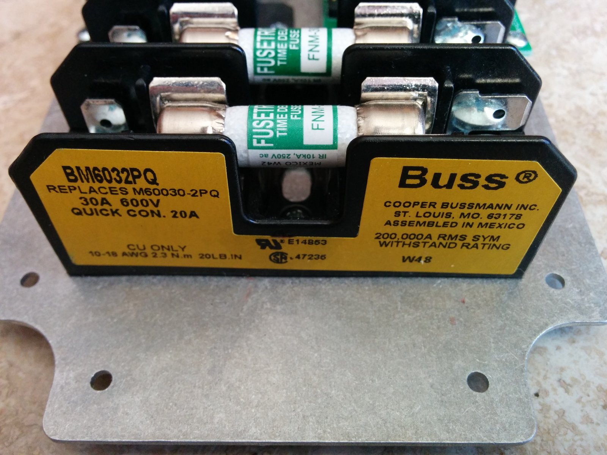</a>
  <a href="images/step-01-2.jpg">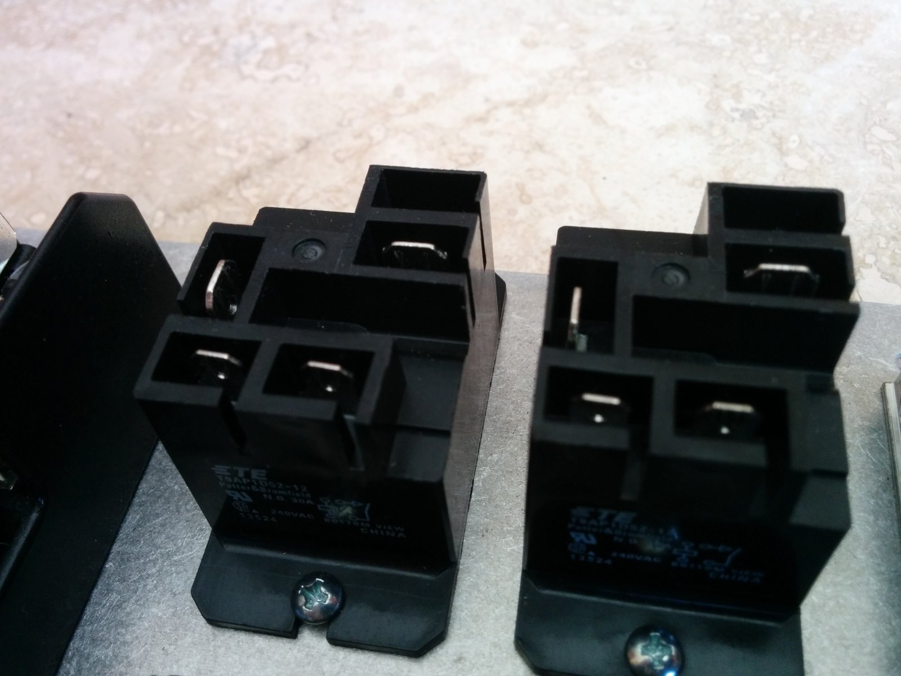</a>

- ⚫ Mount fuse block with 2 - 3/8" screws from the top and lock nuts on the bottom.
- ⚫ Position relays so the small tabs are to the inside for easier routing of low voltage wires.
- ⚫ Mount Relays with 2 - 3/8" screws from the top and lock nuts on the bottom.

---

## Step 2 – Mount OpenEVSE to plate

  <a href="images/step-02-1.jpg">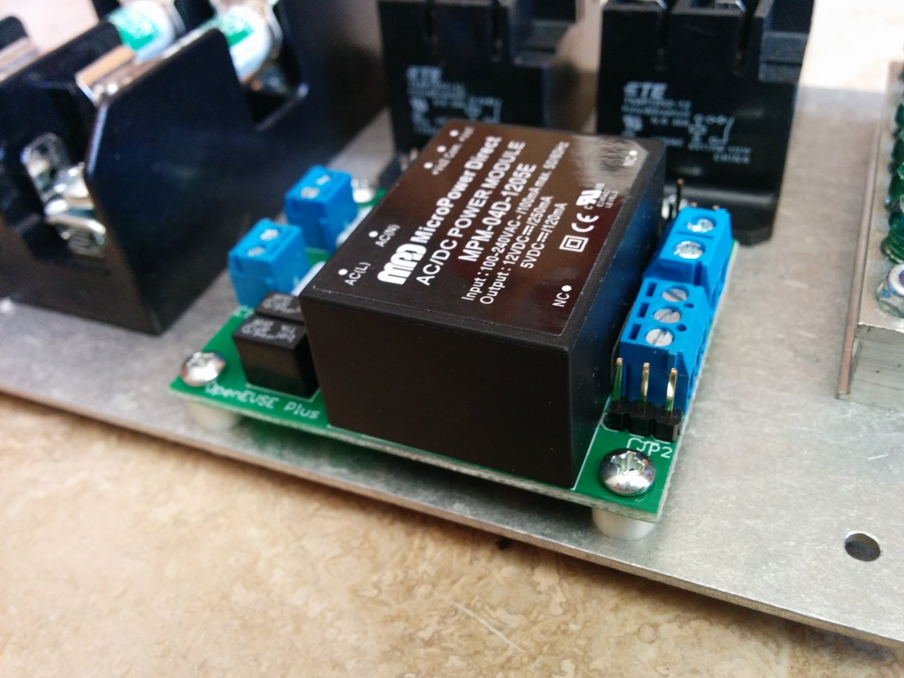</a>
  <a href="images/step-02-2.jpg">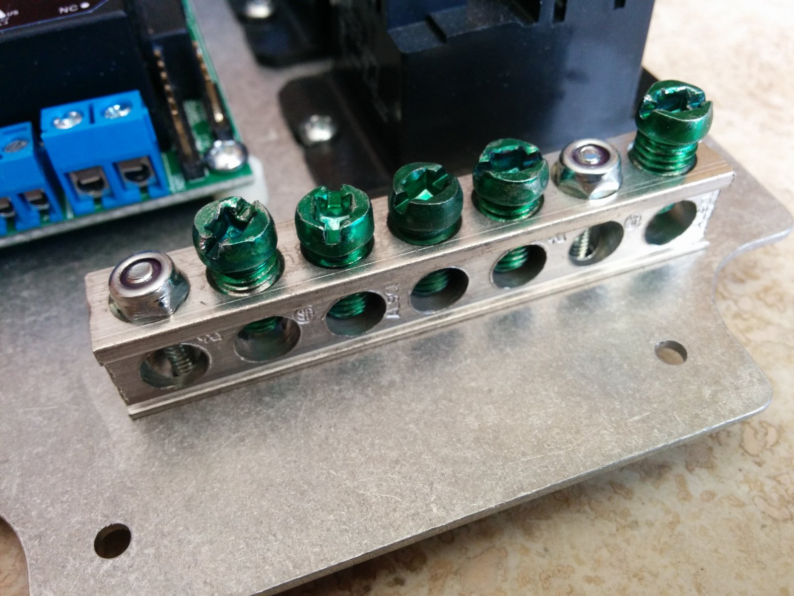</a>
  <a href="images/step-02-3.jpg">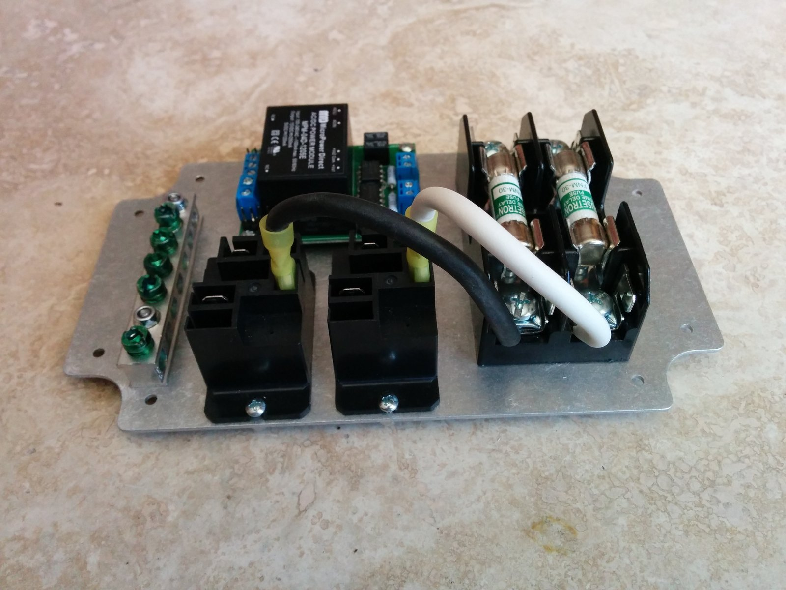</a>

- ⚫ Mount OpenEVSE Plus board with 5/8" screws from the top. NOTE: Kit now includes the latest v4 board which is slightly longer. Drill 2 holes to accommodate upgraded board.
- 📌 Place nylon spacers between OpenEVSE board and mounting plate. Tighten Lock Nuts from the bottom. Do not over tighten.
- ⚫ Mount Ground block with 2 - 3/4" screws from the bottom. Tighten Lock nuts from the top.
- ⚠️ Connect OpenEVSE Ground to the ground Block with a small piece of green wire. Ensure connections are secure.
- ⚫ Crimp Yellow connector to 10AWG wire. Screw to the Fuse block. Wire can come from excess from AC cord or J1772 cable.
- ℹ️ Ensure crimps are secure. Do not solder connectors designed for crimping. Do not connect and disconnect terminal. If loose, discolored, or damaged replace immediately.

---

## Step 3 – Diagram

  
  <a href="images/step-03-2.jpg">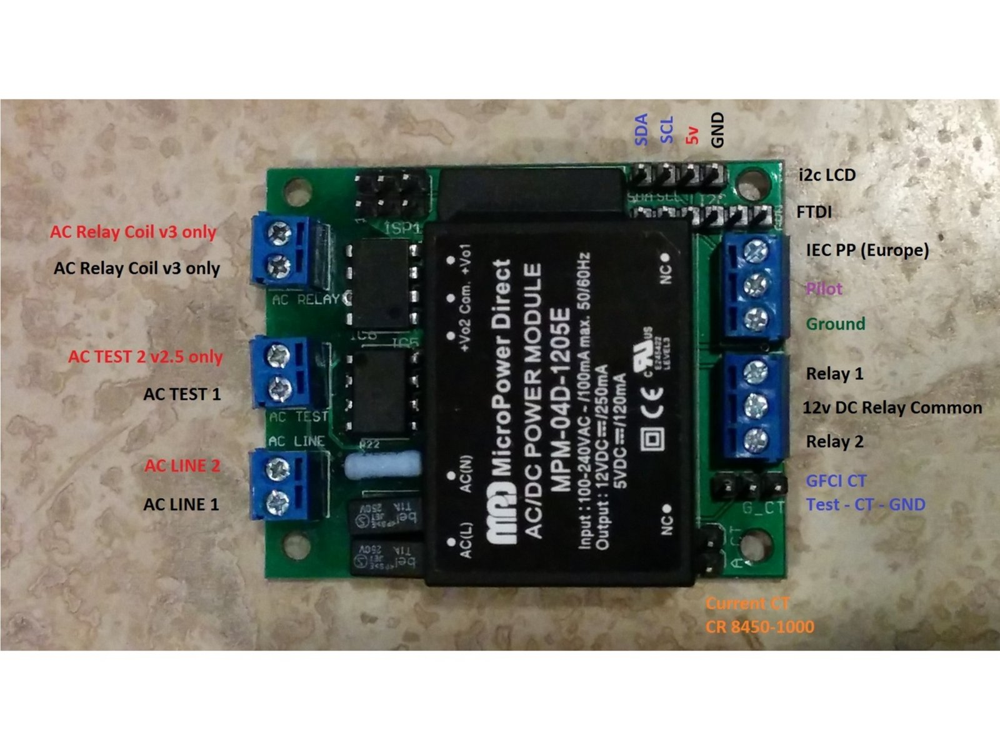</a>

- 🔴 Review the connection diagram for the board you received in your kit.
  - ⚫ v4 After July 2015
  - ⚫ v2 Before July 2015
- ⚫ [V4 Download image](http://files.openevse.com/OpenEVSE_v4.jpg)
- ⚫ [V2.5 Download image](http://files.openevse.com/OpenEVSE_V2_5_v3.jpg)
- ⚠️ Connections are slightly different between board versions. Refer to these diagrams if the image in this guide does not match your board version.

---

## Step 4 – Connect AC Line and Relay

  <a href="images/step-04-1.jpg">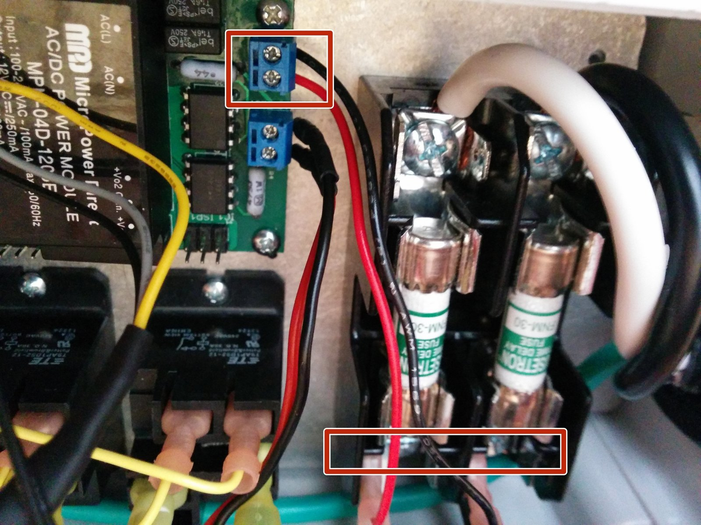</a>
  <a href="images/step-04-2.jpg">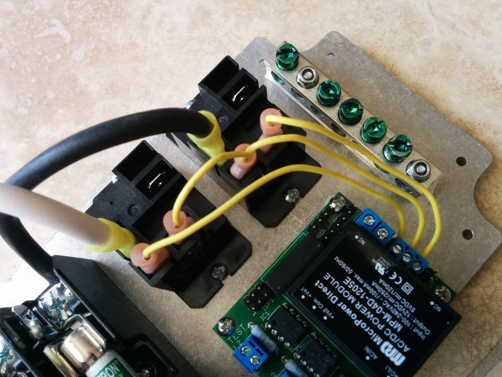</a>

- ⚫ Crimp 22AWG wire to larger 1/4" pink QC connectors. Connect to Fuse block QC terminals.
- ⚫ Screw the 22AWG wires to the AC line block on the OpenEVSE board.
- ⚠️ When connecting relay coil tabs. Ensure the QC terminal slides down the tab. It is possible to wedge the QC connector in by bending tab to the side.
- ⚫ Connect OpenEVSE common relay output (center pin) to 1 relay coil terminal on each relay using small pink QC connectors.
- ⚫ Connect OpenEVSE controller Relay 1 output to remaining pin on first Relay.
- ⚫ Connect OpenEVSE controller screw terminal Relay output 2 to remaining pin on second relay.

---

## Step 5

  <a href="images/step-05-1.jpg">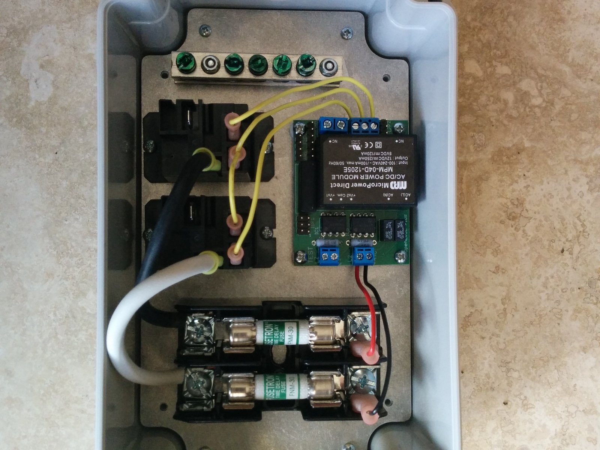</a>

- ⚫ Mount plate to enclosure base
- ⚫ Mount Plate into enclosure base 4 wide screws.

---

## Step 6

  <a href="images/step-06-1.jpg">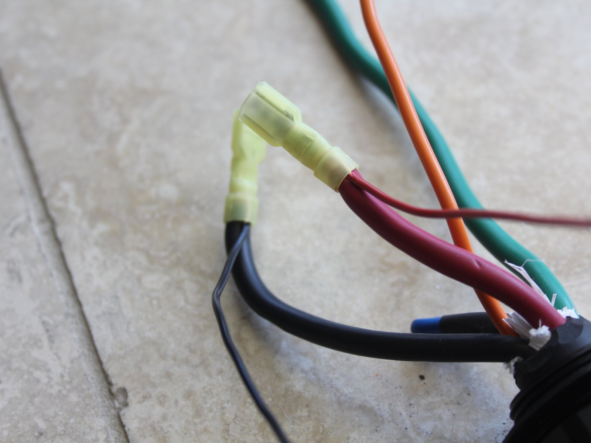</a>

- ⚫ Prepare J1772 cable
- ⚫ Prepare J1772 cable. Strip Cable back at least 8". Put Cable Gland on cable, it may take some effort depending on the diameter of the cable.
- ⚫ Ground and Pilot conductors should be 7" - 8" long.
- ⚫ One Hot conductors should be about 5" long and the other slightly shorter. Crimp Yellow QC connectors to the Hot Conductors AND a 22AWG wire for the AC_Test connections.
- ⚫ Ensure crimps are secure. Do not solder connectors designed for crimping. Do not connect and disconnect terminal. If loose, discolored, or damaged replace immediately.

---

## Step 7 – Prepare and mount AC cord

  <a href="images/step-07-1.jpg">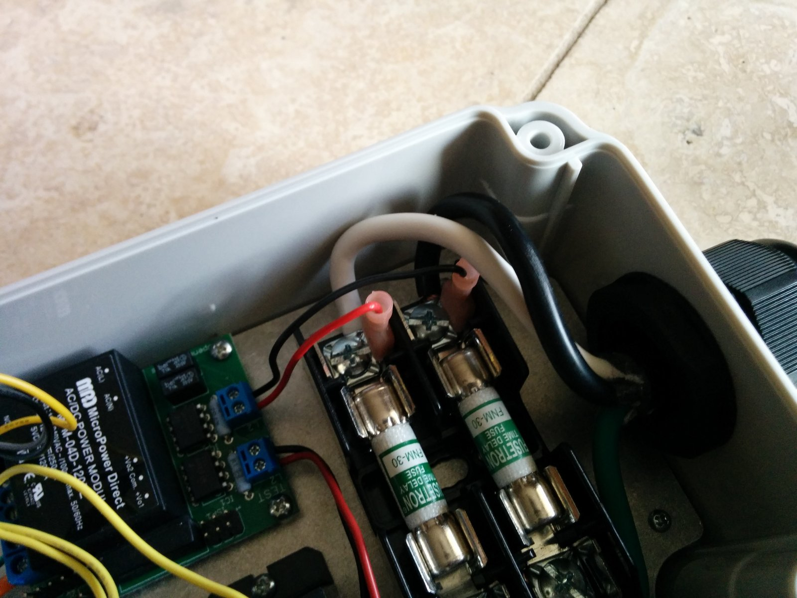</a>

- ⚫ Prepare AC cable (if Applicable). Strip back outer insulation 7". Put Cable Gland on cable.
- ⚫ Ground conductor should be 6" - 7" long.
- ⚫ Hot conductors should be 5" long.
- ⚫ Secure AC Cord Cable Gland to enclosure on the side with the fuse block.
- ⚫ Connect Hot Wires to the fuse block.

---

## Step 8 – Connect J1772 cable to relays

  <a href="images/step-08-1.jpg">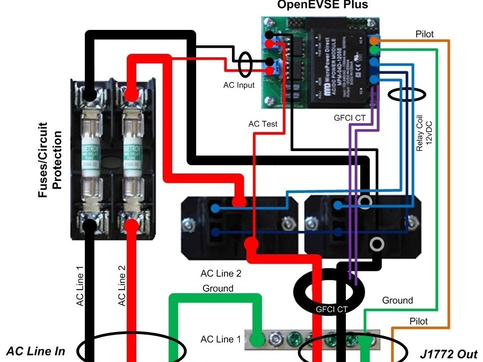</a>
  <a href="images/step-08-2.jpg">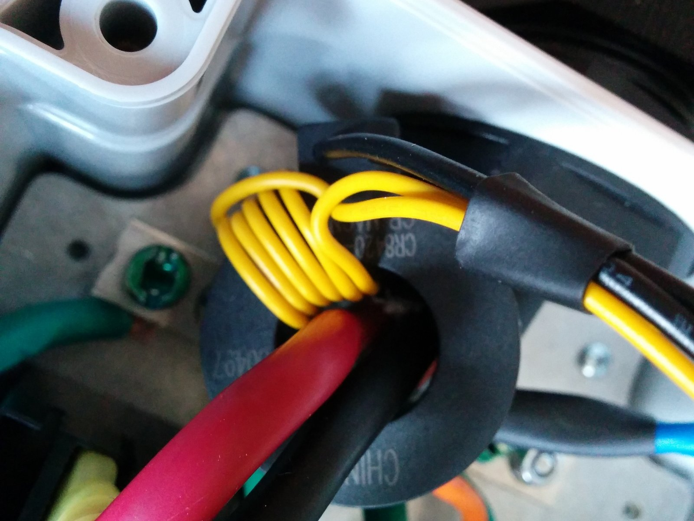</a>
  <a href="images/step-08-3.jpg">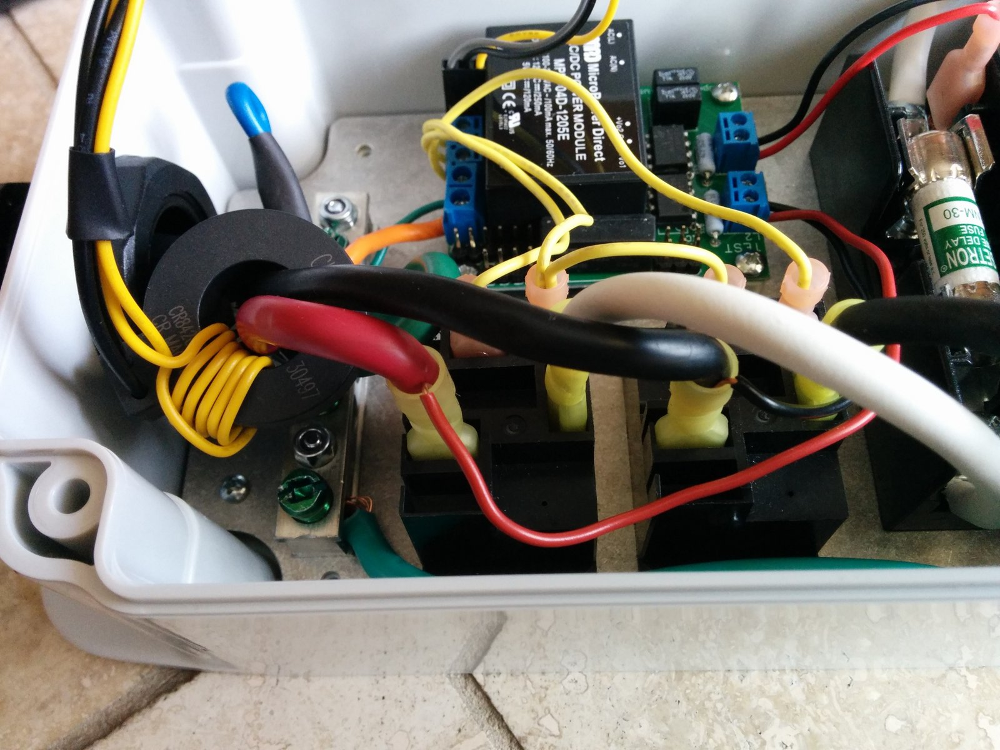</a>

- ⚫ Connect J1772 cable gland to the enclosure base.
- ⚠️ Run both HOT lines through the GFCI coil. Connect GFCI cable to the G_CT header. Black wire closest to the board edge.
- ⚫ Connect J1772 Hot lines to relay outputs.
- ⚫ Connect the AC_Test leads to the OpenEVSE board AC_Test header.
- ⚫ Connect J1772 Ground to Ground block
- ⚫ Connect J1772 Pilot wire to the OpenEVSE board pilot terminal. See diagram in Step 3.

---

## Step 9 – Connect LED

  <a href="images/step-09-1.jpg">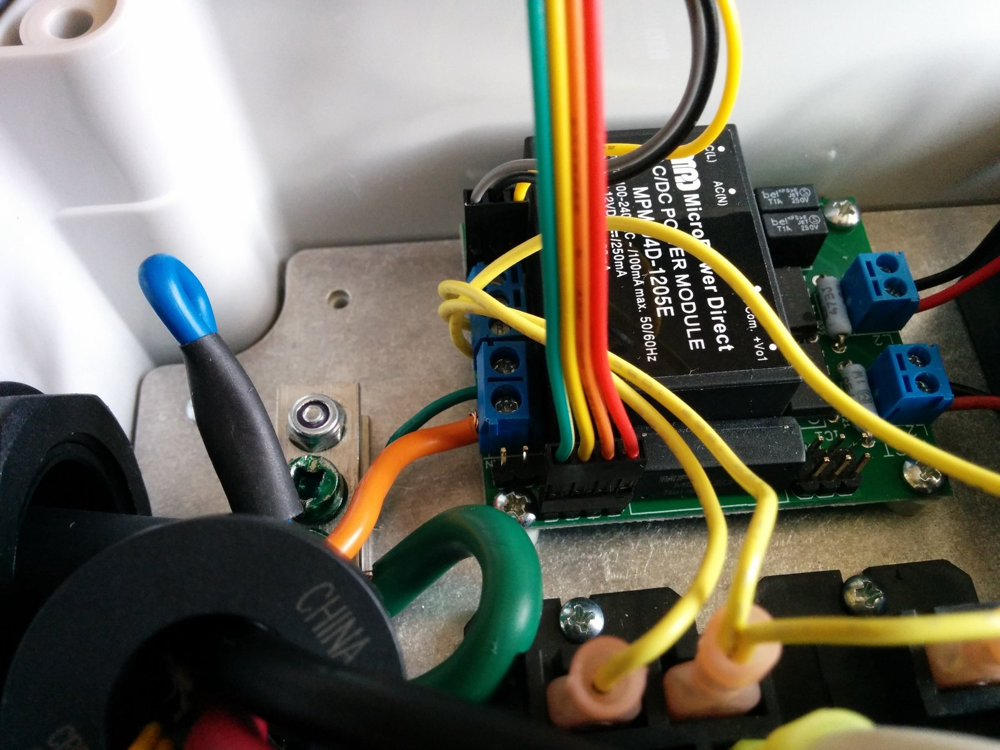</a>
  <a href="images/step-09-2.jpg">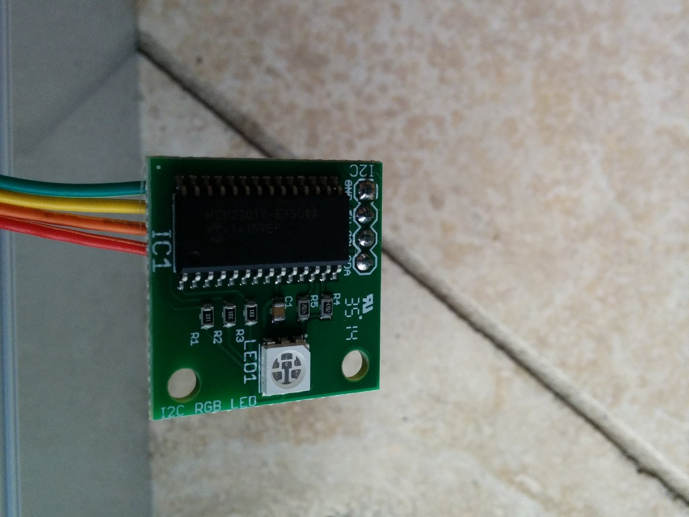</a>

- ⚫ Connect 4 pin LED cable to the OpenEVSE board.
  - ℹ️ Pin closest to board edge is ground on the OpenEVSE Board. See diagram in Step 3.
- ⚫ LED may be used temporarily for testing and troubleshooting or mounted to the lid.
  - ℹ️ Pin closest to board edge is groung on LED Module.

---

## Step 10 – Enclosure lid LED (optional)

  <a href="images/step-10-1.jpg">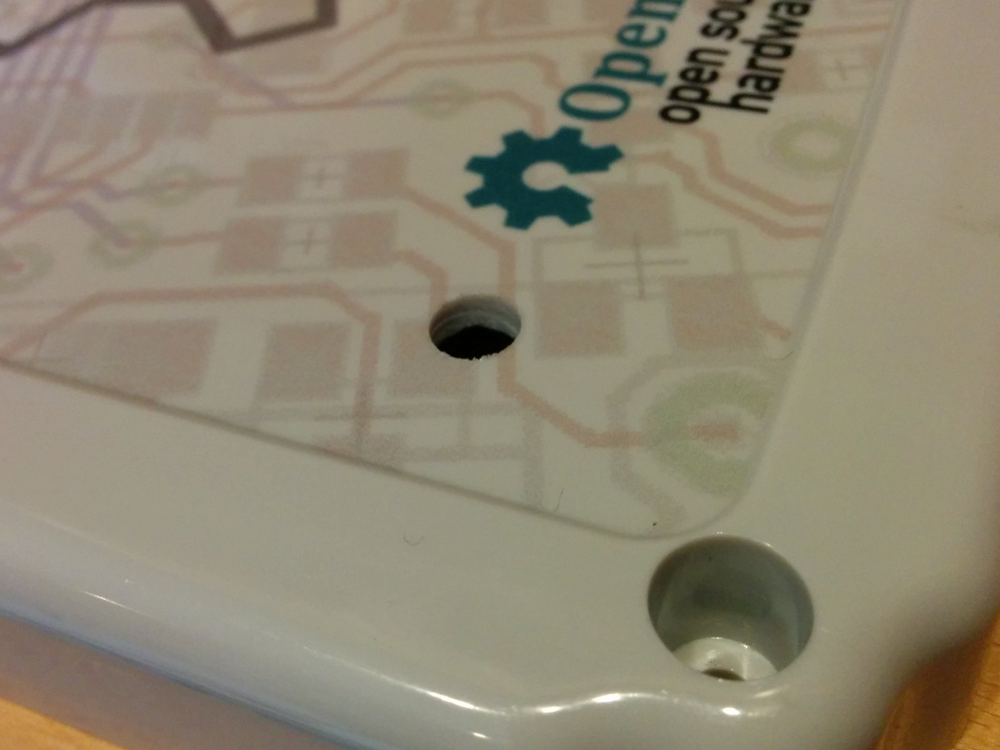</a>
  <a href="images/step-10-2.jpg">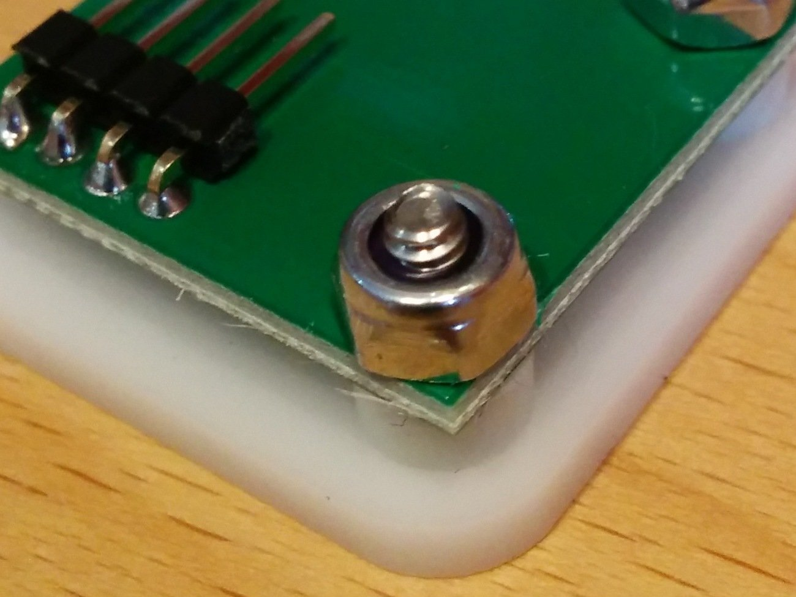</a>
  <a href="images/step-10-3.jpg">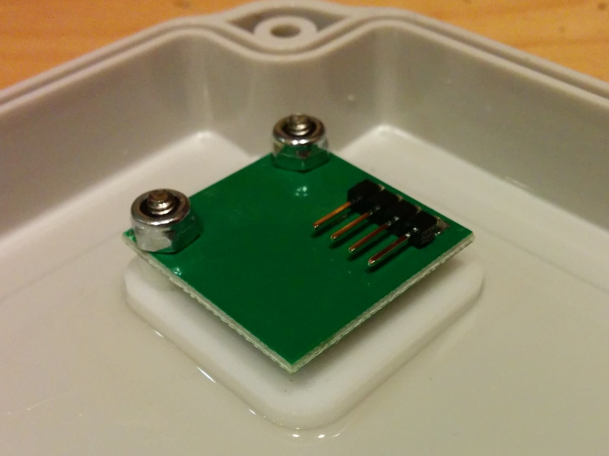</a>

- ⚫ Drill a hole (up to 1/4") in the bottom left of the enclosure leaving at lease 1/2" inch from the edge of the graphics.
- ⚫ Mount the LED logic board to the laser cut plate with the LED facing down so the LED will shine through the plate.
  - ℹ️ Screws should be recessed into the plate.
  - ℹ️ Place the spacer between the plate and LED and the nylon lock nut on top.
- ⚫ Bond the Assembly with watertight, high temperature adhesive such as Epoxy (Best) or Shoegoo E6000 to the enclosure lid so the LED lines up with the hole and the hole is completely covered by the plate.
- ⚠️ Ensure good coverage of the adhesive on the plate to create a watertight seal.

---

## Step 11 – Finishing up

  <a href="images/step-11-1.jpg">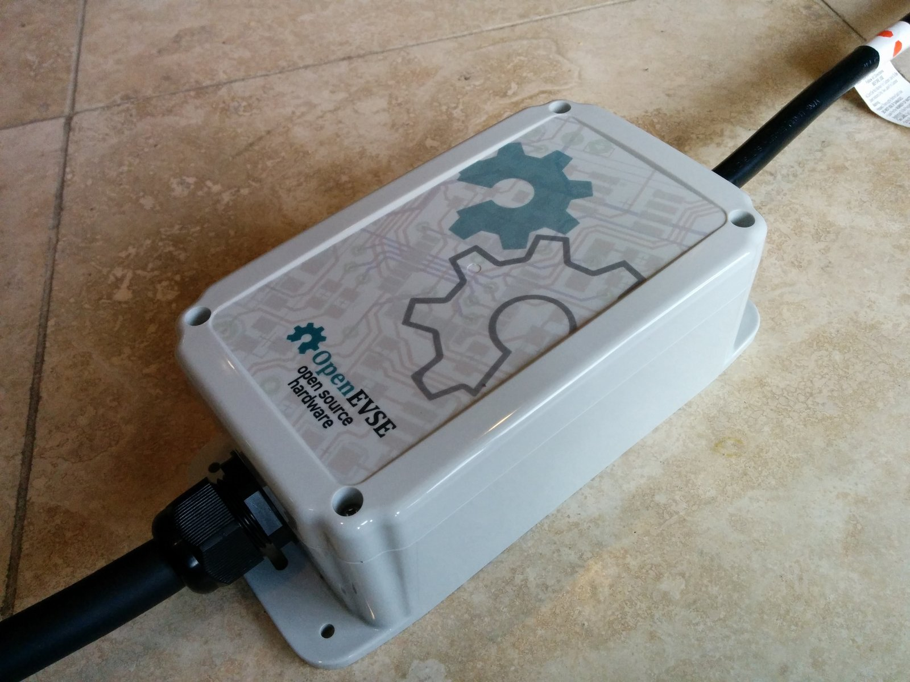</a>

- ⚫ If LED was not mounted to the lid in the previous optional step, Remove LED after testing is complete.
- ⚫ Close enclosure evenly applying pressure to all 4 screws.

---
