# Discontinued June 2016 - v4 OpenEVSE 30A Deluxe

| Difficulty | Steps | Time Required |
| --- | --- | --- |
| Moderate | 13 | 02:00:00 – 03:00:00 |

_Written By: Christopher Howell (and one other contributor)_

## Introduction

- **Warning** Assembly of a Electric Vehicle charging station requires wiring Alternating Current (AC) components that will be exposed to voltages from 100 to 250v. If you do not have the experience and knowledge required to safely work with AC voltages please consult with an experienced electrician for assistance and inspection of your work.

- **Note** Regularly inspect your charging station. Pay special attention to excess heat, components, handles, and wiring will be warm but they should not be HOT...

- Always Disconnect your charging station from power before performing an inspection and/or maintenance

## Parts

- OpenEVSE 30A Charging Station Combo
- OpenEVSE Plus — This guide is for standard non-DIY versions.
- OpenEVSE LCD
- 30A Relay (2)
- Current Transformer — GFCI coil
- 30A Fuse block
- 30A 240v fuses (2)
- Ground Block

### Bullet key

Colored bullets match the colored markers drawn on the photos for each step.

| Marker | Meaning |
| --- | --- |
| ⚫ 🔴 🟠 🟡 🟢 🔵 🩵 🟣 | Instruction — matches the same-colored marker in the photo |
| ℹ️ | Note |
| ⚠️ | Caution |
| 📌 | Reminder / Tip |

## Contents

1. [Install LCD Window](#step-1--install-lcd-window)
2. [Mount LCD to enclosure lid](#step-2--mount-lcd-to-enclosure-lid)
3. [Mount components to plate](#step-3--mount-components-to-plate)
4. [Mount OpenEVSE to plate](#step-4--mount-openevse-to-plate)
5. [Connection Diagrams](#step-5--connection-diagrams)
6. [Connect AC Line and Relay](#step-6--connect-ac-line-and-relay)
7. [Mount plate to enclosure base](#step-7--mount-plate-to-enclosure-base)
8. [Prepare J1772 cable](#step-8--prepare-j1772-cable)
9. [Prepare and mount AC cord](#step-9--prepare-and-mount-ac-cord)
10. [Connect J1772 cable to relays](#step-10--connect-j1772-cable-to-relays)
11. [Connect LCD](#step-11--connect-lcd)
12. [Connect GFCI and Current measurement coils](#step-12--connect-gfci-and-current-measurement-coils)
13. [Menu Settings](#step-13--menu-settings)

---

## Step 1 – Install LCD Window

  <a href="images/step-01-1.jpg">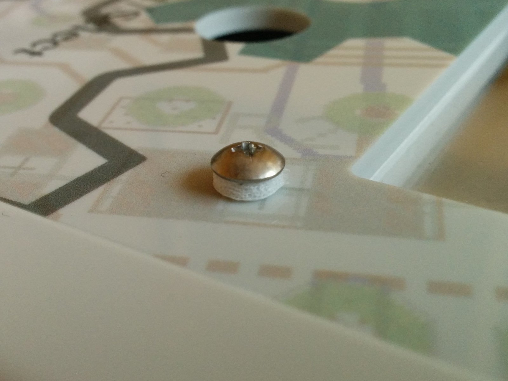</a>
  <a href="images/step-01-2.jpg">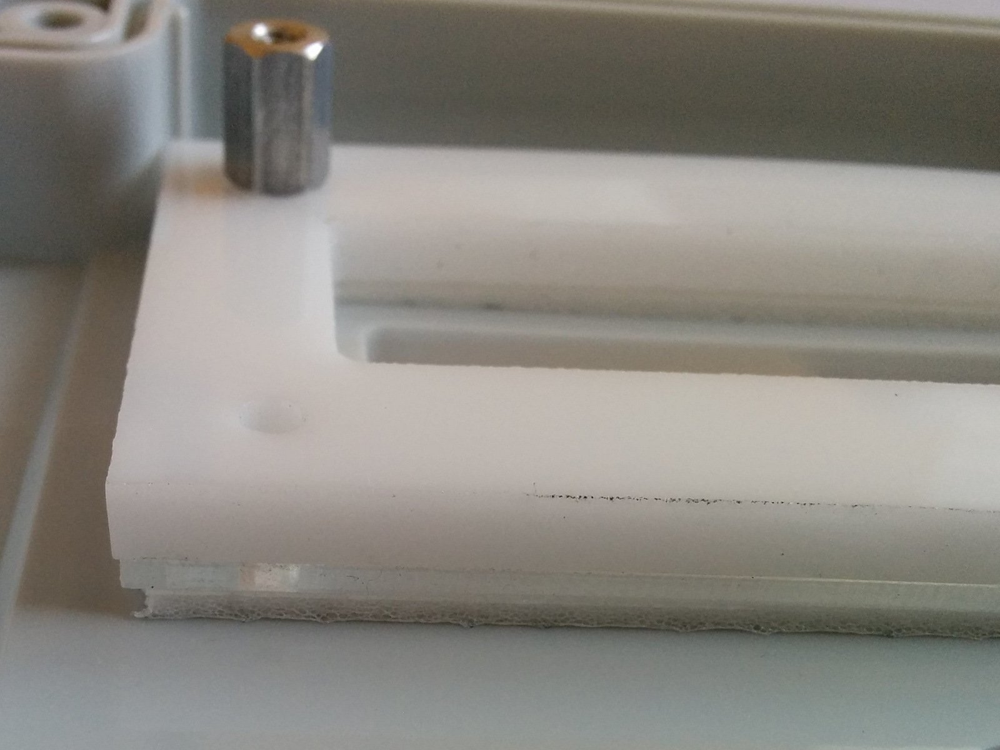</a>

- ⚫ Place 4 foam washers on 4 1/2" wide head screws.
- ⚫ Flip lid upside down and stack... Foam seal, then LCD clear window (remove Protective coating from both sides) and finally the LCD Window Brace (remove protective coating).
- ⚫ Place the 4 - 1/2" Screw through the lid with the foam washer on the outside. Compress foam and thread the 4- Hex Standoffs. Tighten each one hand tight compressing the foam.

---

## Step 2 – Mount LCD to enclosure lid

  <a href="images/step-02-1.jpg">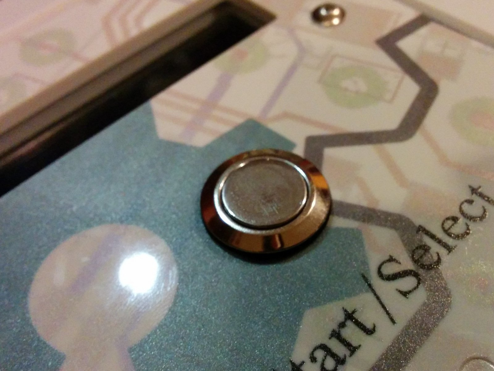</a>
  <a href="images/step-02-2.jpg">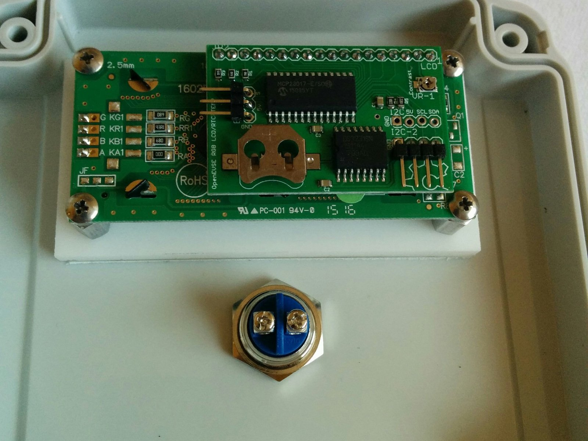</a>
  <a href="images/step-02-3.jpg">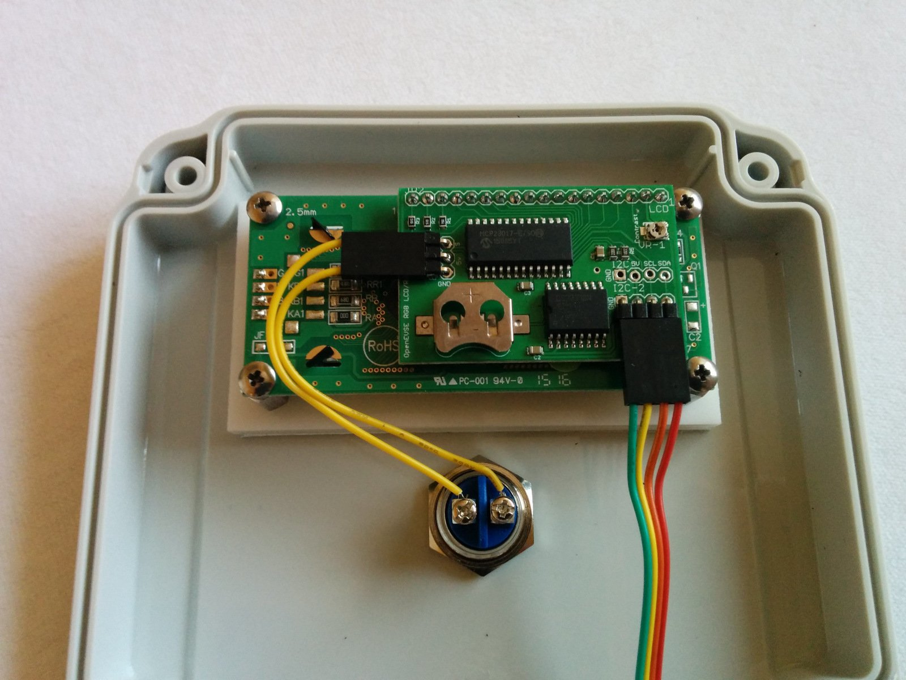</a>

- ⚫ Mount the water resistant button switch to the enclosure lid. Do not over tighten seal, if squeezes out of place the button is too tight.
- ℹ️ Test enclosure lid again for water tightness. Spray water around the LCD window and button and ensure water does nor leak to the back side of the lid. Adjust as necessary.
- ⚫ Using 4 - 5/16" wide head screws. Mount LCD module to the lid.
- ⚠️ Screws should be secure. Take care not to over tighten.
- ⚫ Connect the 3 pin cable to the LCD module. Strip wires about 1/2", fold in half stripped wire and screw into the switch screw lugs.
- ⚫ Connect 4 pin connector to LCD note the color that represents Ground (Green as pictured).

---

## Step 3 – Mount components to plate

  <a href="images/step-03-1.jpg">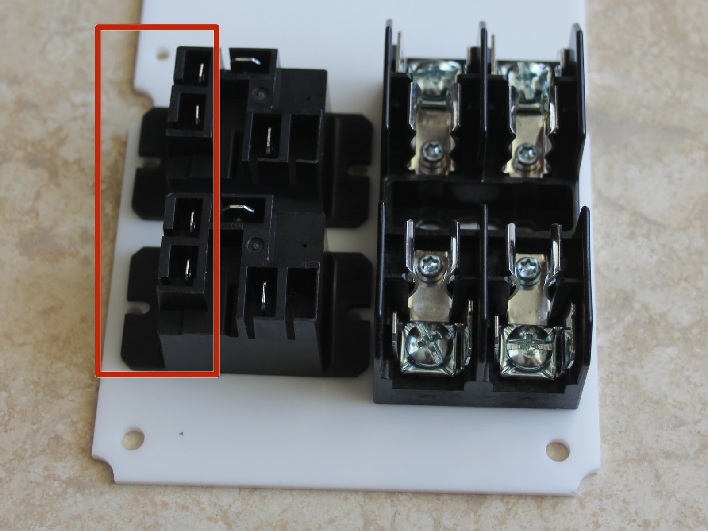</a>
  <a href="images/step-03-2.jpg">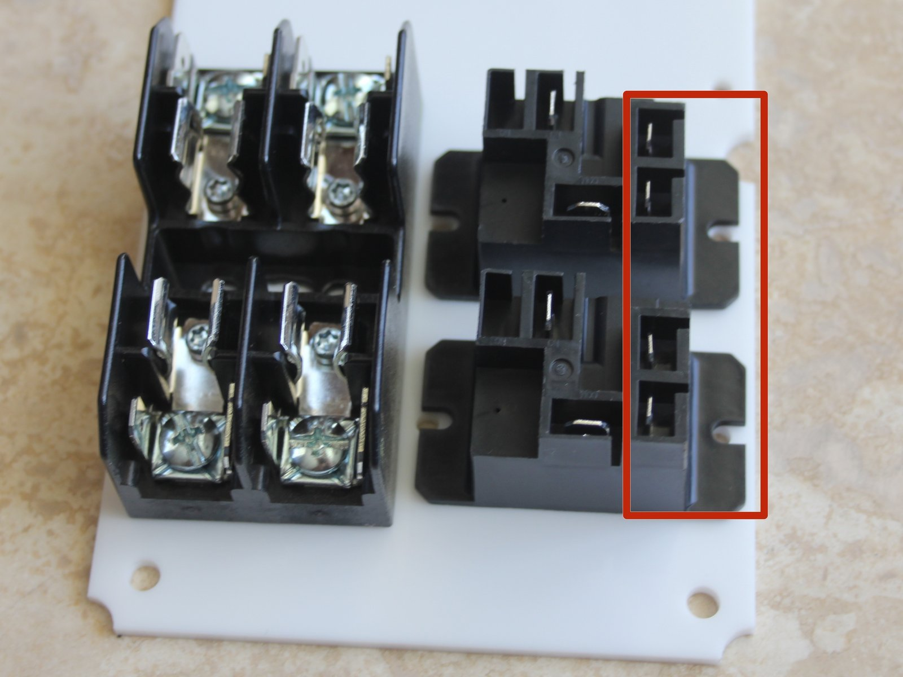</a>

- ℹ️ Your Charging station can be built with AC input Left and J1772 Right or opposite. Flip mounting plate to desired position. Fuses will line up with AC input and relays J1772 cable.
- ⚫ Mount fuse block with 2 - 3/8" screws from the top and lock nuts on the bottom.
- ⚠️ Position relays so the small tabs are to the outside for easier routing of low voltage wires.
- 🔴 Mount Relays with 2 - 3/8" screws from the top and lock nuts on the bottom.

---

## Step 4 – Mount OpenEVSE to plate

  <a href="images/step-04-1.jpg">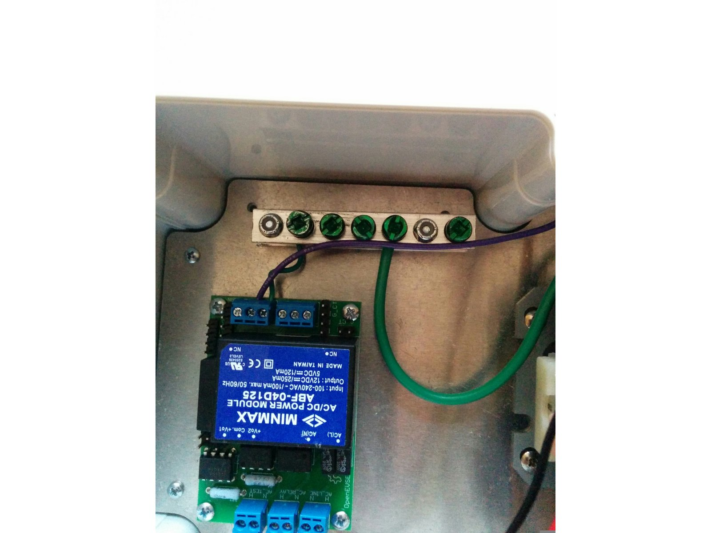</a>
  <a href="images/step-04-2.jpg">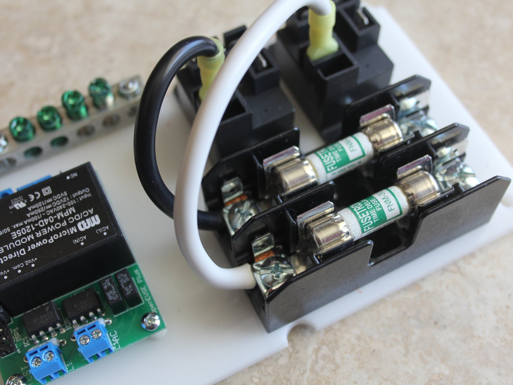</a>

- ⚫ Mount OpenEVSE Plus board with 5/8" screws from the top.
- 📌 Place nylon spacers between OpenEVSE board and mounting plate. Tighten Lock Nuts from the bottom. Do not over tighten.
- ⚫ Mount Ground block with 2 - 3/4" screws from the bottom. Tighten Lock nuts from the top.
- ⚠️ Connect OpenEVSE Ground to the ground Block. Ensure connections are secure.
- ⚫ Crimp Yellow connector to 10AWG wire. Screw to the Fuse block. Wire can come from excess from AC cord or J1772 cable.
- ⚠️ Ensure crimps are secure. Do not solder connectors designed for crimping. Do not connect and disconnect terminal. If loose, discolored, or damaged replace immediately.

---

## Step 5 – Connection Diagrams

  <a href="images/step-05-1.jpg">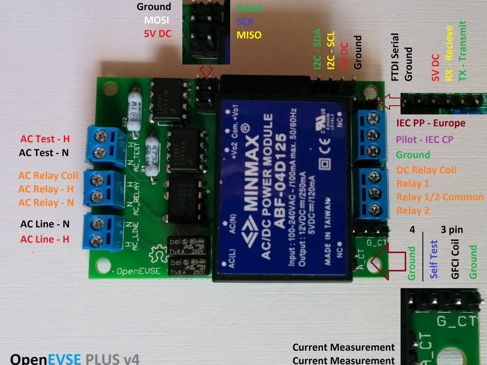</a>
  <a href="images/step-05-2.jpg">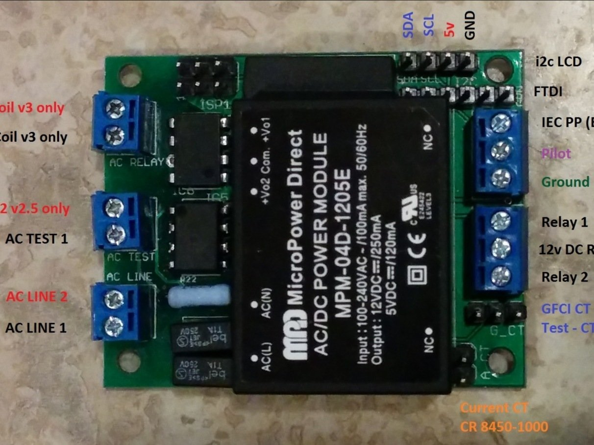</a>

- ⚫ Review the connection diagram for the board you received in your kit. This guide depicts the latest board OpenEVSE v4.
  - 🔴 v4 After July 2015
  - 🔴 v2.5 Before July 2015
- ℹ️ [V4 Download image](http://files.openevse.com/OpenEVSE_v4.jpg)
- ℹ️ [V2.5 Download image](http://files.openevse.com/OpenEVSE_V2_5_v3.jpg)
- ⚠️ Connections are slightly different between board versions. Refer to these diagrams if the image in this guide does not match your board version.

---

## Step 6 – Connect AC Line and Relay

  <a href="images/step-06-1.jpg">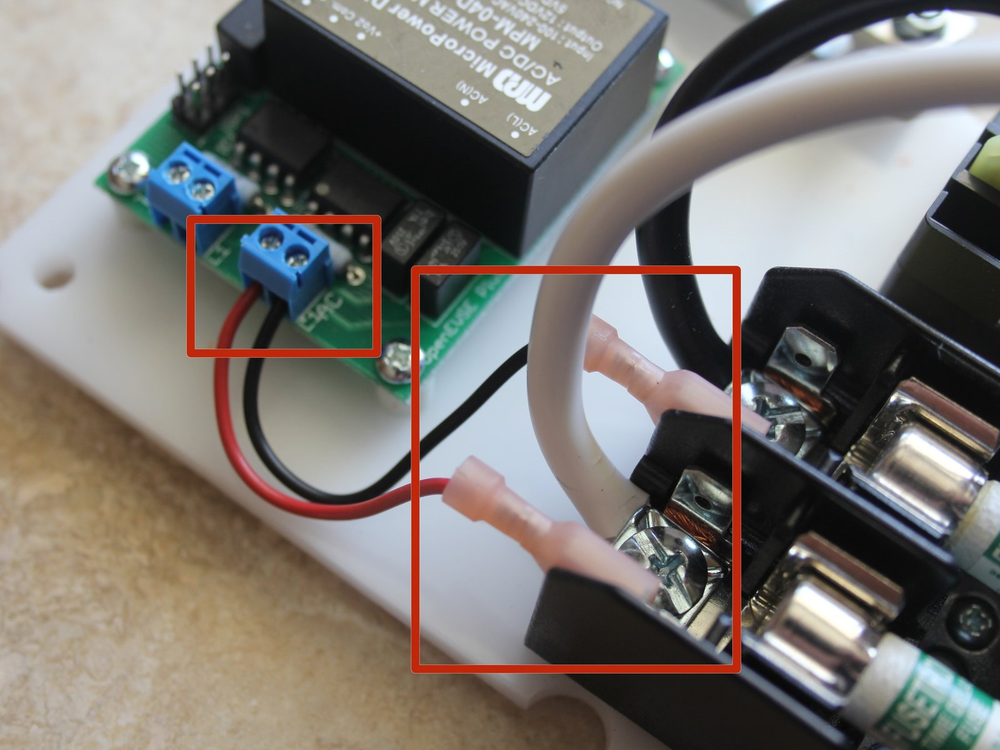</a>
  <a href="images/step-06-2.jpg">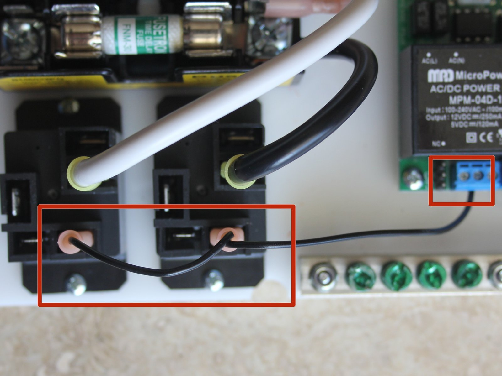</a>
  <a href="images/step-06-3.jpg">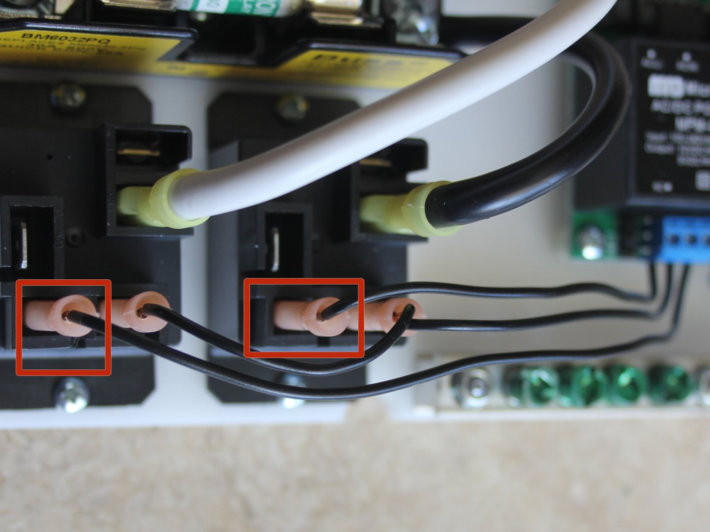</a>

- ⚫ Crimp 22AWG wire to larger 1/4" pink QC connectors. Connect to Fuse block QC terminals.
- ⚫ Screw the 22AWG wires to the "AC Line - N" and "AC Line - H" block on the OpenEVSE board.
- ⚠️ When connecting relay coil tabs. Ensure the QC terminal slides down the tab. It is possible to wedge the QC connector in by bending tab to the side.
- ⚫ Connect OpenEVSE common relay output (center pin) to 1 relay coil terminal on each relay using small pink QC connectors.
- ⚫ Connect OpenEVSE controller Relay 1 output to remaining pin on first Relay.
- ⚫ Connect OpenEVSE controller screw terminal Relay output 2 to remaining pin on second relay.

---

## Step 7 – Mount plate to enclosure base

  <a href="images/step-07-1.jpg">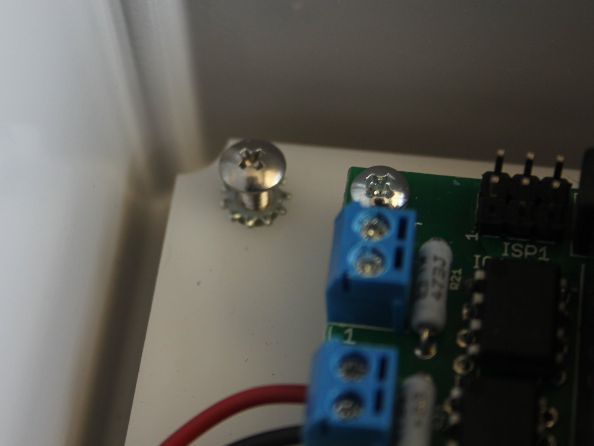</a>

- ⚫ Mount Plate into enclosure base with 4 to 6 screws.

---

## Step 8 – Prepare J1772 cable

  <a href="images/step-08-1.jpg">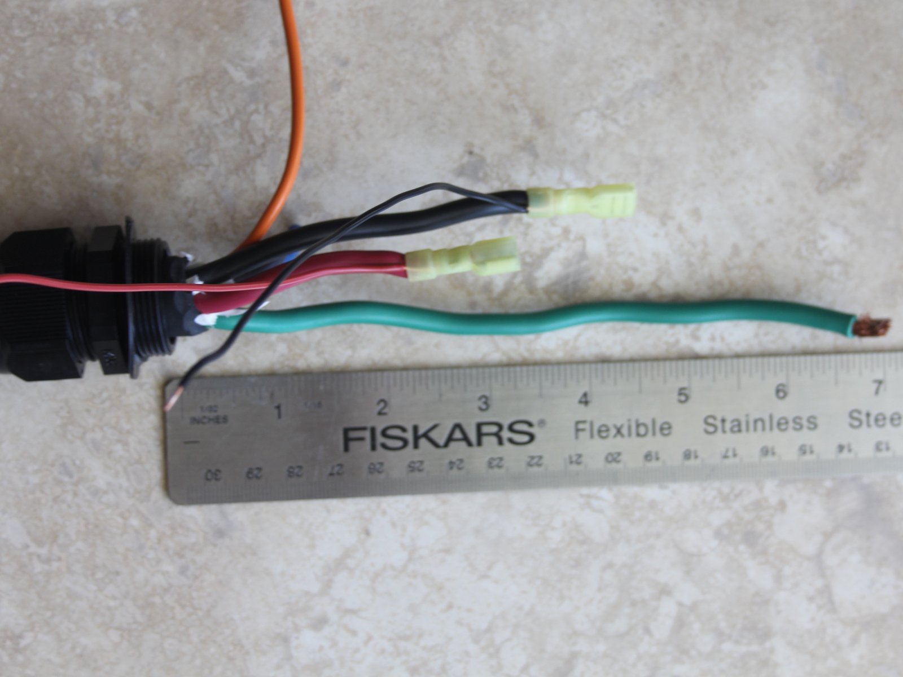</a>
  <a href="images/step-08-2.jpg">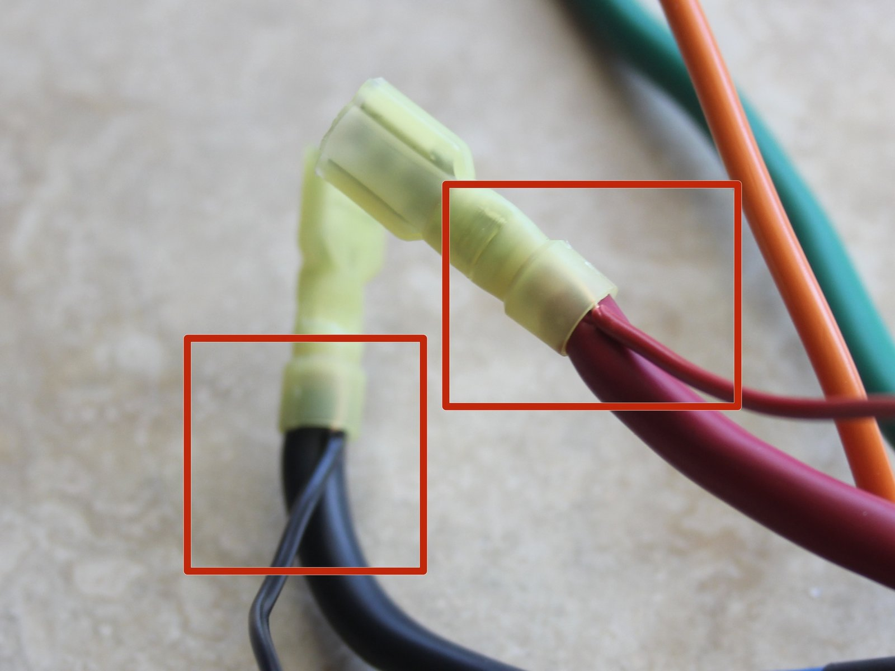</a>

- ⚫ Prepare J1772 cable. Strip Cable back at least 8". Put Cable Gland on cable, it may take some effort depending on the diameter of the cable.
- ⚫ Ground and Pilot conductors should be 7" - 8" long.
- 📌 One Hot conductors should be about 5" long and the other slightly shorter. Crimp Yellow QC connectors to the Hot Conductors AND a 22AWG wire for the AC Test connections.
- ⚠️ Ensure crimps are secure. Do not solder connectors designed for crimping. Do not connect and disconnect terminal. If loose, discolored, or damaged replace immediately.

---

## Step 9 – Prepare and mount AC cord

  <a href="images/step-09-1.jpg">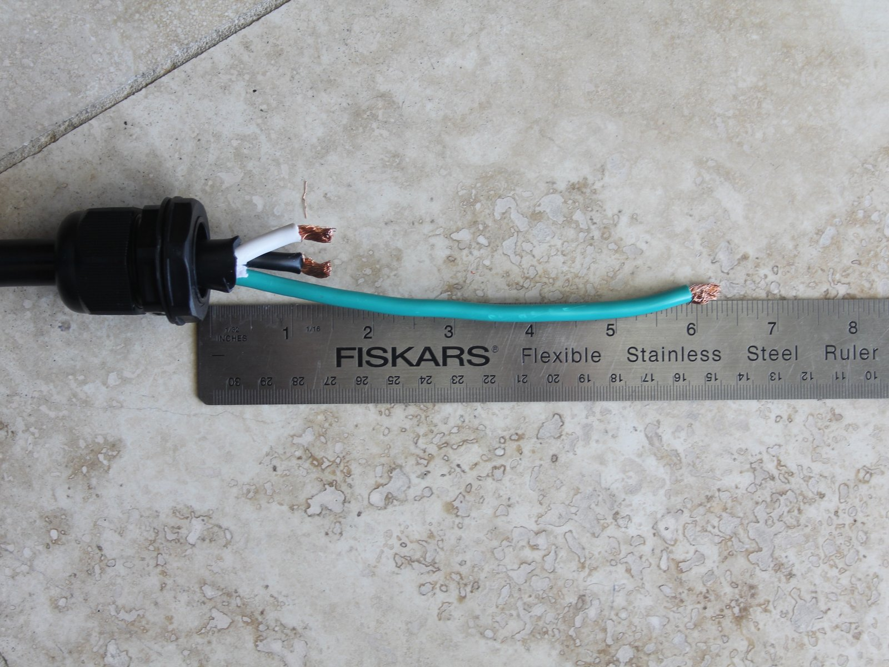</a>
  <a href="images/step-09-2.jpg">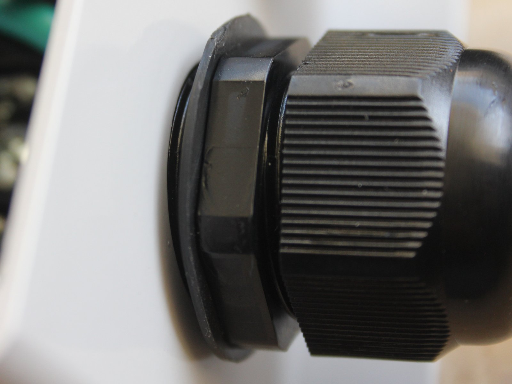</a>
  <a href="images/step-09-3.jpg">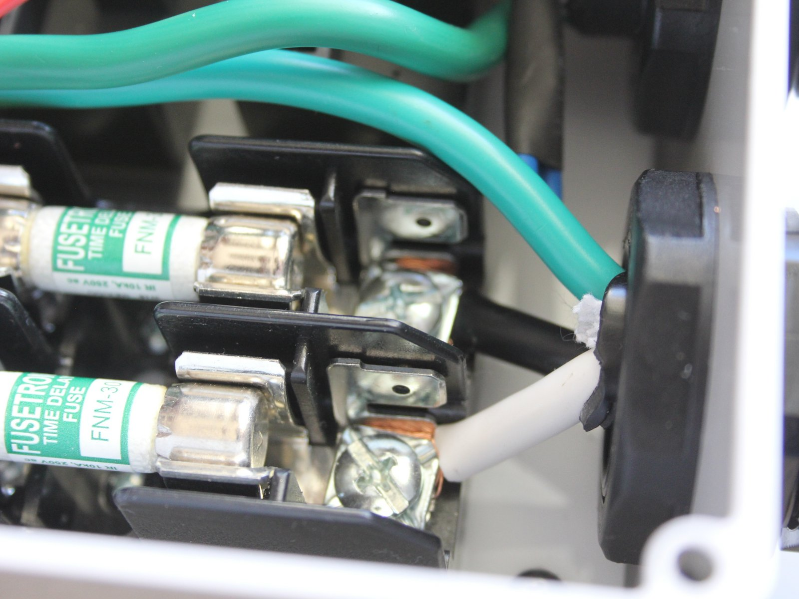</a>

- ⚫ Prepare AC cable (if Applicable). Strip back outer insulation 7". Put Cable Gland on cable.
- ⚫ Ground conductor should be 6" - 7" long.
- ⚫ Hot conductors should be 2" long.
- ⚫ Secure AC Cord Cable Gland to enclosure on the side with the fuse block.
- ⚫ Connect Hot Wires to the fuse block.

---

## Step 10 – Connect J1772 cable to relays

  <a href="images/step-10-1.jpg">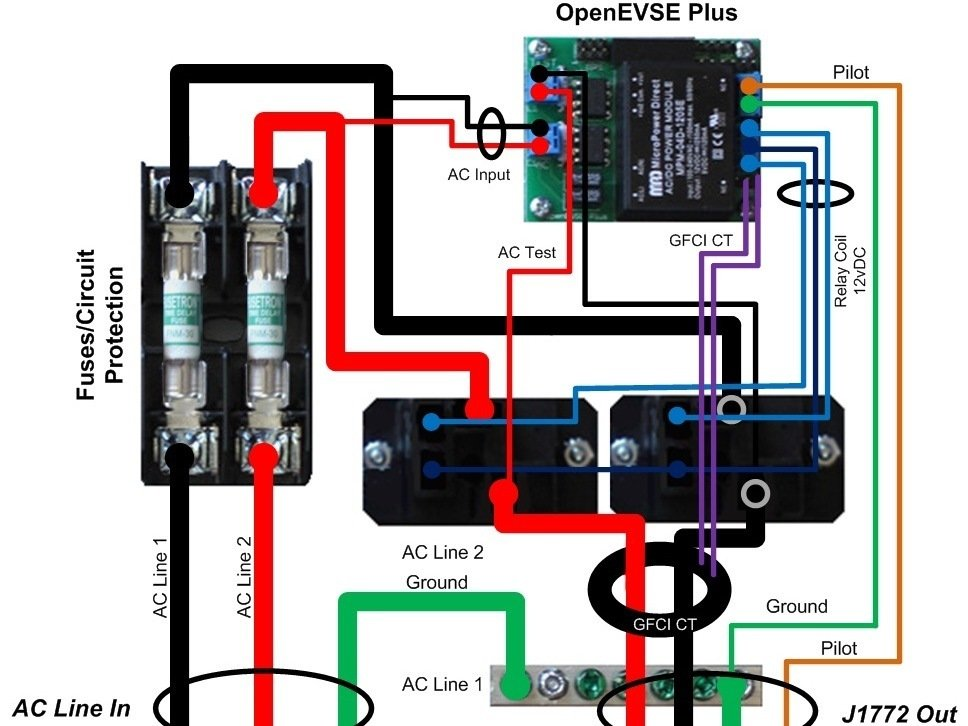</a>
  <a href="images/step-10-2.jpg">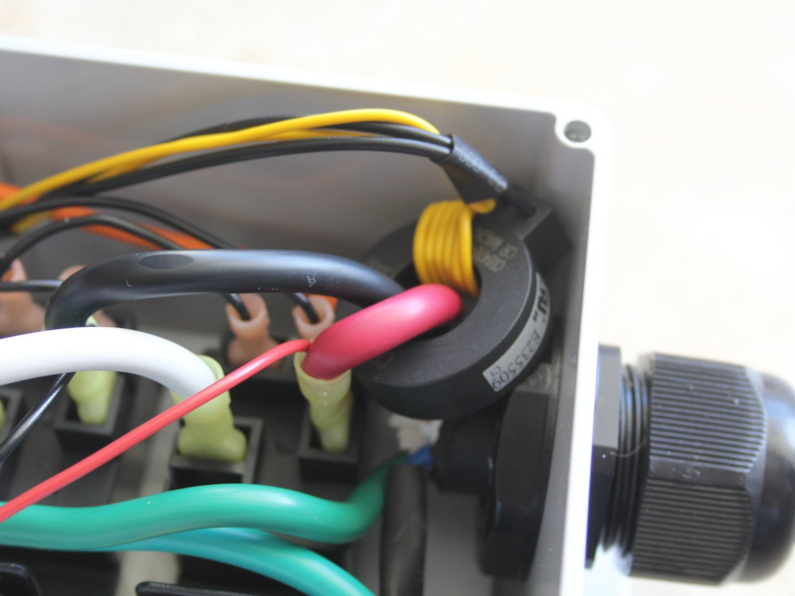</a>
  <a href="images/step-10-3.jpg">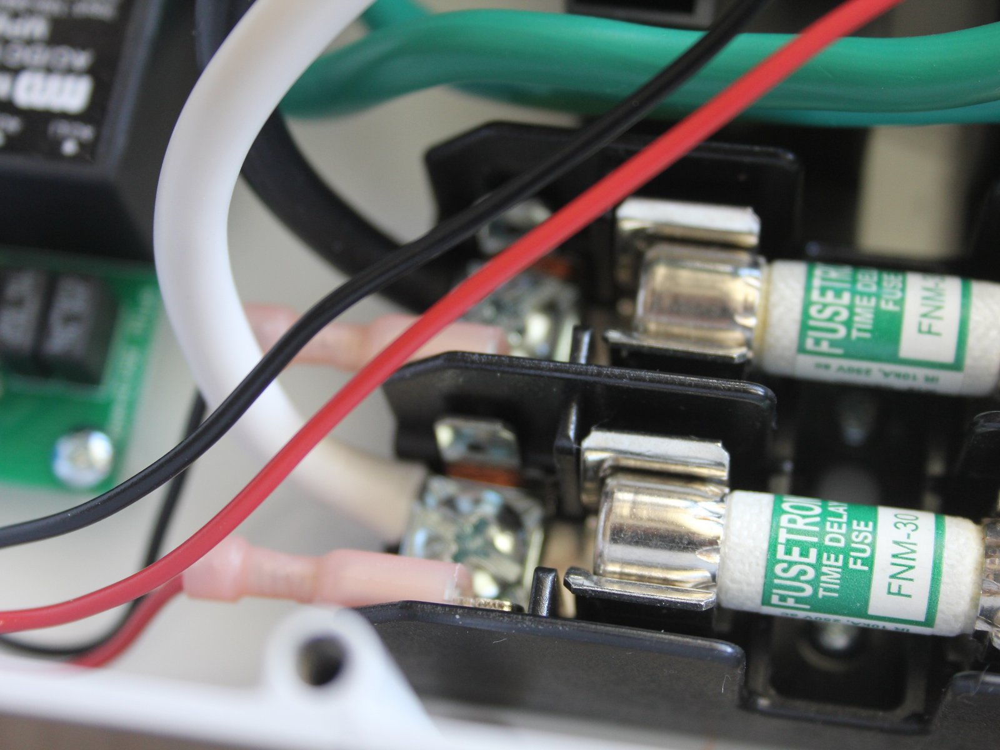</a>

- ⚫ Connect J1772 cable gland to the enclosure base.
- ℹ️ Run both HOT lines through the GFCI coil.
- ⚫ Connect J1772 Hot lines to relay outputs.
- ⚫ Connect the 22AWG wires from the QC connectors on the J1772 cable to the "AC Test - H" and "AC Test - N" to the OpenEVSE board.
- ⚫ Connect J1772 Ground to Ground block
- ⚫ Connect the Control Pilot from the J1772 cable to the OpenEVSE board.
- ℹ️ Each manufacture uses different color codes for pilot. IT/Leviton - Orange, Yasaki - Blue, Quick Charge Power - Purple.

---

## Step 11 – Connect LCD

  <a href="images/step-11-1.jpg">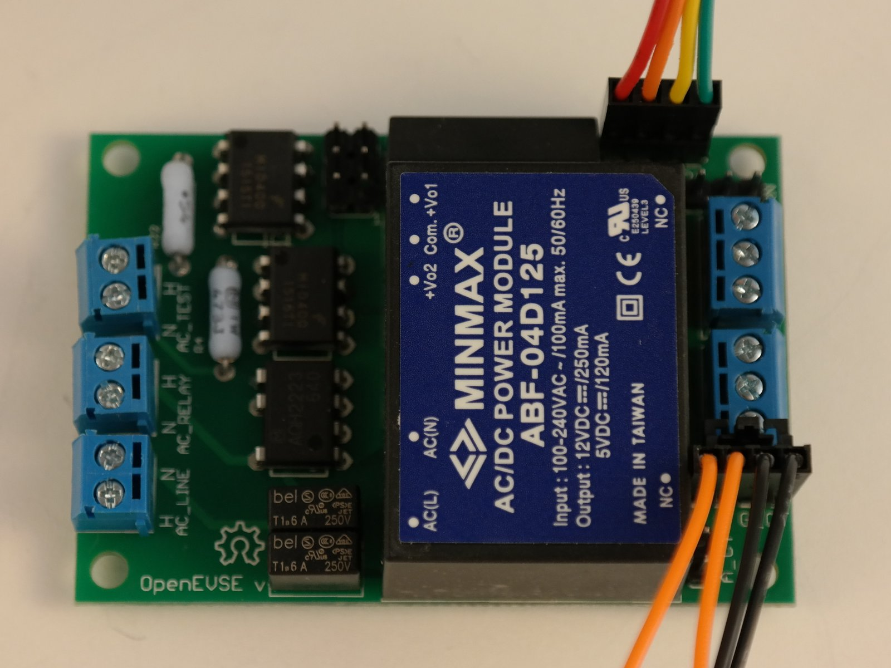</a>

- ⚫ Connect 4 pin LCD cable to the OpenEVSE board.
- ⚫ Ensure the Ground from LCD connected to the ground on OpenEVSE board (ground is closest pin to board edge).
- ⚠️ Colors of 4 pin connector varies and may not be the same as the image.

---

## Step 12 – Connect GFCI and Current measurement coils

  <a href="images/step-12-1.jpg">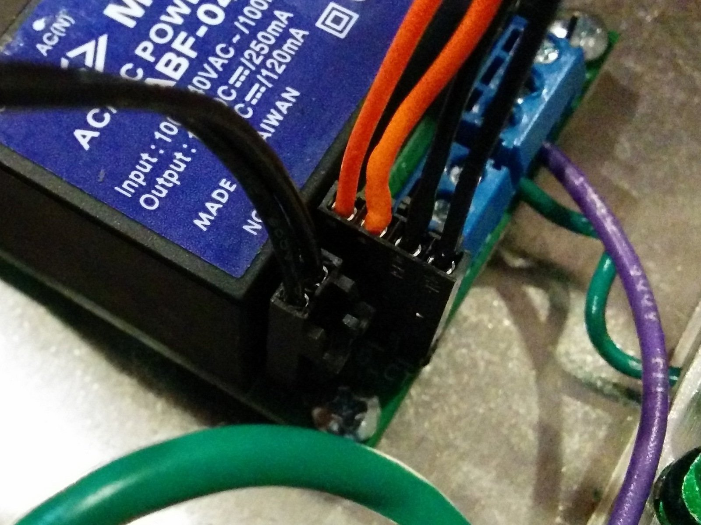</a>

- ⚫ Connect the GFCI coil with self test loop to the 4 pin connector. Orange Self test wires to the inside Black GFCI CT wires to the outside.
- ⚫ Connect the current measurement CT to the 2 pin connector (either direction is fine).

---

## Step 13 – Menu Settings

  <a href="images/step-13-1.jpg">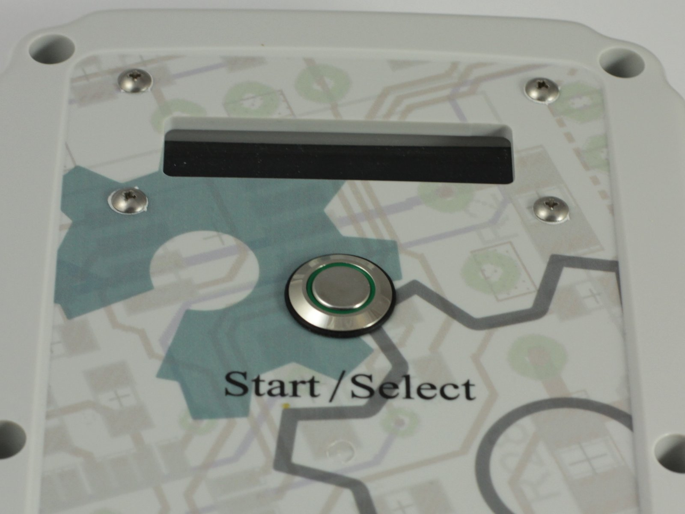</a>

- ⚫ To Enter the Menu Press and hold the button (long press). Press and release (short press) to scroll through Options.
- ⚫ Value kit - Set "Backlight Type" to Monochrome. Menu => Setup => Backlight Type.
- ⚫ Set Current to desired Value. Menu => Setup => Max Current.
- ⚫ Enable GFCI Self Test. Menu => Setup => GFI Self Test

---
