# Discontinued May 2018 - v4 Advanced

| Difficulty | Steps | Time Required |
| --- | --- | --- |
| Moderate | 13 | 00:45:00 – 02:00:00 |

_Written By: Christopher Howell (and 2 other contributors)_

## Introduction

- **Warning** Assembly of a Electric Vehicle charging station requires wiring Alternating Current (AC) components that will be exposed to voltages from 100 to 250v. If you do not have the experience and knowledge required to safely work with AC voltages please consult with an experienced electrician for assistance and inspection of your work.

- **Note** Regularly inspect your charging station. Pay special attention to excess heat, components, handles, and wiring will be warm but they should not be HOT...

- Always Disconnect your charging station from power before performing an inspection and/or maintenance

Kit Contents:

1 - Enclosure

1 - Metal Plate

1 - Screw Pack Enclosure Lid

1 - Screw Pack

1 - LCD Seal Kit

1 - Push button

1 - Relay

3 - Red Wires

3 - Black Wires

1 - Ground Bar

2 - Cable Glands Small

1 - OpenEVSE v4 Controller

1 - RGB Liquid Crystal Display

1 - Wifi Kit

## Tools

- Phillips screw drivers PH1 and PH00

### Bullet key

Colored bullets match the colored markers drawn on the photos for each step.

| Marker | Meaning |
| --- | --- |
| ⚫ 🔴 🟠 🟡 🟢 🔵 🩵 🟣 | Instruction — matches the same-colored marker in the photo |
| ℹ️ | Note |
| ⚠️ | Caution |
| 📌 | Reminder / Tip |

## Contents

1. [Enclosure Lid Poly-Carbonate](#step-1--enclosure-lid-poly-carbonate)
2. [Mount LCD to enclosure lid](#step-2--mount-lcd-to-enclosure-lid)
3. [Mount Components to Plate](#step-3--mount-components-to-plate)
4. [Connection Diagrams](#step-4--connection-diagrams)
5. [Struthers and Dunn - Low Current AC wiring](#step-5--struthers-and-dunn---low-current-ac-wiring)
6. [Secure Mounting Plate](#step-6--secure-mounting-plate)
7. [Mount J1772 cable](#step-7--mount-j1772-cable)
8. [Connect GFCI and Current measurement coils](#step-8--connect-gfci-and-current-measurement-coils)
9. [Connect J1772 Cable](#step-9--connect-j1772-cable)
10. [Connect AC Input](#step-10--connect-ac-input)
11. [Connect LCD](#step-11--connect-lcd)
12. [Setting LCD Contrast](#step-12--setting-lcd-contrast)
13. [Menu Settings](#step-13--menu-settings)

---

## Step 1 – Enclosure Lid Poly-Carbonate

  <a href="images/step-01-1.jpg">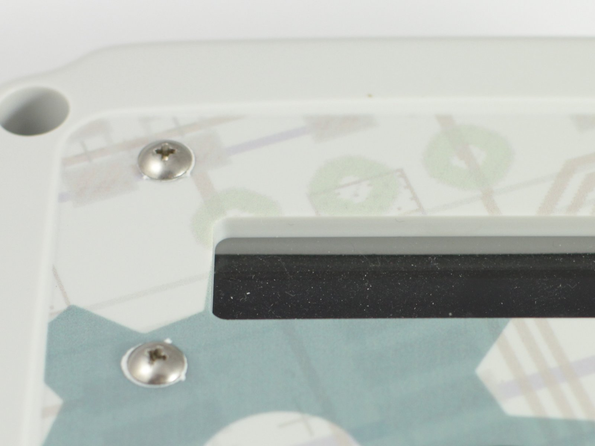</a>
  <a href="images/step-01-2.jpg">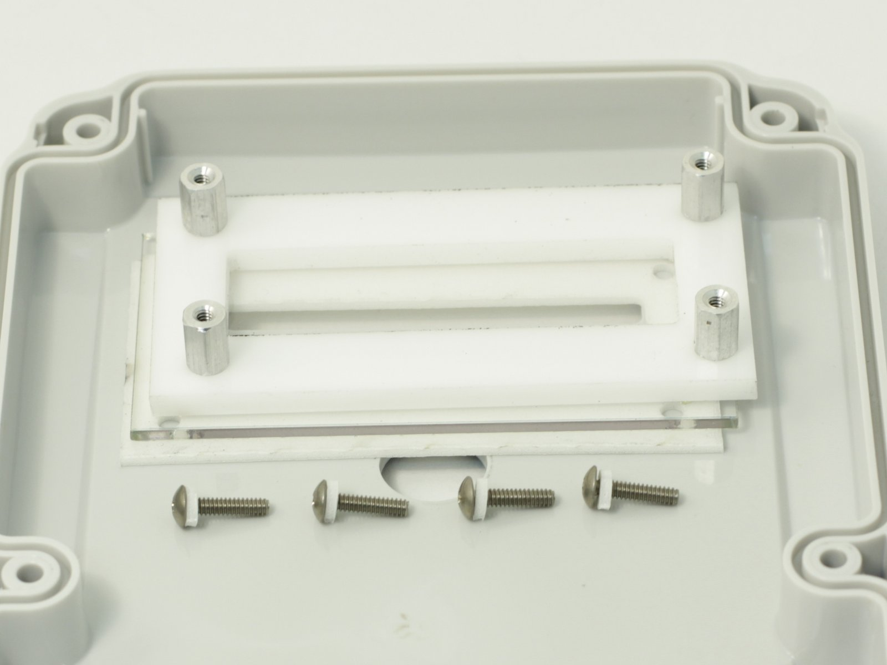</a>
  <a href="images/step-01-3.jpg">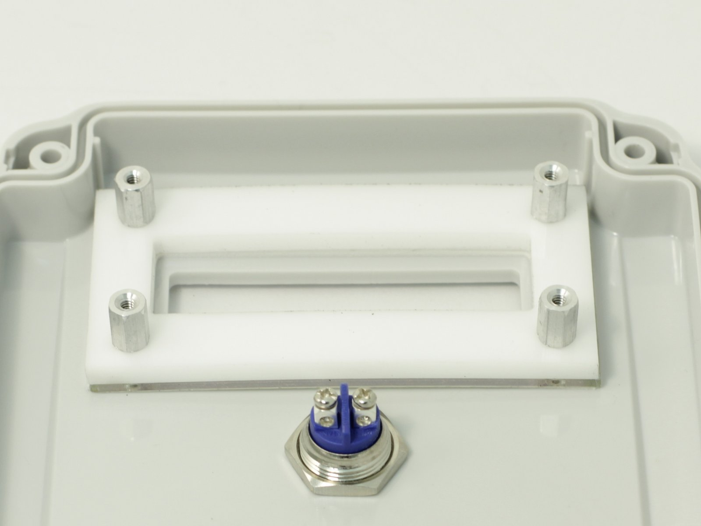</a>

- ⚫ Place the 4 - 10mm M2.5 screws through the top of the enclosure.
- ⚫ Flip lid upside down and stack... Foam window seal, then LCD clear window (remove Protective coating from both sides) .
  - ℹ️ Note: Kits shipped before February 2018 also include a LCD brace. Install the brace on top of the LCD window.
  - ℹ️ Kits shipped February 2018 and later include a 1/4" thick LCD window and do not require the brace.
- ⚫ Place the 4 - 10mm M2.5 screw through the lid. Compress window foam and thread into the 4- Hex Standoffs. Tighten each one hand tight compressing the foam fully.

---

## Step 2 – Mount LCD to enclosure lid

  <a href="images/step-02-1.jpg">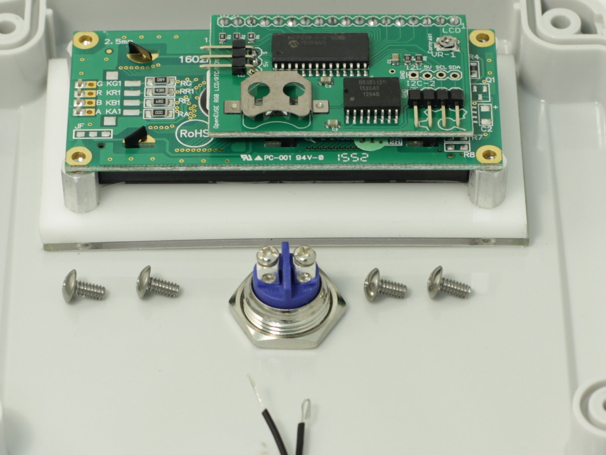</a>
  <a href="images/step-02-2.jpg">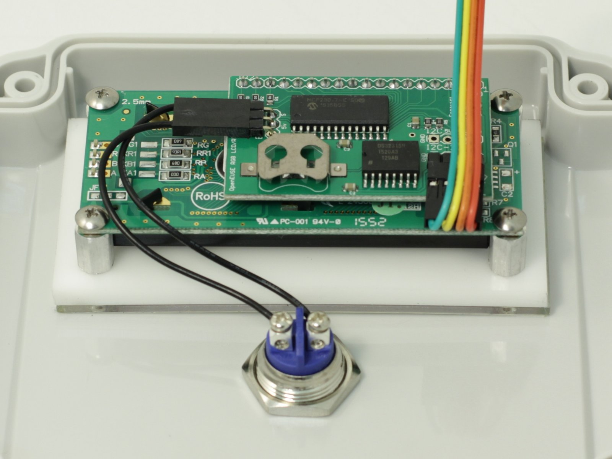</a>
  <a href="images/step-02-3.jpg">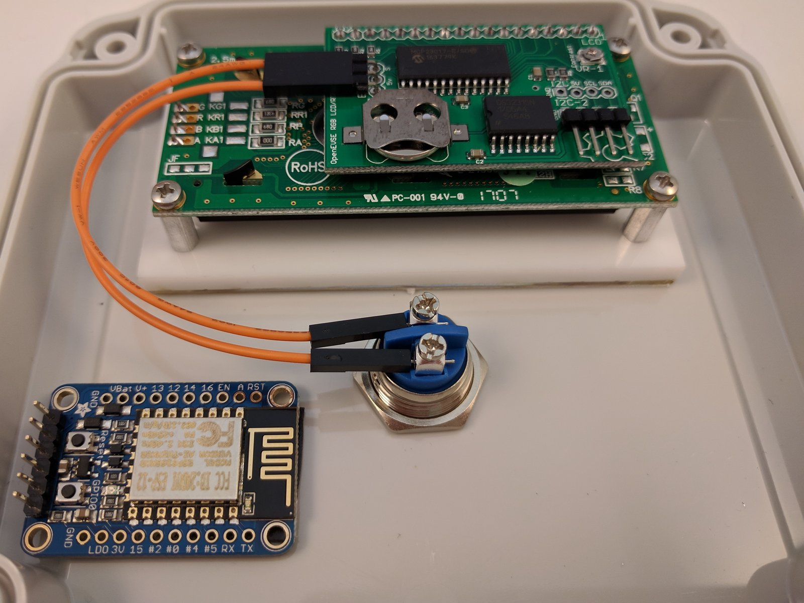</a>

- ⚫ Mount the water resistant button switch to the enclosure lid, O-ring seal on the outside. Do not over tighten seal, if squeezes out of place the button is too tight.
- 📌 Test enclosure lid for water tightness. Spray water around the LCD window and button and ensure water does nor leak to the back side of the lid. Adjust as necessary.
- ⚫ Using 4 - 6mm M2.5 screws. Mount LCD module to the lid.
  - ⚠️ Screws should be secure. Take care not to over tighten.
- ⚫ Connect 4 pin connector to LCD note the color that represents Ground (Green as pictured). Ground pin is labeled (pin closest to board center).
- ℹ️ Optional - If installing Wifi, now is a good time to mount. Position to the left of the button with the header pins to the far left.
- ℹ️ Optional - Insert a CR1220 or CR1225 coin cell into the battery holder. If using charging station timers this will keep time during power outages.

---

## Step 3 – Mount Components to Plate

  <a href="images/step-03-1.jpg">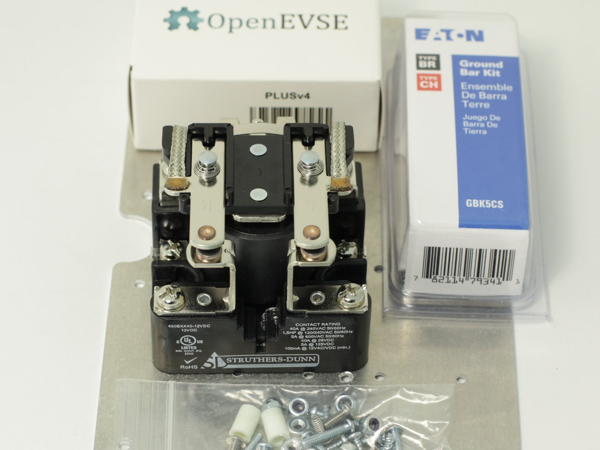</a>
  <a href="images/step-03-2.jpg">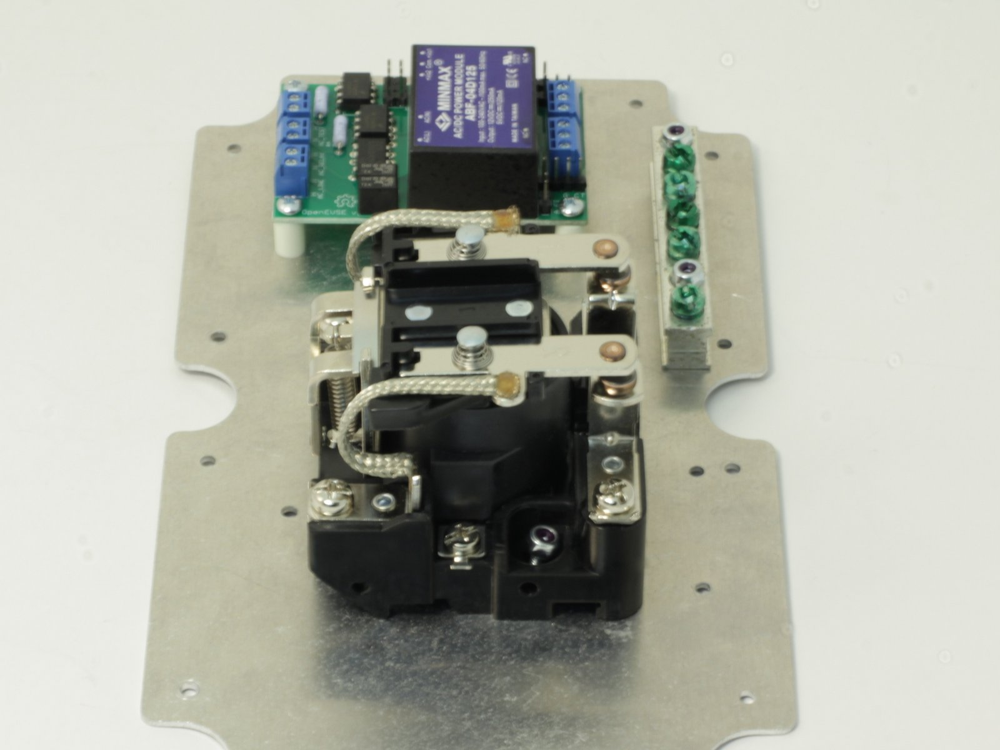</a>

- ⚠️ If your kit contains a Packard C240C contactor, continue here. [Guide](../discontinued-may-2018-v4-standard/README.md)
- ⚫ Mount hex standoffs to the top side of the plate mounting plate with 4 - 6 mm M2.5 screws. Mount the OpenEVSE board to the hex standoffs with the other 4 - 6mm M2.5 screws.
- ⚫ Mount Ground bar header block to the mounting plate from the top using 2 - 5/8" self threading screws.
- ⚠️ Do not over tighten the self threading screws. tighten until secure. Use of a non powered Screw driver is recommended.
- ⚫ Mount the Struthers - Dunn contactor using 2 - 1/2" self threading screws.

---

## Step 4 – Connection Diagrams

  <a href="images/step-04-1.jpg">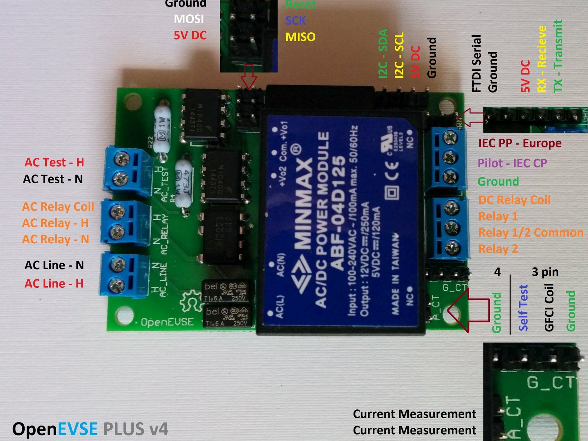</a>
  <a href="images/step-04-2.jpg">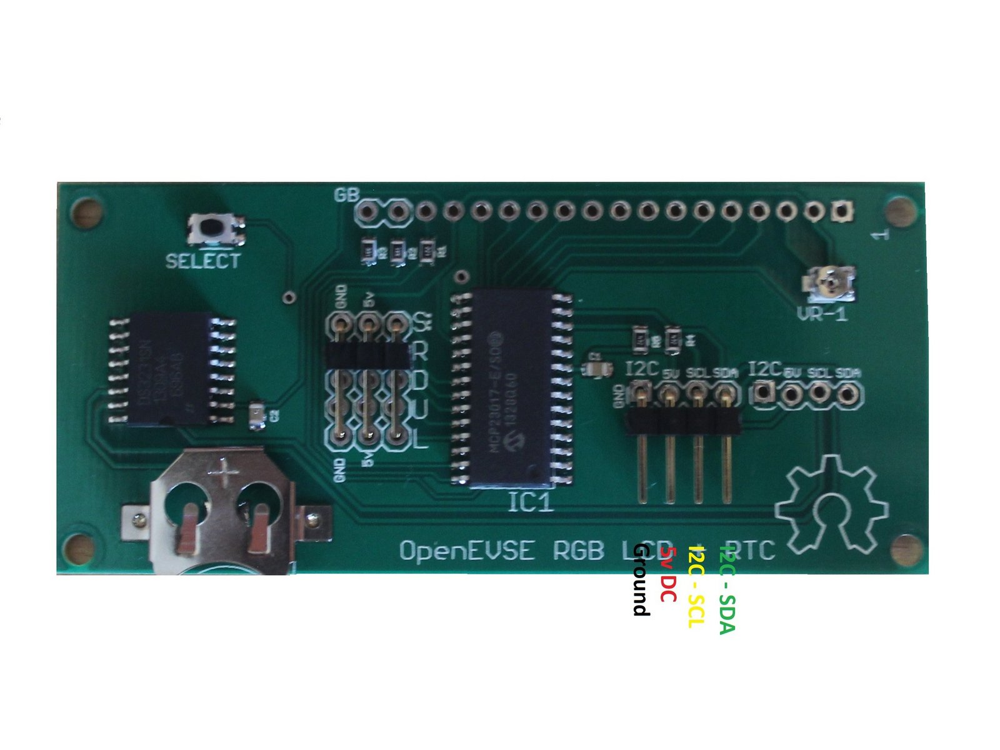</a>

- ⚫ Review the connection diagram for the board you received in your kit. This guide depicts the latest board OpenEVSE v4.
  - ⚫ [V4 Download image](http://files.openevse.com/OpenEVSE_v4.jpg)
- ⚫ Connections are slightly different between board versions. Refer to these diagrams if the image in this guide does not match your board version.

---

## Step 5 – Struthers and Dunn - Low Current AC wiring

  <a href="images/step-05-1.jpg">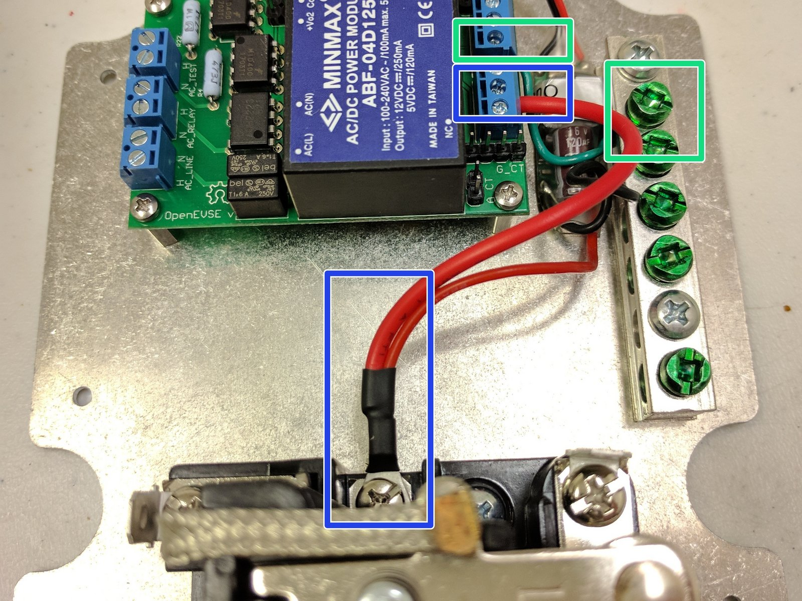</a>
  <a href="images/step-05-2.jpg">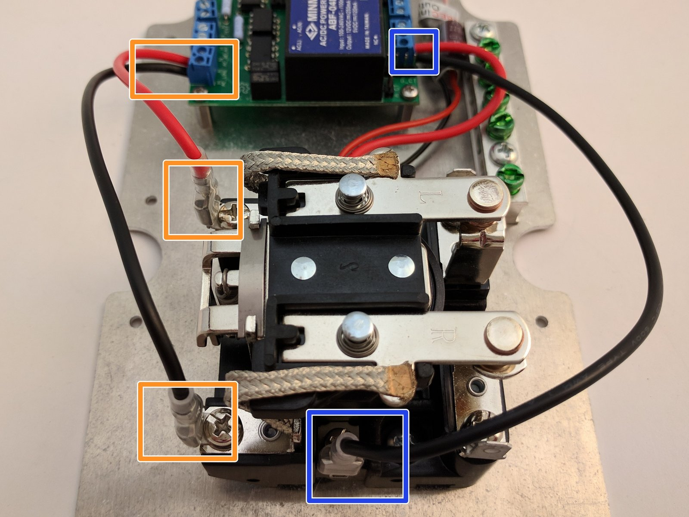</a>
  <a href="images/step-05-3.jpg">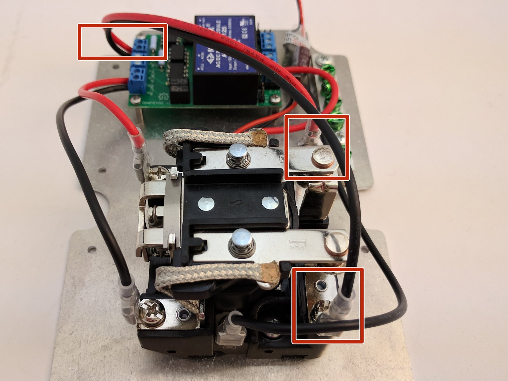</a>

- ⚠️ If your kit contains a Packard C240C contactor, continue here. [Guide](../discontinued-may-2018-v4-standard/README.md)
- 🔵 Struthers & Dunn - Connect DC relay coil (top) with a red wire to OpenEVSE controller Relay 1/2 Common. Connect relay coil (bottom) with a black wire to Relay 2.
  - ℹ️ Connect the +RED wire of the UBEC supply to DC_Relay 1/2 Common of the DC_Relay block or the +12V ring terminal of the relay.
  - ℹ️ Connect the -BLACK wire of the UBEC supply to the Ground bar.
- 🟠 Connect OpenEVSE AC_Line to the incoming AC side of the contactor.
- 🔴 Connect OpenEVSE AC_Test to the hot line of the contactor output (J1772 side) to both Hot 1 and Hot 2/Neutral.
- 🟢 Connect the Ground wire from the ground block to the OpenEVSE board.

---

## Step 6 – Secure Mounting Plate

  <a href="images/step-06-1.jpg">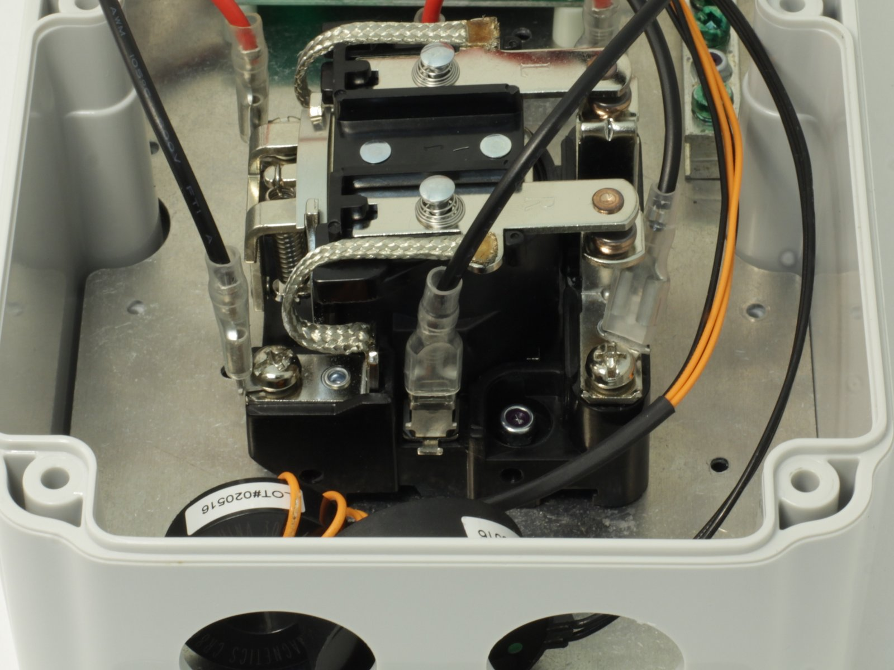</a>

- 📌 Install Cable glands on the enclosure.
  - ℹ️ Optional - If using a large input cable/gland install input cable (LEFT), use a drill with a step bit to enlarge the hole.
- ⚫ Mount plate to Enclosure box using 6 - self tapping screws (2 top, 2 middle 2 bottom).

---

## Step 7 – Mount J1772 cable

  <a href="images/step-07-1.jpg">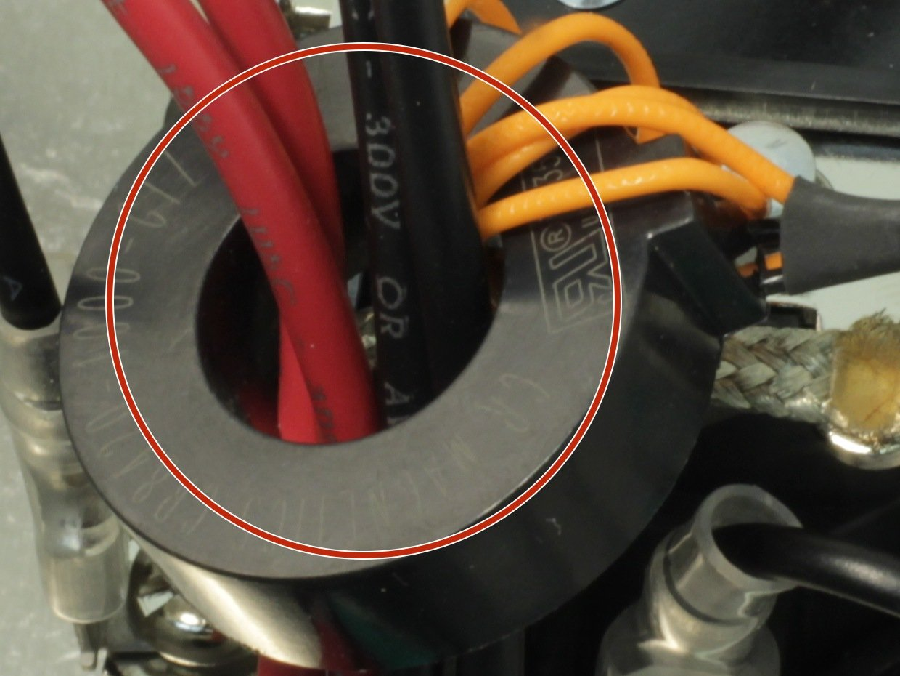</a>
  <a href="images/step-07-2.jpg">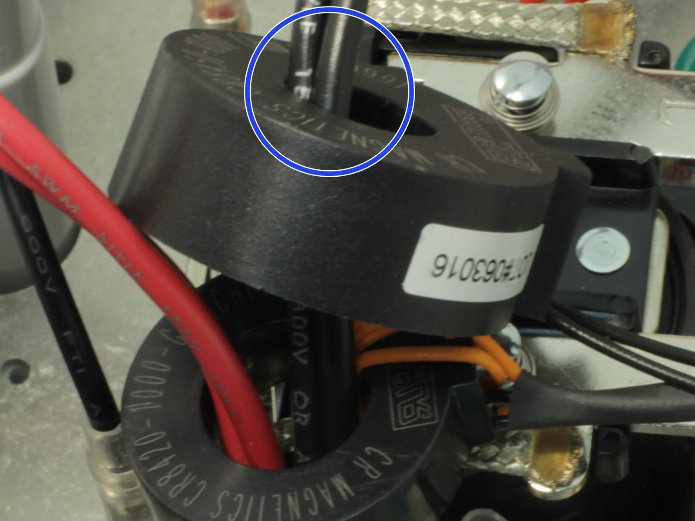</a>

- ⚫ Insert the J1772 cable through a Cable Gland and assemble loosely into the RIGHT hole in the box.
- 🔴 Thread BOTH AC lines through the Ground Fault Coil (4-pin). If you are using the OpenEVSE 40A J1772 Cable, this is both the red pairs AND the black pairs.
- 🔵 Thread one AC line through the current-measurement CT (2-pin [OpenEVSE Current CT](http://store.openevse.com/products/current-measurement-transformer-kit)) . If you are using the OpenEVSE 40A J1772 Cable, this is either the red pair OR the black pair of wires.
- ℹ️ The Ground should be connected with some extra slack so if the cable is forcefully pulled the pilot disconnects first and ground last.

---

## Step 8 – Connect GFCI and Current measurement coils

  <a href="images/step-08-1.jpg">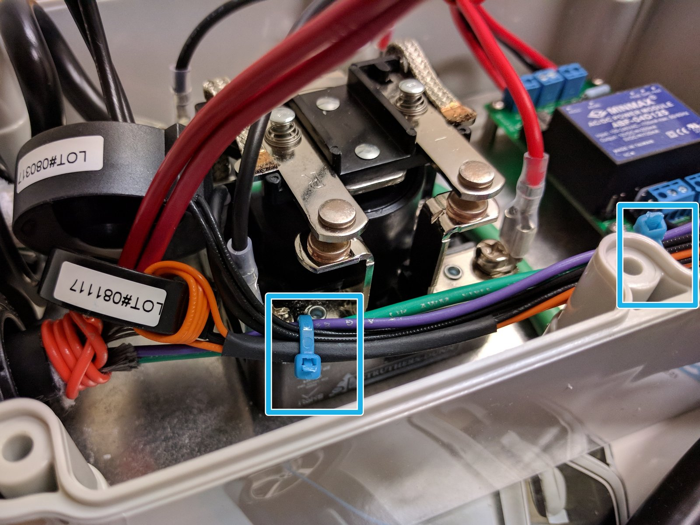</a>
  <a href="images/step-08-2.jpg">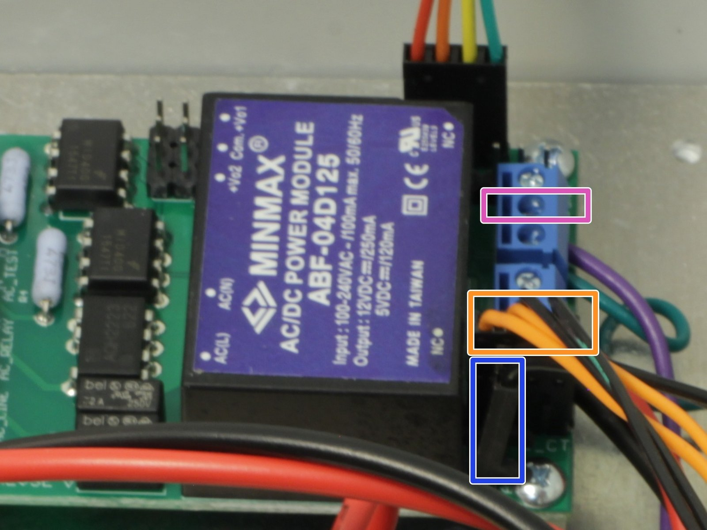</a>
  <a href="images/step-08-3.jpg">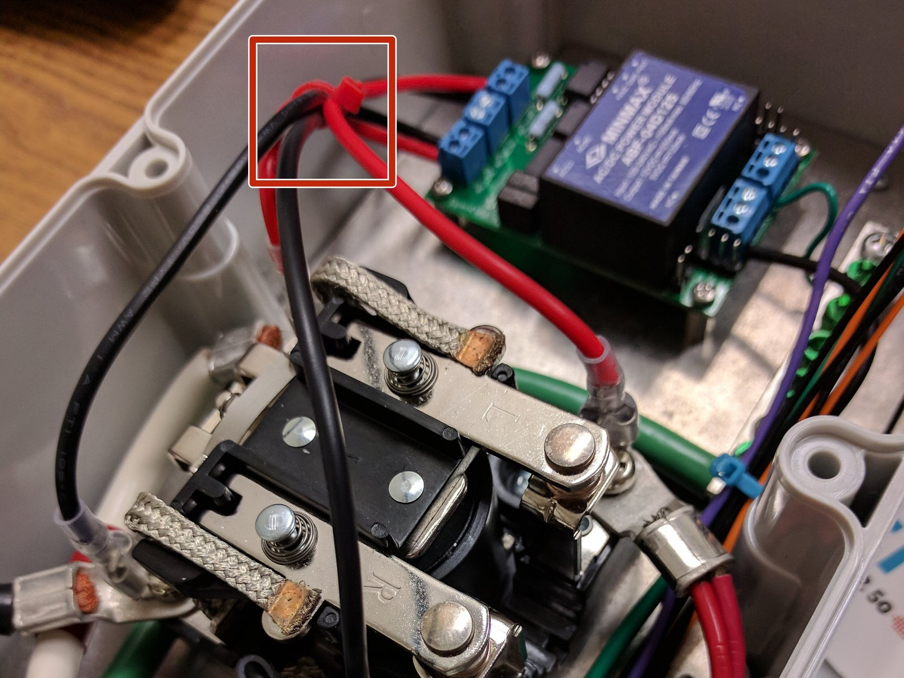</a>

- 🩵 Organize the low voltage wires (EV Ground, EV Pilot, GFCI coil lead, Current coil lead and the relay coil) and secure with a tie wraps with light tension. Tuck the wires down to the bottom of the enclosure.
- 🟠 Connect the 4-pin GFCI CT connector to the OpenEVSE board. This coil has two black wires and two orange self-test wires looped through the coil with a 4 pin connector. Orange Self test wires positioned to the inside Black GFCI CT wires to the outside.
- 🔵 Connect the current measurement CT to the 2 pin connector (either direction is fine).
- 🟣 Connect the control pilot (CP) line (see below for common colors) to the OpenEVSE pilot screw terminal connection.
  - ℹ️ OpenEVSE Quick Charge Power and Tesla PURPLE, Leviton ORANGE, Yazaki BLUE
- 🔴 Use a tie wrap to secure the high-voltage low-current wires with light tension. Position so that the wires are pulled away from the center screw post/seal.

---

## Step 9 – Connect J1772 Cable

  <a href="images/step-09-1.jpg">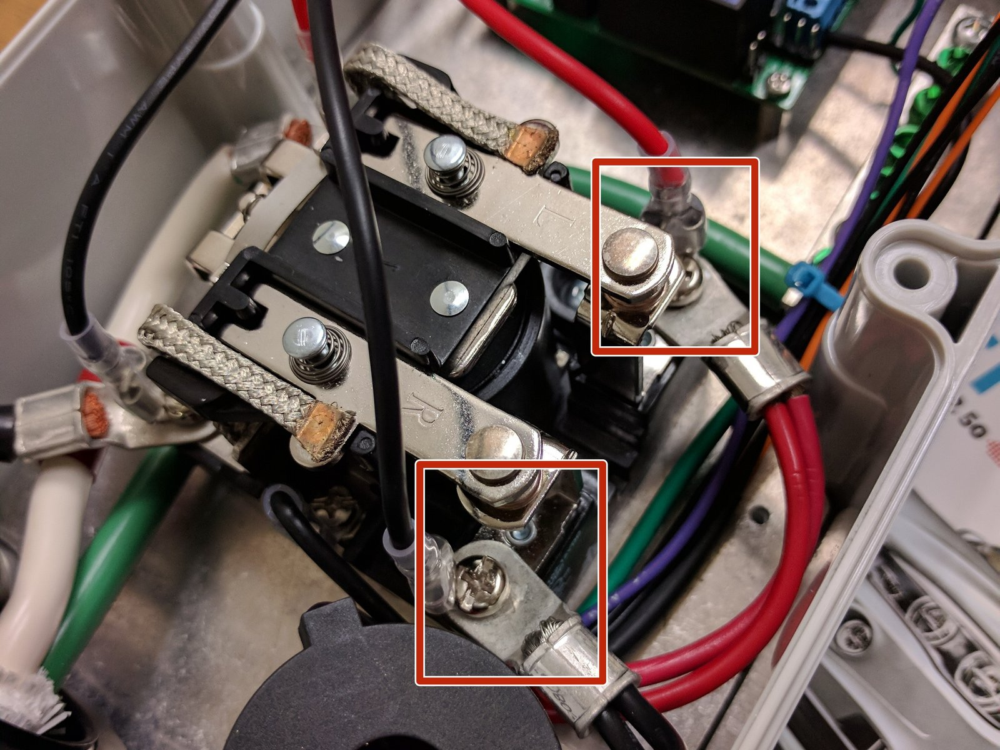</a>

- 📌 OpenEVSE Ultra Flexible Cable include factory terminated ends with Ring Terminals. Other cables will require 6AWG terminals to be crimped following the recommendations of the terminal supplier.
- 🔴 Screw the Power Terminals to the relay with the Quick connect terminal for OpenEVSE AC_Test on top.
- ⚫ Tighten the J1772 cable gland and check its integrity.

---

## Step 10 – Connect AC Input

  <a href="images/step-10-1.jpg">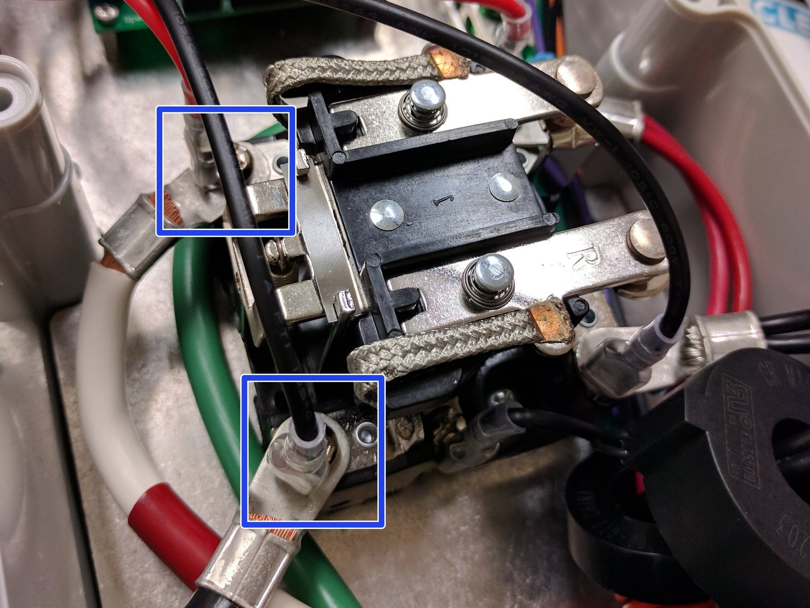</a>

- ⚫ Insert the AC Input cable through the LEFT Cable Gland and assemble loosely into the hole in the box.
  - ⚠️ Check the color code for your country and plug type as it varies region by region. Pictures show US 3 wire (Green, White, Black). Note US 4 wire (Green, White, Black, Red) White Neutral not used and should be capped.
- 🟢 Run the Ground wire along the bottom of the enclosure and secure the conductor the the ground block.
- 🔵 Screw Ring Terminals to the contactor with the Quick connect terminal for OpenEVSE AC_Line on top.
- ⚫ Tighten the cable gland and check its integrity. Check the input wires are secure.

---

## Step 11 – Connect LCD

  <a href="images/step-11-1.jpg">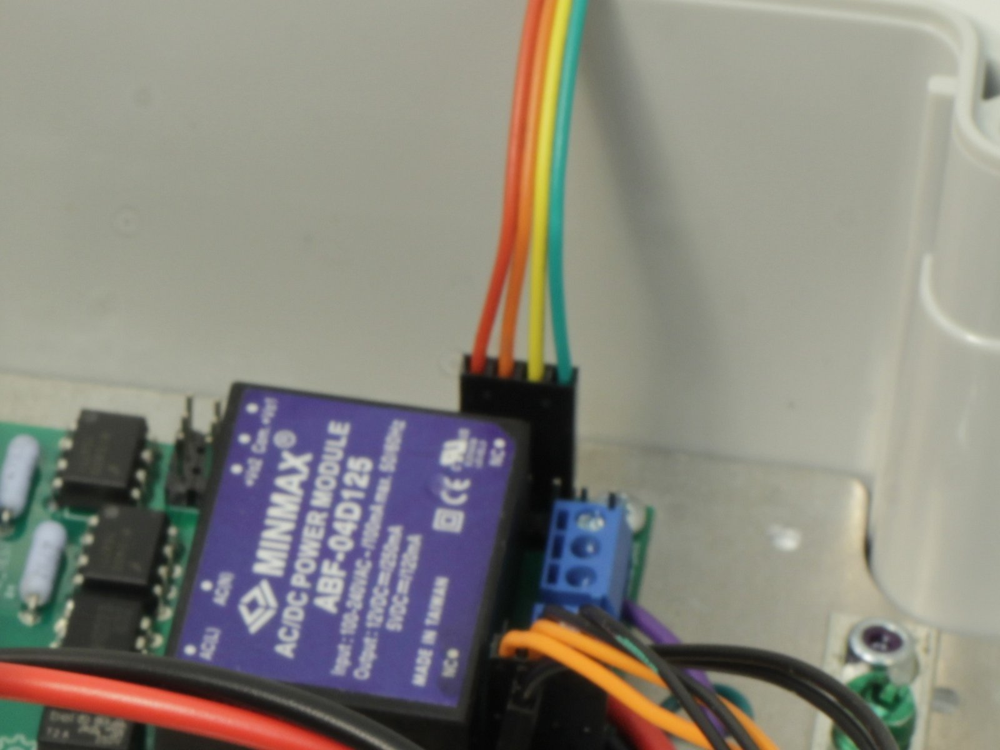</a>

- ⚫ Connect the LCD cable to the OpenEVSE controller. The pin closest to the board edge is ground (green pictured).

---

## Step 12 – Setting LCD Contrast

  <a href="images/step-12-1.jpg">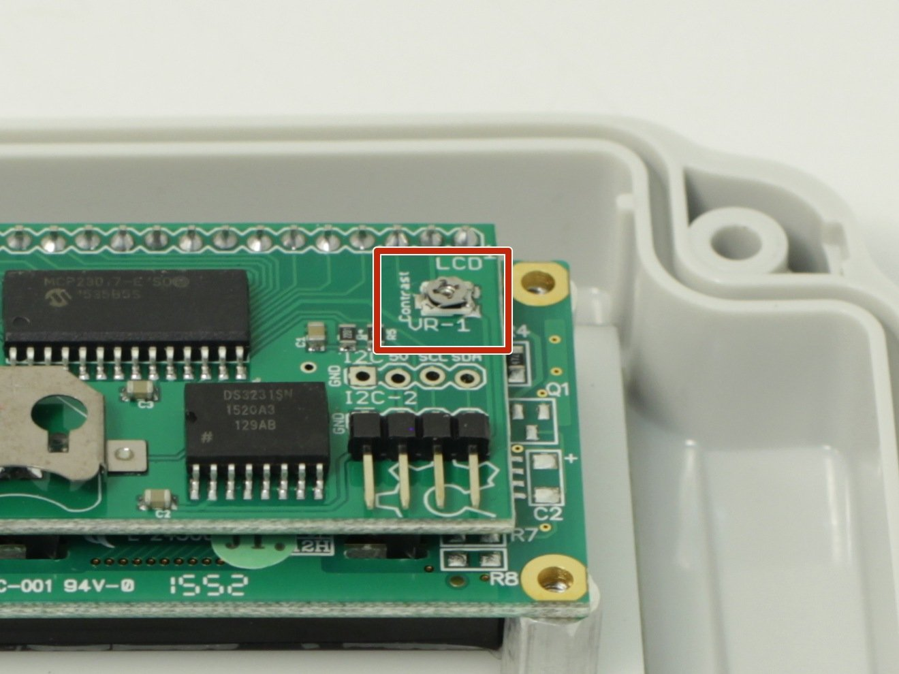</a>
  <a href="images/step-12-2.jpg">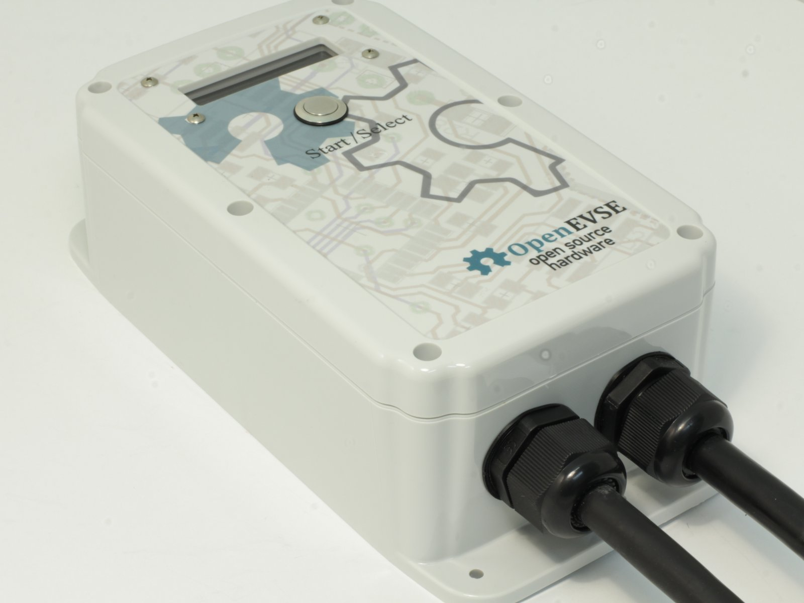</a>

- ⚠️ Power ON. Use caution.
  - ℹ️ A OpenEVSE programmer can be used to power the controller to adjust contrast. Note there will be errors (this is normal) as not all systems are powered.
- 🔴 Adjust LED contrast (VR-1) if text is not visible. Be very careful not to touch any while powered.
- ⚫ When adjusting, be gentle. Do not force past the stop in either direction. If forced past the stop, the part will no longer function.
- ⚫ Secure the enclosure lid. Tighten the screws slowly alternating across and top, middle and bottom.

---

## Step 13 – Menu Settings

  <a href="images/step-13-1.jpg">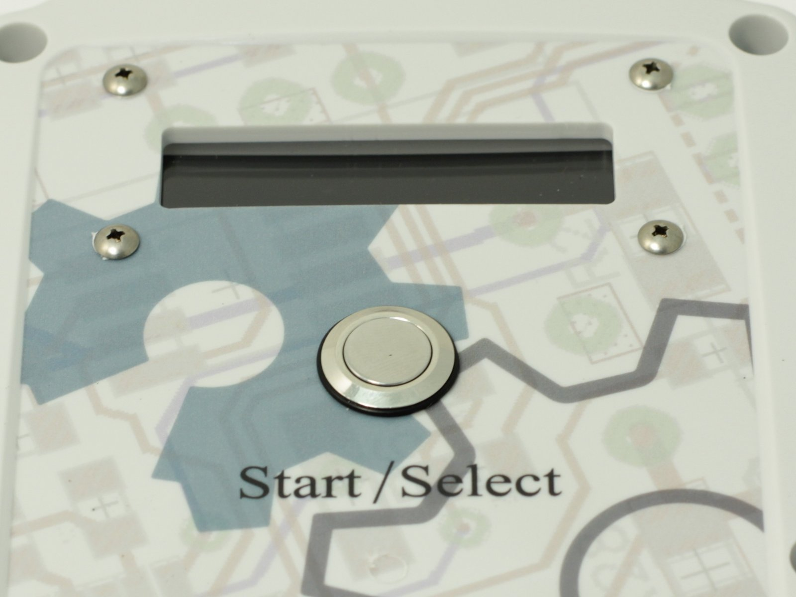</a>

- ⚫ To Enter the Menu Press and hold the button (long press). Press and release (short press) to scroll through Options.
- ⚫ Set Current to desired Value (80% of your circuit breaker value). Menu => Setup => Max Current.
- ⚫ Enable GFCI Self Test. Menu => Setup => GFI Self Test

---
