# Discontinued May 2018 - v4 Standard

| Difficulty | Steps | Time Required |
| --- | --- | --- |
| Moderate | 14 | 01:00:00 – 02:00:00 |

_Written By: Christopher Howell (and 11 other contributors)_

## Introduction

- **Warning** Assembly of a Electric Vehicle charging station requires wiring Alternating Current (AC) components that will be exposed to voltages from 100 to 250v. If you do not have the experience and knowledge required to safely work with AC voltages please consult with an experienced electrician for assistance and inspection of your work.

- **Note** Regularly inspect your charging station. Pay special attention to excess heat, components, handles, and wiring will be warm but they should not be HOT...

- Always Disconnect your charging station from power before performing an inspection and/or maintenance

## Documents

- [OpenEVSE_P50.pdf](documents/OpenEVSE_P50.pdf)

### Bullet key

Colored bullets match the colored markers drawn on the photos for each step.

| Marker | Meaning |
| --- | --- |
| ⚫ 🔴 🟠 🟡 🟢 🔵 🩵 🟣 | Instruction — matches the same-colored marker in the photo |
| ℹ️ | Note |
| ⚠️ | Caution |
| 📌 | Reminder / Tip |

## Contents

1. [Enclosure Lid Poly-Carbonate](#step-1--enclosure-lid-poly-carbonate)
2. [Mount LCD to enclosure lid](#step-2--mount-lcd-to-enclosure-lid)
3. [Mount Components to Plate](#step-3--mount-components-to-plate)
4. [Connection Diagrams](#step-4--connection-diagrams)
5. [Packard - Low Current AC wiring](#step-5--packard---low-current-ac-wiring)
6. [Secure Mounting Plate](#step-6--secure-mounting-plate)
7. [Mount J1772 cable](#step-7--mount-j1772-cable)
8. [Connect GFCI and Current measurement coils](#step-8--connect-gfci-and-current-measurement-coils)
9. [Connect J1772 Cable](#step-9--connect-j1772-cable)
10. [Connect AC Input](#step-10--connect-ac-input)
11. [Ground Connections](#step-11--ground-connections)
12. [Setting LCD Contrast](#step-12--setting-lcd-contrast)
13. [Menu Settings](#step-13--menu-settings)
14. [Optional Upgrades](#step-14--optional-upgrades)

---

## Step 1 – Enclosure Lid Poly-Carbonate

  <a href="images/step-01-1.jpg">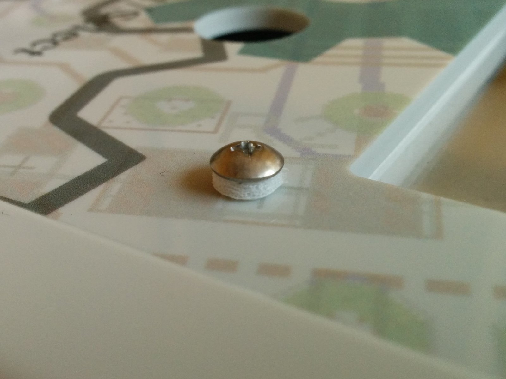</a>
  <a href="images/step-01-2.jpg">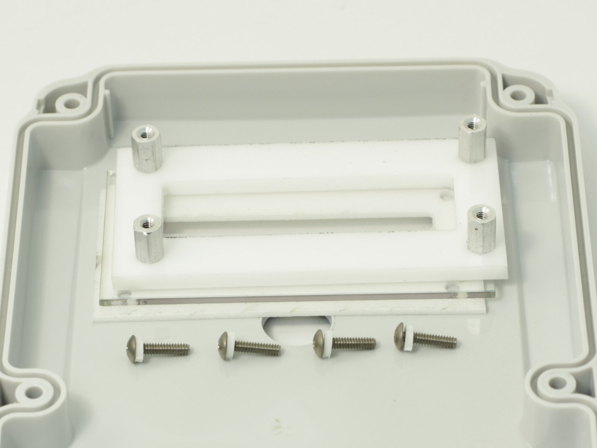</a>
  <a href="images/step-01-3.jpg">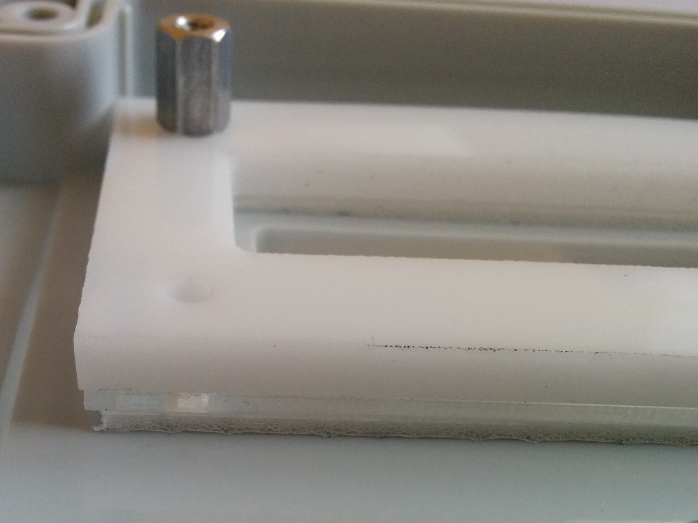</a>

- ⚫ Place the 4 - 10mm M2.5 screws through the top of the enclosure.
- ⚫ Flip lid upside down and stack as follows: Foam seal, then LCD clear window (remove protective coating from both sides).
  - ℹ️ Note: Kits shipped before February 2018 also include a LCD brace. Install the brace on top of the LCD window.
  - ℹ️ Kits shipped February 2018 and later include a 1/4" thick LCD window and do not require the brace.
- ⚫ Place the (4) - 10mm M2.5 screws through the lid with the foam washer on the outside. Compress foam and thread the (4) - Hex Standoffs. Tighten each one hand tight, compressing the foam.

---

## Step 2 – Mount LCD to enclosure lid

  <a href="images/step-02-1.jpg">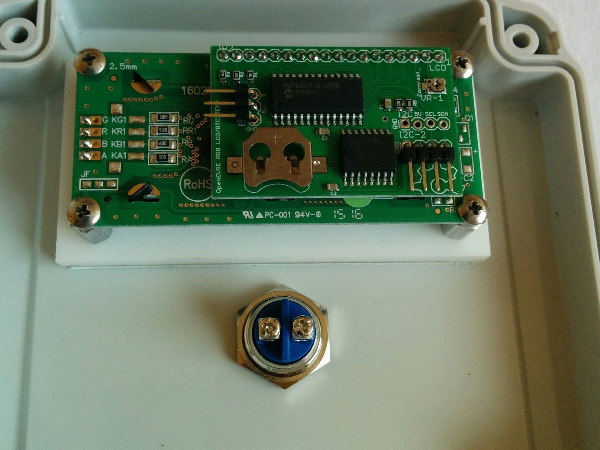</a>
  <a href="images/step-02-2.jpg">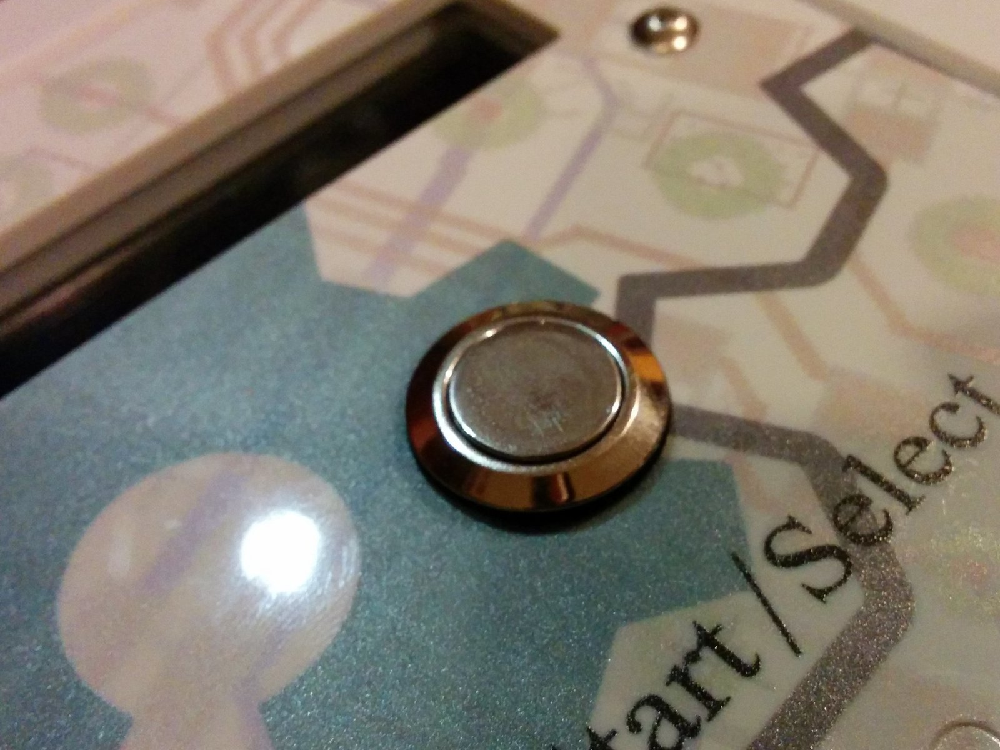</a>
  <a href="images/step-02-3.jpg">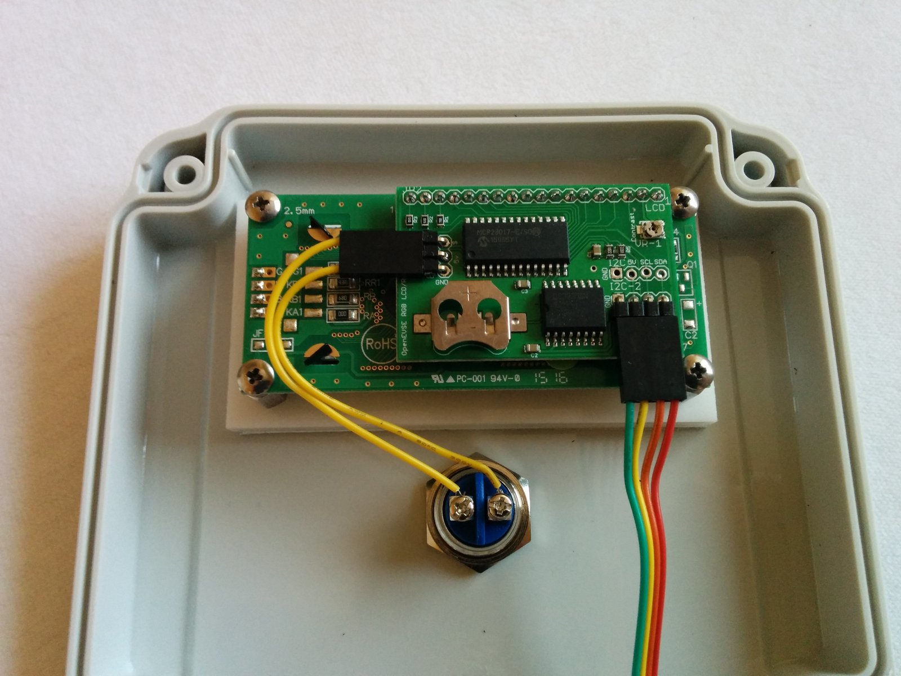</a>

- ⚫ Mount the water resistant button switch to the enclosure lid, rubber seal on the outside. Do not over-tighten seal. If it squeezes out of place, the button is too tight.
- 📌 Test enclosure lid for water tightness. Spray water around the LCD window and button, ensuring that water does not leak to the back side of the lid. Adjust as necessary.
- ⚫ Using (4) - 6mm M2.5 screws, mount LCD module to the lid.
- ⚠️ Screws should be secure. Take care not to over-tighten.
- ⚫ Connect the 3-pin cable connector to the LCD module. Strip wires about 1/2", fold in half stripped wire and screw into the switch screw lugs.
- ⚫ Connect the 4-pin connector to the LCD. Note the color that represents the ground wire (green in picture).
- ℹ️ Optional - Insert a CR1220 or CR1225 coin cell into the battery holder. If using charging station timers this will keep time during power outages.

---

## Step 3 – Mount Components to Plate

  <a href="images/step-03-1.jpg">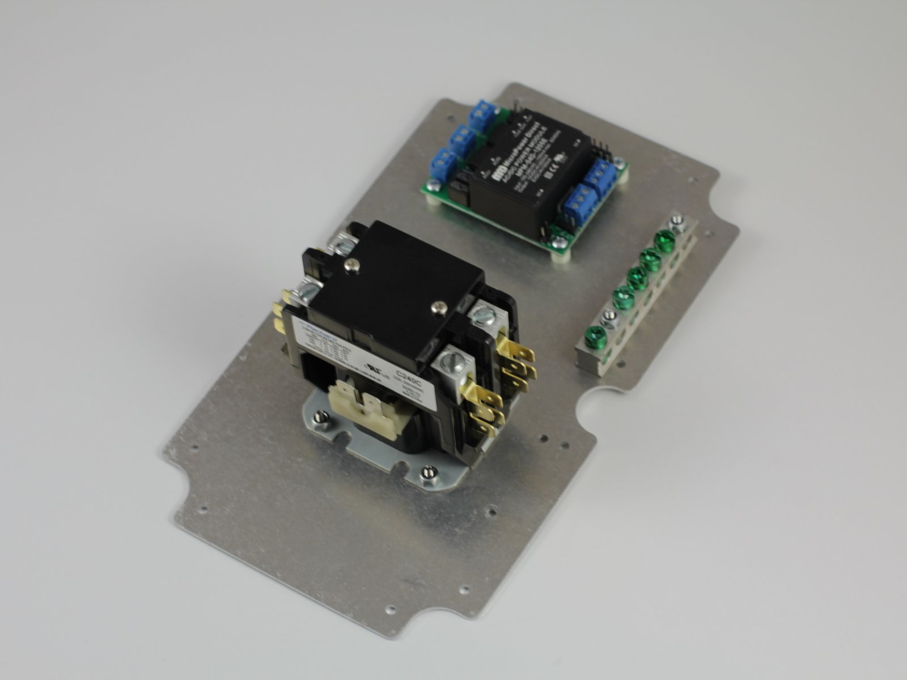</a>

- ⚫ Mount OpenEVSE board to the mounting plate with hex stand-offs and (8) - M2.5 x 6mm screws.
- ⚫ Mount ground bar from the top to the mounting plate using (2) - 5/8" self-tapping screws.
- ⚫ Mount the Packard C240C contactor from the top to the plate with (4) - 1/4" self-tapping screws.
- ⚠️ Do not over-tighten the self-tapping screws. Tighten only until fully threaded and secure.

---

## Step 4 – Connection Diagrams

  <a href="images/step-04-1.jpg">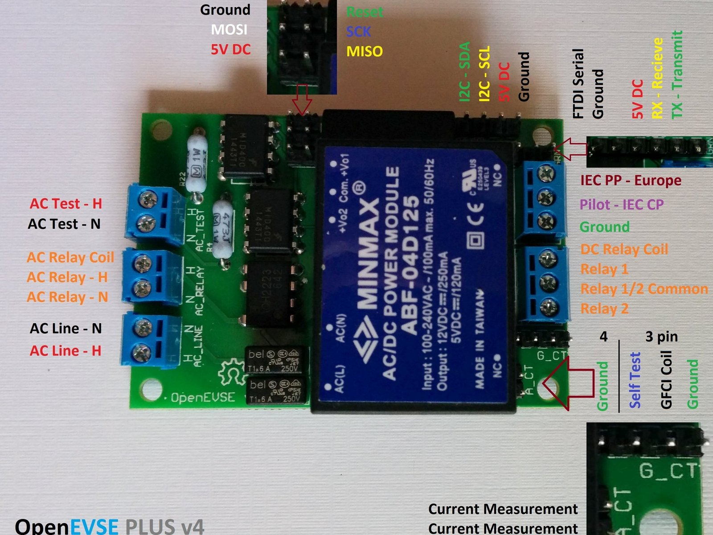</a>

- ⚫ Review the connection diagram for the board you received in your kit. This guide depicts the latest board OpenEVSE v4.
  - ⚫ v4 After July 2015
- ⚫ [V4 Download image](http://files.openevse.com/OpenEVSE_v4.jpg)
- ⚠️ Connections are slightly different between board versions. Refer to these diagrams if the image in this guide does not match your board version.

---

## Step 5 – Packard - Low Current AC wiring

  <a href="images/step-05-1.jpg">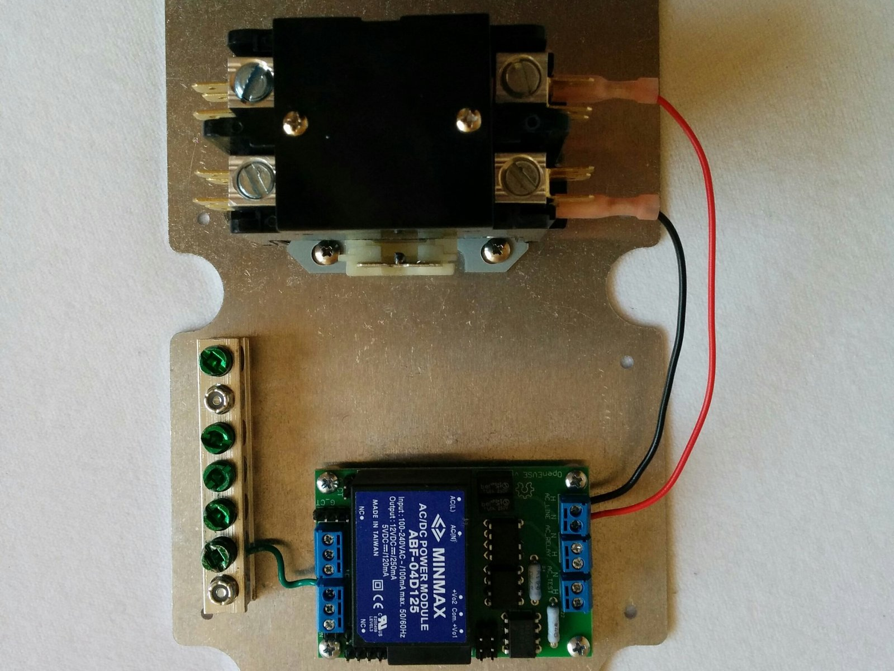</a>
  <a href="images/step-05-2.jpg">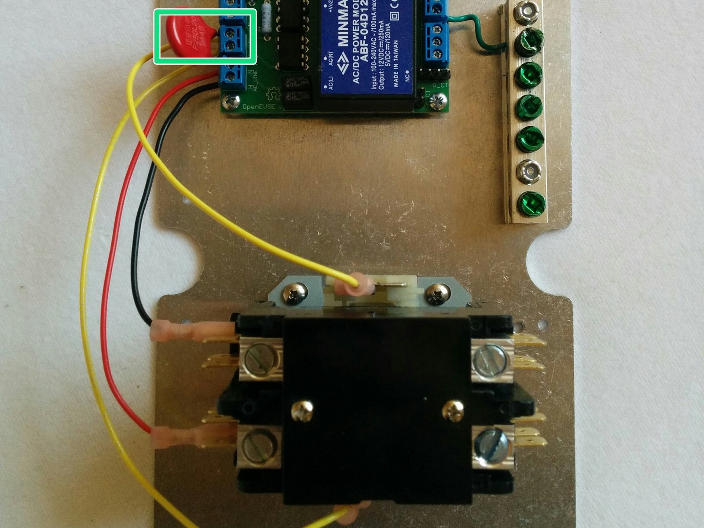</a>
  <a href="images/step-05-3.jpg">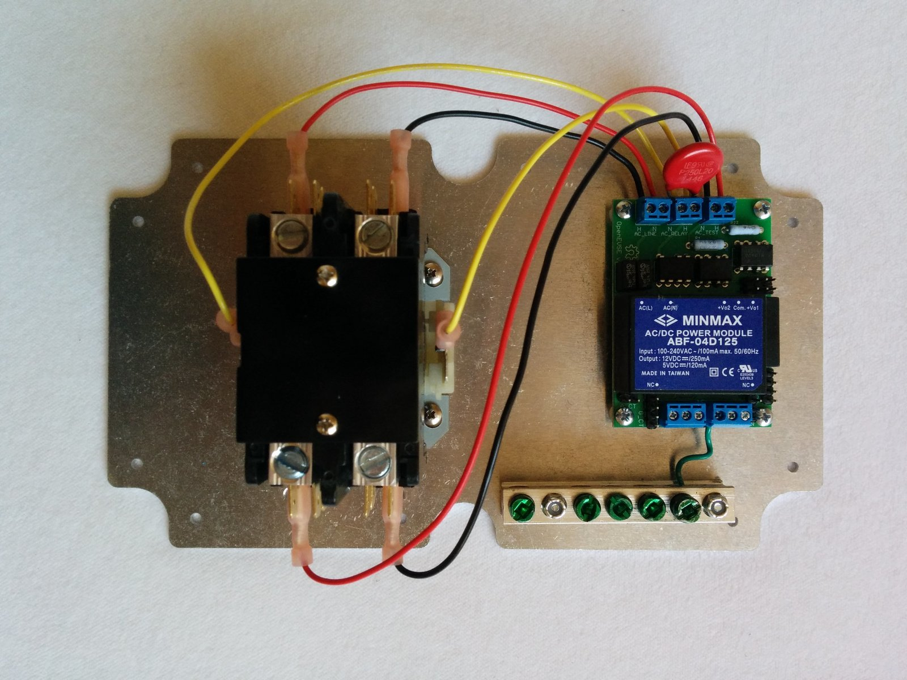</a>

- ⚫ Connect OpenEVSE AC line to the incoming AC side of the contactor. Connect OpenEVSE Ground to Ground Block.
- ⚠️ Packard - Connect contactor coil to the OpenEVSE AC relay output (v4 middle).
- ℹ️ Kits include a MOV V275LA20AP (red disk Metal Oxide Varistor) to reduce chatter noise created by the bouncing contactor coil.
  - 🔴 Connect the red MOV across the AC_Relay terminals on the OpenEVSE board. This shares terminal positions with the AC Relay coil wires.
- ⚫ Connect OpenEVSE AC Test (v4 top block or V3 middle) to the hot line of the contactor output (J1772 side). V3 Hot only, V4 both Hot and Hot/Neutral.
- 🟢 Connect the Ground wire from the ground block to the OpenEVSE board.

---

## Step 6 – Secure Mounting Plate

  <a href="images/step-06-1.jpg">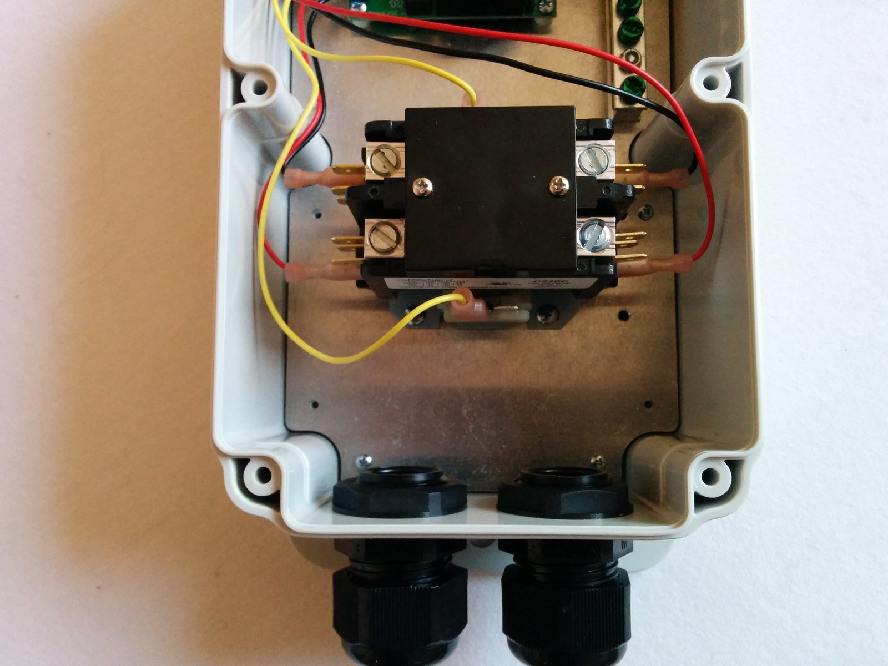</a>

- 📌 Install Cable glands on the enclosure. If using a large gland for the input cable, use a step drill to enlarge the hole. (Left as built in this guide)
- ⚫ Mount plate to Enclosure box using q6 - self tapping screws (2 top, 2 middle 2 bottom).

---

## Step 7 – Mount J1772 cable

  <a href="images/step-07-1.jpg">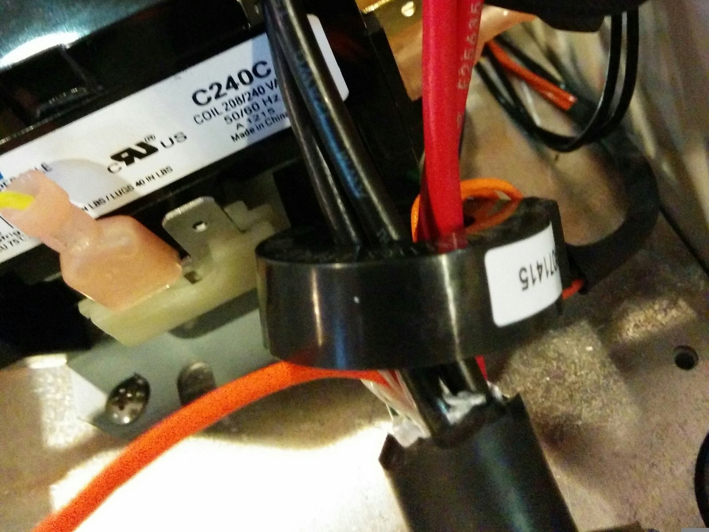</a>
  <a href="images/step-07-2.jpg">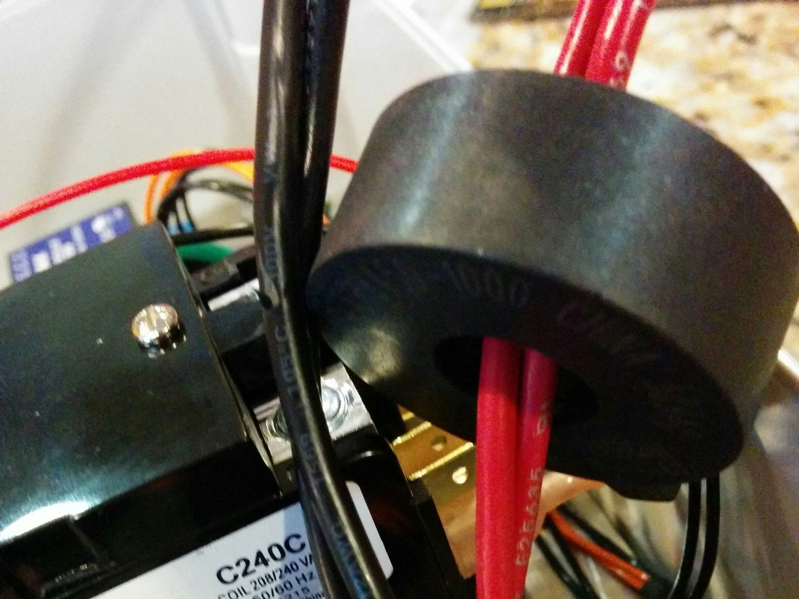</a>

- ⚫ Thread BOTH AC lines through the Ground Fault Coil (4-pin). If you are using the OpenEVSE 40A J1772 Cable, this is both the red pairs AND the black pairs.
- ℹ️ Thread one AC line (either side Hot1 or side Hot2) through the current-measurement CT (2-pin [OpenEVSE Current CT](http://store.openevse.com/products/current-measurement-transformer-kit)) . If you are using the OpenEVSE 40A J1772 Cable, this is either the red pair OR the black pair of wires.

---

## Step 8 – Connect GFCI and Current measurement coils

  <a href="images/step-08-1.jpg">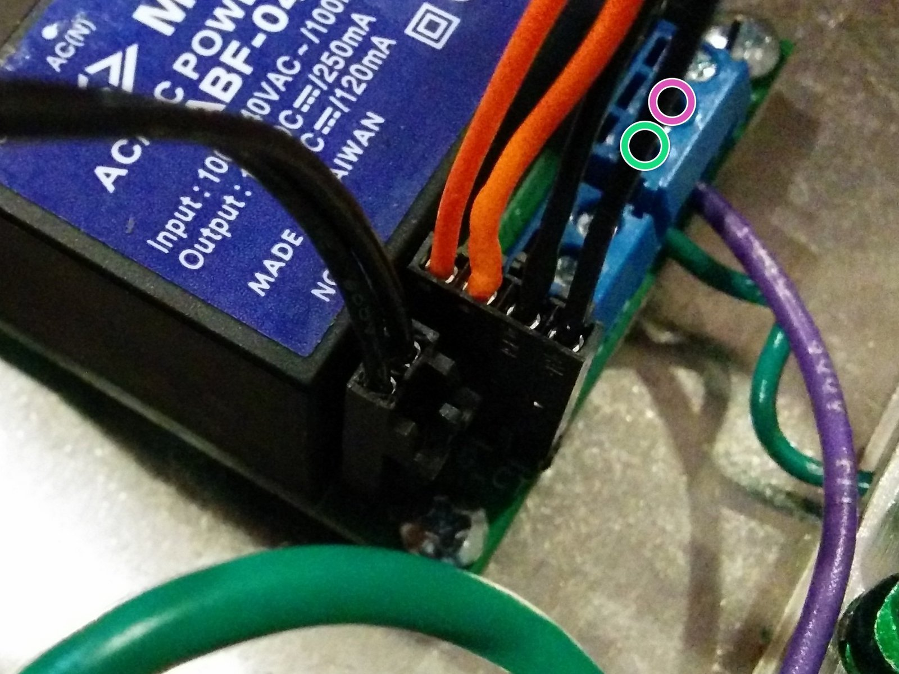</a>

- 🟠 Connect the 4-pin GFCI CT connector to the OpenEVSE board. This coil has two black wires and two orange self-test wires looped through the coil with a 4 pin connector. Orange Self test wires positioned to the inside Black GFCI CT wires to the outside.
- ⚫ Deluxe kits - Connect the current measurement CT to the 2 pin connector (either direction is fine).
- 🟣 Connect the EV control pilot (CP) line (see below for common colors) to the OpenEVSE pilot screw terminal connection.
  - ℹ️ OpenEVSE Quick Charge Power and Tesla PURPLE, Leviton ORANGE, Yazaki BLUE

---

## Step 9 – Connect J1772 Cable

  <a href="images/step-09-1.jpg">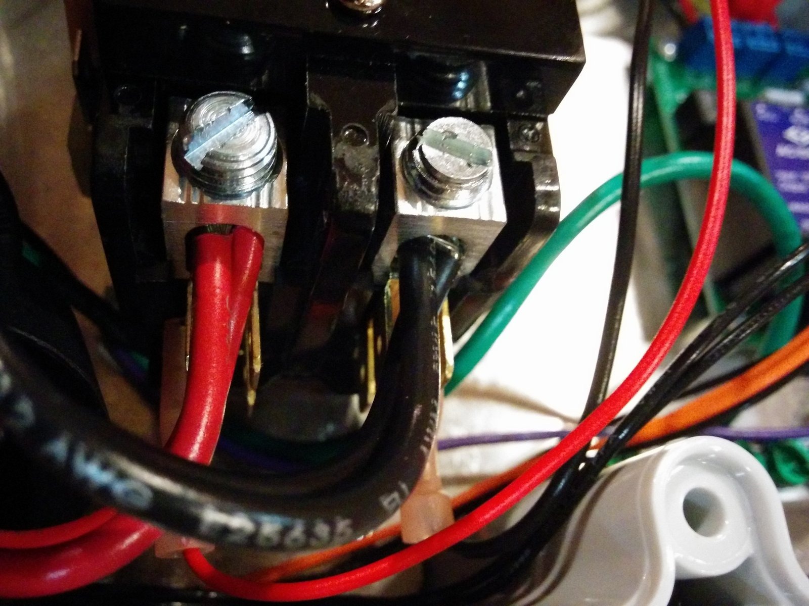</a>

- ⚫ The OpenEVSE Ultra Flexible Cable ends are factory terminated with sleeve ferrules.
- ⚠️ Other J1772 cables [Data Bulletin](http://www2.schneider-electric.com/resources/sites/SCHNEIDER_ELECTRIC/content/live/FAQS/126000/FA126881/en_US/Fine%20Stranded%20Wire%200515DB0301.pdf) must be terminated with appropriately sized and crimped sleeve ferrules.
- ⚫ Insert terminated conductors into the lugs and securely tighten screws.
- ⚫ Tighten the J1772 cable gland and check its integrity.

---

## Step 10 – Connect AC Input

  <a href="images/step-10-1.jpg">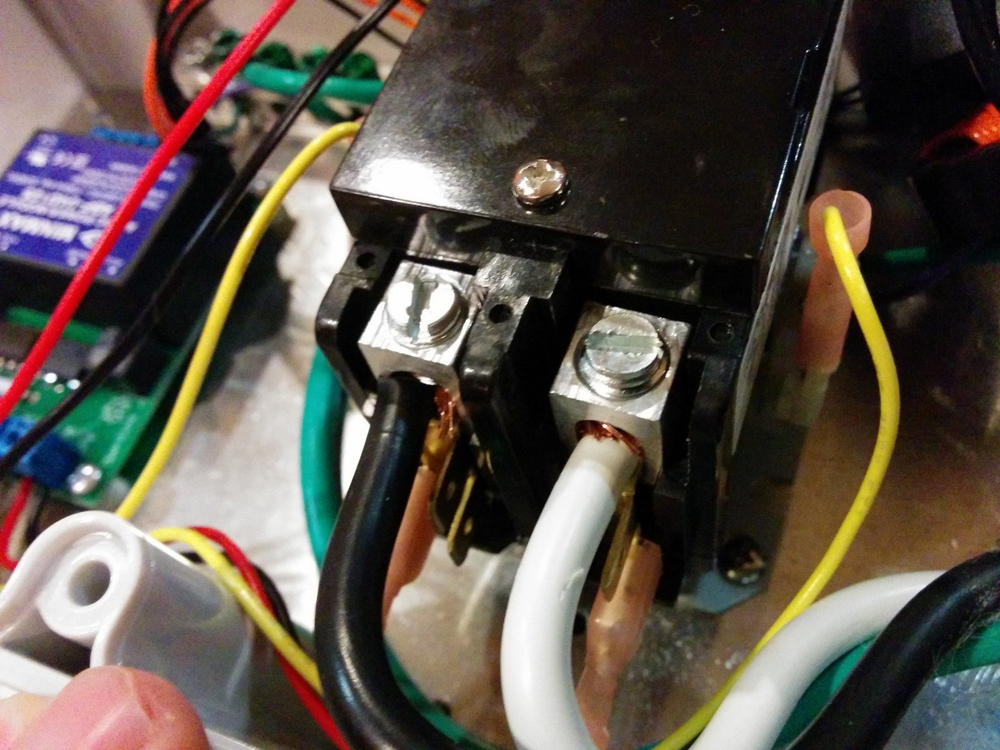</a>
  <a href="images/step-10-2.jpg">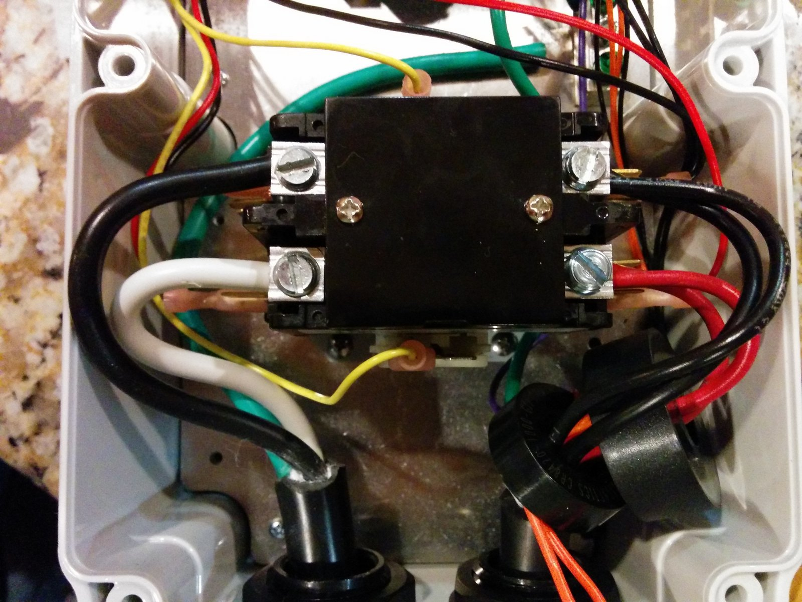</a>

- ⚫ Insert the AC Input cable through a Cable Gland and assemble loosely into the hole in the box.
- ⚠️ The OpenEVSE Input cables are factory terminated with sleeve ferrules. If using another input cable terminate the ends with the appropriate size sleeve ferrule.
- ⚫ Strip the insulation off about 3/4" of insulation, terminate with ends sleeve ferrules.
- ℹ️ Check the color code for your country and plug type as it varies region by region. Pictures show US 3 wire (Green, White, Black). Note US 4 wire (Green, White, Black, Red) White Neutral not used and should be capped.
- ⚫ Insert terminated wires into lugs and tighten. The 50A kit supports both Split Phase US (Hot, Hot and Ground) and single Phase (Hot, Neutral, Ground) at a voltage of 208 - 240v AC.
- ⚫ Tighten the cable gland and check its integrity. Check the input wires are secure.

---

## Step 11 – Ground Connections

  <a href="images/step-11-1.jpg">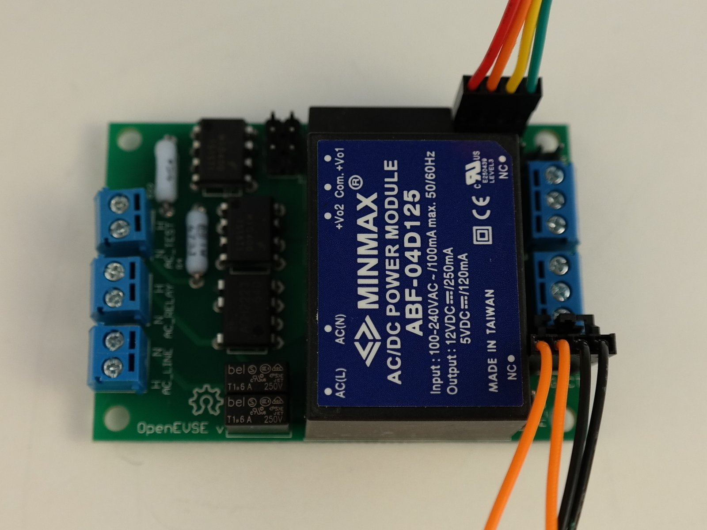</a>
  <a href="images/step-11-2.jpg">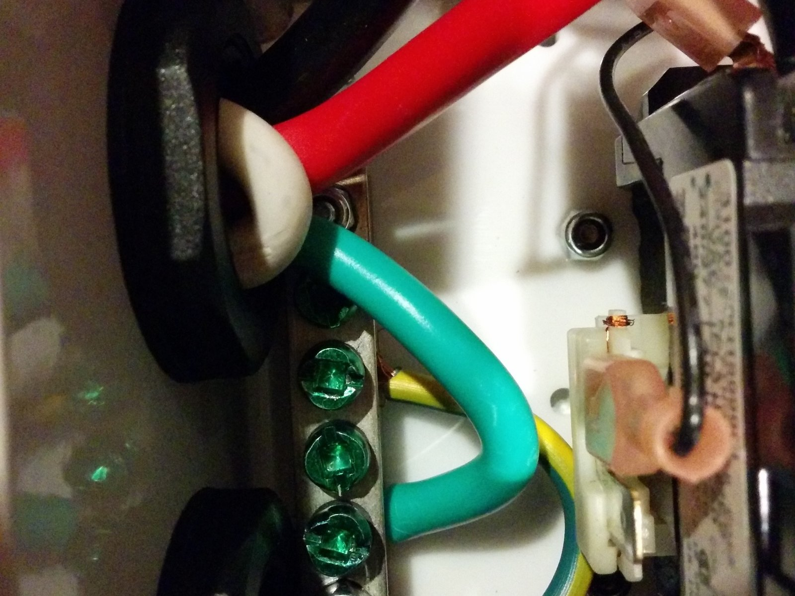</a>

- ⚫ Connect the ground (Green) from the AC cord to the ground block.
- ⚫ Connect the Ground from the J1772 cable to the ground block.
- ℹ️ Connect the 4 pin LCD cable. Ensure GND marked on LCD matches Ground on OpenEVSE board (pin closest to board edge).

---

## Step 12 – Setting LCD Contrast

  <a href="images/step-12-1.jpg">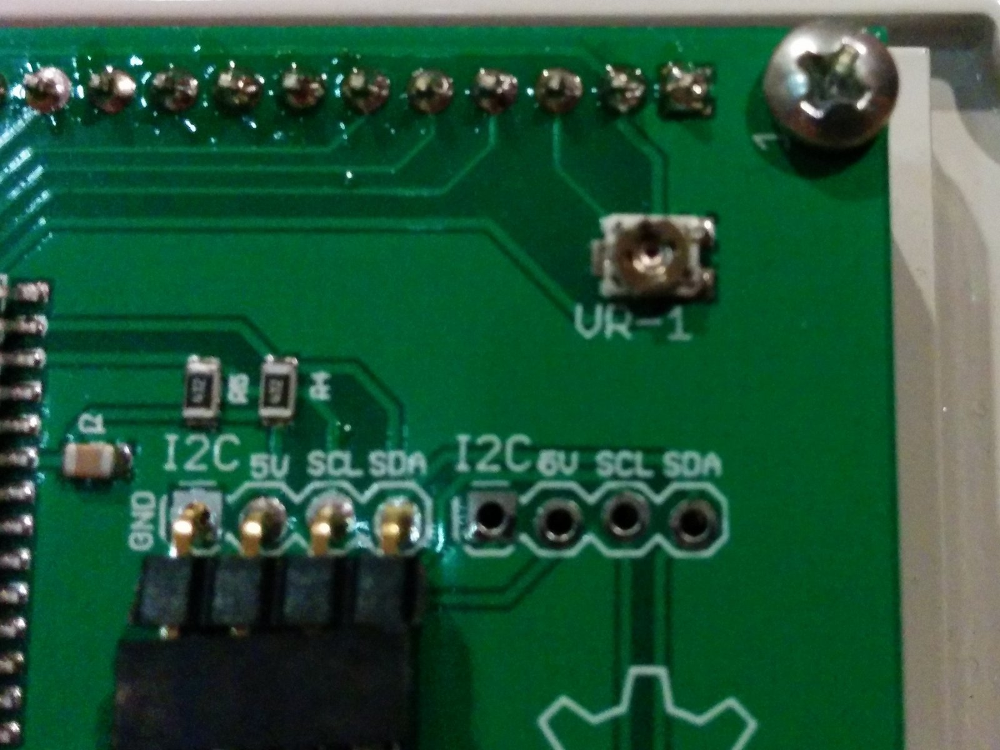</a>

- ⚠️ Power ON with programmer or USB serial if possible. If necessary power with AC using extreme caution.
- ⚫ If display text is dim or not present adjust LED contrast (VR-1) located on the right side of the Display Module.
- 📌 When adjusting, be gentle. Do not force past the stop in either direction. If forced past the stop, the part will no longer function.
- ⚫ Secure the enclosure lid. Tighten the screws slowly alternating across and top, middle and bottom.

---

## Step 13 – Menu Settings

  <a href="images/step-13-1.jpg">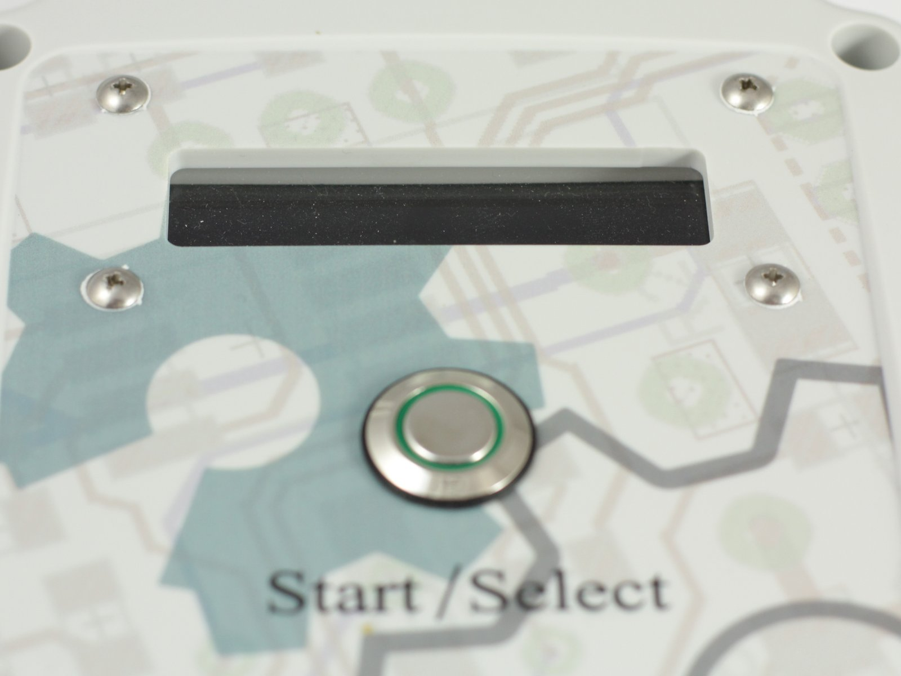</a>

- ⚫ To Enter the Menu Press and hold the button (long press). Press and release (short press) to scroll through Options.
- ⚫ Set "Service Level" to Level 2. Menu=> Setup => Service Level.
- ⚫ Set Current to desired Value (80% of your circuit breaker value). Menu => Setup => Max Current.
- ⚫ Enable GFCI Self Test. Menu => Setup => GFI Self Test

---

## Step 14 – Optional Upgrades

  <a href="images/step-14-1.jpg">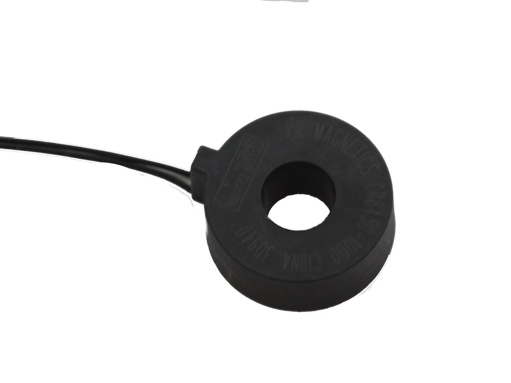</a>

- ℹ️ WiFi can be optionally added to Standard Kits. The WiFi Guide is here:
  - ⚫ [WiFi Guide](https://openevse.dozuki.com/Guide/OpenEVSE+WiFi+%28Beta%29/14)
  - ⚫ [WiFi Firmware and Documentation](https://github.com/OpenEVSE/ESP8266_WiFi_v2.x)
- ℹ️ Current Measurement features can be added to Standard kits.
  - ⚫ [Store - Current Measurement Transformer](https://store.openevse.com/products/current-measurement-transformer-kit)
  - ⚫ [See Advanced Guide - Step 7](../discontinued-may-2018-v4-advanced/README.md#step-7--mount-j1772-cable)

---
