# How to Build a GFCI coil with self test

| Difficulty | Steps | Time Required |
| --- | --- | --- |
| Easy | 5 | 00:10:00 – 00:15:00 |

_Written By: Christopher Howell (and one other contributor)_

## Tools

- Soldering Iron

## Parts

- Current Transformer

### Bullet key

Colored bullets match the colored markers drawn on the photos for each step.

| Marker | Meaning |
| --- | --- |
| ⚫ 🔴 🟠 🟡 🟢 🔵 🩵 🟣 | Instruction — matches the same-colored marker in the photo |
| ℹ️ | Note |
| ⚠️ | Caution |
| 📌 | Reminder / Tip |

## Contents

1. [Step 1](#step-1)
2. [Preparing 3 pin connector](#step-2--preparing-3-pin-connector)
3. [Wrap the self test wire](#step-3--wrap-the-self-test-wire)
4. [Solder the CT](#step-4--solder-the-ct)
5. [Test Connections/Connect to OpenEVSE](#step-5--test-connectionsconnect-to-openevse)

---

## Step 1

  <a href="images/step-01-1.jpg">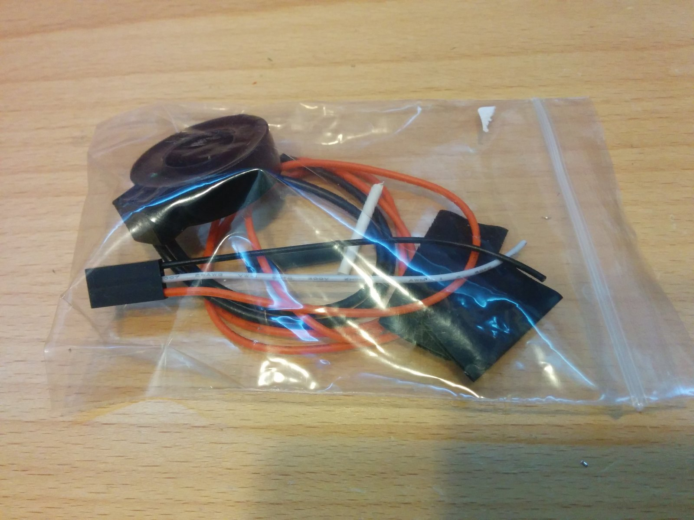</a>
  <a href="images/step-01-2.jpg">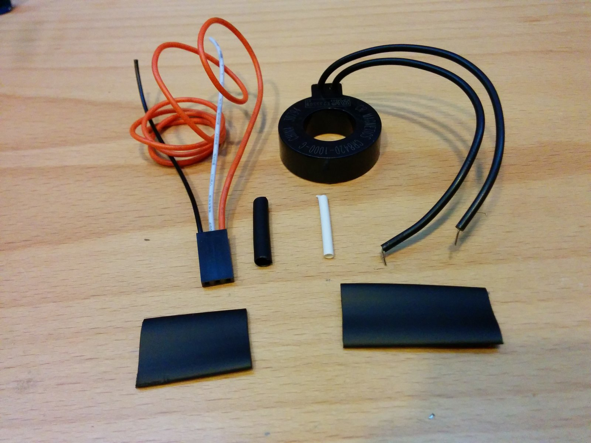</a>

- ⚫ Unpackage the GFCI coil and components.

---

## Step 2 – Preparing 3 pin connector

  <a href="images/step-02-1.jpg">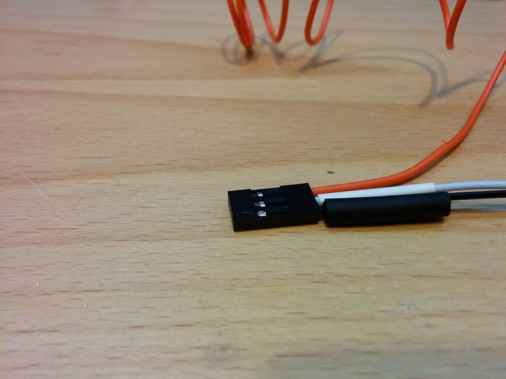</a>
  <a href="images/step-02-2.jpg">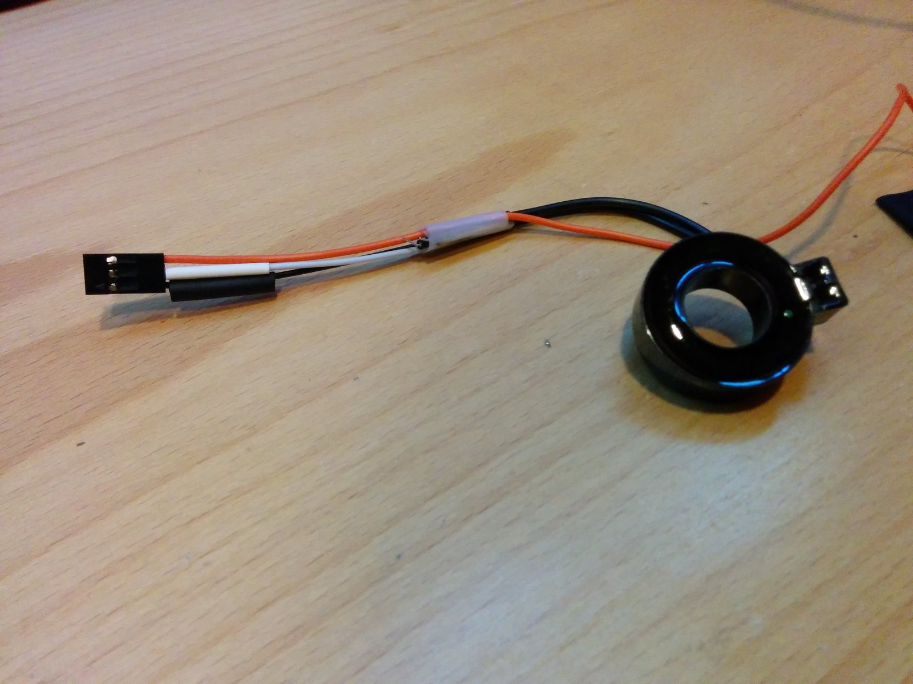</a>
  <a href="images/step-02-3.jpg">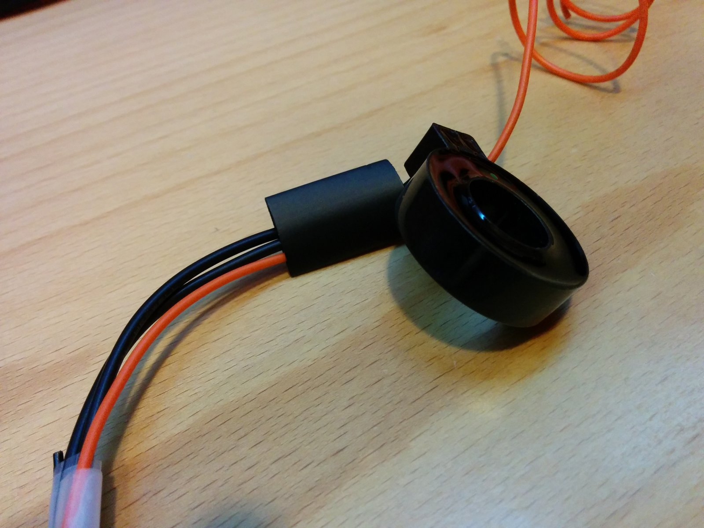</a>

- ⚫ Prepare 3 pin connector by sliding shrink wrap tubing onto the white and black wire.
- ⚫ Temporarily tape the GFCI coil wires to the connector wires overlapping by 3/4" to 1".
- ⚫ Place a large piece of shrink tubing at the end of the CT wires run the orange wire through.

---

## Step 3 – Wrap the self test wire

  <a href="images/step-03-1.jpg">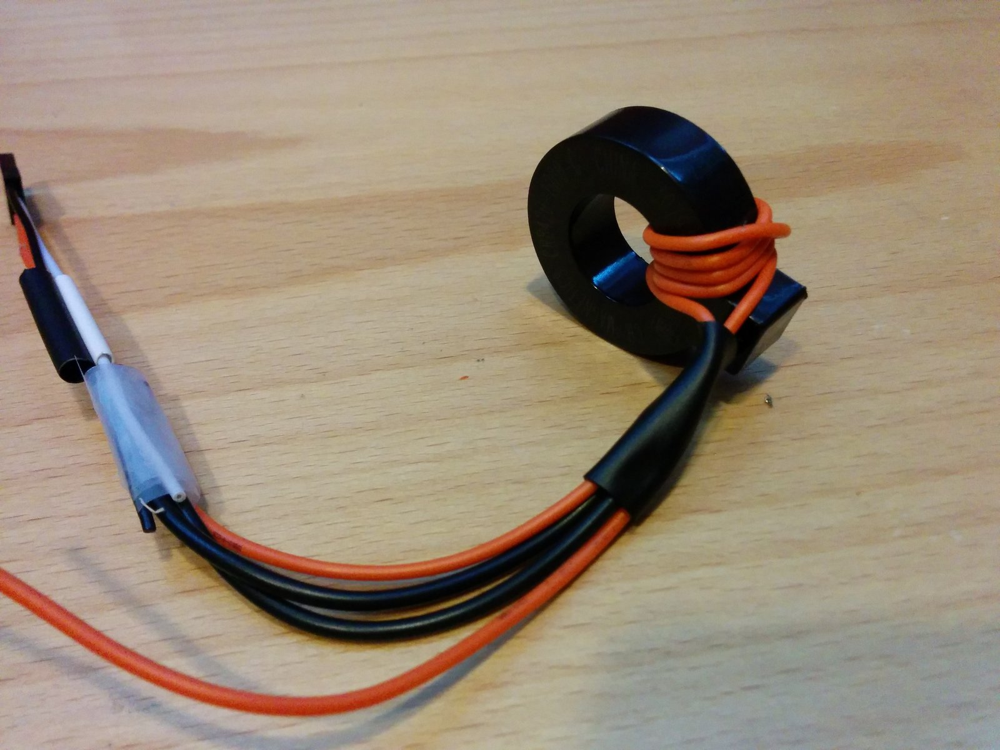</a>
  <a href="images/step-03-2.jpg">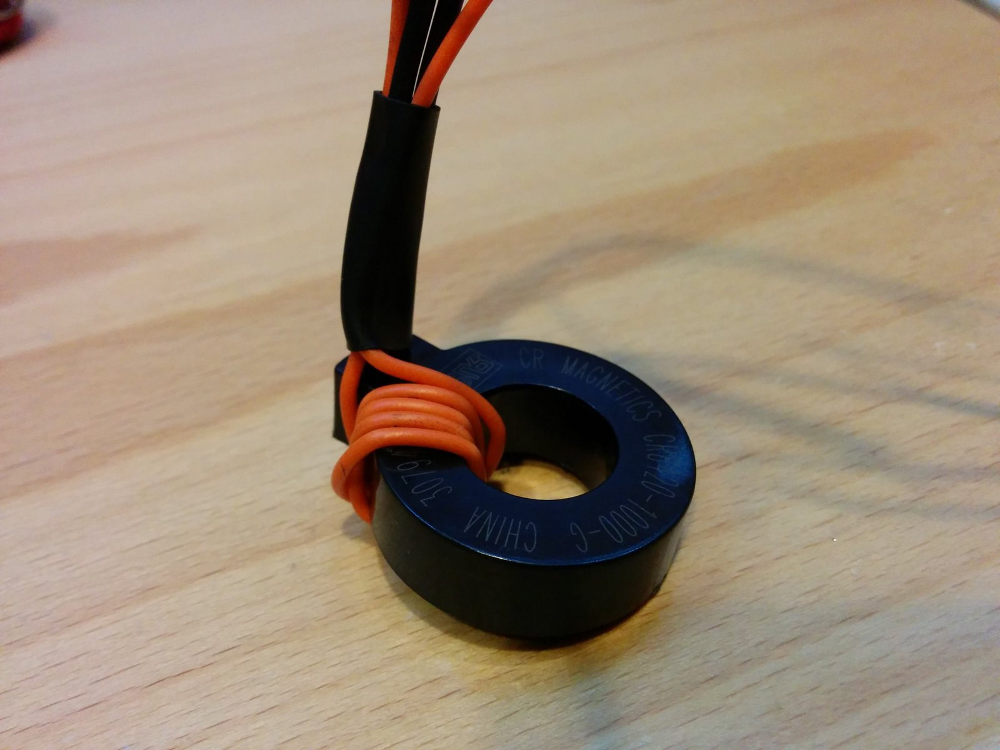</a>

- ⚫ Wrap the orange wire self test wire through the CT 5 times then back to the shrink tubing.
- ⚫ Shrink the tubing with a heat gun or very carefully with a lighter to ensure the wires stay in place.

---

## Step 4 – Solder the CT

  <a href="images/step-04-1.jpg">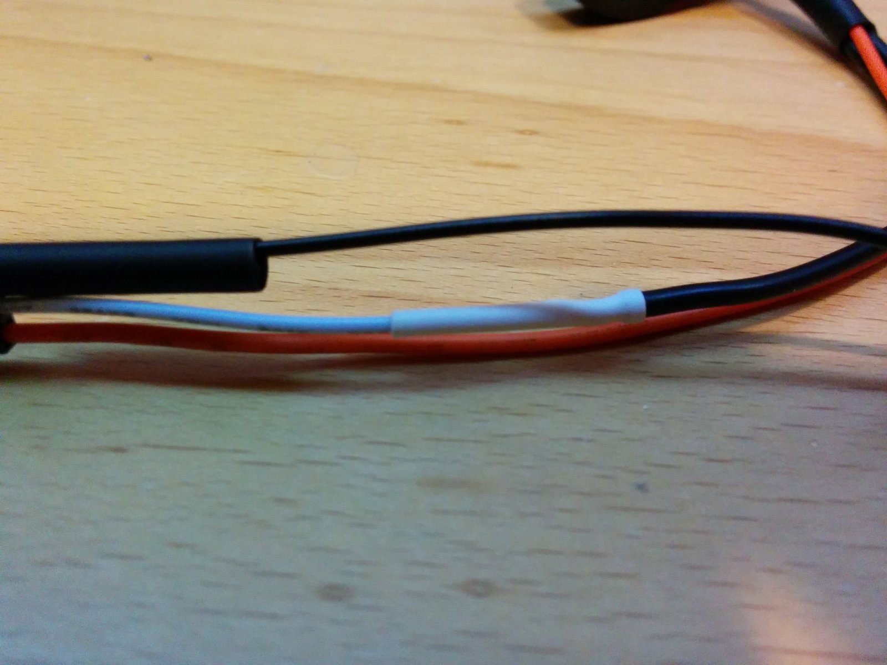</a>
  <a href="images/step-04-2.jpg">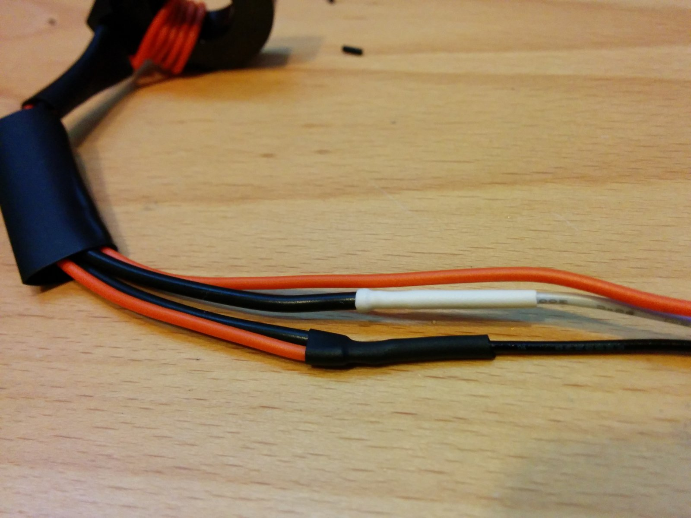</a>
  <a href="images/step-04-3.jpg">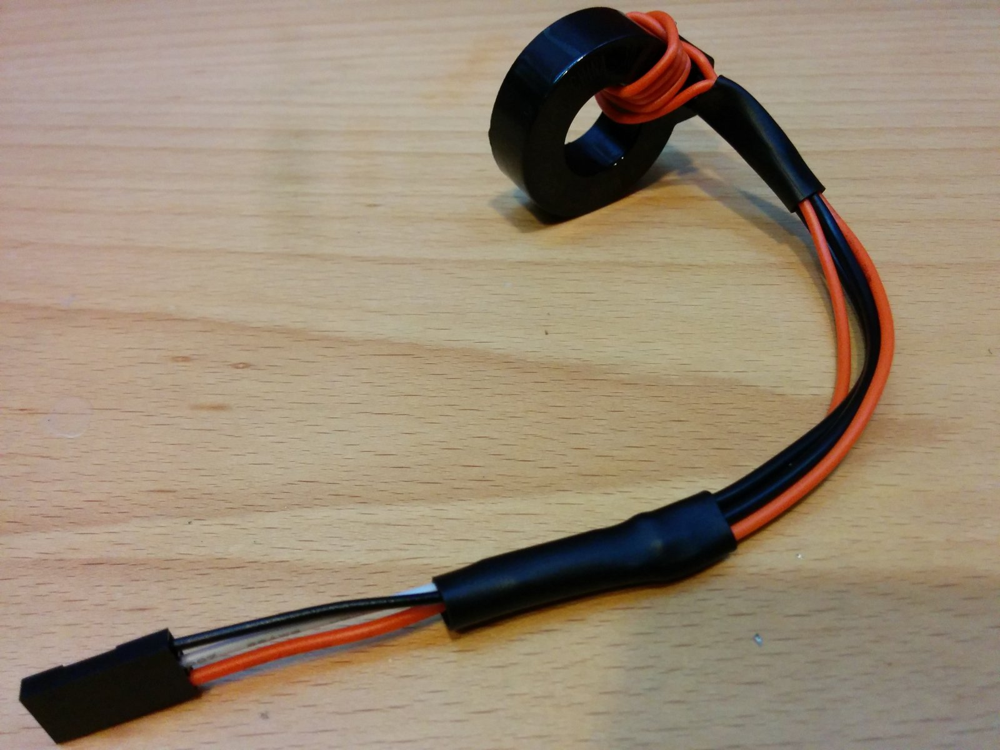</a>

- ⚫ Cut the white wire to length leaving one quarter inch overlap and solder to 1 CT wire. Shrink the tubing.
- ⚫ Cut the black wire to length leaving one quarter inch overlap and solder to both the orange wire and the other lead from the CT. Shrink the tubing.
- ⚫ Shrink a large piece of shrink tubing over the connections to finish your GFCI coil with self test.

---

## Step 5 – Test Connections/Connect to OpenEVSE

  <a href="images/step-05-1.jpg">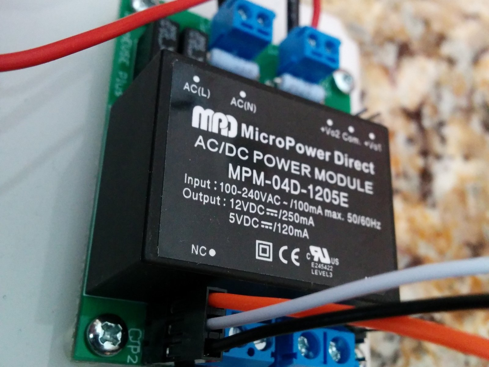</a>

- ⚫ Test connections with a multimeter set to measure resistance. Orange to Black should measure 0 ohms. White to Black should read 42 to 50 ohms.
- ⚫ Connect to OpenEVSE board. Ground (Black wire) should be closest to the board edge.

---
