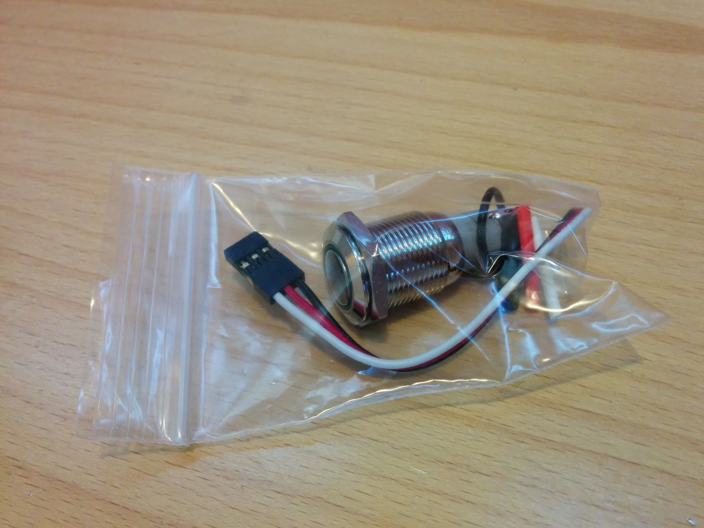
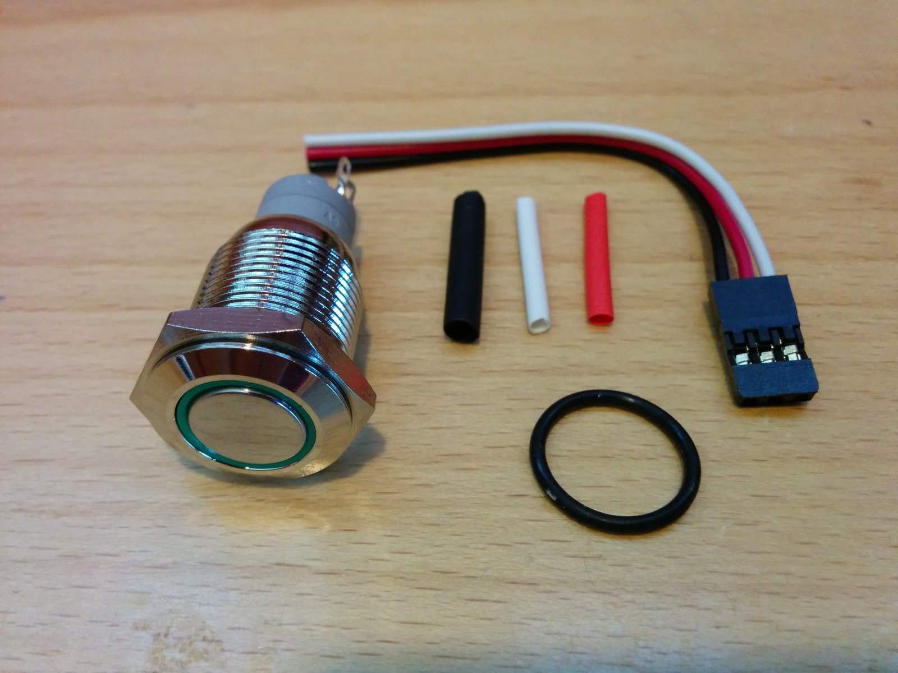
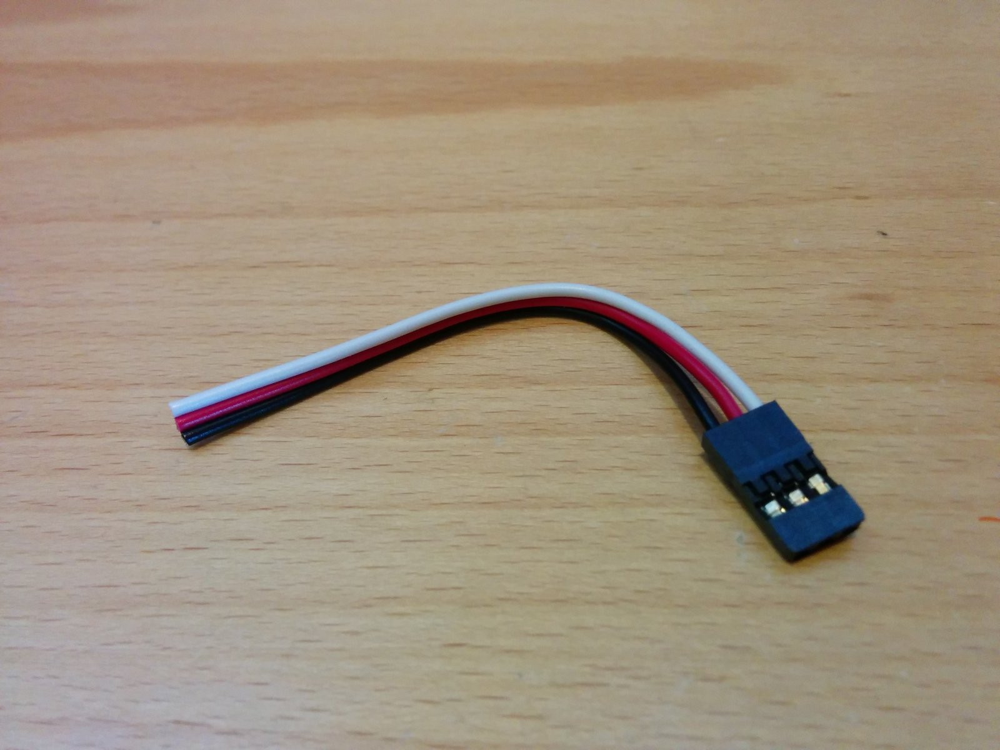
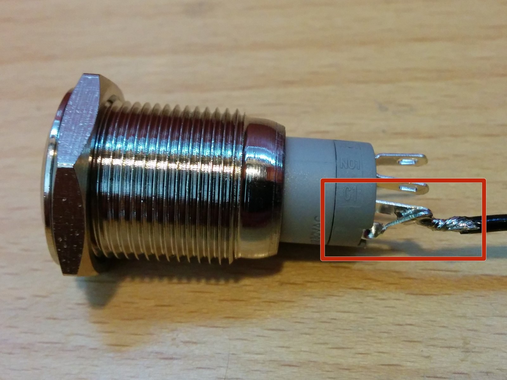
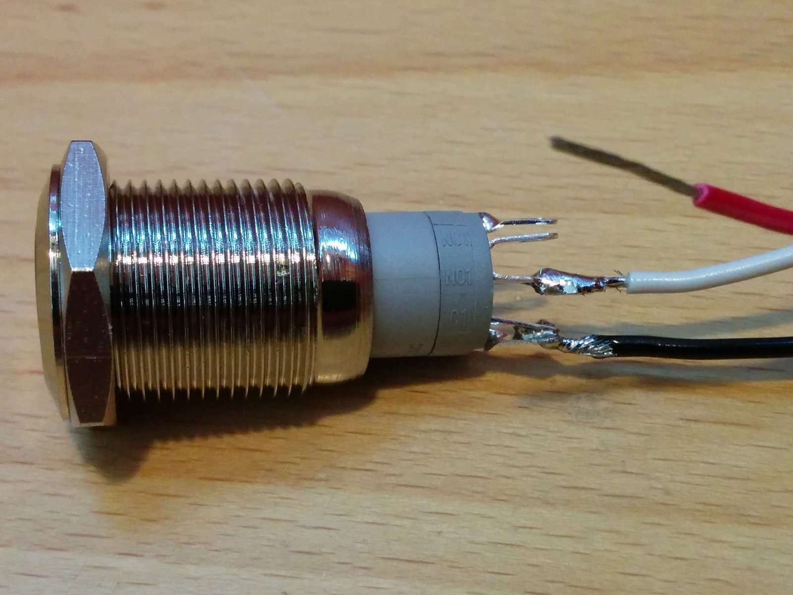
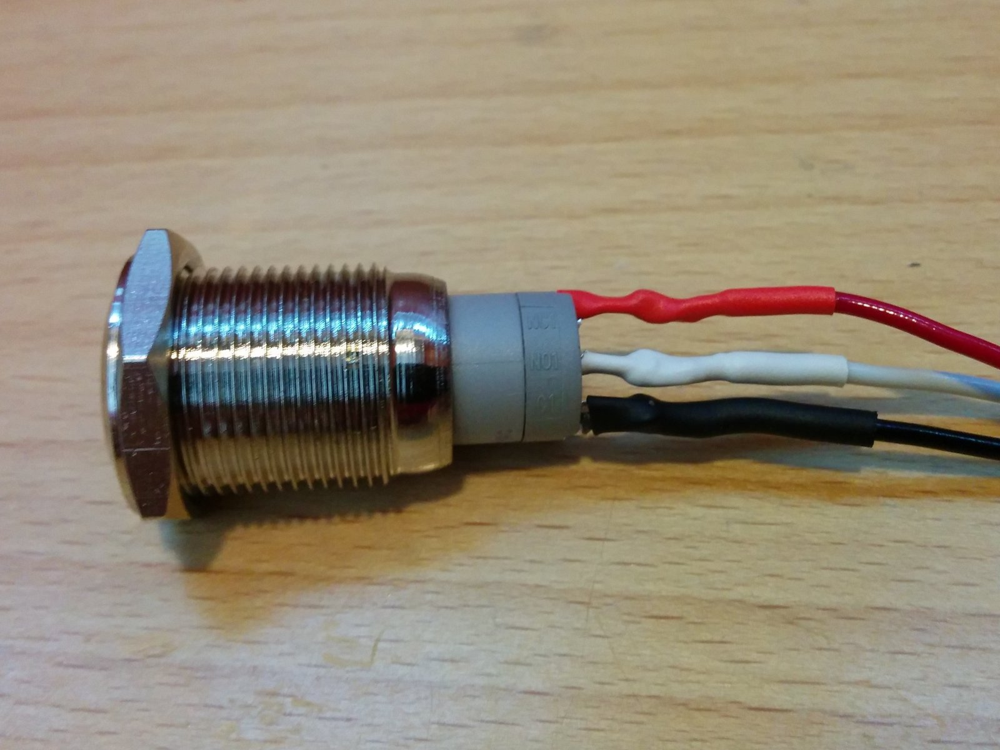

# How to Build a lit push-button

| Difficulty | Steps | Time Required |
| --- | --- | --- |
| Easy | 3 | 00:10:00 – 00:15:00 |

_Written By: Christopher Howell_

## Tools

- Soldering Iron

## Parts

- Lit Push Button

### Bullet key

Colored bullets match the colored markers drawn on the photos for each step.

| Marker | Meaning |
| --- | --- |
| ⚫ 🔴 🟠 🟡 🟢 🔵 🩵 🟣 | Instruction — matches the same-colored marker in the photo |
| ℹ️ | Note |
| ⚠️ | Caution |
| 📌 | Reminder / Tip |

## Contents

1. [Step 1](#step-1)
2. [Connector preperarion](#step-2--connector-preperarion)
3. [Solder Button](#step-3--solder-button)

---

## Step 1

  
  

- ⚫ Remove button components from packaging

---

## Step 2 – Connector preperarion

  

- ⚫ Strip one-half inch of each other three wires on the connector cable
- ⚫ Separate insulation on wires and place heat shrink tubing over the corresponding color.

---

## Step 3 – Solder Button

  
  
  

- ⚠️ Solder the ground wire to **BOTH** the negative "-" terminal and the neighboring terminal labeled "C1".
- ⚫ Solder the white wire to the middle terminal labeled in "NO1".
- ⚫ Solder the red wire to the positive terminal at the end of the row labeled "+" and shrink the tubing over the connections on all three wires.
- ℹ️ The unused terminal labled "NC1" on the button may be clipped off if desired.

---
