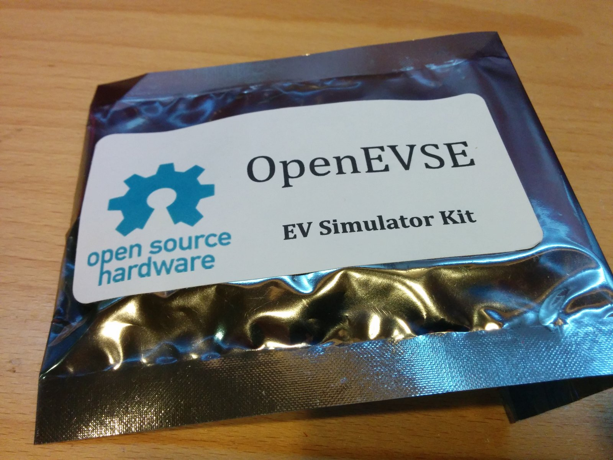
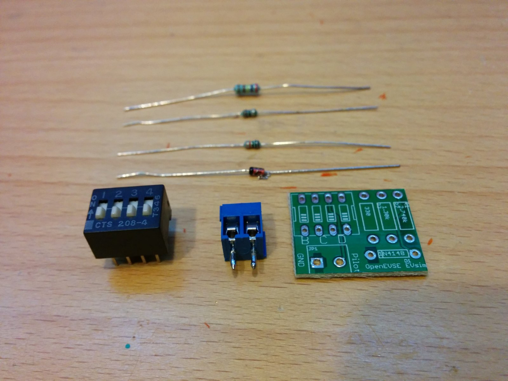
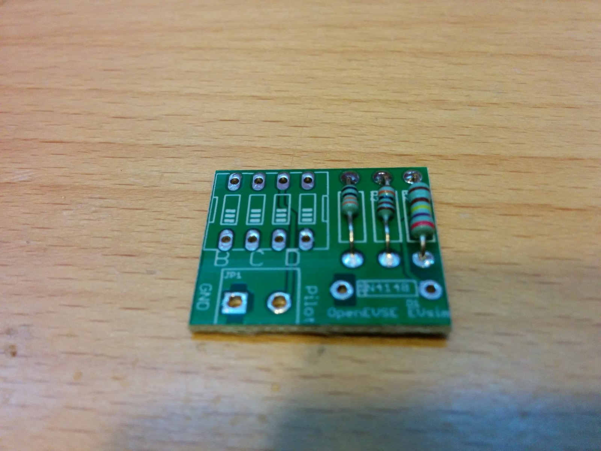
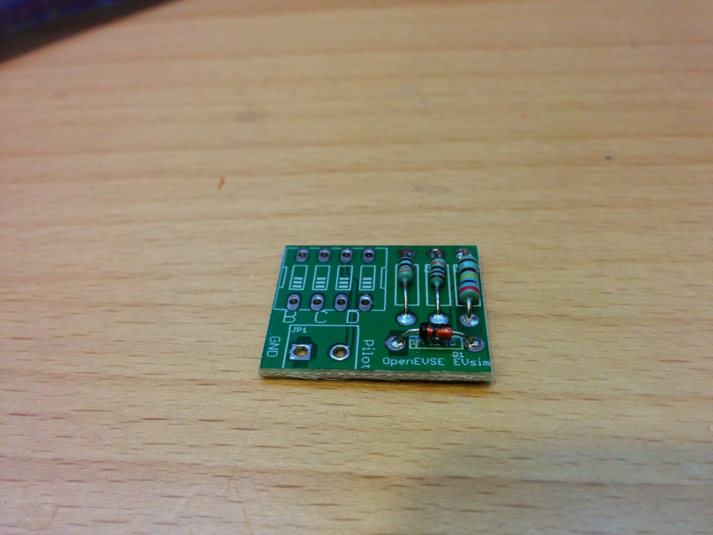
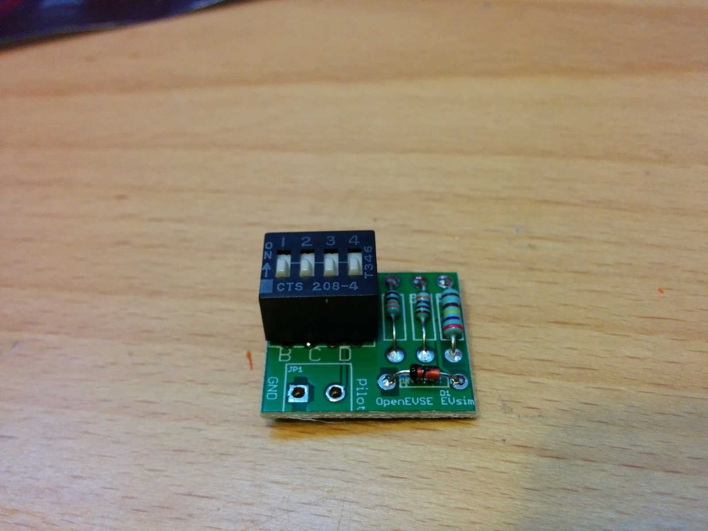
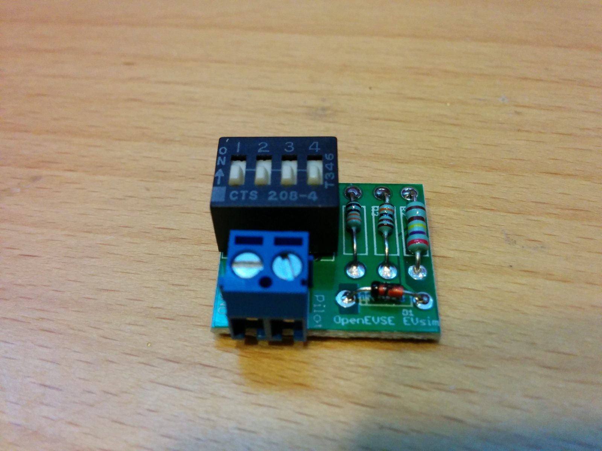

# How to Build OpenEVSE EV Simulator v2

| Difficulty | Steps | Time Required |
| --- | --- | --- |
| Easy | 3 | 00:05:00 – 00:10:00 |

_Written By: Christopher Howell_

## Parts

- OpenEVSE EV Sim v2

### Bullet key

Colored bullets match the colored markers drawn on the photos for each step.

| Marker | Meaning |
| --- | --- |
| ⚫ 🔴 🟠 🟡 🟢 🔵 🩵 🟣 | Instruction — matches the same-colored marker in the photo |
| ℹ️ | Note |
| ⚠️ | Caution |
| 📌 | Reminder / Tip |

## Contents

1. [Step 1](#step-1)
2. [Solder Resistors and Diode](#step-2--solder-resistors-and-diode)
3. [More Soldering](#step-3--more-soldering)

---

## Step 1

  
  

- ⚫ Remove the EV simulator components from packaging

---

## Step 2 – Solder Resistors and Diode

  
  

- ⚫ Solder resistors in place matching the values with a silk screen using a multimeter. Trim excess leads.
- ⚫ Solder the diode in place matching the stripe on the diode with a stripe on the silk screen. Trim excess leads.

---

## Step 3 – More Soldering

  
  

- ⚫ Solder the 4 positions switch with the numbers at the top.
- ⚫ Solder the screw terminal to the board with the openings for the wire facing out.

---
