# How to build OpenEVSE LCD kits

| Difficulty | Steps | Time Required |
| --- | --- | --- |
| Easy | 6 | 00:15:00 – 00:20:00 |

_Written By: Christopher Howell (and one other contributor)_

## Tools

- Soldering Iron

## Parts

- OpenEVSE LCD

### Bullet key

Colored bullets match the colored markers drawn on the photos for each step.

| Marker | Meaning |
| --- | --- |
| ⚫ 🔴 🟠 🟡 🟢 🔵 🩵 🟣 | Instruction — matches the same-colored marker in the photo |
| ℹ️ | Note |
| ⚠️ | Caution |
| 📌 | Reminder / Tip |

## Contents

1. [Step 1](#step-1)
2. [Header Pins](#step-2--header-pins)
3. [LCD board to board pins](#step-3--lcd-board-to-board-pins)
4. [Solder LCD to logic board](#step-4--solder-lcd-to-logic-board)
5. [Connect cable and adjust contrast](#step-5--connect-cable-and-adjust-contrast)
6. [Connect to OpenEVSE](#step-6--connect-to-openevse)

---

## Step 1

  <a href="images/step-01-1.jpg">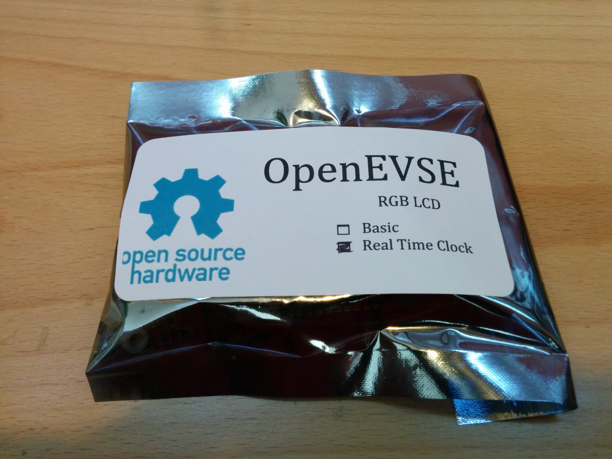</a>
  <a href="images/step-01-2.jpg">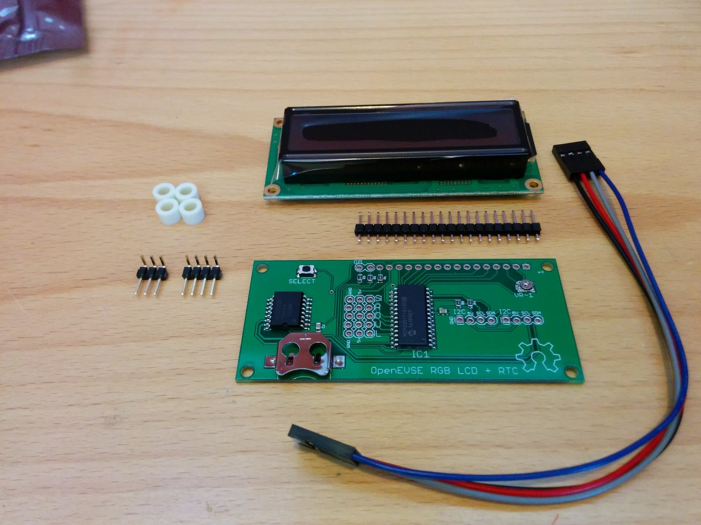</a>

- ⚫ Carefully remove all the components from the anti-static bag.

---

## Step 2 – Header Pins

  <a href="images/step-02-1.jpg">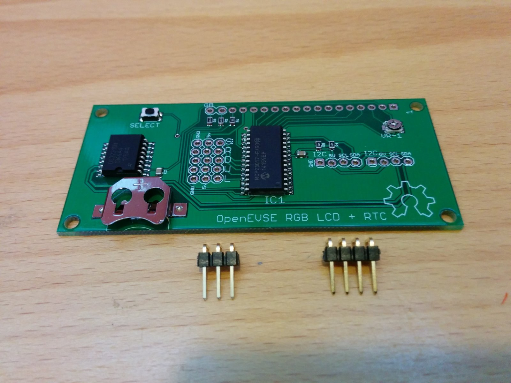</a>
  <a href="images/step-02-2.jpg">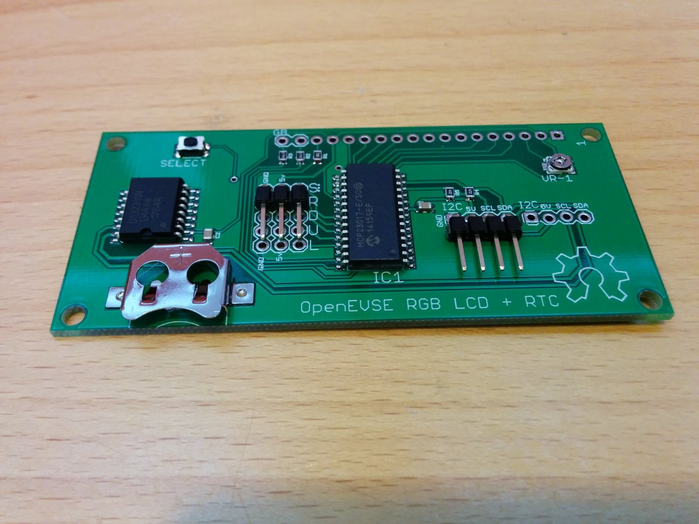</a>
  <a href="images/step-02-3.jpg">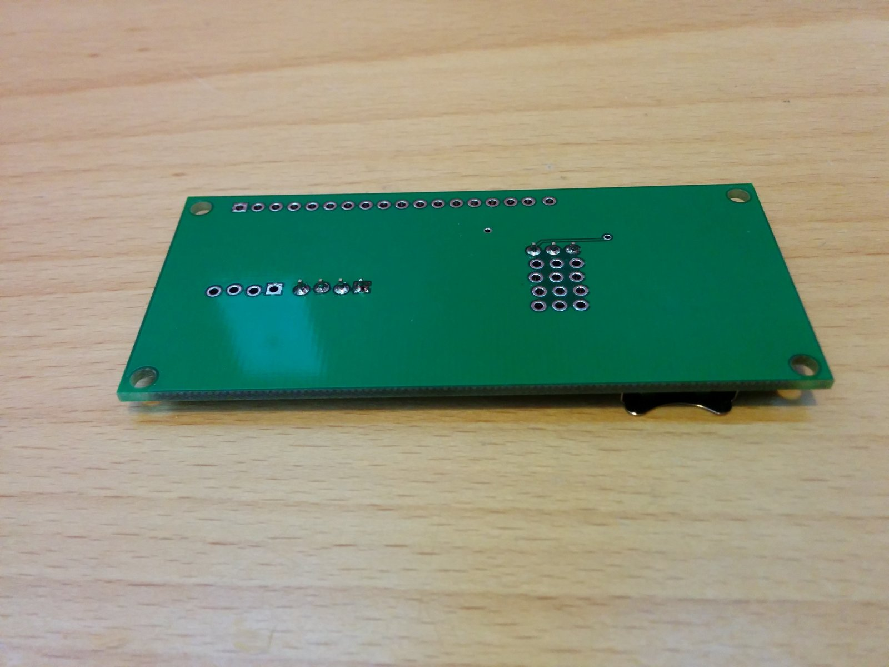</a>

- ⚫ Solder the 3&4 pin right angle headers to the OpenEVSE LCD logic board.

---

## Step 3 – LCD board to board pins

  <a href="images/step-03-1.jpg">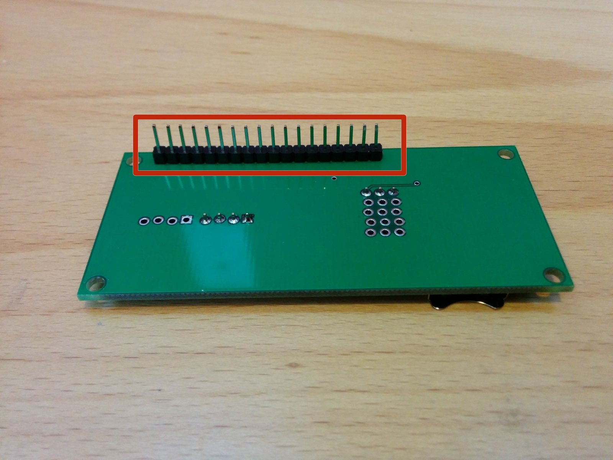</a>
  <a href="images/step-03-2.jpg">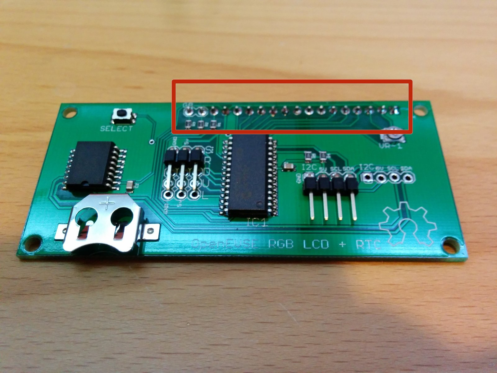</a>

- ⚠️ Solder the 16 (Mono LCD) or 18 (RGB LCD) pin header on the bottom of OpenEVSE logic board (solder from the top - pins on bottom) See picture 1 and 2.
- ℹ️ Do not install header pins in the G & B holes if you are building a Mono LCD.

---

## Step 4 – Solder LCD to logic board

  <a href="images/step-04-1.jpg">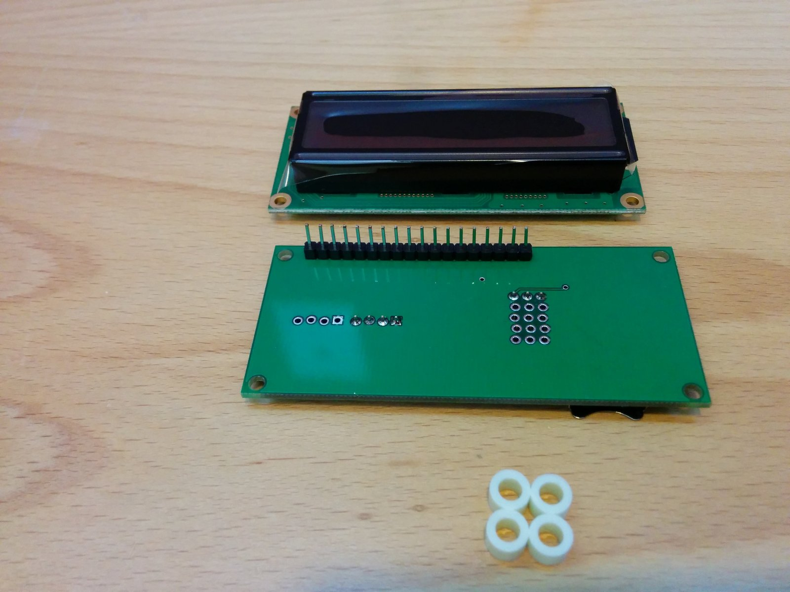</a>
  <a href="images/step-04-2.jpg">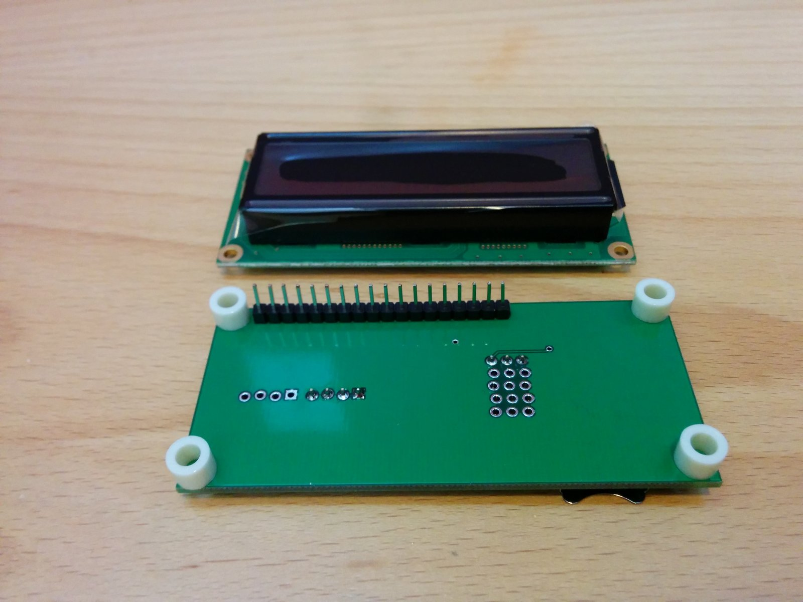</a>
  <a href="images/step-04-3.jpg">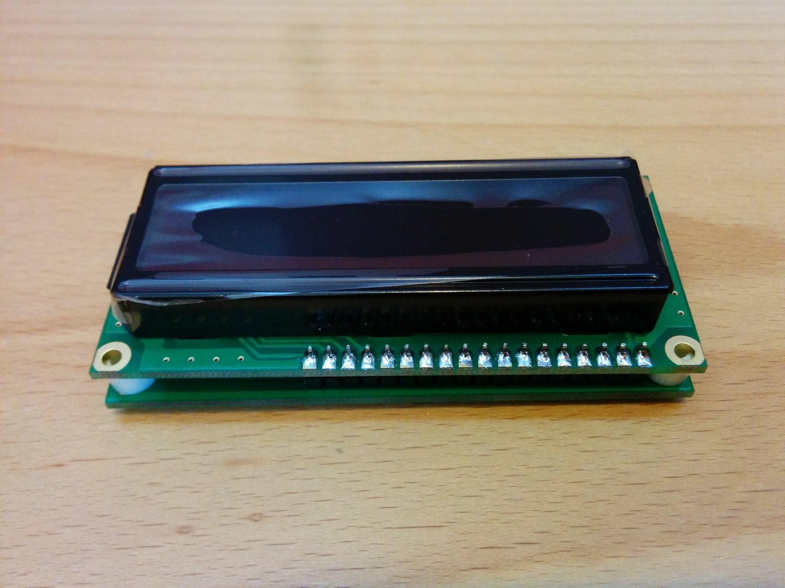</a>

- ⚫ Place nylon spacers on each corner of the logic board.
- ⚫ Position LCD module on top of the spacers and solder in place.

---

## Step 5 – Connect cable and adjust contrast

  <a href="images/step-05-1.jpg">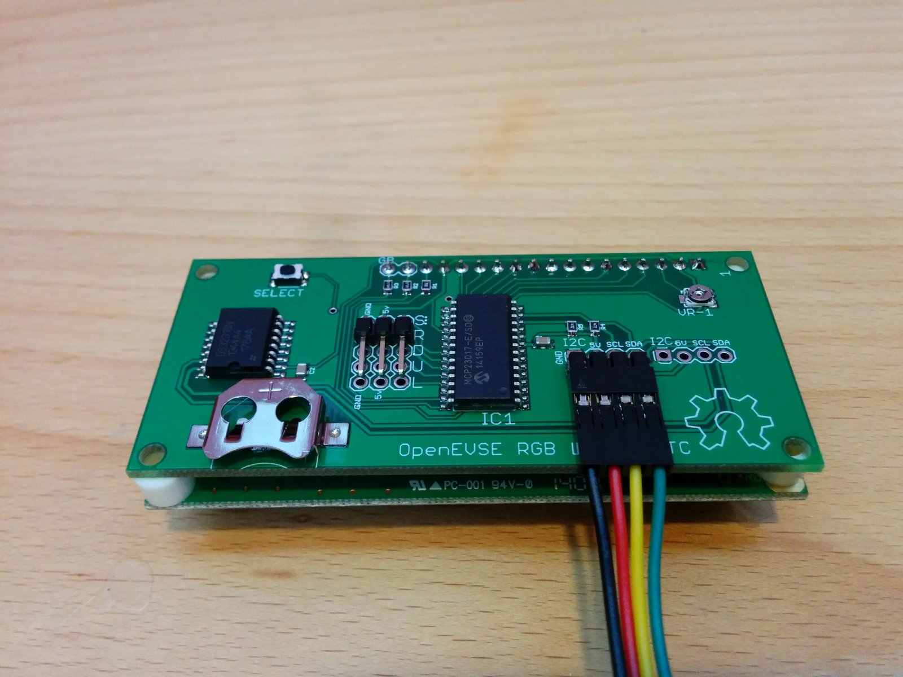</a>
  <a href="images/step-05-2.jpg">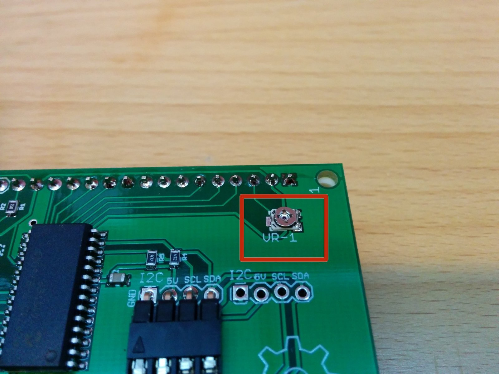</a>
  <a href="images/step-05-3.jpg">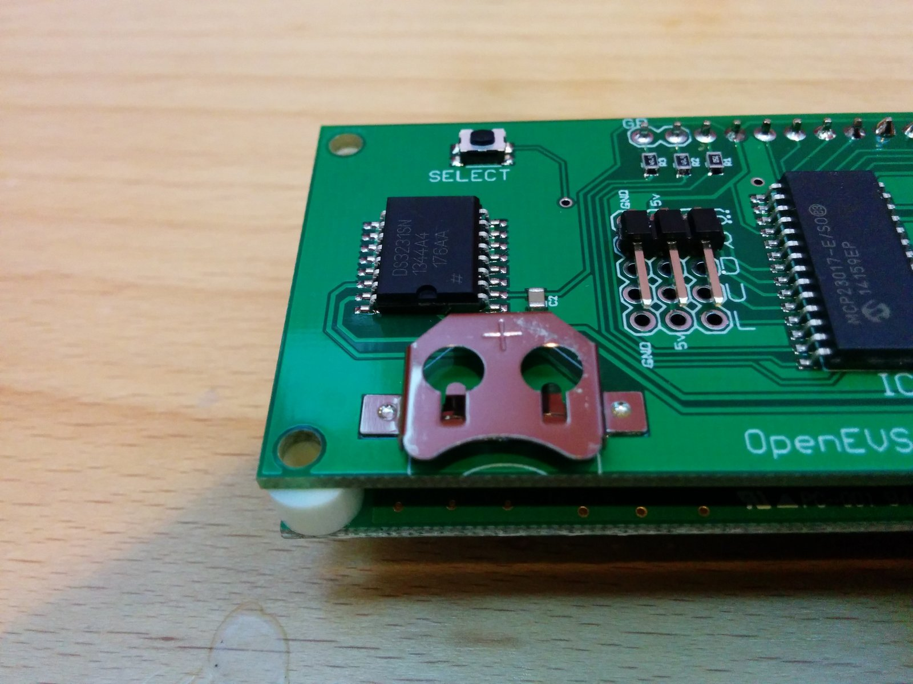</a>

- ⚫ Connect 4 pin cable to the logic board with ground on the left side. Cable colors may vary.
- ⚠️ Adjust contrast with VR-1 pot.
- ℹ️ Optional - Insert a CR1216 or CR1220 coin cell battery if you wish to keep current time after power failure with the Real Time Clock option.

---

## Step 6 – Connect to OpenEVSE

  <a href="images/step-06-1.jpg">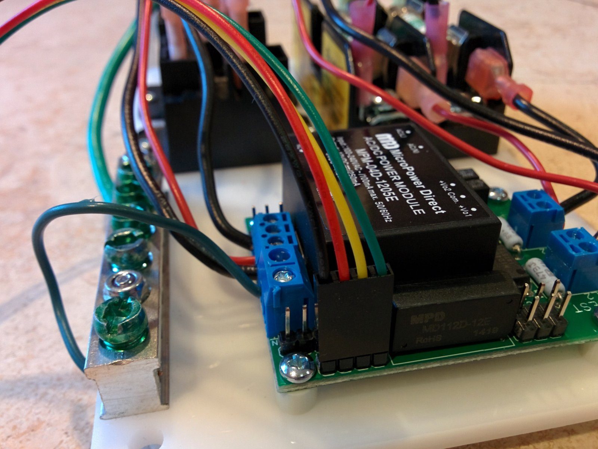</a>

- ⚫ Connect 4 pin LCD cable to the OpenEVSE board.
- ℹ️ Ground pin is closest to board edge.

---
