# How to Build OpenEVSE Plus

| Difficulty | Steps | Time Required |
| --- | --- | --- |
| Easy | 5 | 00:10:00 – 00:15:00 |

_Written By: Christopher Howell (and 2 other contributors)_

## Tools

- Soldering Iron

## Parts

- OpenEVSE Plus
- Solder

### Bullet key

Colored bullets match the colored markers drawn on the photos for each step.

| Marker | Meaning |
| --- | --- |
| ⚫ 🔴 🟠 🟡 🟢 🔵 🩵 🟣 | Instruction — matches the same-colored marker in the photo |
| ℹ️ | Note |
| ⚠️ | Caution |
| 📌 | Reminder / Tip |

## Contents

1. [Step 1](#step-1)
2. [Solder header pins](#step-2--solder-header-pins)
3. [Solder DC/DC converter module](#step-3--solder-dcdc-converter-module)
4. [Power Supply](#step-4--power-supply)
5. [Connection Diagrams](#step-5--connection-diagrams)

---

## Step 1

  <a href="images/step-01-1.jpg">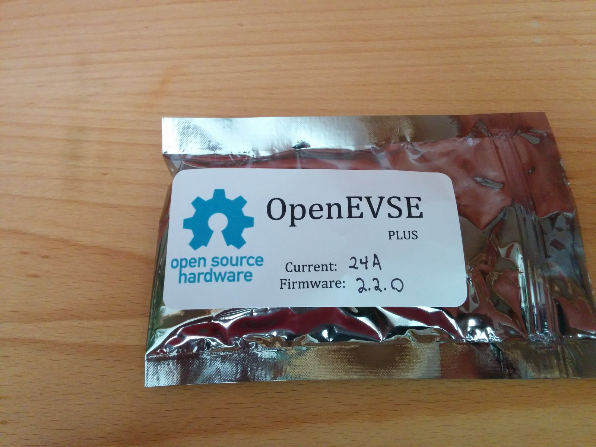</a>
  <a href="images/step-01-2.jpg">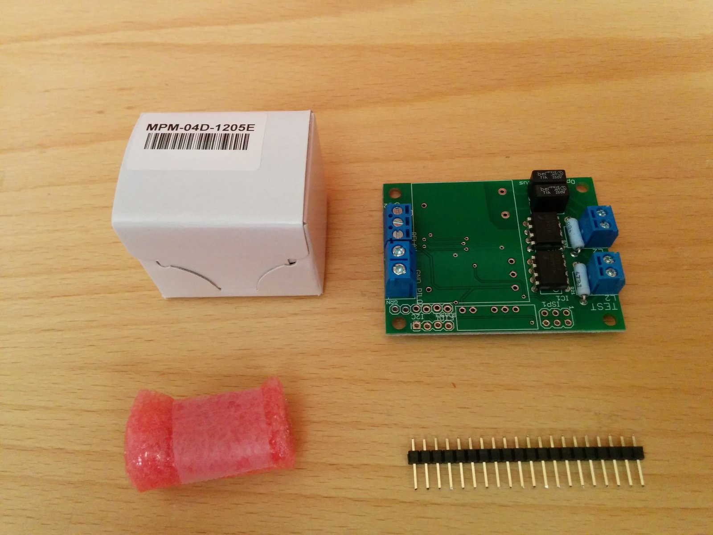</a>

- ⚫ Carefully remove components from antistatic bag.

---

## Step 2 – Solder header pins

  <a href="images/step-02-1.jpg">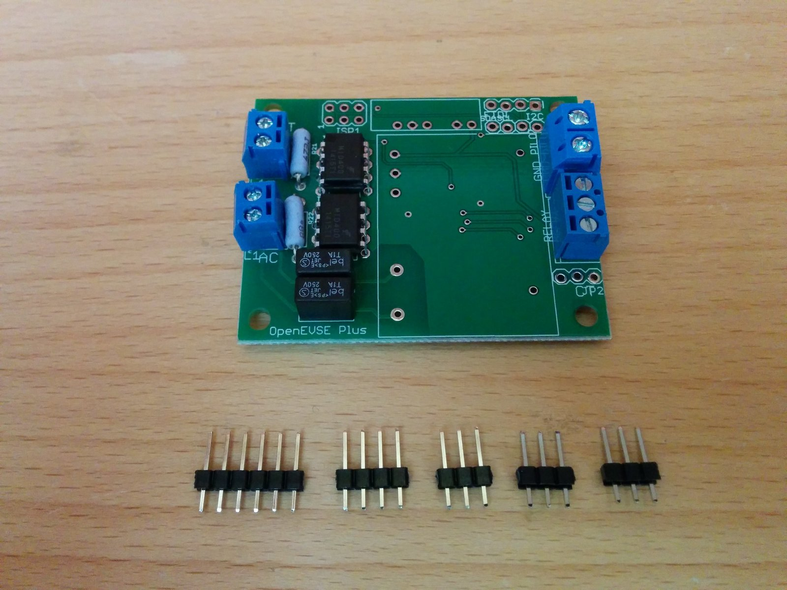</a>
  <a href="images/step-02-2.jpg">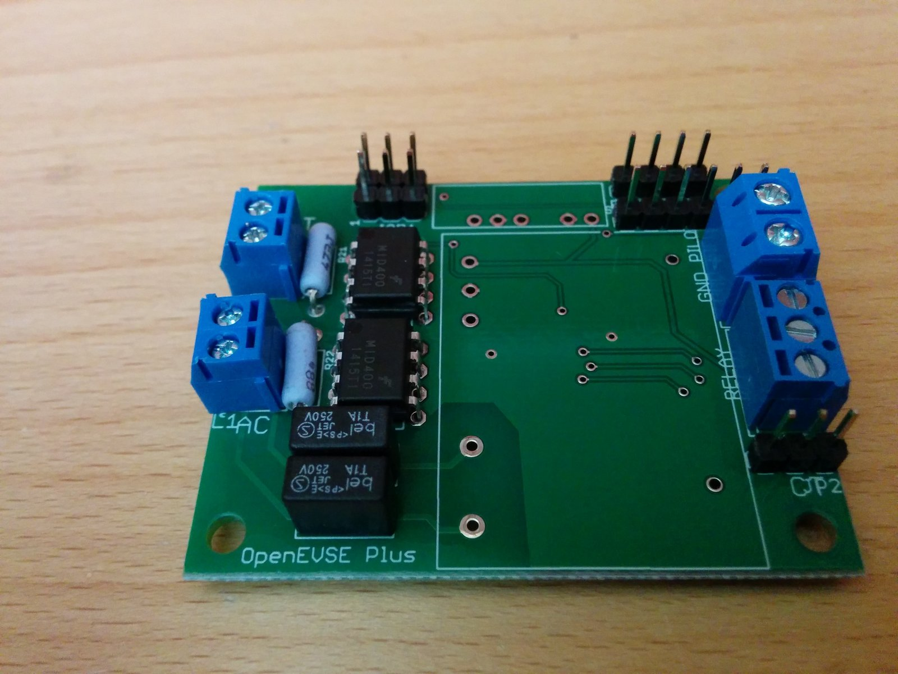</a>
  <a href="images/step-02-3.jpg">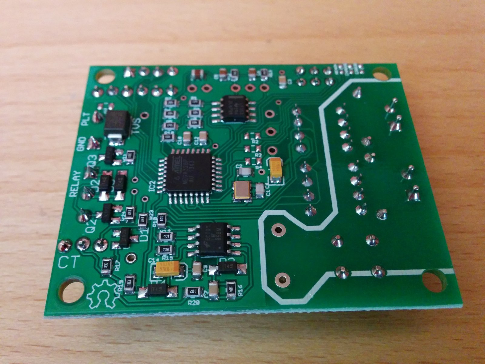</a>

- ⚫ Break header pins to match the holes and solder into place.
- ⚠️ Take care not to touch other components in the area with your soldering iron.
- ⚫ Optional - If you are measuring current with the [CR Magnetics 8450-1000](http://store.openevse.com/products/current-measurement-transformer-kit), you will need an additional 2-pin header for the "A_CT" connection.

---

## Step 3 – Solder DC/DC converter module

  <a href="images/step-03-1.jpg">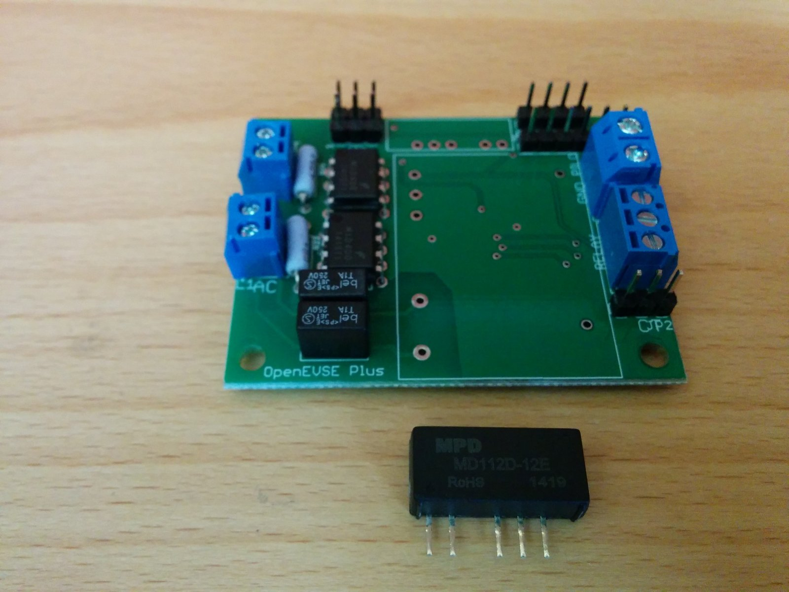</a>
  <a href="images/step-03-2.jpg">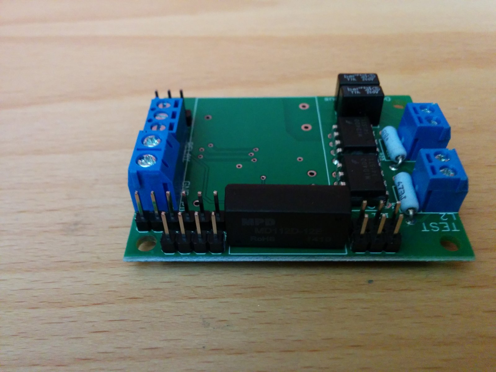</a>
  <a href="images/step-03-3.jpg">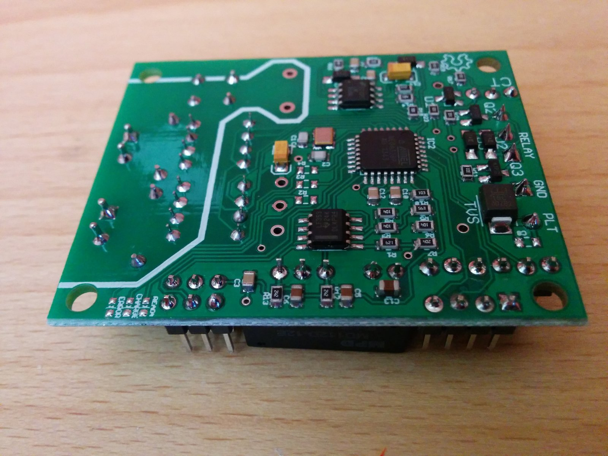</a>

- ⚫ Solder the DC to DC converter to the OpenEVSE board.
- ⚠️ Take care not to touch other components with your soldering iron.
- ⚫ Trim the excess leads off the DC to DC converter.

---

## Step 4 – Power Supply

  <a href="images/step-04-1.jpg">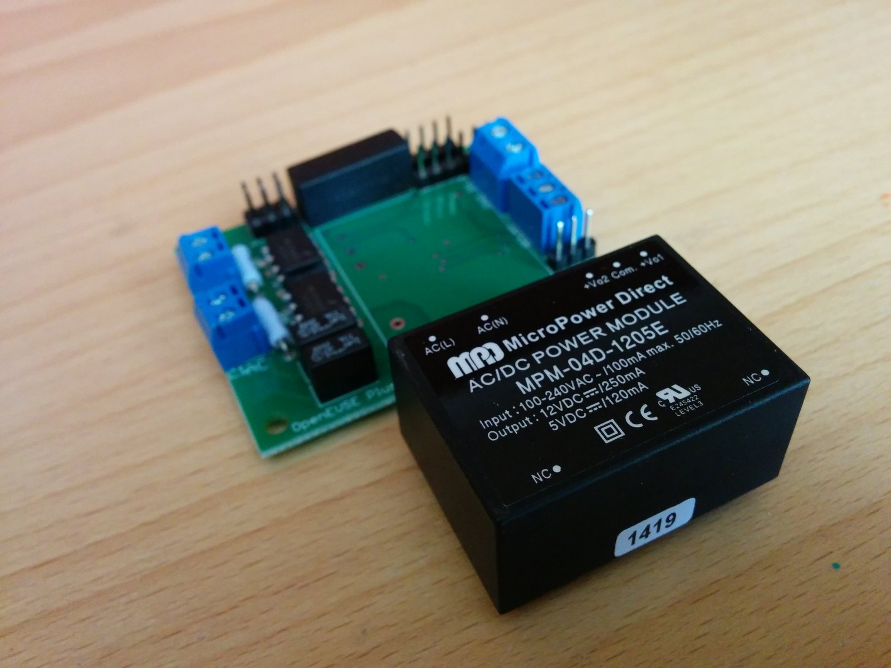</a>
  <a href="images/step-04-2.jpg">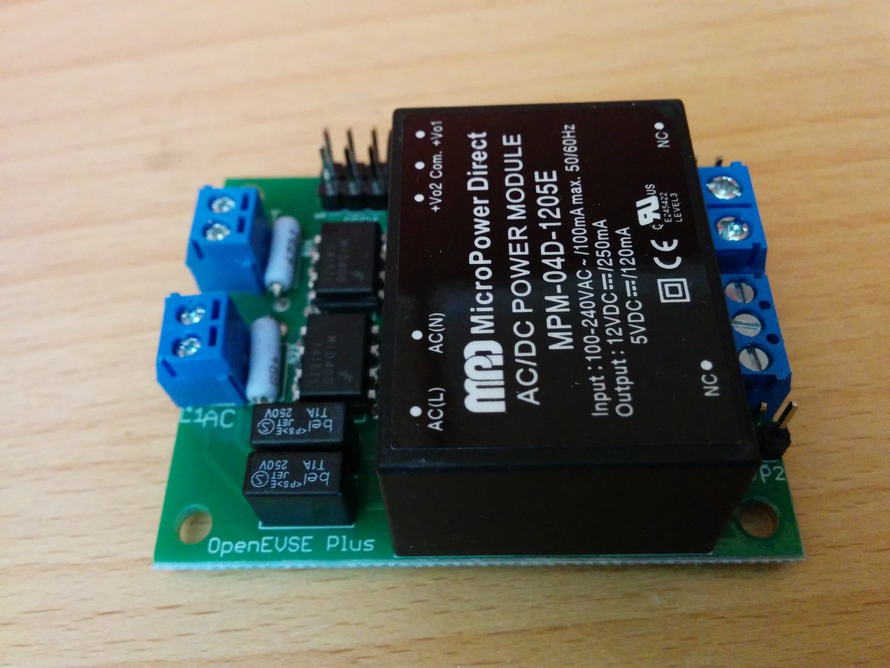</a>
  <a href="images/step-04-3.jpg">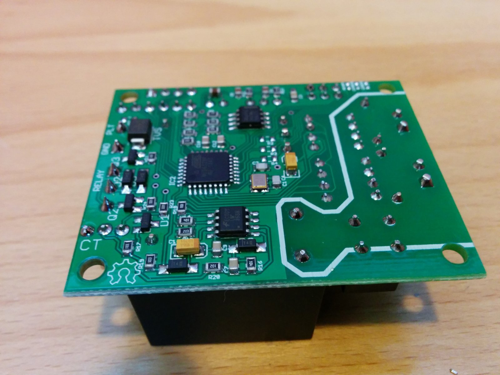</a>

- ⚫ Solder the AC to DC converter to the OpenEVSE board.
- ⚠️ Take care not to touch other components while you solder the power supply leads.
- ⚫ Trim any excessively long leads from the bottom of the board.

---

## Step 5 – Connection Diagrams

  <a href="images/step-05-1.jpg">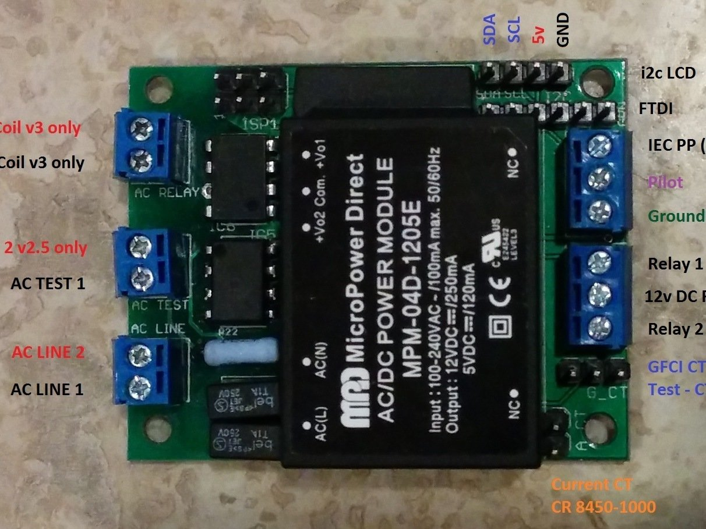</a>

- ⚫ Connection Diagram Plus v2.5 and v3 - [JPG](http://files.openevse.com/OpenEVSE_V2_5_v3.jpg)

---
