# How to build SAE J1772 cable assembly

| Difficulty | Steps | Time Required |
| --- | --- | --- |
| Moderate | 13 | 00:40:00 |

_Written By: Christopher Howell_

## Parts

- OpenEVSE J1772
- OpenEVSE Bulk Cable (25)

### Bullet key

Colored bullets match the colored markers drawn on the photos for each step.

| Marker | Meaning |
| --- | --- |
| ⚫ 🔴 🟠 🟡 🟢 🔵 🩵 🟣 | Instruction — matches the same-colored marker in the photo |
| ℹ️ | Note |
| ⚠️ | Caution |
| 📌 | Reminder / Tip |

## Contents

1. [SAE J1772 Cable Assembly](#step-1--sae-j1772-cable-assembly)
2. [Prepare Cable](#step-2--prepare-cable)
3. [Prerequisites](#step-3--prerequisites)
4. [Proximity](#step-4--proximity)
5. [Crimp Ground pin](#step-5--crimp-ground-pin)
6. [Crimp Power Pins](#step-6--crimp-power-pins)
7. [Crimp Signal Pins](#step-7--crimp-signal-pins)
8. [Assemble housing](#step-8--assemble-housing)
9. [Push Button](#step-9--push-button)
10. [Prepare assembly for closeout](#step-10--prepare-assembly-for-closeout)
11. [Bottom Shell](#step-11--bottom-shell)
12. [Closeout](#step-12--closeout)
13. [Finish cable end](#step-13--finish-cable-end)

---

## Step 1 – SAE J1772 Cable Assembly

  <a href="images/step-01-1.jpg">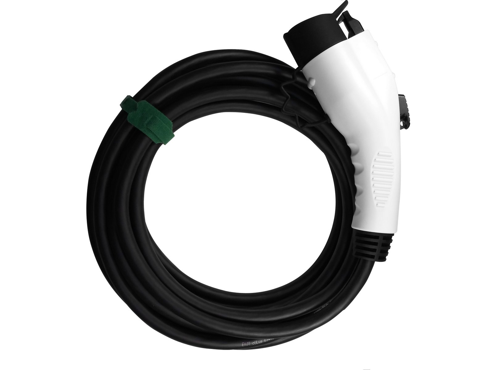</a>
  <a href="images/step-01-2.jpg">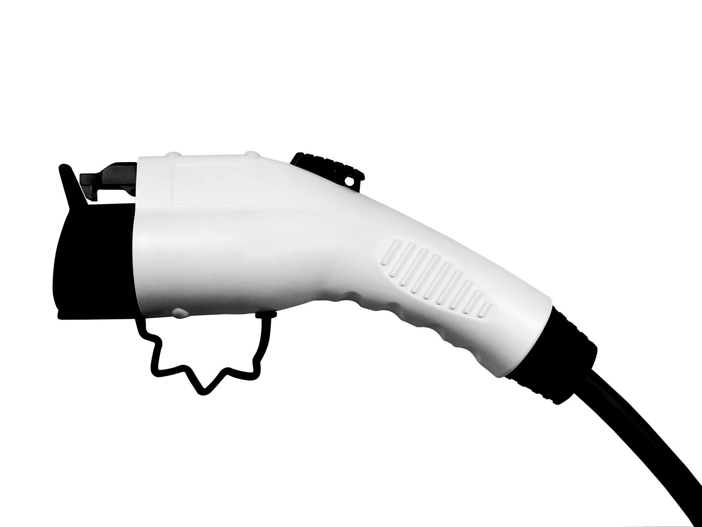</a>
  <a href="images/step-01-3.jpg">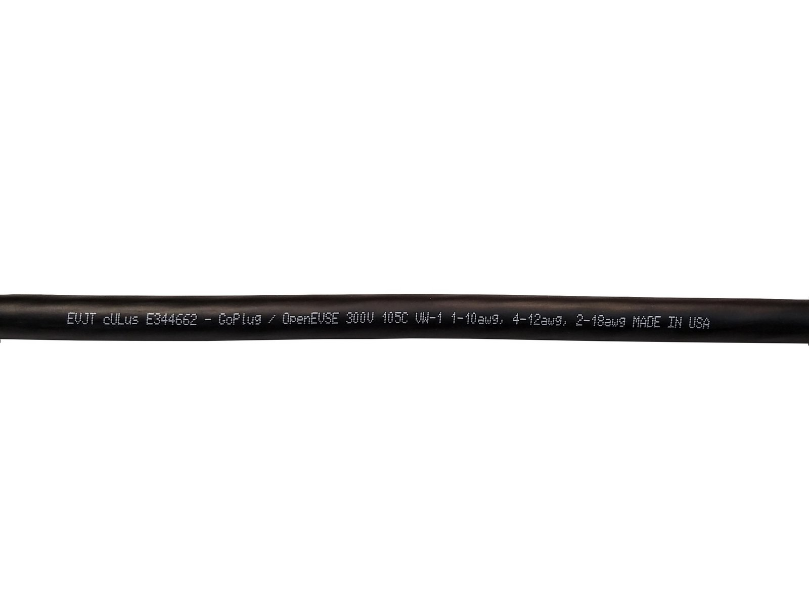</a>

- ⚫ This guide provides the assembly procedure for SAE J1772 cable from parts available from at OpenEVSE.

---

## Step 2 – Prepare Cable

  
  <a href="images/step-02-2.jpg">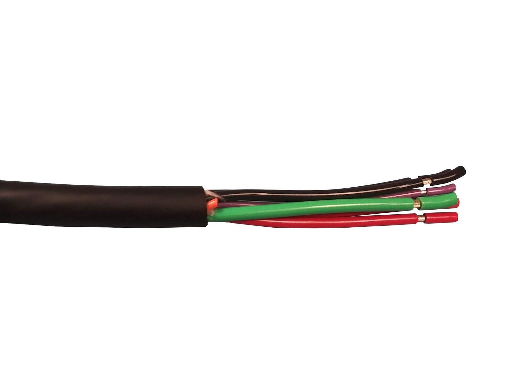</a>
  <a href="images/step-02-3.jpg">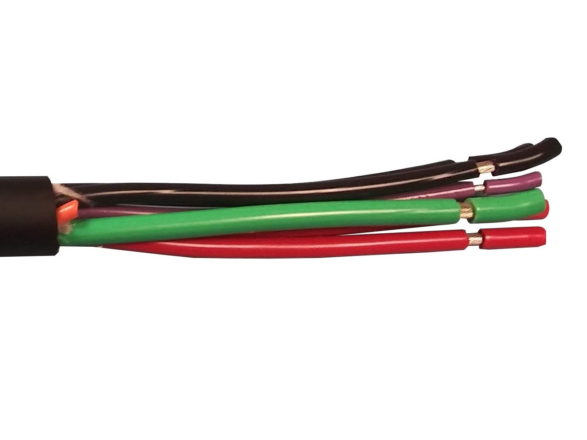</a>

- ⚫ This guide uses 40A EVJT cable available from OpenEVSE.
- ⚫ Remove 3.25 inches of the outer jacket.
- ⚫ Strip and retain insulation from RED, BLACK and GREEN wire 1/2 inch (0.50").
- ⚫ Strip and retain insulation from Purple wire 3/8 inch (0.375")
- ⚫ Cut orange wire flush with outer jacket.

---

## Step 3 – Prerequisites

  <a href="images/step-03-1.jpg">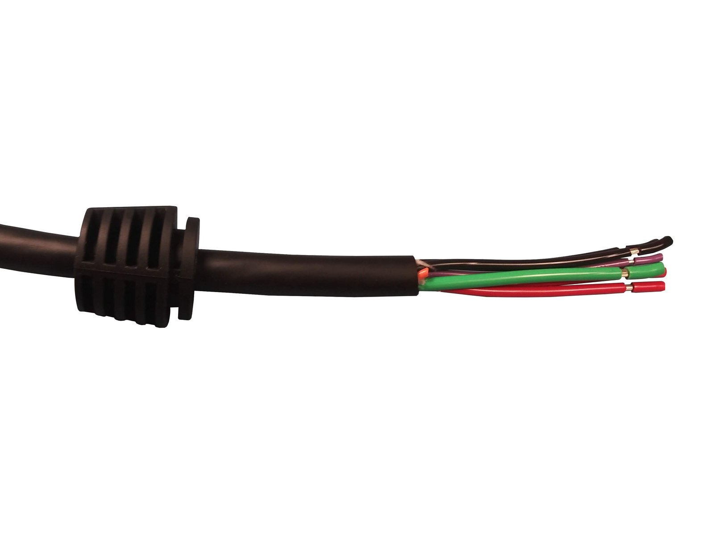</a>
  <a href="images/step-03-2.jpg">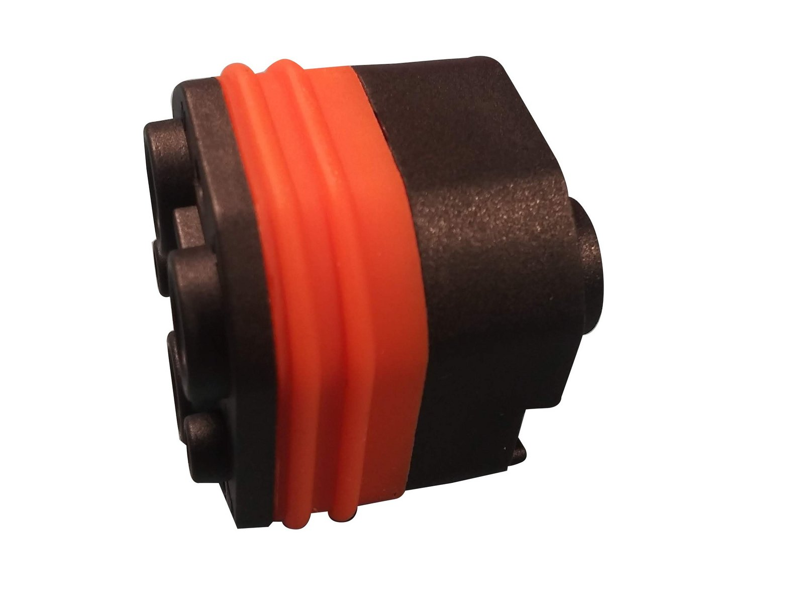</a>
  <a href="images/step-03-3.jpg">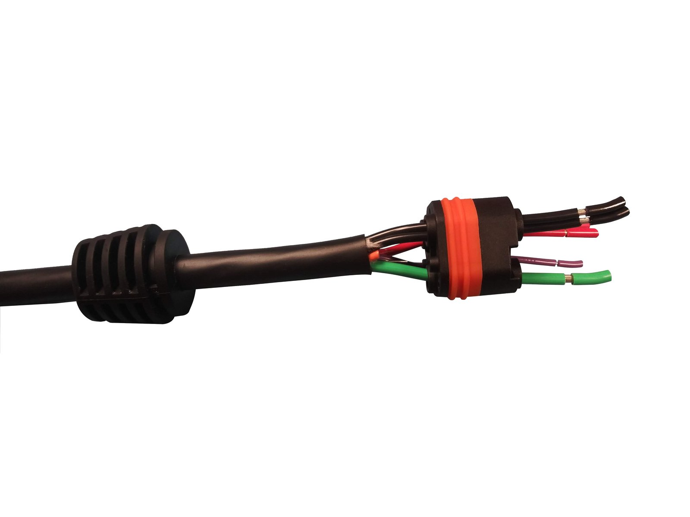</a>

- ⚫ Slide gland onto the cable. The notched end should face toward the stripped conductors.
- ⚫ Assemble the pin guide/seal.
- ⚠️ The plastic parts should make contact all the way around the orange rubber seal. If not check that the parts are in the correct orientation.
- ⚫ Insert conductors into the guide/seal, abbreviations are molded into the plastic part. PE = GREEN, CP = PURPLE, N - RED, L - BLACK

---

## Step 4 – Proximity

  <a href="images/step-04-1.jpg">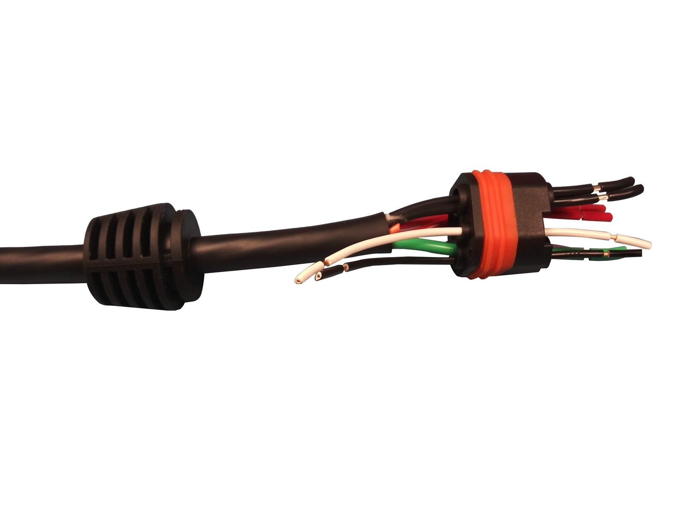</a>

- ⚫ Cut 6" each of BLACK and WHITE 18AWG stranded wire.
- ⚫ Strip and retain 0.50" of insulation off both ends of the BLACK and WHITE wires.
- ⚫ Insert the 18AWG BLACK wire in the PE position in addition to the GREEN wire.
- ⚫ Insert a 18AWG WHITE wire in the hole labeled PP.

---

## Step 5 – Crimp Ground pin

  <a href="images/step-05-1.jpg">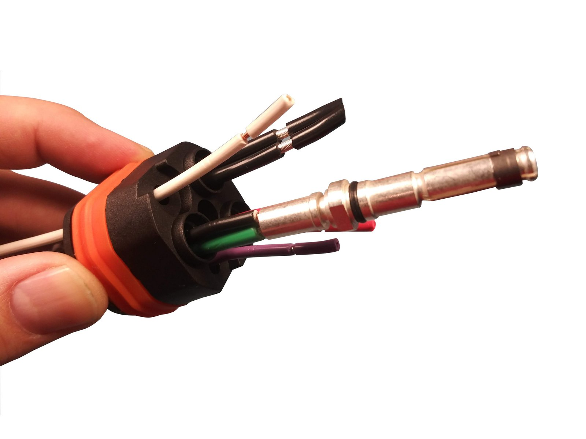</a>
  <a href="images/step-05-2.jpg">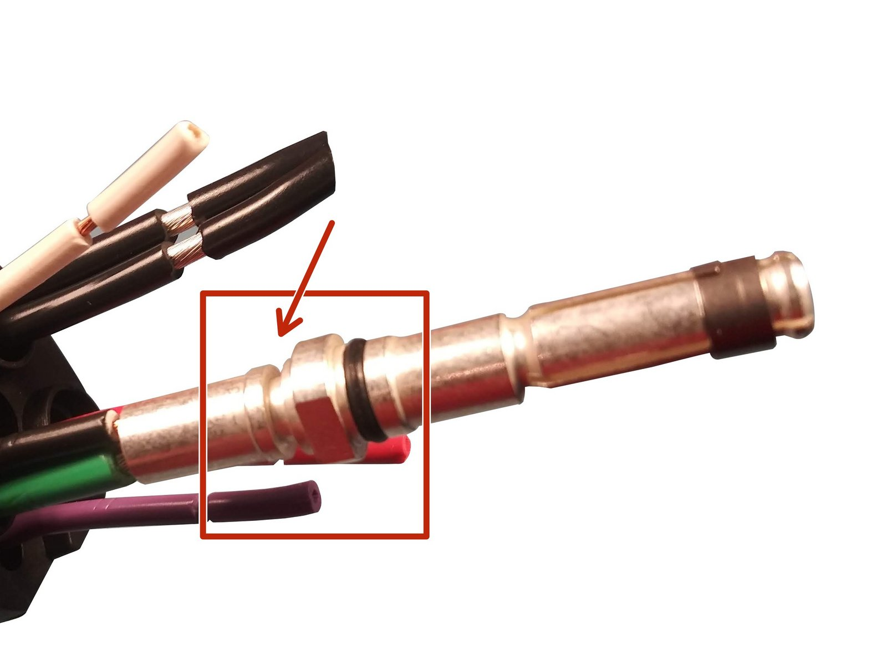</a>

- 📌 Remove insulation from the GREEN and BLACK wire.
- 🟢 Insert the ground pin on the 10AWG GREEN wire and the 18AWG BLACK Proximity wire.
- ⚠️ Note the Ground pin is different from the power pins. Note the notch near the area where the wire is inserted.
- ⚫ Crimp Ground pin with Pico Corporation 400B pneumatic crimping tool at 80PSI.
  - 📌 Recommended Die Pico 414DA-8N
  - 📌 Recommended locator - OpenEVSE J1772 Power/Ground
- ⚠️ Soldering the pins is possible but requires a lot of heat to get solder to flow throughout. Crimping is recommended.

---

## Step 6 – Crimp Power Pins

  <a href="images/step-06-1.jpg">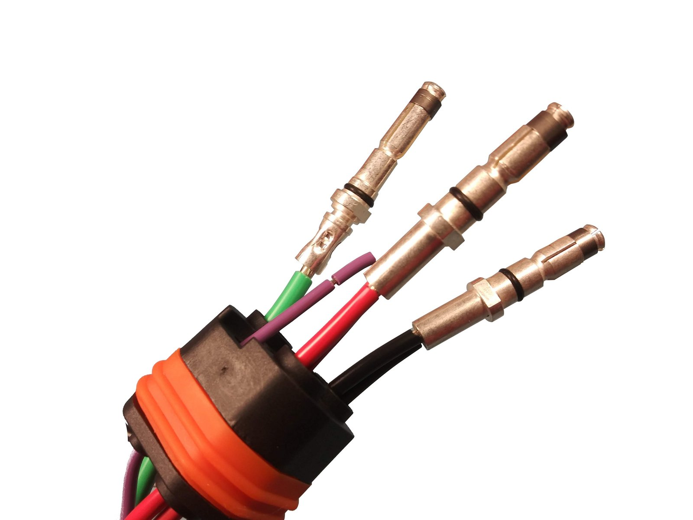</a>
  <a href="images/step-06-2.jpg">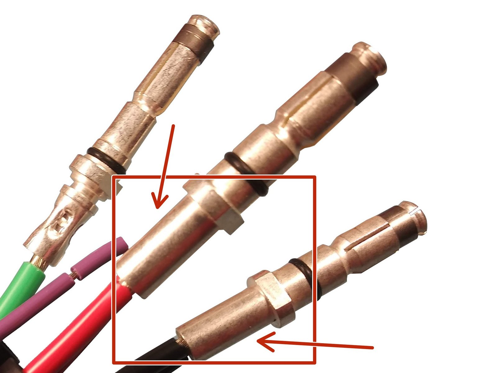</a>

- 📌 Remove the insulation on all the RED and BLACK power wires.
- ⚫ Insert the power pin on the BLACK wire(s) and crimp.
- 🔴 Insert the power pin in the RED wire(s) and crimp.
- ⚠️ Note the power pins are different from the ground pin. Note the smooth surface along the crimp area where the wire is inserted.
- ⚫ Crimp Power pins with Pico Corporation 400B pneumatic crimping tool at 80PSI.
  - 📌 Recommended Die Pico 414DA-8N
  - 📌 Recommended locator - OpenEVSE J1772 Power/Ground
- ⚠️ Soldering the pins is possible but requires a lot of heat to get solder to flow throughout. Crimping is recommended.

---

## Step 7 – Crimp Signal Pins

  <a href="images/step-07-1.jpg">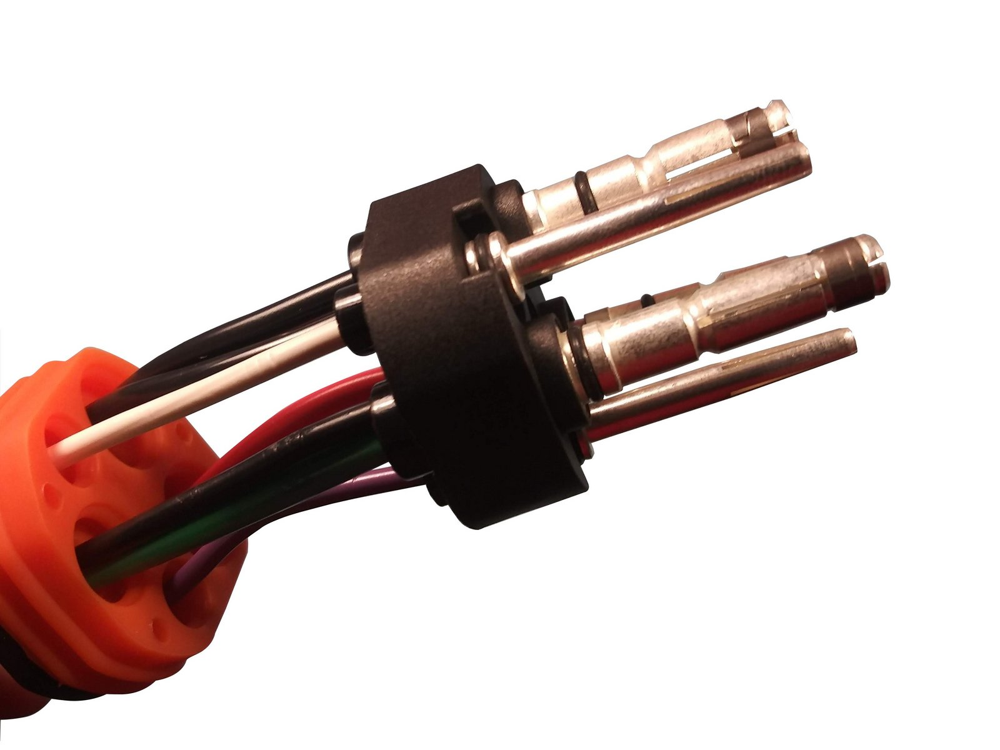</a>

- 🟣 Insert the signal pin on the PURPLE wire and crimp.
- ⚫ Insert the signal pin on the WHITE wire and crimp.
- ⚫ Crimp Ground pin with Pico Corporation 400B pneumatic crimping tool at 80PSI.
  - 📌 Recommended Die Pico 414DA-12N
  - 📌 Recommended locator - OpenEVSE J1772 Signal
- ⚠️ Soldering the pins is possible but requires a lot of heat to get solder to flow throughout. Crimping is recommended.
- ⚫ Slide up the pin guide onto the pins.

---

## Step 8 – Assemble housing

  <a href="images/step-08-1.jpg">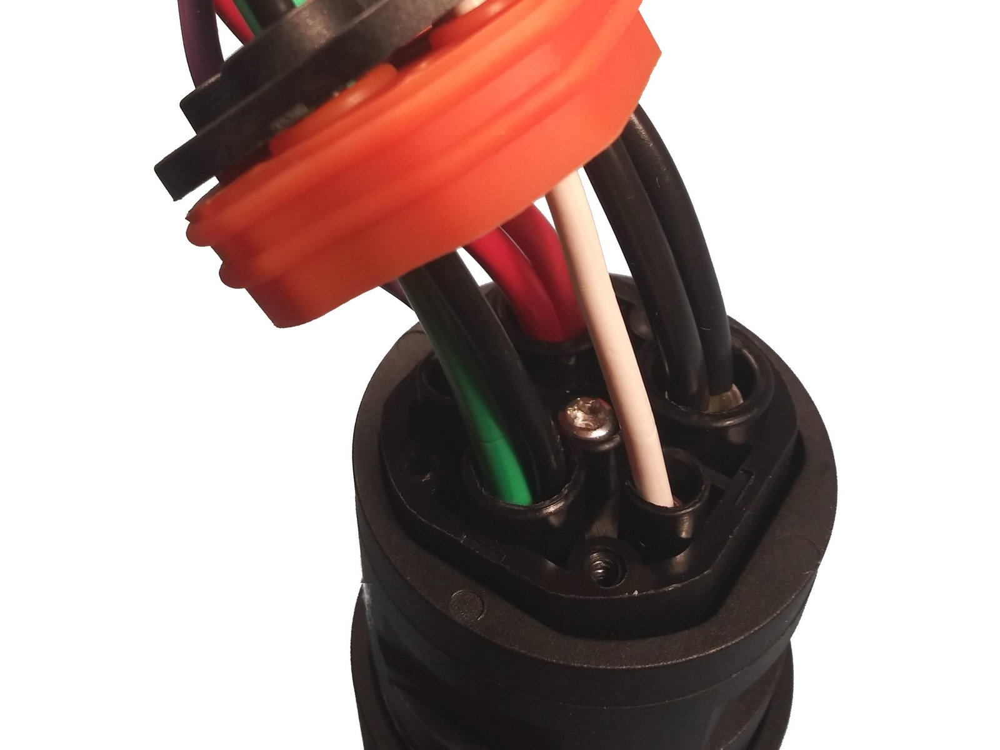</a>
  <a href="images/step-08-2.jpg">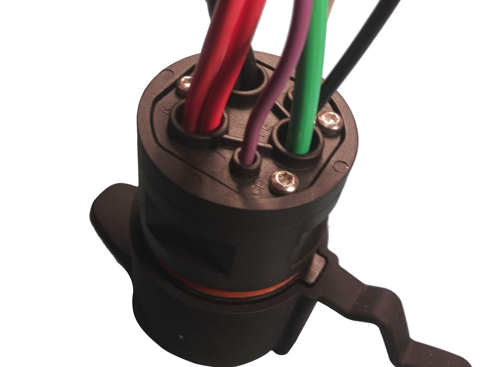</a>

- ⚫ Insert pins into the connector housing.
- ⚫ Screw pin guide to the connector housing using 16 mm screw.
- ⚫ Slide orange seal and black plastic retainer down.
- ⚫ Screw retainer in with three 20 mm retainer screws.

---

## Step 9 – Push Button

  <a href="images/step-09-1.jpg">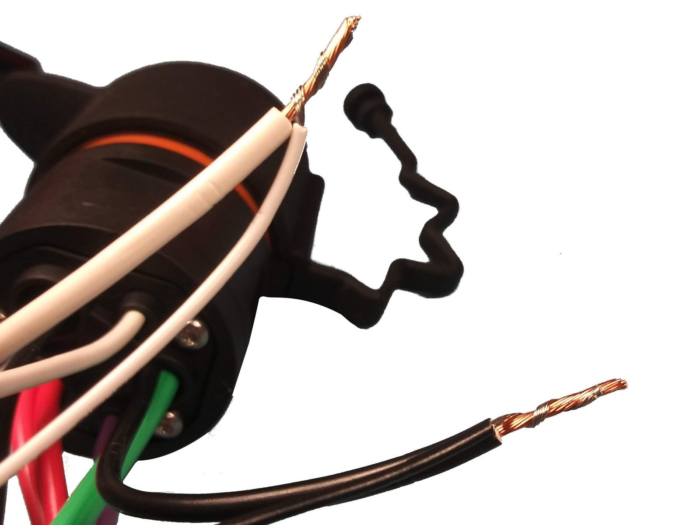</a>
  <a href="images/step-09-2.jpg">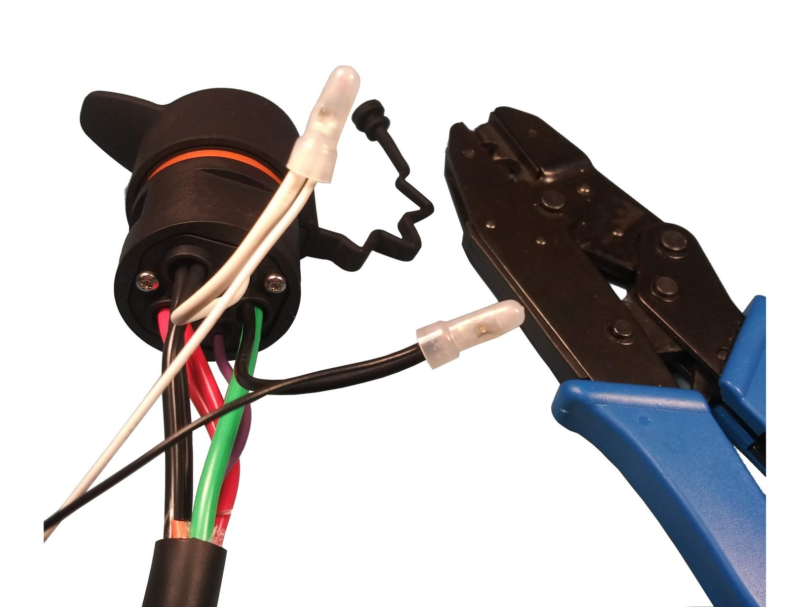</a>

- ⚫ Strip 0.50" off both the BLACK and WHITE wires from the push button switch assembly.
- ⚫ Remove the insulation off all BLACK and WHITE wires.
- ⚫ Twist WHITE wires together from bottom to top and crimp.
- ⚫ Twist BLACK wires together from bottom to top and crimp.

---

## Step 10 – Prepare assembly for closeout

  <a href="images/step-10-1.jpg">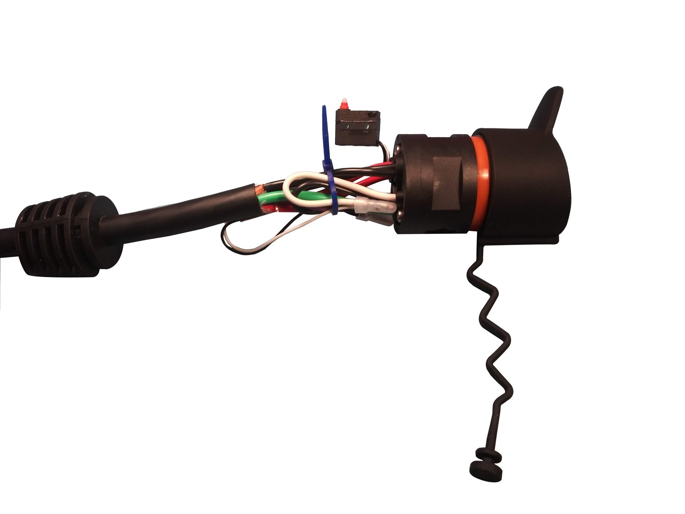</a>

- ⚫ Position switch under the power and ground conductors as shown in the photo.
- ⚫ Fold WHITE and BLACK 18AWG wires in half.
- ⚫ Loosely tighten a tie wrap to keep the wires closely bunched.

---

## Step 11 – Bottom Shell

  <a href="images/step-11-1.jpg">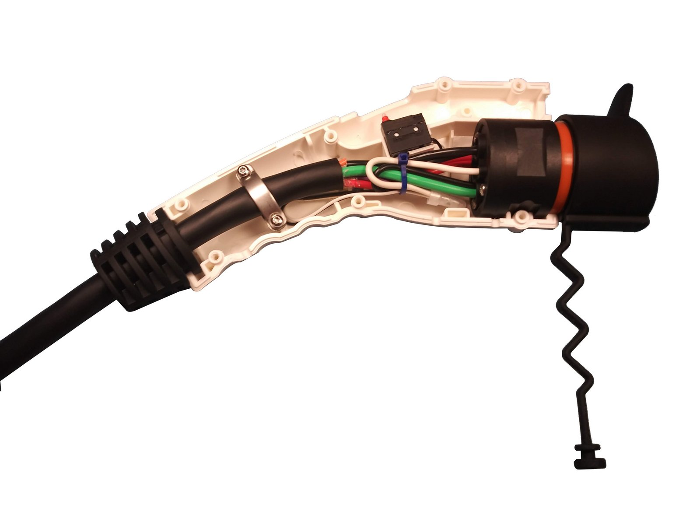</a>
  <a href="images/step-11-2.jpg">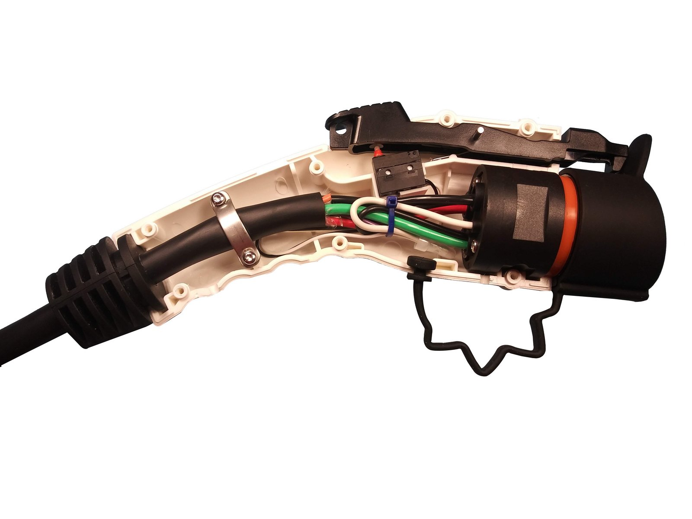</a>

- ⚫ Insert nose in bottom shell.
- ⚫ Insert cable gland in bottom shell, adjust position if necessary.
- ⚫ Insert switch in position in the bottom shell.
- ⚫ Secure cable in the strain relief.
- ⚠️ Position tie wrap to avoid pinching wires in the shell seam during closeout.
- ⚫ Tension button spring and install button/spring/pin. Slid pin into the molded bushing.

---

## Step 12 – Closeout

  <a href="images/step-12-1.jpg">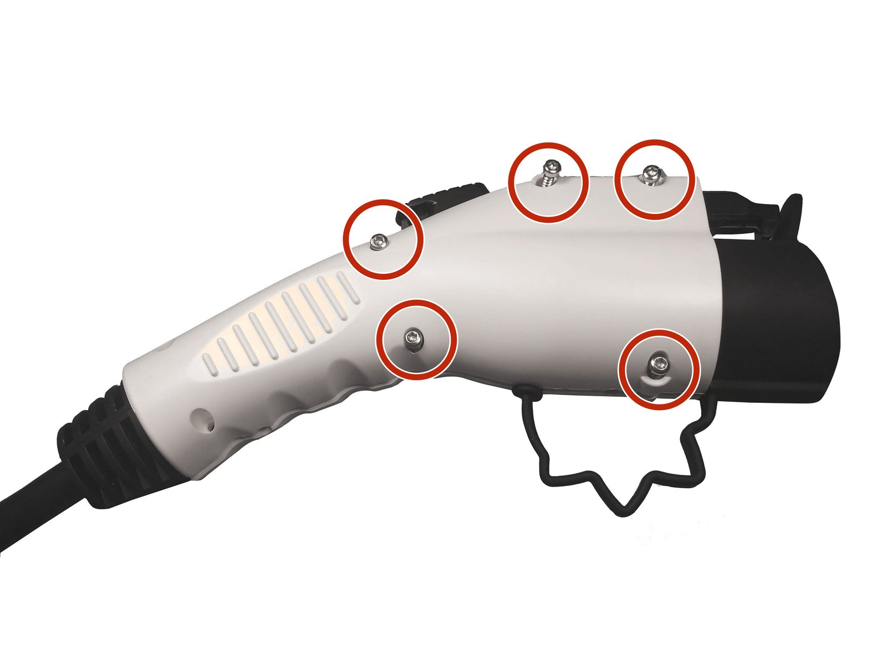</a>
  <a href="images/step-12-2.jpg">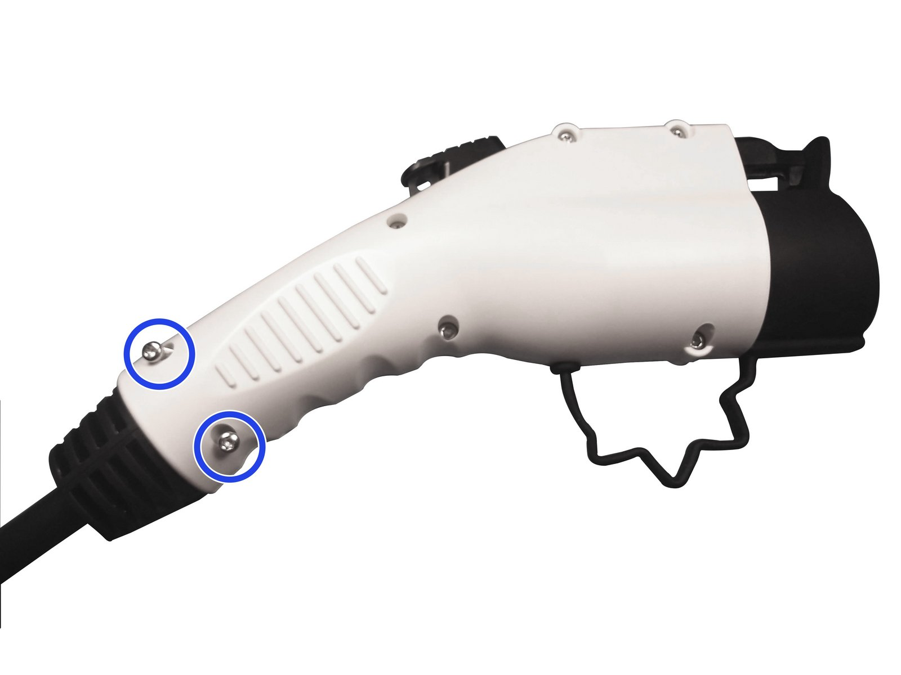</a>

- 📌 Insert dust cap end in shell halves.
- 🔴 Insert and tighten 16 mm screws in holes marked in RED.
- 🔵 Insert and tighten 12 mm screws in positions marked in BLUE.

---

## Step 13 – Finish cable end

  
  <a href="images/step-13-2.jpg">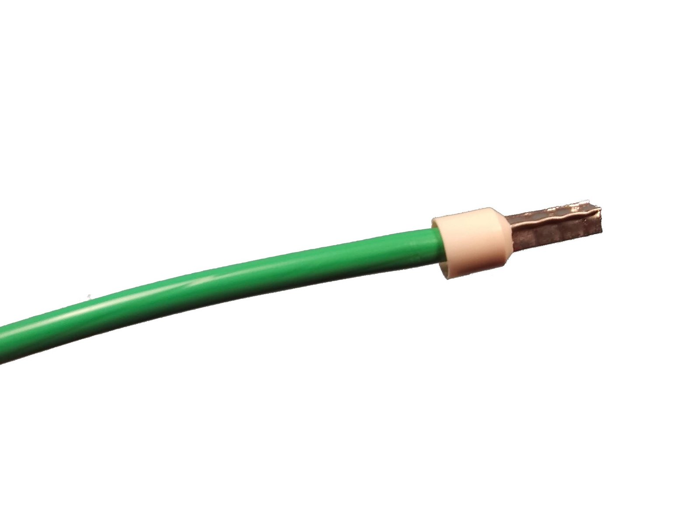</a>

- ⚫ Remove insulation and crimp ring terminal on BLACK wires.
- 🔴 Remove insulation and crimp ring terminals on RED wires.
- 🟢 Remove insulation and Crimp Sleeve ferrule on GREEN wire.

---
