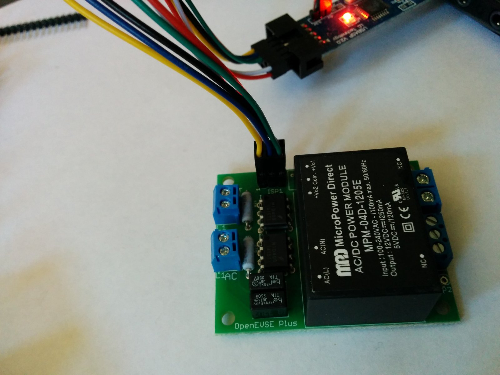
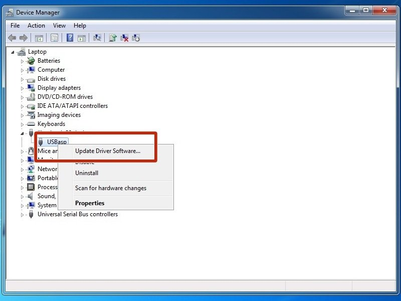
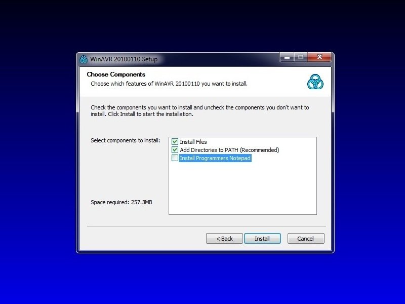
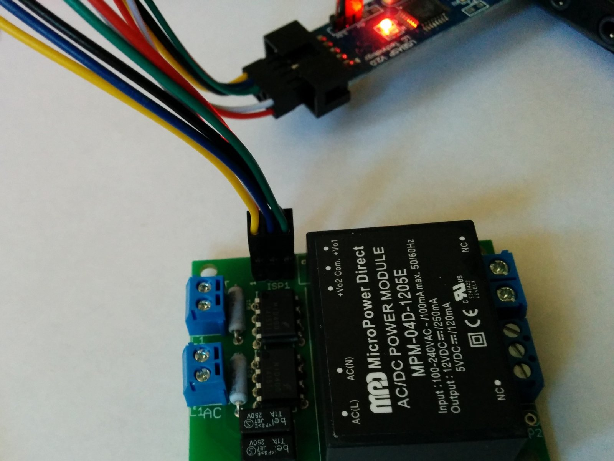
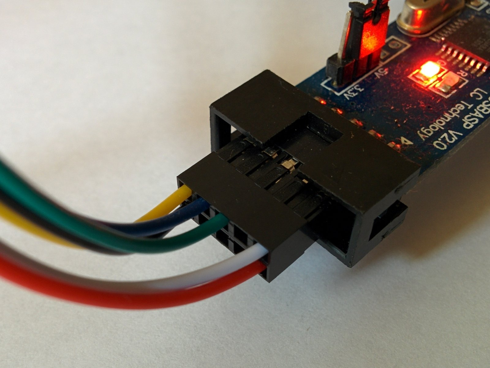
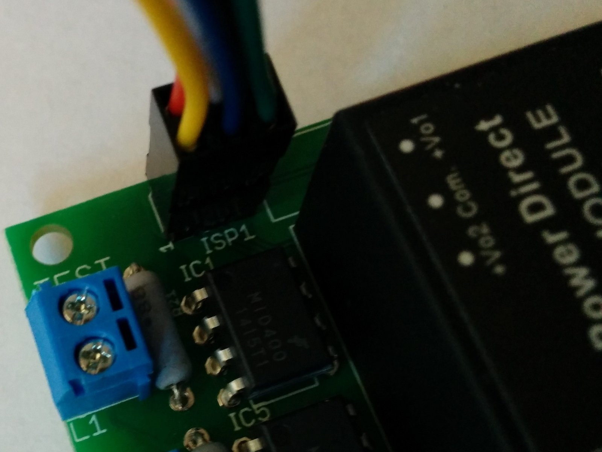
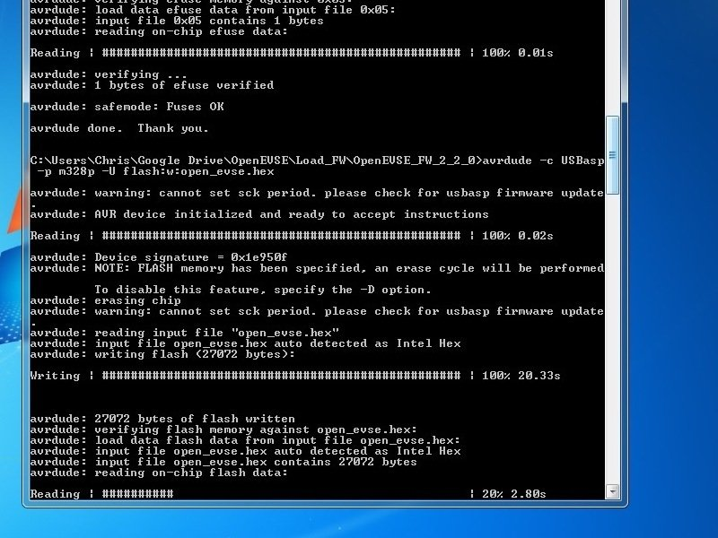

# How to Load OpenEVSE Firmware (WinAVR)

| Difficulty | Steps | Time Required |
| --- | --- | --- |
| Easy | 5 | 00:05:00 – 00:10:00 |

_Written By: Christopher Howell (and 2 other contributors)_

## Tools

- Windows PC

## Parts

- OpenEVSE Plus
- OpenEVSE Programmer

### Bullet key

Colored bullets match the colored markers drawn on the photos for each step.

| Marker | Meaning |
| --- | --- |
| ⚫ 🔴 🟠 🟡 🟢 🔵 🩵 🟣 | Instruction — matches the same-colored marker in the photo |
| ℹ️ | Note |
| ⚠️ | Caution |
| 📌 | Reminder / Tip |

## Contents

1. [How to Load OpenEVSE Firmware](#step-1--how-to-load-openevse-firmware)
2. [Installing Device Driver.](#step-2--installing-device-driver)
3. [Install WinAVR](#step-3--install-winavr)
4. [Connect OpenEVSE to programmer](#step-4--connect-openevse-to-programmer)
5. [Loading firmware](#step-5--loading-firmware)

---

## Step 1 – How to Load OpenEVSE Firmware

  

- ⚫ This Guide explains the Firmware loading process for OpenEVSE.
- ℹ️ This guide is specifically intended for the Windows Operating system. Advanced users may use a similar process for MacOS and LINUX.

---

## Step 2 – Installing Device Driver.

  

- ⚫ Download Windows Driver for the OpenEVSE Programmer. Using this guide. [https://rayshobby.net/dead-simple-driver-installation-for-usbasp-and-usbtiny-on-windows/](https://rayshobby.net/dead-simple-driver-installation-for-usbasp-and-usbtiny-on-windows/)

---

## Step 3 – Install WinAVR

  

- ⚫ Download and install the WinAVR software. [WinAVR](http://sourceforge.net/projects/winavr/files/latest/download?source=dlp)
- ⚫ Select BOTH the Install Files and Add Path Options. Developers Notepad is Optional.

---

## Step 4 – Connect OpenEVSE to programmer

  
  
  

- ⚫ Connect Programmer to OpenEVSE then connect to USB port on PC.
- ℹ️ The red stripe on the ribbon cable or yellow wire on the 6 pin connector aligns with pin 1 of the ISP connector.

---

## Step 5 – Loading firmware

  

- ⚫ Download a pre-compiled HEX file from the [OpenEVSE Sources](https://github.com/OpenEVSE/open_evse/releases) for your OpenEVSE product and your desired configuration.
- ⚫ Download the latest firmware and save files into a local folder.
- ⚠️ If the ATMEGA328P chip has never had firmware loaded fuse bit must be set with the following command: avrdude -c USBasp -p m328p -U lfuse:w:0xFF:m -U hfuse:w:0xDF:m -U efuse:w:0x05:m
- ℹ️ To upgrade firmware, run the following command at a terminal or command prompt. avrdude -c USBasp -p m328p -U flash:w:file_name_of the_firmware.hex
- ℹ️ Warning can not set SCK period is normal and can be ignored.

---
