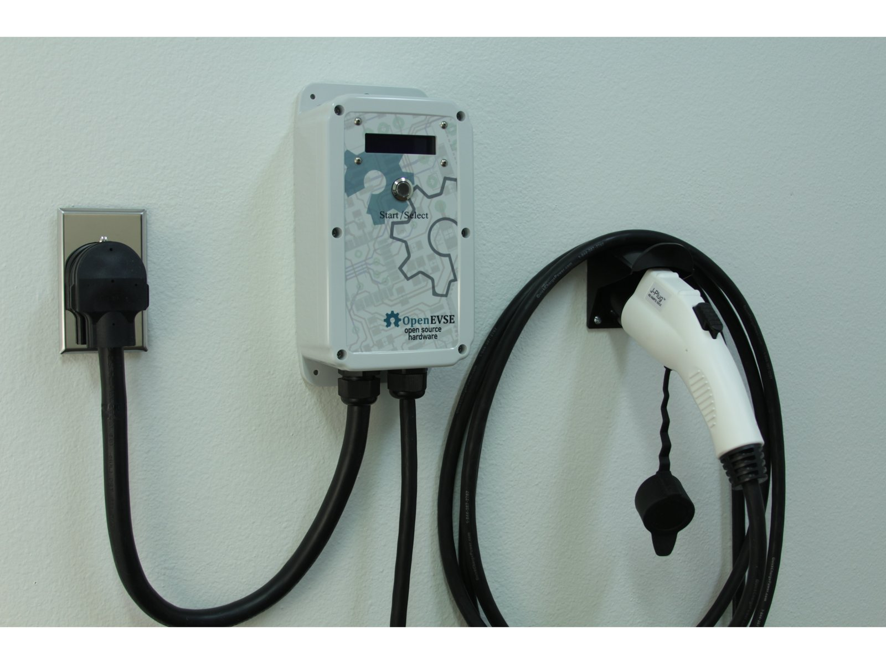
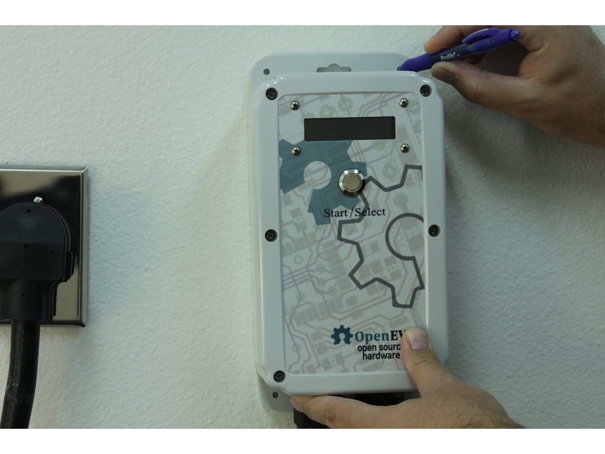
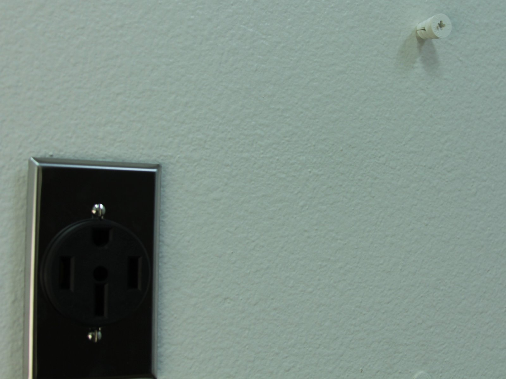
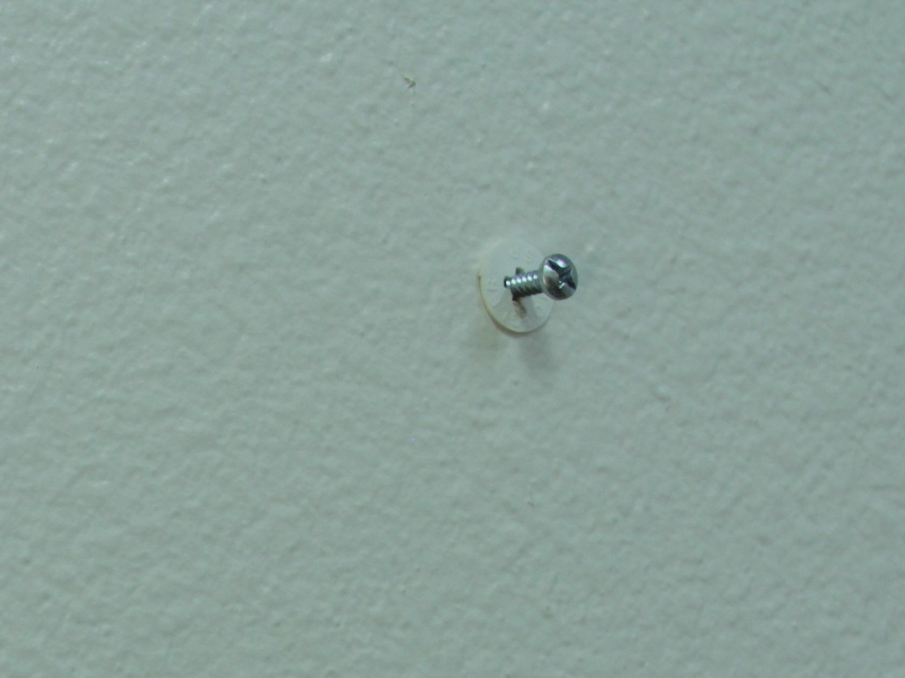
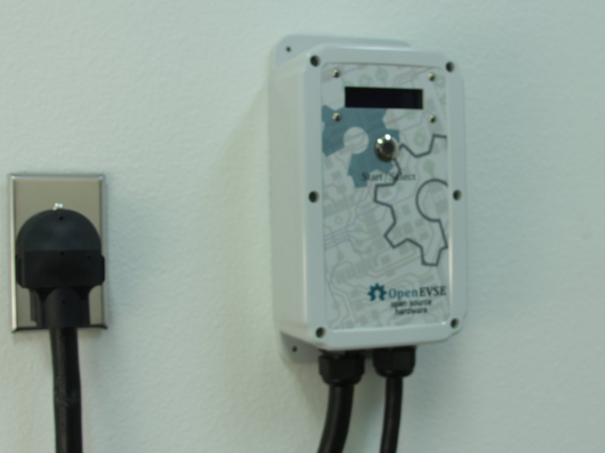
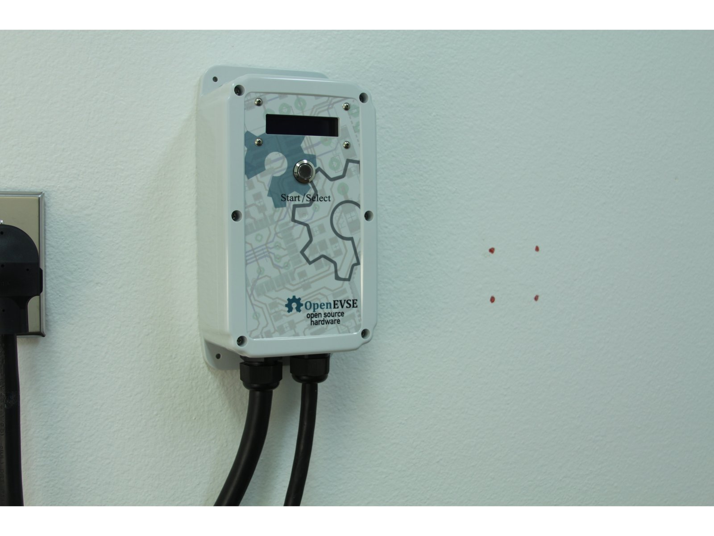
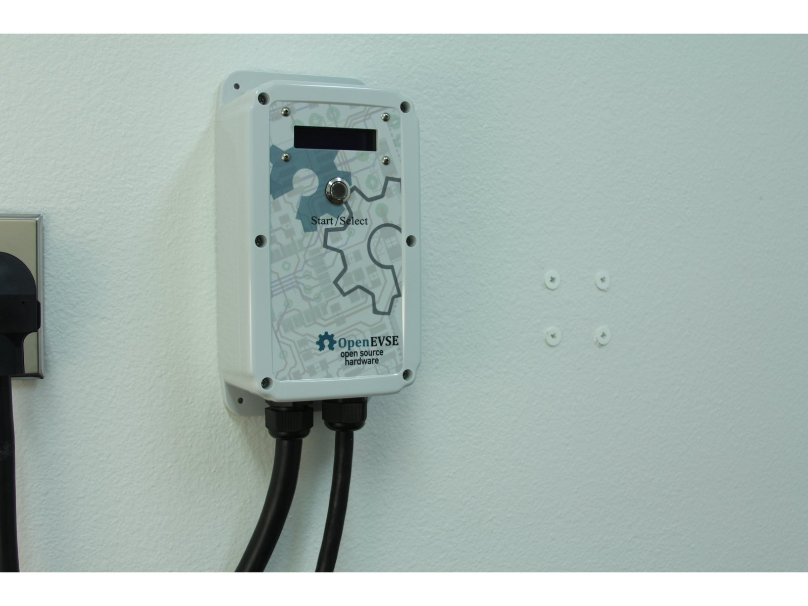
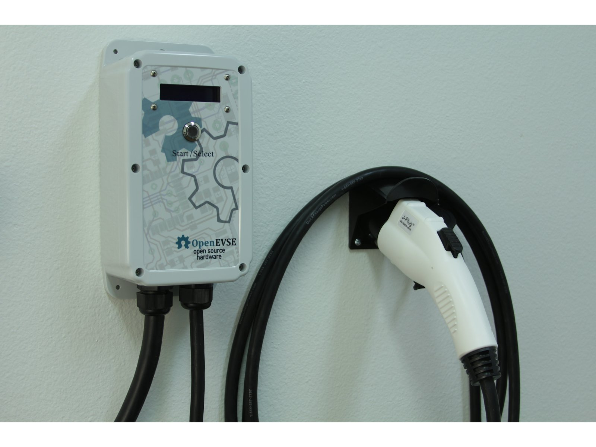

# Mounting Your Charging Station

| Difficulty | Steps | Time Required |
| --- | --- | --- |
| Easy | 5 | 00:15:00 |

_Written By: Christopher Howell_

## Tools

- Philips Screw Driver

## Documents

- [Mounting_template.pdf](documents/Mounting_template.pdf)
- [Mounting_template_Holster.pdf](documents/Mounting_template_Holster.pdf)

### Bullet key

Colored bullets match the colored markers drawn on the photos for each step.

| Marker | Meaning |
| --- | --- |
| ⚫ 🔴 🟠 🟡 🟢 🔵 🩵 🟣 | Instruction — matches the same-colored marker in the photo |
| ℹ️ | Note |
| ⚠️ | Caution |
| 📌 | Reminder / Tip |

## Contents

1. [Introduction](#step-1--introduction)
2. [Location](#step-2--location)
3. [Drill holes](#step-3--drill-holes)
4. [Mount Charging Station](#step-4--mount-charging-station)
5. [Mount Holster](#step-5--mount-holster)

---

## Step 1 – Introduction

  

- ℹ️ Tools Required
  - ⚫ Drill with 1/4" bit (drywall) or 1/8 bit (wood )
  - ⚫ # 2 Phillips screwdriver
  - ⚫ (Optional) Level

---

## Step 2 – Location

  

- ⚫ Your Charging Station should be mounted on a flat surface in close proximity to your plug.
- 📌 **Note. Why is the power cord so short...? **J1772 and UL standards require a short input cord for enhanced safety. The EV cord is protected with several safety checks and cutoff but the input cord can not be protected. Keeping the input cord short reduces the risk of damage.
- ⚠️ Turn off power at the circuit breaker.
- ⚫ Plug in to the socket (with power off) and mark a location that allows a gentle bend of the input cord.
  - ⚫ **Option - Portable** Mark 2 center holes top and bottom if you plan to use your Charging station on the road. It will be very easy to remove.
  - ⚫ **Option - Static** For more static install, mark the 4 corner holes.

---

## Step 3 – Drill holes

  
  

- ⚫ Drywall - Drill your holes with a 1/4" drill bit.
  - ⚫ Insert the drywall anchor and screw in until flush with the wall
- ⚫ Wood - Drill through the wood or stud with a 1/8" drill bit.
- ⚫ Center mount - Screw in the screws leaving the head extended by 1/2".

---

## Step 4 – Mount Charging Station

  

- ⚫ **Center Mount (Portable)** - Slide screws through the large opening. Shift the station either to the left or right. Tighten the screws as necessary to keep the station in place.
- ⚫ **Corner Mount (Stationary)** Screw in the 4 screws.

---

## Step 5 – Mount Holster

  
  
  

- ⚫ Use the Holster as a template and mark the holes.
- ⚫ Drywall - Drill your holes with a 1/4" drill bit.
  - ⚫ Insert the drywall anchor and screw in until flush with the wall
- ⚫ Wood - Drill through the wood or stud with a 1/8" drill bit.
- ℹ️ Tip - Screw in the top screws first and tilt the holster up for easier access to the top holes.

---
