# OCPP Setup Pulse Energy

| Difficulty | Steps | Time Required |
| --- | --- | --- |
| Moderate | 5 | No estimate |

_Written By: Christopher Howell_

### Bullet key

Colored bullets match the colored markers drawn on the photos for each step.

| Marker | Meaning |
| --- | --- |
| ⚫ 🔴 🟠 🟡 🟢 🔵 🩵 🟣 | Instruction — matches the same-colored marker in the photo |
| ℹ️ | Note |
| ⚠️ | Caution |
| 📌 | Reminder / Tip |

## Contents

1. [Create a free account](#step-1--create-a-free-account)
2. [Add OpenEVSE charging station](#step-2--add-openevse-charging-station)
3. [OpenEVSE OCPP Setup](#step-3--openevse-ocpp-setup)
4. [Navigate to Pulse Energy Analytics](#step-4--navigate-to-pulse-energy-analytics)
5. [View data on Pulse Energy Analytics](#step-5--view-data-on-pulse-energy-analytics)

---

## Step 1 – Create a free account

  <a href="images/step-01-1.png">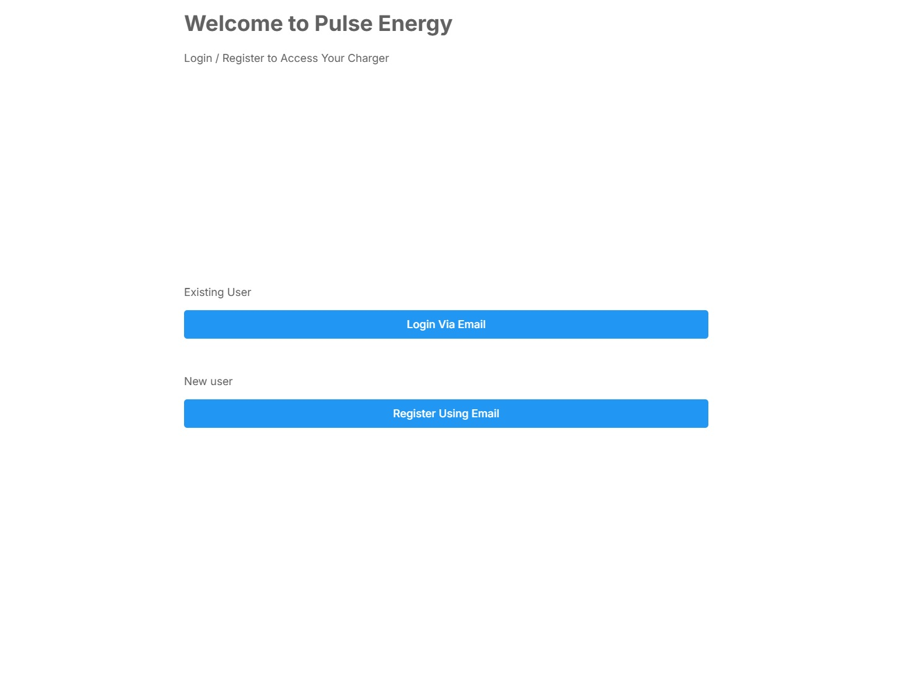</a>
  <a href="images/step-01-2.png">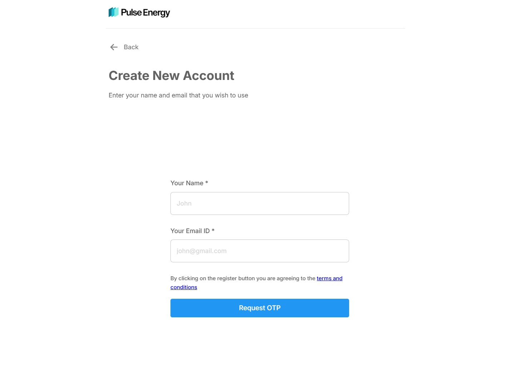</a>

- ⚫ With a web browser navigate to [https://homecharger.pulseenergy.io/insta](https://homecharger.pulseenergy.io/insta)
- ⚫ Create an account.
- ℹ️ Pulse energy allows up to 10 stations in a free account.

---

## Step 2 – Add OpenEVSE charging station

  <a href="images/step-02-1.png">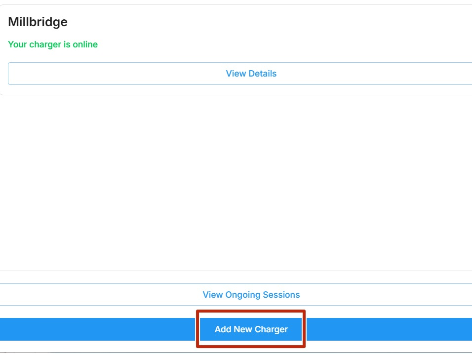</a>
  <a href="images/step-02-2.png">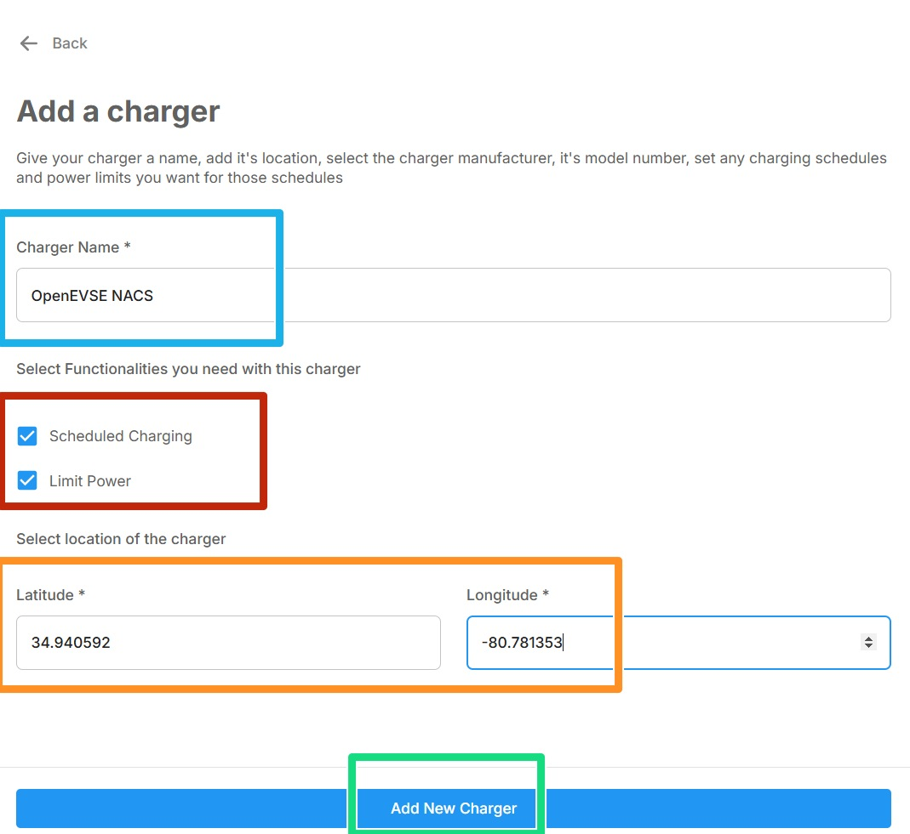</a>

- ⚫ Click Add New Charger on the Charger Dashboard Screen
- 🩵 Name your OpenEVSE Station
- 🔴 Check the "Schedule Charging" and "Limit Power" boxes
- 🟠 Enter Longitude and Latitude of the station.
- 🟢 Click Add New Charger

---

## Step 3 – OpenEVSE OCPP Setup

  <a href="images/step-03-1.png">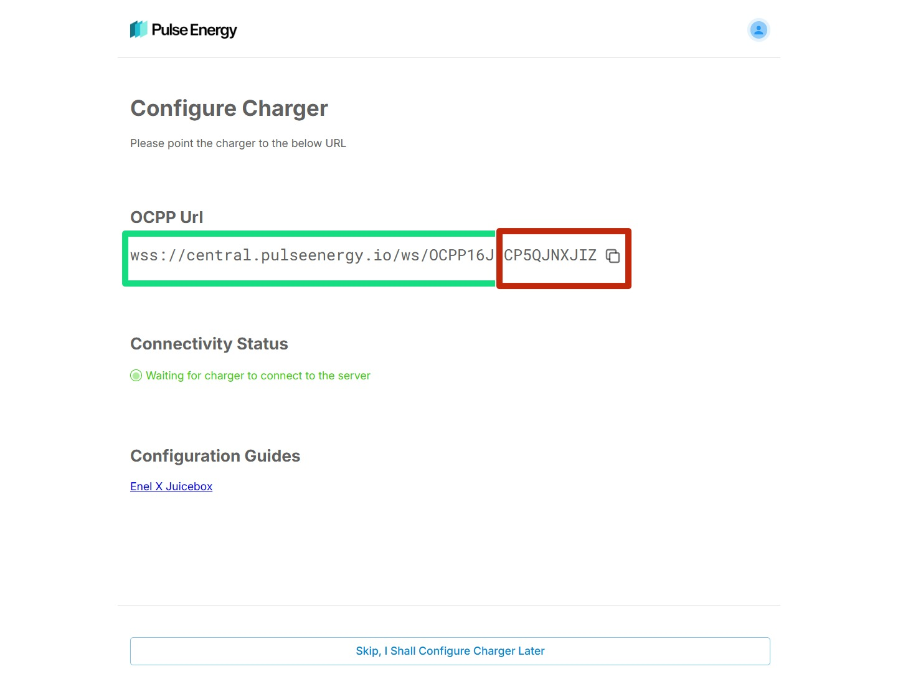</a>
  <a href="images/step-03-2.png">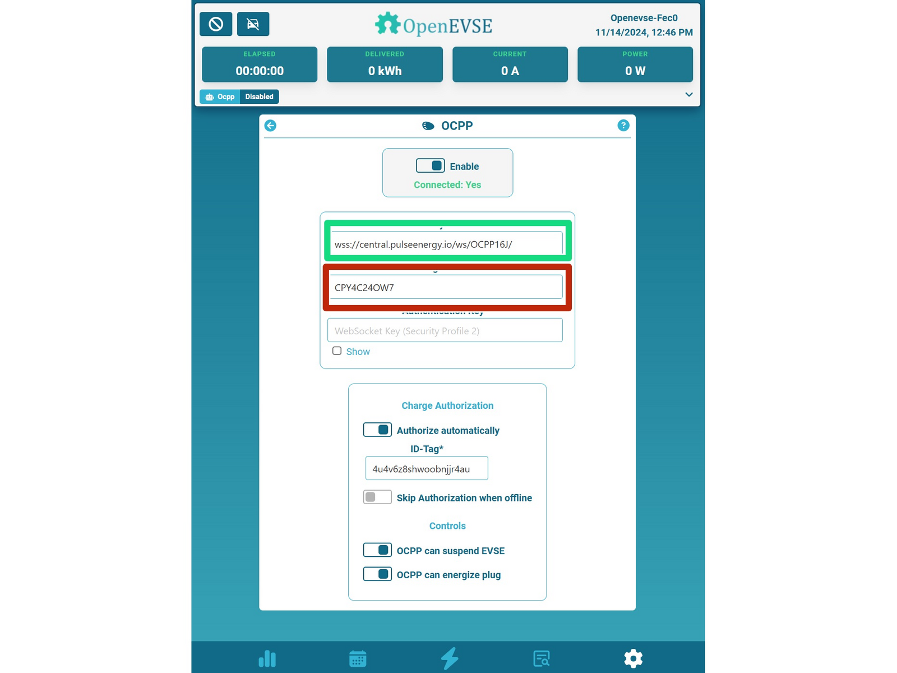</a>
  <a href="images/step-03-3.png">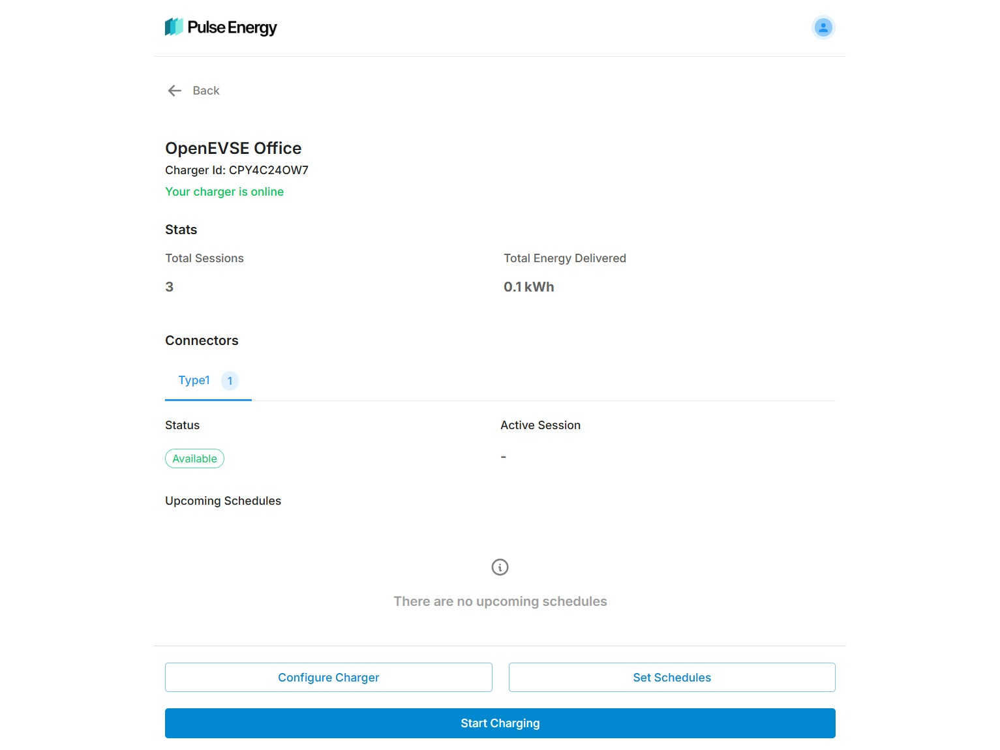</a>

- ⚫ Copy the OCPP link from Pulse Energy.
- ⚠️ OpenEVSE has a separate field for URL and Charger ID. The last part of the URL will be input in the "Charge Box ID".
- ⚫ Click the Enable Slider on OpenEVSE
- ⚫ The charger status should now be active on the Pulse Energy page. Its okay if OpenEVSE still says disconnected, we still need to add an ID tag.

---

## Step 4 – Navigate to Pulse Energy Analytics

  <a href="images/step-04-1.png">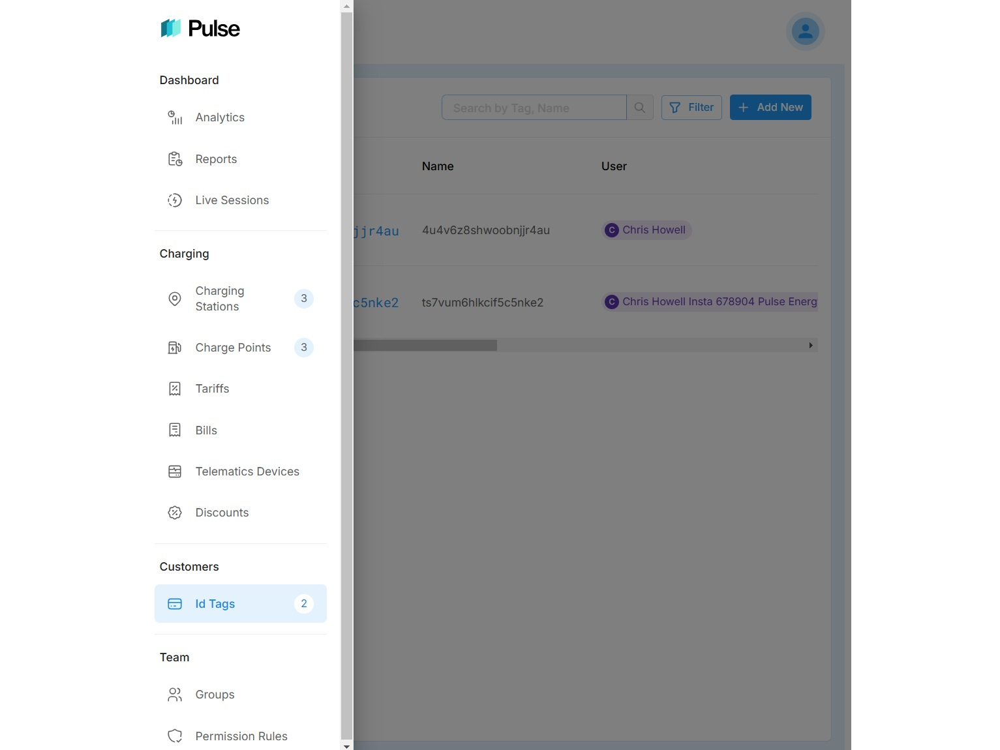</a>
  <a href="images/step-04-2.png">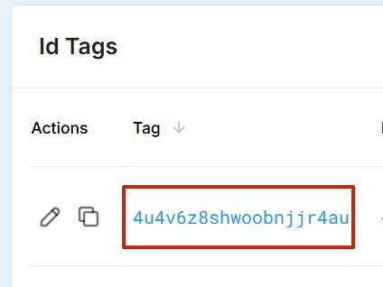</a>
  <a href="images/step-04-3.png">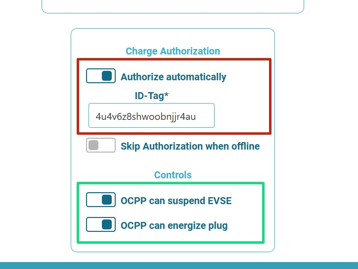</a>

- ⚫ Using a web browser navigate to [https://homecharger.pulseenergy.io/analytics](https://homecharger.pulseenergy.io/analytics)
- ⚫ Click the menu icon and select ID Tags
- 🔴 Copy the ID Tag and paste into OpenEVSE ID-Tag Field. Enable the Authorize checkbox.
- 🟢 Enable the energize and suspend boxes.

---

## Step 5 – View data on Pulse Energy Analytics

  <a href="images/step-05-1.png">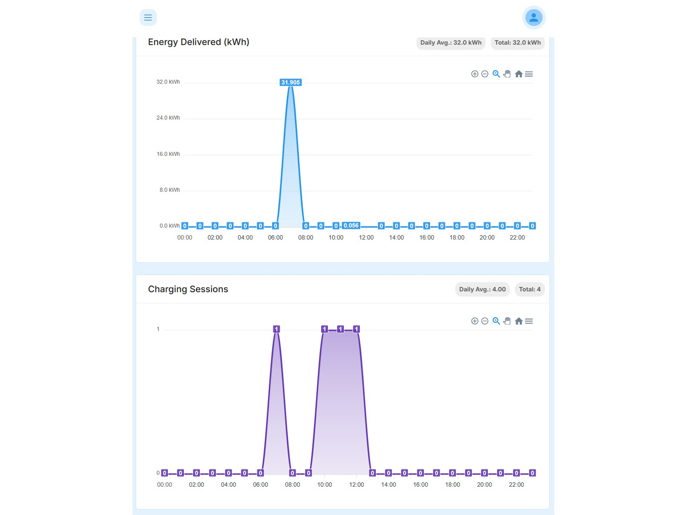</a>

- ⚫ Your station and data should now be live on the Pulse Energy Site. [https://homecharger.pulseenergy.io/analytics](https://homecharger.pulseenergy.io/analytics)

---
