# OpenEVSE P50D-WV kit  alternate build guide

| Difficulty | Steps | Time Required |
| --- | --- | --- |
| Moderate | 12 | No estimate |

_Written By: Andrew Daviel_

> [!NOTE]
> This guide was marked **In Progress** on the original OpenEVSE guide site and may be incomplete.

## Introduction

OpenEVSE is an open-source project to create an [EVSE](https://en.wikipedia.org/wiki/Charging_station) - Electric Vehicle Supply Equipment. This device is basically just a cable that connects the battery charger aboard an EV to an electricity supply, but it contains a safety relay to disconnect the power if there is no car plugged in, and a mechanism to signal to the car how much current it is allowed to consume. In this EVSE, the current may be selected from a menu via a push-button on the front, so it can be tailored to the supply outlet.

As an open-source project, full software and hardware details are freely available. They are scattered over about 5 different websites and domains, but in 2016 could mostly be found at [github.com/openevse](https://github.com/openevse)

This kit includes pre-assembled boards for the OpenEVSE_PLUS_v4 (EVSE control and DC power supply) and the OpenEVSE_LCD (display module)

## Parts

- OpenEVSE Kit - Level1 Level2 50A — From https://store.openevse.com/
- J1772 Cable Assembly 40A — From store.openevse.com or quickchargepower.com

## Documents

- [OpenEVSEv4kit wiring](documents/OpenEVSEv4kit.pdf)
- [OpenEVSEv4kit routing](documents/OpenEVSEv4kitA.pdf)
- [Connectors](documents/connectors.pdf)
- [Packing_List](documents/packinglist.pdf)

### Bullet key

Colored bullets match the colored markers drawn on the photos for each step.

| Marker | Meaning |
| --- | --- |
| ⚫ 🔴 🟠 🟡 🟢 🔵 🩵 🟣 | Instruction — matches the same-colored marker in the photo |
| ℹ️ | Note |
| ⚠️ | Caution |
| 📌 | Reminder / Tip |

## Contents

1. [Safety Considerations](#step-1--safety-considerations)
2. [Unboxing the kit](#step-2--unboxing-the-kit)
3. [Assemble the lid](#step-3--assemble-the-lid)
4. [Assemble the base plate](#step-4--assemble-the-base-plate)
5. [Review wiring diagram](#step-5--review-wiring-diagram)
6. [Review cable routing](#step-6--review-cable-routing)
7. [Contactor wiring](#step-7--contactor-wiring)
8. [Contactor Wiring 2](#step-8--contactor-wiring-2)
9. [Fit the lid and LCD panel](#step-9--fit-the-lid-and-lcd-panel)
10. [Fitting a power connector](#step-10--fitting-a-power-connector)
11. [Setup](#step-11--setup)
12. [Supply outlet wiring](#step-12--supply-outlet-wiring)

---

## Step 1 – Safety Considerations

  <a href="images/step-01-1.jpg">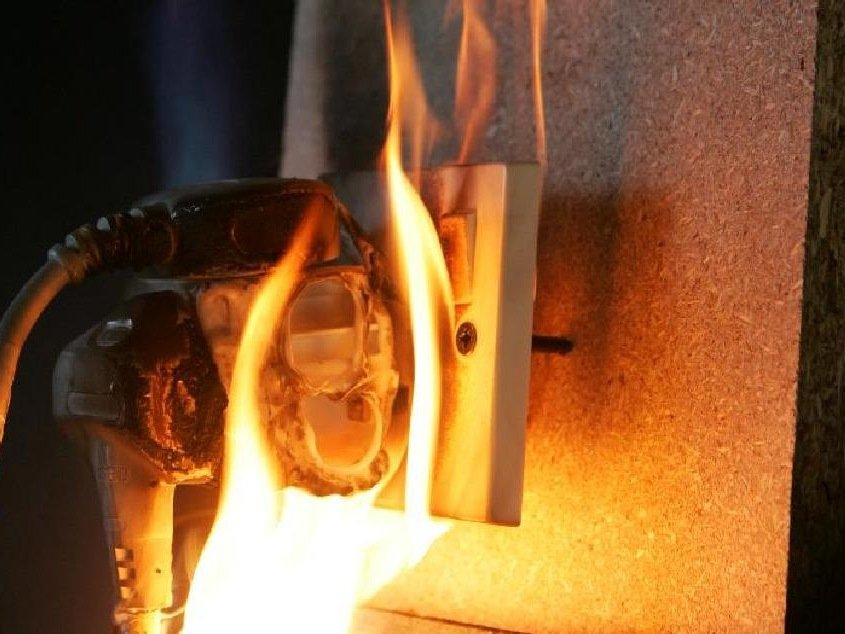</a>

- ⚫ The EVSE is protected only by upstream overcurrent protection - breakers or fuses. Though it may be operated at Level 1 on a 16A circuit, it may also be operated at Level 2 on a 50A circuit. That means that up to 10KW of fault current power could flow without tripping a breaker - easily enough to start fires.
- ⚫ To minimize resistive heating, all joints should be well-made and all plugs and wires should be adequately sized. The current-carrying capacity (ampacity) of wires and cable is typically regulated by government bodies, either independently or based on [IEEE-835-1994](https://standards.ieee.org/findstds/standard/835-1994.html).
- ⚫ The basic principle is that resistive heating of the wires should not cause the temperature of the cable insulation to be elevated beyond its rating (typically 90C). Since cable provides thermal insulation, cable current is derated compared to wires in air.
- ⚫ Though the standards themselves must be purchased, derivative works are available online, e.g. [codemath.com](http://www.codemath.com/cgi-bin/Run.pl). EV charging counts as a continuous load. Typical values are 12A:14AWG, 30A:10AWG, 40A:8AWG, 50A:6AWG
- ⚫ The supply cable to the EVSE should be gauged for the highest continuous load; my Nissan Leaf can charge at 30A so I used 10AWG. When making adapters, a lighter gauge can be used, e.g. 14AWG for a 15A outlet with a charge current of 12A
- ⚫ When operated near its current capacity, EV cable (any cable) should be uncoiled and allowed to air-cool, and not covered with thermal insulation e.g .carpet

---

## Step 2 – Unboxing the kit

  <a href="images/step-02-1.jpg">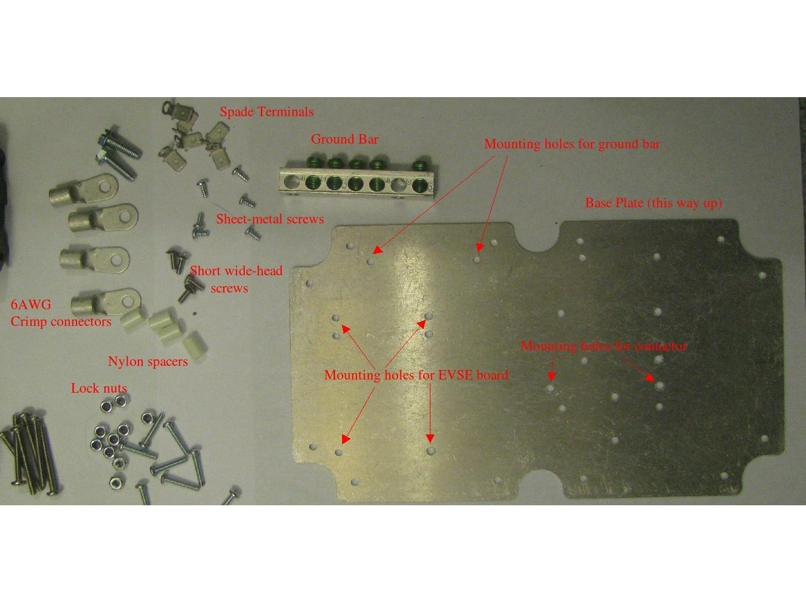</a>
  <a href="images/step-02-2.jpg">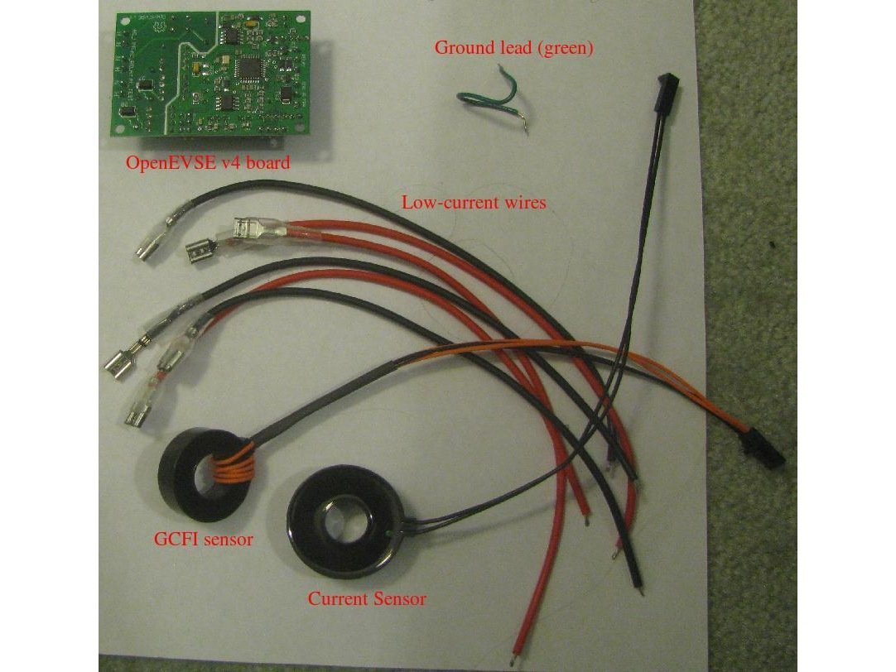</a>
  <a href="images/step-02-3.jpg">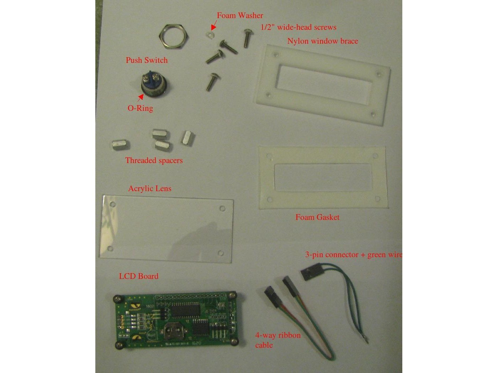</a>

- ⚫ Open the box and identify the parts. See the Packing List document [PDF](documents/packinglist.pdf)

---

## Step 3 – Assemble the lid

  <a href="images/step-03-1.jpg">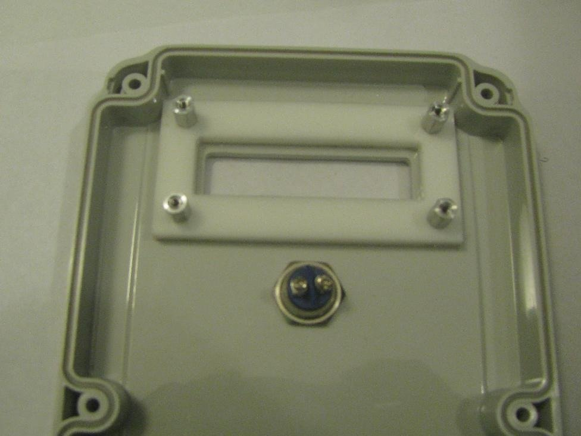</a>
  <a href="images/step-03-2.jpg">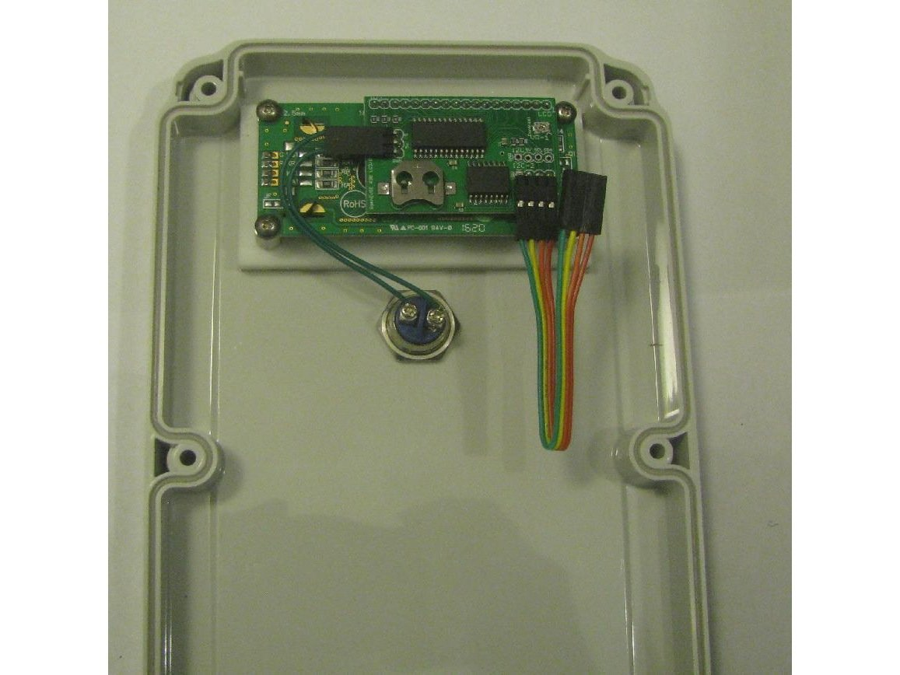</a>

- ⚫ Identify the four 1/2" wide-head screws. They fit the threaded metal spacers. Identify the four foam plastic washers.
- ⚫ Fit the foam washers on the screws. Remove the protective film from the clear acrylic window and from the white nylon window brace. The metal spacers have a slight depression one end - the flat end goes down. Fit the screws to the case, then stack the rectangular foam seal, the clear window, the nylon brace, and the spacers.
- ⚫ Tighten the screws. You may need to compress the assembly initially to start the screws in the thread. Do not over-tighten.
- ⚫ Fit the LCD board to the spacers with the short wide-head screws
- ⚫ Fit the 3-position socket with green wire to the 3-pin header on the daughterboard. The polarity is unimportant. Cut the wire mid-way.
- ⚫ Fit the button switch to the lid, with the O-ring on the outside. Do not over-tighten or the O-ring will be displaced. If that happens, unscrew the switch and start again.
- ⚫ Strip the cut ends of the green wire and screw to the switch contacts.
- ⚫ Fit the 4-pin connector with the rainbow cable to the 4-pin header on the LCD board. The green wire should be connected to pin 1 (with the square solder pad, on the left)

---

## Step 4 – Assemble the base plate

  <a href="images/step-04-1.jpg">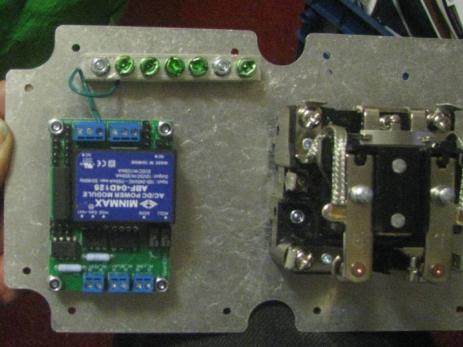</a>
  <a href="images/step-04-2.jpg">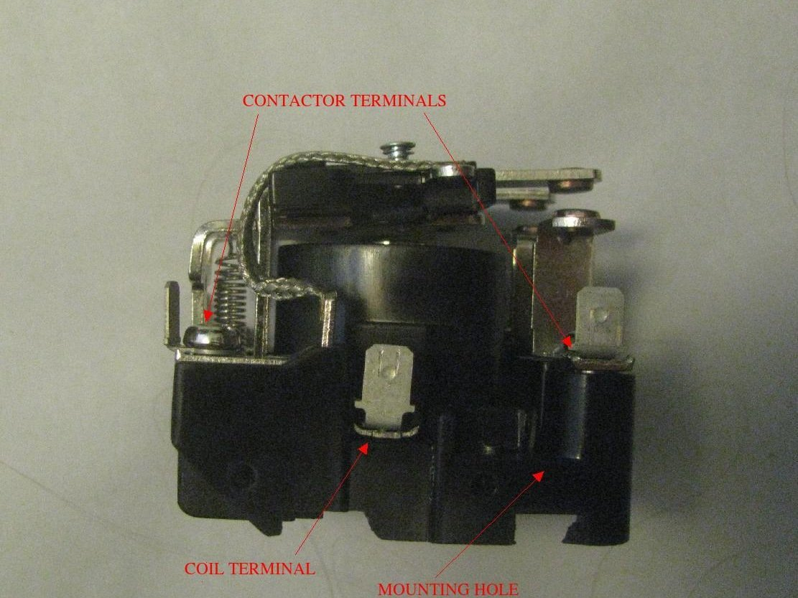</a>

- ⚫ Orient the metal base plate. The plate is drilled for more than one style of relay and board; not all the holes are used. The mounting holes for the ground bar may be identified (silver nuts here).
- ⚫ With the plate the correct way up, mount the OpenEVSE board on the nylon spacers with four 5/8" screws and lock nuts. The nuts should go on the back of the plate, not as shown in the photo (I ground down one nut to fit).
- ⚫ Mount the ground bar to the plate with two 5/8" screws and lock nuts.
- ⚫ Mount the Struthers & Dunn contactor to the plate with two 5/8" screws and lock nuts. Ignore the extra holes.
- ⚫ The relay coil terminals are the two centre ones. Unscrew the philips screws and secure two of the spade terminals to the coil connections.

---

## Step 5 – Review wiring diagram

  <a href="images/step-05-1.jpg">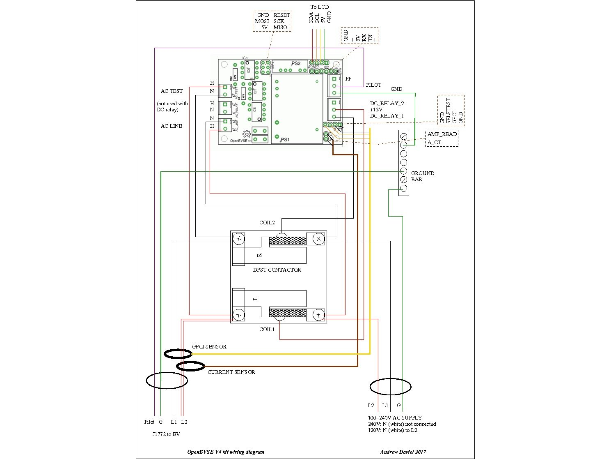</a>
  

- ⚫ See [PDF](documents/OpenEVSEv4kit.pdf) document for more readable image. The OpenEVSE board is designed to drive either a 12V DC relay coil for the Struthers & Dunn DPST contactor, or a 120V AC coil for a Packard C240C contactor, or two SPST contactors. Different connections are used for each. For the Struthers & Dunn contactor, the terminal block marked "AC_RELAY" is not used.
- ⚫ Only one of the DC relay connections is used. I used the one marked DC_RELAY_1 on the board schematic. The relay coil is not polarised, and AC has no polarity, so it does not actually matter what colour wire is used or which way round the relay is wired. I chose to use red for the +12V supply to the relay and for the L2 supply.
- ⚫ Green is used for ground. That does matter. The EVSE may be used on any line voltage between 100-240V AC, 50-60Hz. In North America the choice is usually 120V single-phase or 240V split-phase, though 208V single-phase may be available in some locations. For 120V, neutral (N) is grounded at the utility supply and is commonly not switched.
- ⚫ By convention, in North America, white is used for AC neutral and black or red for live. A split-phase supply may or may not have a neutral, with black and red use for the two lives. Since the EVSE may be connected to either 120V or 240V, for consistancy I have used black for L1. L2 to the car is red, but L2 on the input is white.

---

## Step 6 – Review cable routing

  <a href="images/step-06-1.jpg">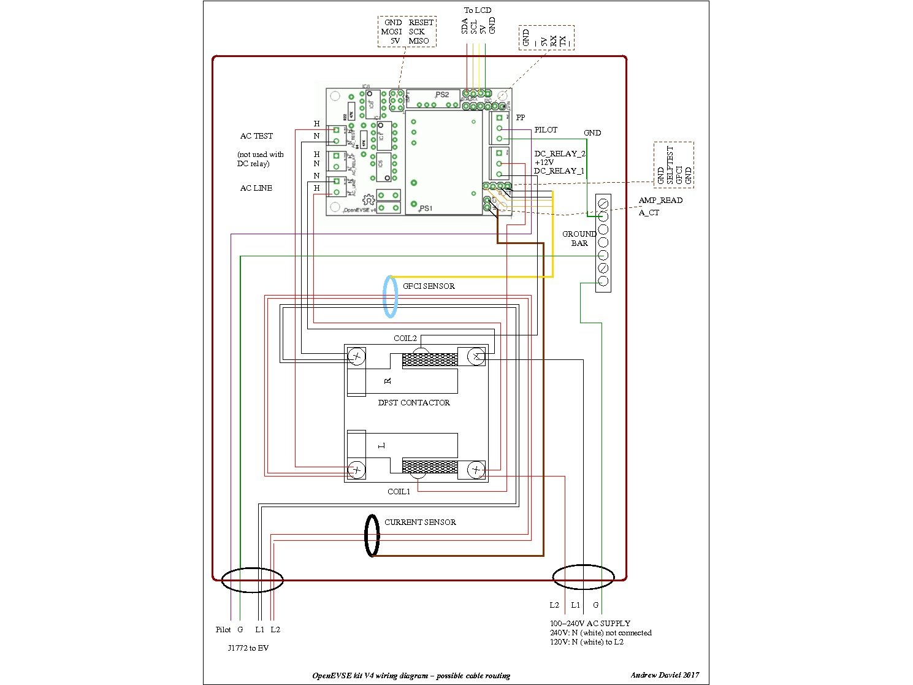</a>
  

- ⚫ There are some constraints on cable routing. The high-current wires have a limited bending radius, and must pass through the current-measurement toroids. Cable routing must not interfere with the contactor switching - wires should not pass over the contactor. See [PDF](documents/OpenEVSEv4kitA.pdf) document for more readable image.
- ⚫ I chose to place the input power cable on the right, the output cable to the EV on the left, and lead the wires around the contactor, secured with cable ties. I drilled extra holes in the base plate to secure the ties. The toroids are placed on either side of the contactor. I also shortened some of the provided low-current leads.

---

## Step 7 – Contactor wiring

  <a href="images/step-07-1.jpg">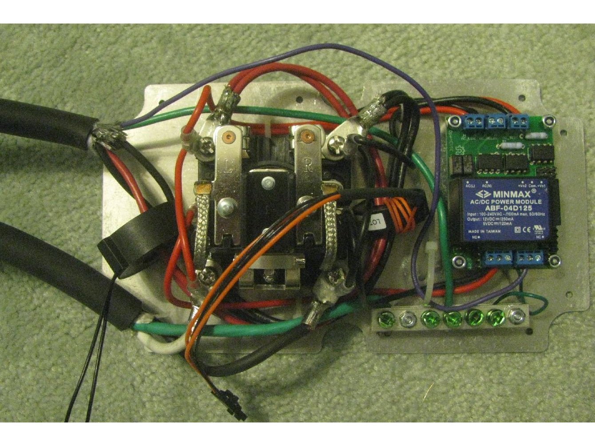</a>
  <a href="images/step-07-2.jpg">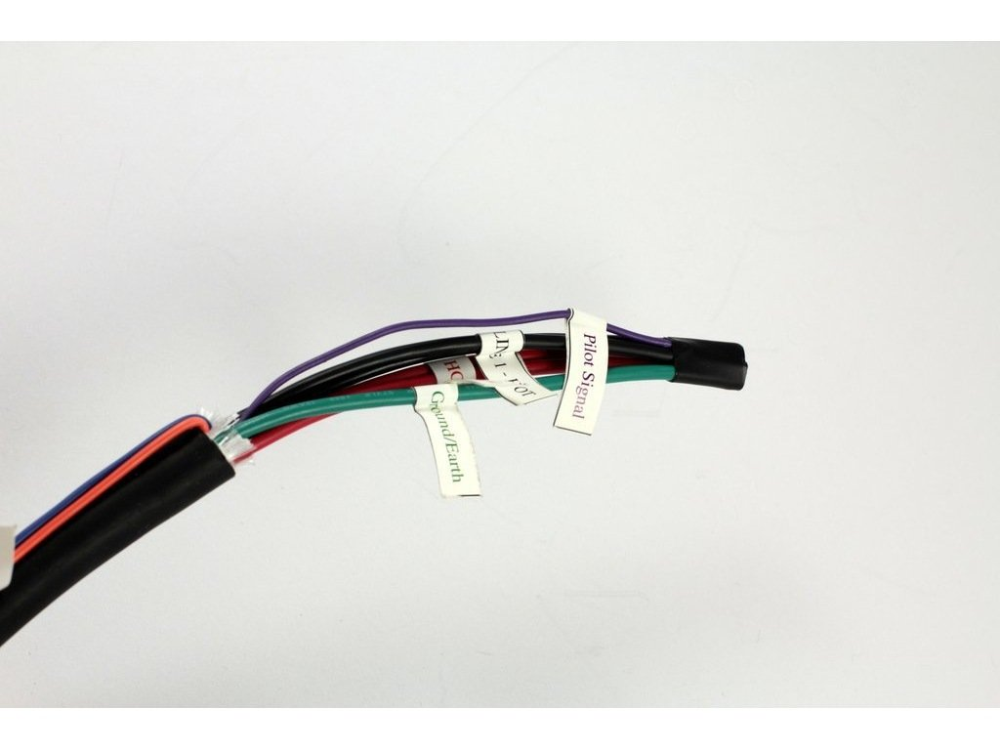</a>
  <a href="images/step-07-3.jpg">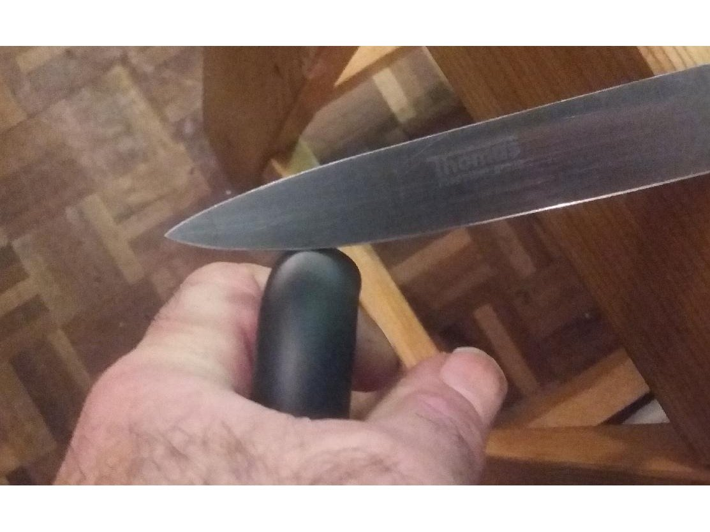</a>

- ⚫ Fit the cable glands to the polycarbonate box. The glands serve both as waterproofing and as strain relief, and should fit snugly around the power cables when tightened.
- ⚫ Feed the input power cable and the J1772 cable through the cable glands and pull through enough length to work with. Strip back a sufficient length of the outer insulation on both cables - about 3 inches on the input cable and 9 inches on the EV cable.
- ⚫ Bend the cable into a small-radius loop, then cut into the outside of the loop with a sharp knife. The cut should propagate into the insulation, allowing it to be pulled apart by hand, Repeat on all sides of the cable. Try not to cut the inner insulation
- ⚫ Cut and strip each of the wires in each cable to the appropriate length, bearing in mind the cable routing. There should be about an inch of outer insulation extending through the cable gland. The ground wires need to go to the ground bar, the pilot wire to the terminal block on the EVSE board. Crimp the connector lugs on to the L1,L2 cables.
- ⚫ EV cables from openevse and quickchargepower use two 12AWG wires for L1 and L2, together equivalent to 9AWG. Crimp them both into one lug. My preference is to solder after crimping, for corrosion resistance and better electrical connection. Do not tin leads before crimping - solder creeps under pressure and will loosen.
- ⚫ I would prefer to substitute 8AWG or 10AWG lugs that actually fit the cable for the 6AWG lugs provided. Failing that, double over the stripped end of the cable.
- ⚫ One pair (either L1 or L2) of wires from the EV cable should be routed through the current sensing toroid (with two sense leads). Both pairs (L1 and L2) should be routed through the GFCI toroid, in the same direction. GFCI works by sensing any difference in the flow and return currents.
- ⚫ Unscrew the terminal screws from the contactor, and bolt the high-current lugs in place with the spade terminals on top. The cable lugs should be in contact with the metal surface of the contactor terminal (bolts should not be used as current carriers).

---

## Step 8 – Contactor Wiring 2

  <a href="images/step-08-1.jpg">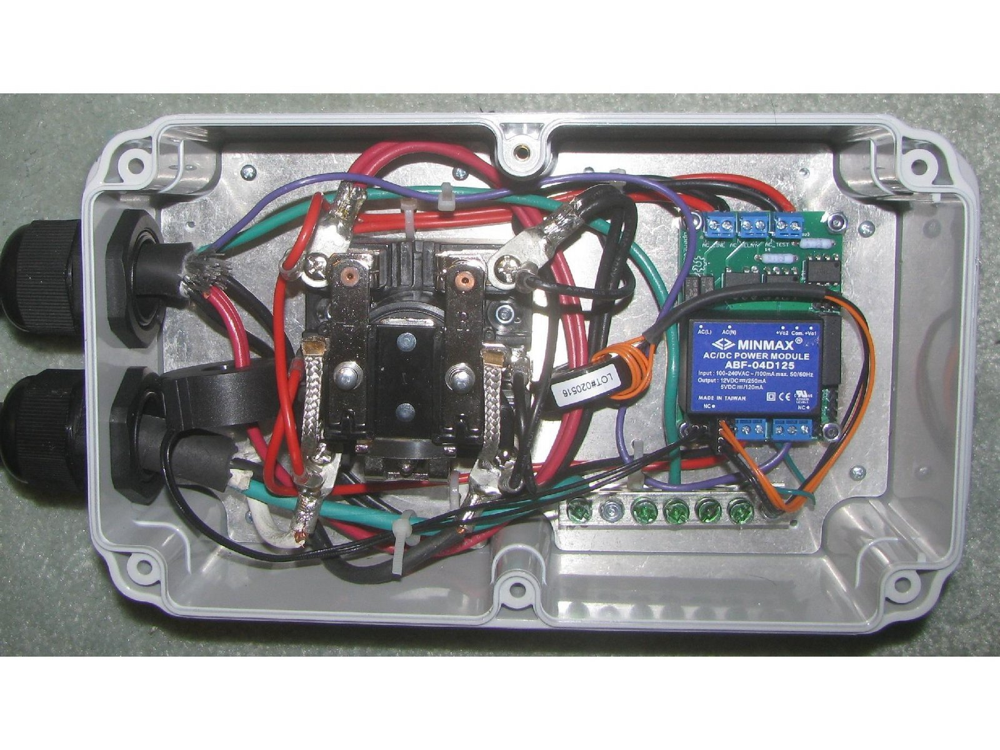</a>

- ⚫ Connect the low-current wires from the input side of the contactor to the AC_LINE inputs on the EFSE board. Connect the low-current wires from the output of the contactor to the AC_TEST inputs. Connect the contactor coil terminals to the DC relay outputs on the EVSE board. Connect the green ground wire from the EVSE board to the ground bar.
- ⚫ Connect the 2-pin connector from the current sense toroid to the 2-pin header on the EVSE board marked A_CT. Connect the 4-pin connector from the GFCI toroid to the header marked G_CT. The orange test wires go on the inside, next to the power supply block.
- ⚫ Connect the pilot wire (usually purple) from the EV cable to the terminal connector on the EVSE board. The EV cable may have an unused wire, which should be cut flush with the outer insulation. Verify all connections are correct and secure, then fasten with cable ties. The contactor armature must be completely free to move.
- ⚫ Slide the power cables through the cable glands and drop the assembled base plate into the polycarbonate box. Fasten the plate to the box in several positions using the supplied sheet-metal screws. Tighten the cable glands so that they grip the cables firmly.
- ⚫ Using a meter, verify all power connections. Ground on the input cable should connect to the ground bar and to the ground socket on the J1772 plug. L1 and L2 should connect through to the appropriate pins on the J1772 plug when the contactor is closed by hand, and should not be shorted together or to ground.

---

## Step 9 – Fit the lid and LCD panel

  <a href="images/step-09-1.jpg">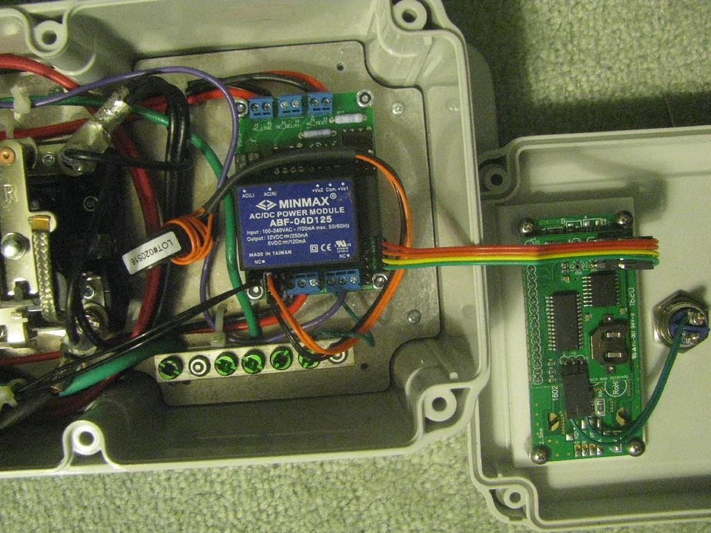</a>
  <a href="images/step-09-2.jpg">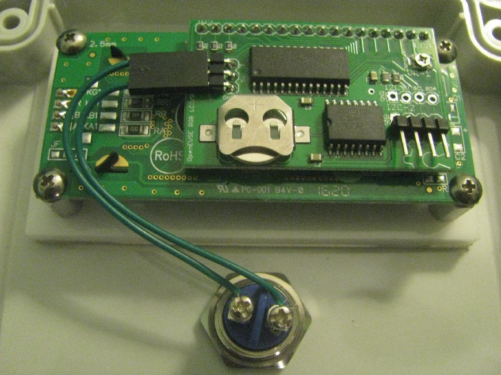</a>

- ⚫ Connect the 4-conductor ribbon cable from the LCD board on the lid to the 4-pin header on the EVSE board. The green (ground) wire connects to the pin with the square solder pad next to the screw. Use the 4-pin header at the edge of the board, not the 6-pin header next to it.
- ⚫ Connect the power cable to a 120V power source. Verify that the LCD panel lights up, and is readable. Adjust the trimpot on the LCD board if necessary.
- ⚫ Optionally, insert a 3V 12mm button cell (CR1220, 1225, 1216) into the battery slot on the LCD board, to provide power for the time-of-day clock.
- ⚫ Fit the lid to the box, and secure with the 6 long screws.

---

## Step 10 – Fitting a power connector

  <a href="images/step-10-1.jpg">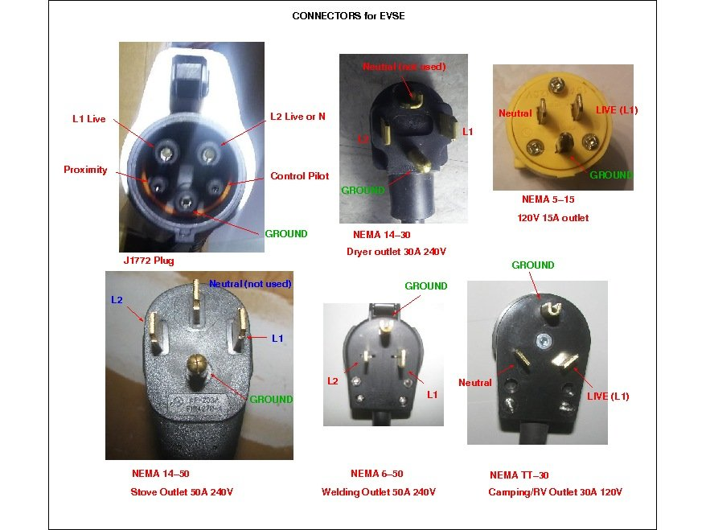</a>
  <a href="images/step-10-2.jpg">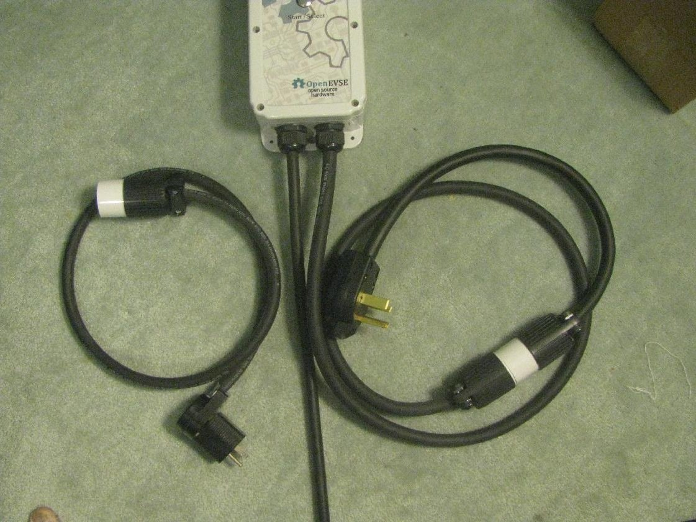</a>

- ⚫ This EVSE can operate at either Level 1 or Level 2, on different voltages and current limits, which are communicated to the charger on the EV via the pilot wire. The current limit must be matched to the connector and the available supply. In North America, there are a number of possible outlets, some of which are shown in the diagram.
- ⚫ For maximum flexibility, fit the EVSE with a NEMA L6-50 locking plug, and then create a number of adaptors L6-50 to 6-50, TT-30, 5-15 etc., which will allow the EVSE to be plugged into dryer outlets, campground RV outlets, welding equipment outlets as well as household 15A outlets.
- ⚫ Commonly, one can buy adapters to down-convert, e.g. NEMA 14-50 stove plug to 15-15 household socket, rated 15A. For the EVSE, we need to up-convert, 50A socket to 15A plug. Use 10AWG cable and 50A connectors for the EVSE end of the adapter, rated for the highest-power circuit used.
- ⚫ If there is a fault in the EVSE when connected to a 50A supply, the supply-side breaker should trip, rather than the cables melting or the EVSE catching fire.
- ⚫ Since the contactor switches both AC lines (L1 and L2, or live and neutral for level 1 charging), it does not actually matter which way round or what colour the supply wires are (except that ground is green). The cable from the EVSE to the adapter will be used for both single-phase (live,neutral) and split-phase (L1,L2)

---

## Step 11 – Setup

  <a href="images/step-11-1.jpg">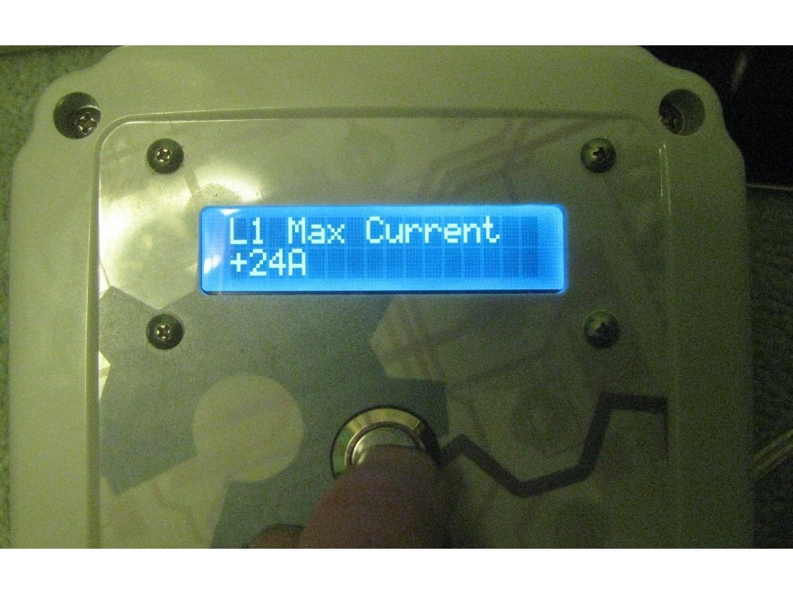</a>
  <a href="images/step-11-2.jpg">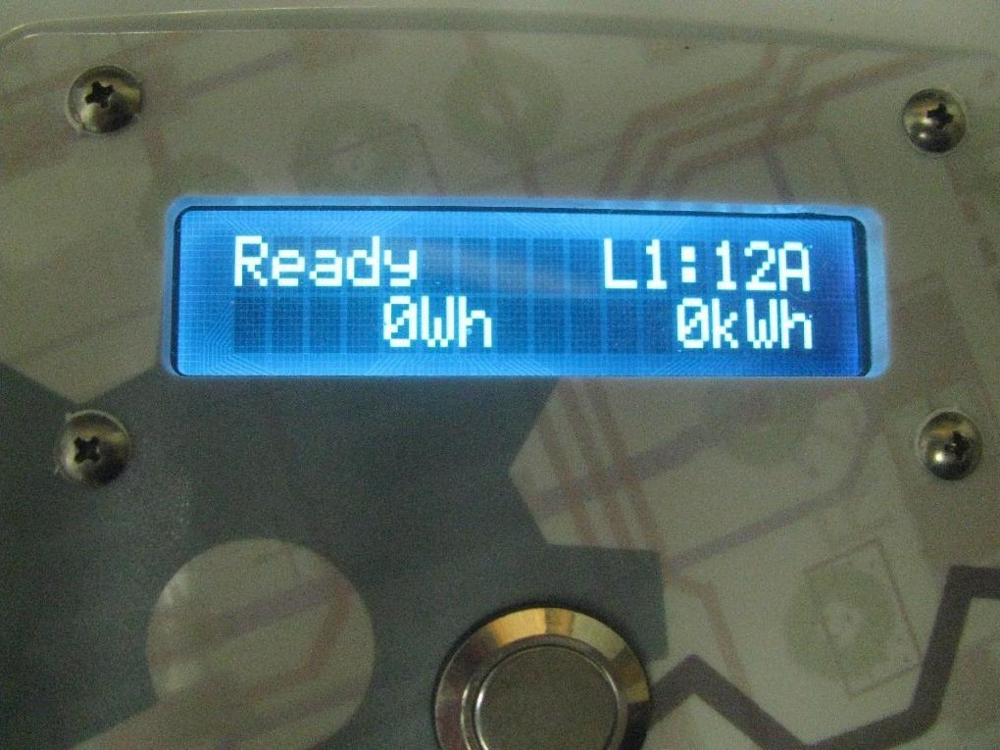</a>

- ⚫ The EVSE controller is programmed with the push button. Push and hold the button to enter setup mode. A short press steps through the available options, while a long press selects one. A selected option is indicated with a **+**
- ⚫ If a battery is fitted, program the date and time. The clock is not necessary for operation, however.
- ⚫ The EVSE may be set to charge at L1 or L2, or Auto. In Auto mode, it will automatically switch depending on the supply voltage (120V or 240V).
- ⚫ The maximum charge rate must be set separately for L1 and L2 charging. In L1 mode, the current may be set in 1A increments from 6A to 24A. It should be set to 80% of the supply rating, e.g. 12A for a 15A outlet (16A breaker) or 16A for a 20A outlet.
- ⚫ In L2 mode (240V) the maximum current can be set in 2A increments between 6A and 80A. However, the Struthers & Dunn contactor is rated only for 40A, as is the J1772 cable. Do not exceed this limit. The EVSE will communicate the allowed current to the vehicle, which will have its own maximum charge current.
- ⚫ Set the maximum current to the least of: 80% of the supply breaker rating, 40A, the rating of the J1772 cable, the rating of the supply outlet, the continuous load rating of the supply cable, the rating of any adapters. E.g for a TT30 campground outlet or14-30 dryer outlet , use 24A. For a 50A welding outlet but 30A EV cable, use 30A.
- ⚫ Set all the other checks to "on". E.g. GFCI self-test, ground check.

---

## Step 12 – Supply outlet wiring

  <a href="images/step-12-1.jpg">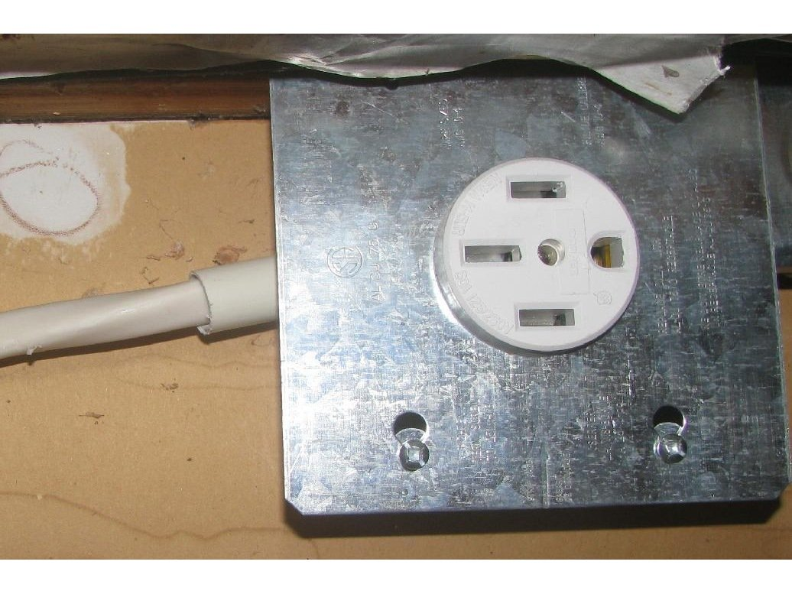</a>

- ⚫ Strictly speaking, the supply wiring falls outside the purview of a build guide, and is typically regulated by a government body. However, the supply outlet and wiring should be rated for a continuous load at least as high as the maximum current used by the EVSE (typically 30A), and protected by a breaker or fuse 125% of that value.
- ⚫ The image shows a NEMA 14-50 outlet with 8AWG wire. The outlet is the only load connected to a ganged pair of 40A breakers, fed from a 70A upstream supply. This outlet is used for a Nissan Leaf which can draw a maximum of 30A. (It would be more common to use a 6-50 3-pin outlet, since neutral is not used by the EVSE)
- ⚫ Depending on local regulations, it may be necessary to employ a qualified electrician for this.

---
