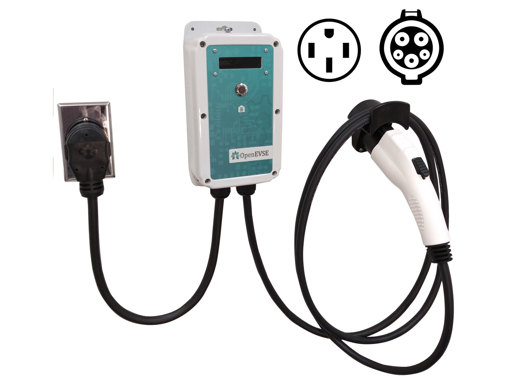
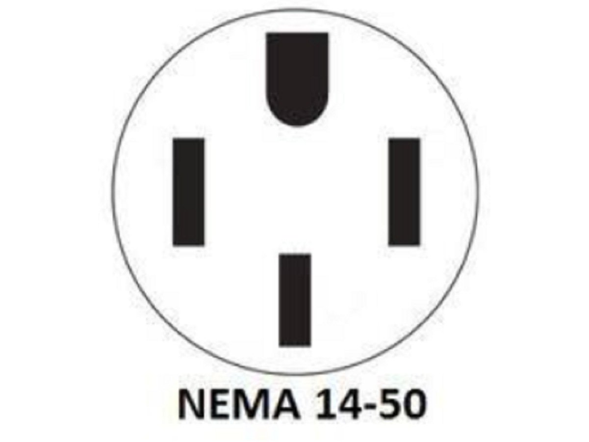
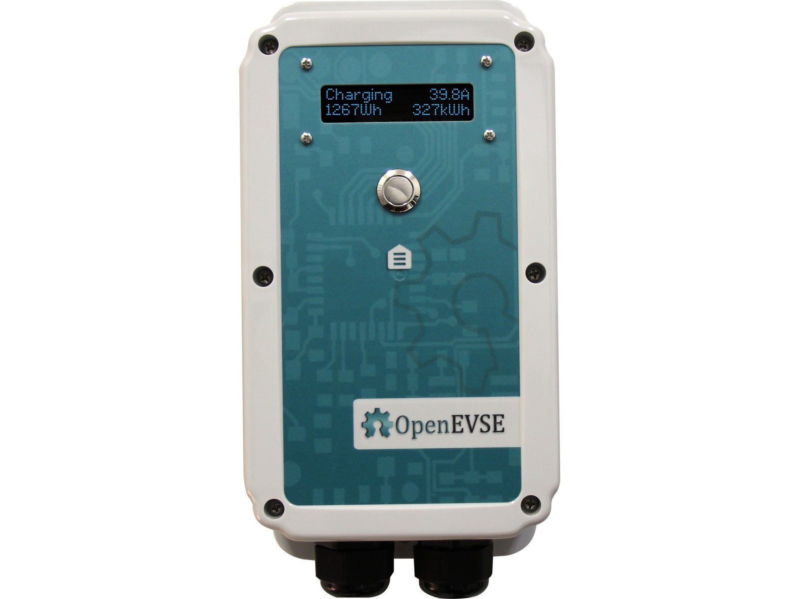
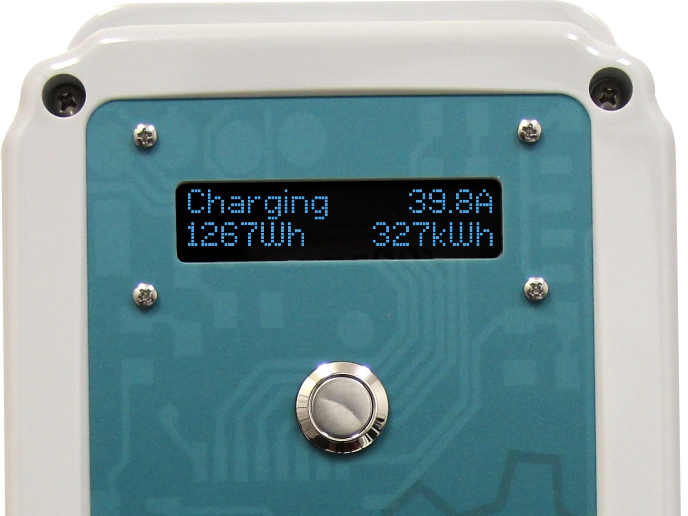

# Quick Start Guide

| Difficulty | Steps | Time Required |
| --- | --- | --- |
| Very easy | 7 | 00:15:00 |

_Written By: Christopher Howell_

## Documents

- [Quick Start Guide](documents/quickstartguide.pdf)
- [Mounting_template.pdf](documents/Mounting_template.pdf)
- [Mounting_template_Holster.pdf](documents/Mounting_template_Holster.pdf)

### Bullet key

Colored bullets match the colored markers drawn on the photos for each step.

| Marker | Meaning |
| --- | --- |
| ⚫ 🔴 🟠 🟡 🟢 🔵 🩵 🟣 | Instruction — matches the same-colored marker in the photo |
| ℹ️ | Note |
| ⚠️ | Caution |
| 📌 | Reminder / Tip |

## Contents

1. [Welcome to OpenEVSE](#step-1--welcome-to-openevse)
2. [Electrical Requirements](#step-2--electrical-requirements)
3. [Mount Charging Station](#step-3--mount-charging-station)
4. [Color Display](#step-4--color-display)
5. [Connect WiFi](#step-5--connect-wifi)
6. [Connect to WiFi](#step-6--connect-to-wifi)
7. [Support](#step-7--support)

---

## Step 1 – Welcome to OpenEVSE

  

- ⚫ Thank You for purchasing a OpenEVSE Charging Station

---

## Step 2 – Electrical Requirements

  

- ⚫ NEMA 14-50 commonly called an "RV outlet" is recommended to charge your vehicle Level 2 at up to 40A.

---

## Step 3 – Mount Charging Station

  

- ⚫ Mount charging station using appropriate method for the mounting surface. Visit our online guide for more detail.
- 📌 For the full Guide Click here:
  - 📌 [Mount your charging station.](../mounting-your-charging-station/README.md)
- ⚫ Portable Mark 2 center holes top and bottom if you plan to use your Charging station on the road. It will be very easy to remove.
- ⚫ Static For more static install, mark the 4 corner holes.

---

## Step 4 – Color Display

  

- ℹ️ Visualize the status of your station from a distance with color
- 🟢 Ready - Green
- 🟡 Connected - Yellow
- 🔵 Charging - Blue
- 🔴 Error - Red
- 🟣 Sleeping - Purple

---

## Step 5 – Connect WiFi

  

- ⚫ Connect charging station to your WiFi network with a phone, tablet, or computer. Visit our online guide for more detail.
- 📌 For the full Guide Click here:
  - 📌 [Connect WiFi](../wifi-join-network/README.md)
- ⚫ Connect to the OpenEVSE WiFi Portal
  - ⚠️ Network: OpenEVSE_XXXXXX
  - ⚠️ Password: openevse

---

## Step 6 – Connect to WiFi

- ⚫ open web browser enter [openevse.local](http://openevse.local) or [192.168.4.1](http://192.168.4.1) if portal does not open automatically
- ⚫ select your network
- ⚫ enter your network password
- ⚫ reconnect device to your network
- ⚫ reconnect to [openevse.local](http://openevse.local)

---

## Step 7 – Support

  

- ⚫ Contact us with any questions
  - ℹ️ Web: [openevse.com](https://openevse.com)
  - ℹ️ E-mail: support@openevse.com

---
