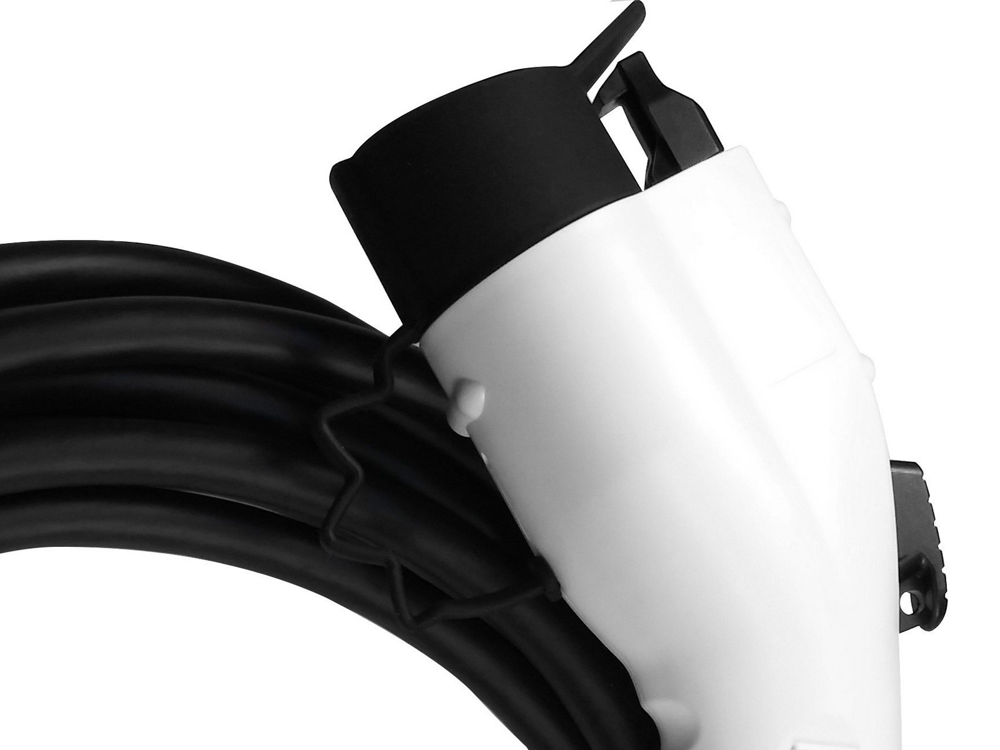
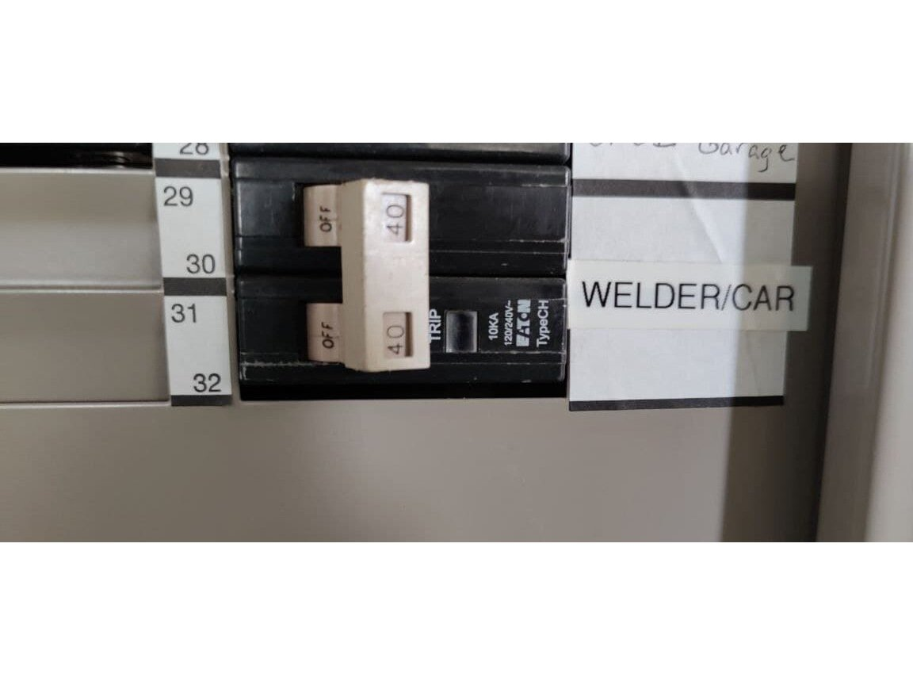
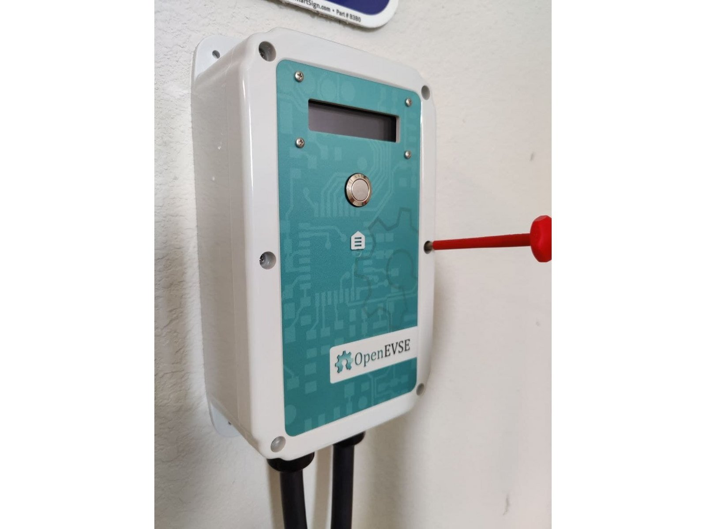
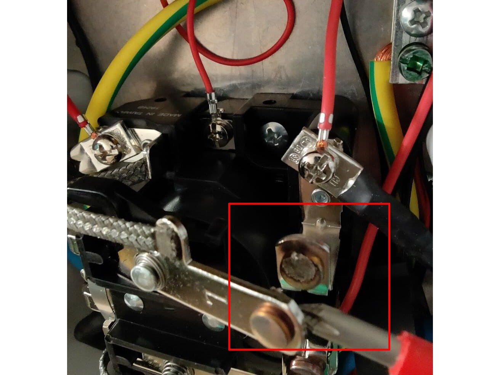
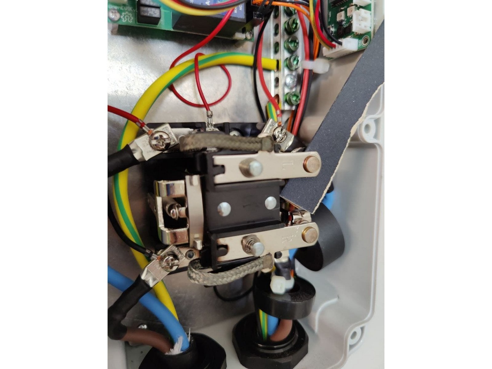
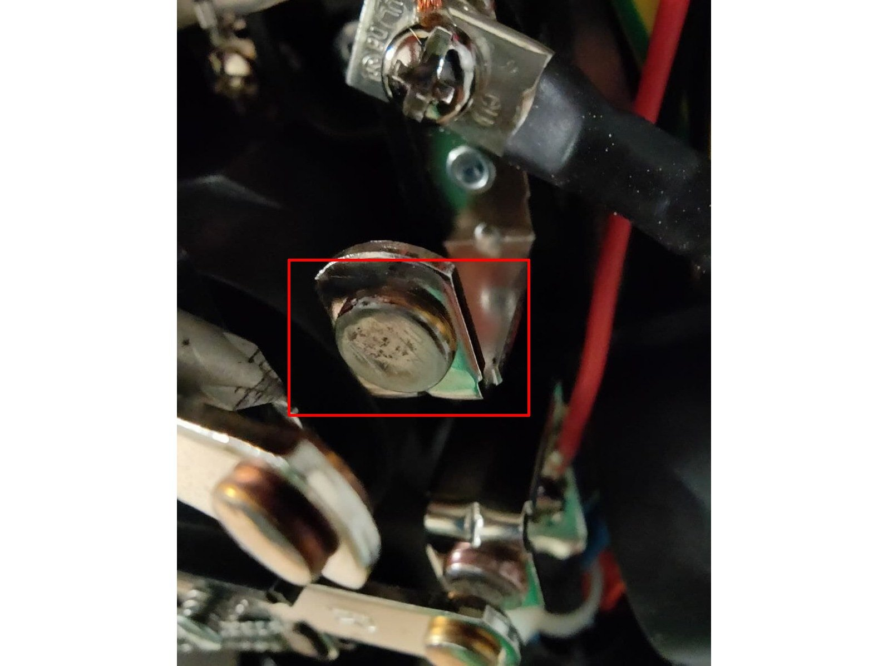
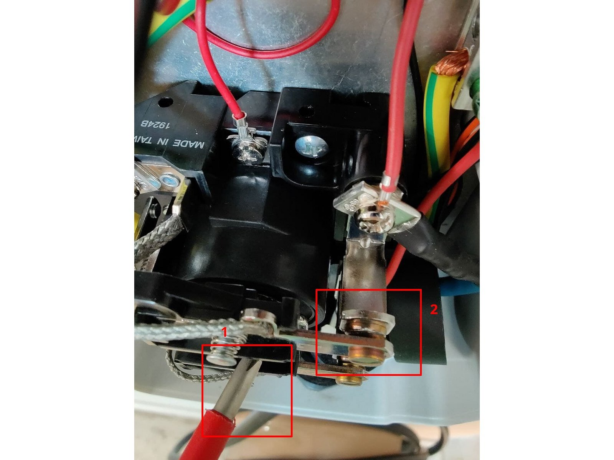
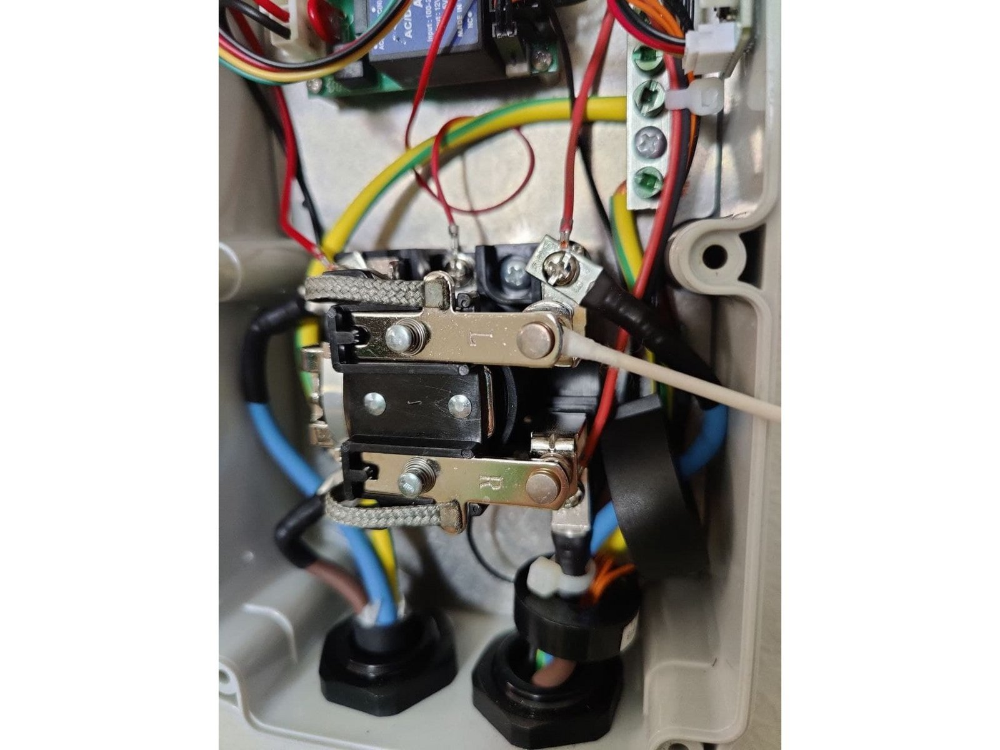
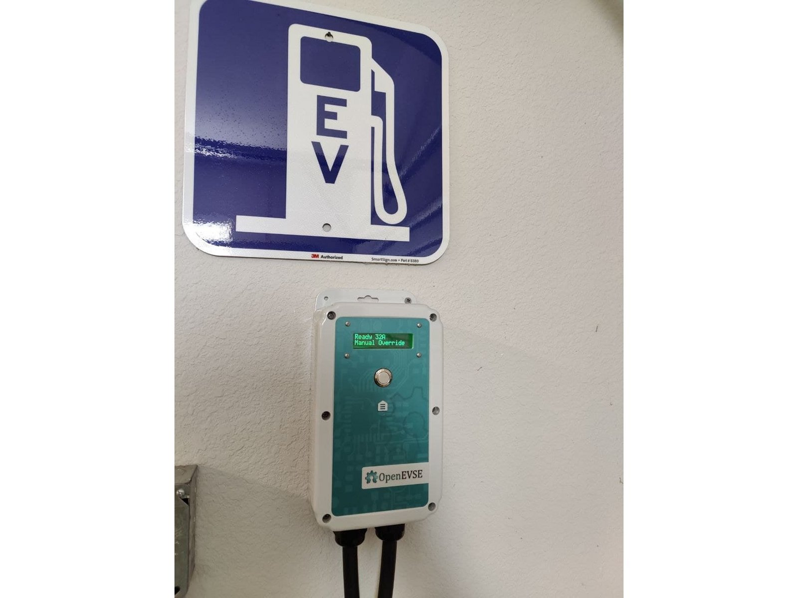

# Relay Maintenance

| Difficulty | Steps | Time Required |
| --- | --- | --- |
| Easy | 7 | 00:30:00 |

_Written By: Alex von Gluck (and one other contributor)_

## Introduction

Troubleshooting and repairing a "Stuck Relay" error.

This repair procedure applies to any OpenEVSE with an open-air relay (contactor) such as the 50A - Struthers - Dunn.

**If your relay is a sealed unit, replace the entire relay.**

## Tools

- Phillips Screwdriver
- Multimeter
- Emery Cloth
- Electric Contact Cleaner

### Bullet key

Colored bullets match the colored markers drawn on the photos for each step.

| Marker | Meaning |
| --- | --- |
| ⚫ 🔴 🟠 🟡 🟢 🔵 🩵 🟣 | Instruction — matches the same-colored marker in the photo |
| ℹ️ | Note |
| ⚠️ | Caution |
| 📌 | Reminder / Tip |

## Contents

1. [Introduction](#step-1--introduction)
2. [Power off unit](#step-2--power-off-unit)
3. [Open unit](#step-3--open-unit)
4. [Inspect contacts](#step-4--inspect-contacts)
5. [Sand contacts](#step-5--sand-contacts)
6. [Clean contacts](#step-6--clean-contacts)
7. [Test](#step-7--test)

---

## Step 1 – Introduction

  

- ⚫ EV standards (IEC and SAE) require charging stations to provide soft start and soft stop of each charging session.
- ⚠️ A properly functioning station should never require relay maintenance.
- 📌 Ensure that the button on SAE J1772 plugs and lock/unlock are functioning properly to automatically remove all load before disconnecting vehicle.
- ⚠️ The plug should never be disconnected under load if the button/unlock are working correctly.

---

## Step 2 – Power off unit

  

- ⚫ Turn power off to your OpenEVSE unit at the breaker
- ⚠️ Validate that your OpenEVSE unit is off

---

## Step 3 – Open unit

  

- ⚫ Open your OpenEVSE unit
- ⚠️ Validate that voltage is not present with your multimeter to ensure electricity is off

---

## Step 4 – Inspect contacts

  

- ⚫ Inspect the relay, ensure the contacts open and close as expected.
- ⚫ Gently tug any stuck contacts to free them.
- ⚠️ If the relay is seriously damaged, melted, bent, broken, or the contacts cannot be separated, replace it.
- ℹ️ If relay is lightly pitted, or has other debris or build-up as shown in picture, continue guide to clean.

---

## Step 5 – Sand contacts

  
  
  

- ⚠️ 'Ensure any sharp metal burrs are removed from the edges of contacts. A metal file might be required.
- ⚫ Cut a piece of coarse emery cloth roughly 3x the width of the contact (normal sandpaper is not recommended as it can leave deposits of other metal types on the contact surface)
- ⚫ Fold the piece of coarse emery cloth, and place it between one set of contacts at a time. Apply gentle pressure to the contacts and sand evenly between the two surfaces.
- ⚫ Repeat process above using coarse, medium, and fine emery cloth to ensure a good connection.
- ⚫ Close the relay by gently pressing the plastic top bracket. Ensure an even and flat connection between the contacts.

---

## Step 6 – Clean contacts

  

- ⚫ Once your contacts are evenly sanded, use contact cleaner and a q-tip to scrub each contact surface removing any build-up, metal, or grease

---

## Step 7 – Test

  

- ⚫ Reassemble your OpenEVSE and power it on.
- ℹ️ Monitor the self-test to ensure errors have cleared
- ⚫ Attach a vehicle and charge at the full rate, monitor the OpenEVSE unit for any excessive heat build-up.
- ⚠️ If any excessive heat is detected on the OpenEVSE unit, replace the relay.
- ⚫ Slowly plug and unplug the vehicle a few times ensuring the relay opens and closes as expected each time.

---
