# Replace Controller in Juicebox v1

| Difficulty | Steps | Time Required |
| --- | --- | --- |
| Easy | 7 | 00:15:00 |

_Written By: Christopher Howell (and one other contributor)_

### Bullet key

Colored bullets match the colored markers drawn on the photos for each step.

| Marker | Meaning |
| --- | --- |
| ⚫ 🔴 🟠 🟢 🔵 🟣 | Instruction — matches the same-colored marker in the photo |
| ℹ️ | Note |
| ⚠️ | Caution |
| 📌 | Reminder / Tip |

## Contents

1. [Remove lid](#step-1--remove-lid)
2. [Remove Juicebox Controller Board](#step-2--remove-juicebox-controller-board)
3. [Install OpenEVSE controller](#step-3--install-openevse-controller)
4. [Connect AC wires](#step-4--connect-ac-wires)
5. [Connect Low Voltage wires](#step-5--connect-low-voltage-wires)
6. [Connect more low voltage wires](#step-6--connect-more-low-voltage-wires)
7. [Install Lid](#step-7--install-lid)

---

## Step 1 – Remove lid

  <a href="images/step-01-1.jpg">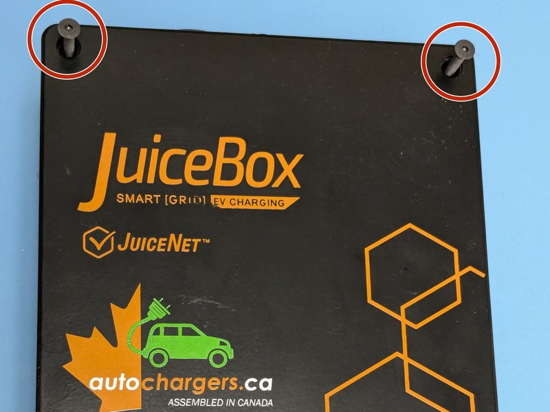</a>
  <a href="images/step-01-2.jpg">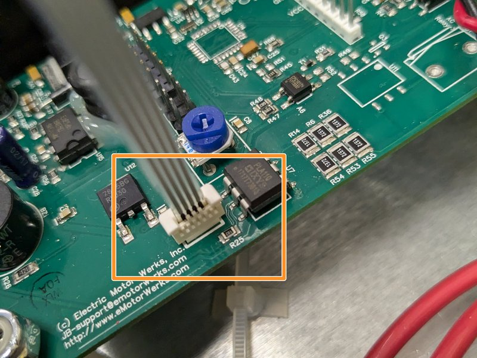</a>

- ℹ️ Unplug your station or turn off circuit breaker. Never work on your station energized.
- 🔴 Remove the 4 Torx T10 Screws.
- ⚠️ Carefully lift the lid and disconnect the ribbon cable for the indicator lights.

---

## Step 2 – Remove Juicebox Controller Board

  <a href="images/step-02-1.jpg">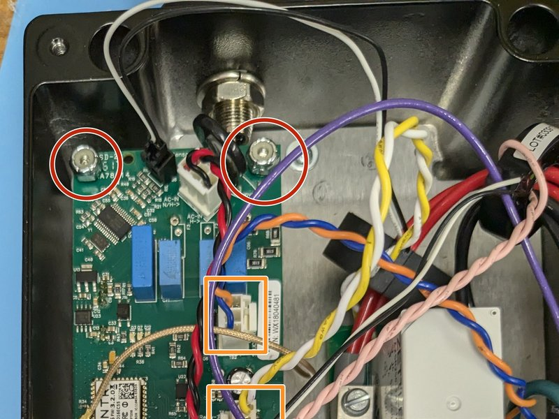</a>
  <a href="images/step-02-2.jpg">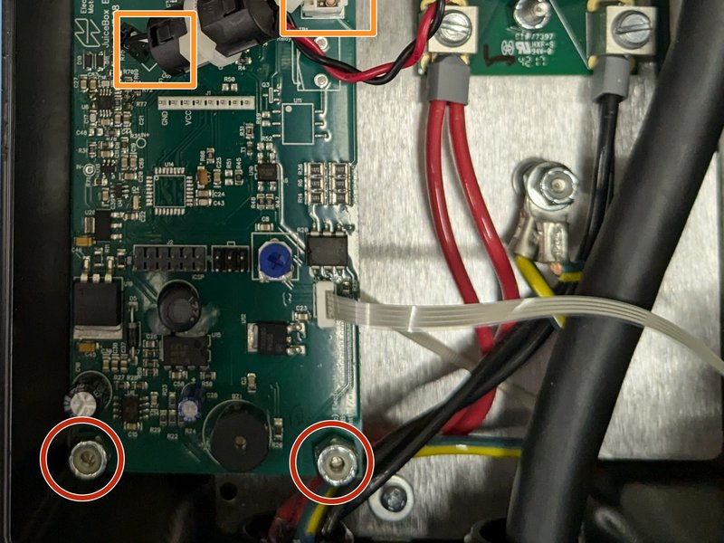</a>

- 🔴 Remove the 4 11/32" nuts on each corner of the controller board.
- 🟠 Remove all of the connectors. Note most have tabs which when pressed release the connector.
- ⚫ Remove the circuit board.

---

## Step 3 – Install OpenEVSE controller

  <a href="images/step-03-1.jpg">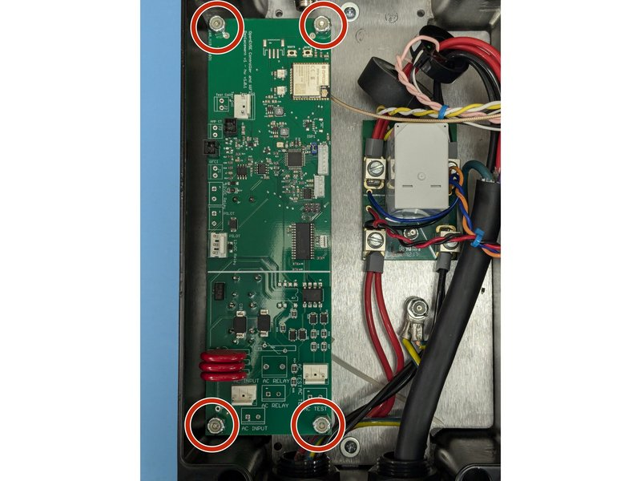</a>

- ⚫ Install the OpenEVSE controller board.
- 🔴 Secure the controller with the 4 11/32" nuts.

---

## Step 4 – Connect AC wires

  <a href="images/step-04-1.jpg">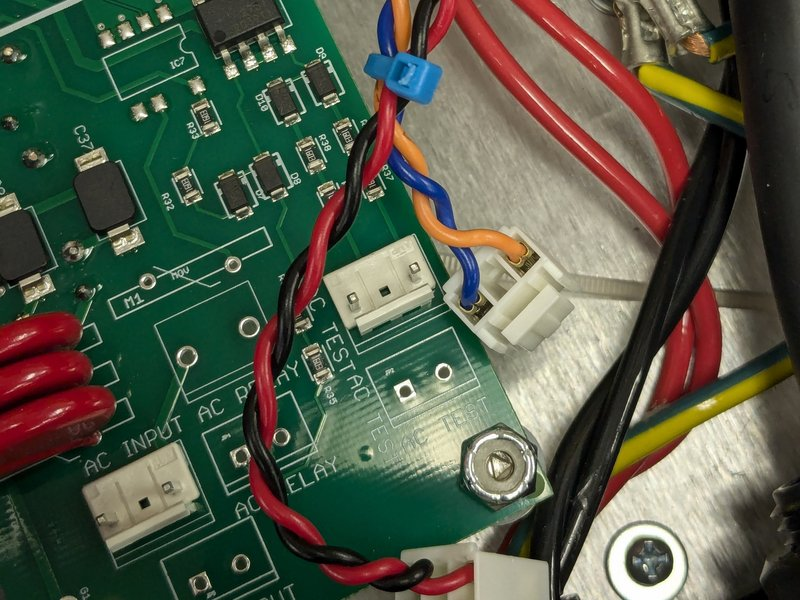</a>
  <a href="images/step-04-2.jpg">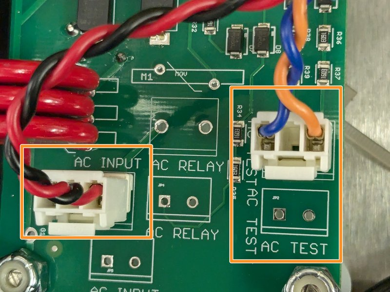</a>

- 🔴 Identify the AC wires coming from the circuit board/Relay Module. Tie wrap them together.
- 🟠 Connect AC_INPUT (RED and BLACK) and AC_TEST (BLUE and ORANGE)

---

## Step 5 – Connect Low Voltage wires

  <a href="images/step-05-1.jpg">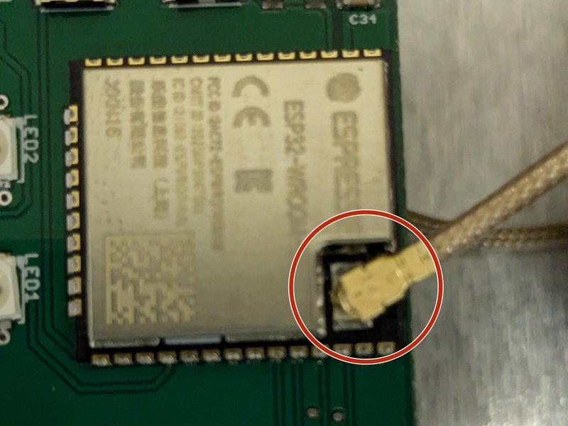</a>
  <a href="images/step-05-2.jpg">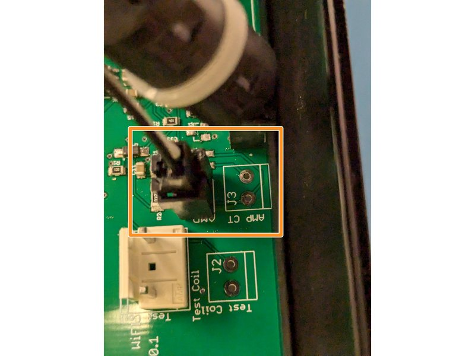</a>
  <a href="images/step-05-3.jpg">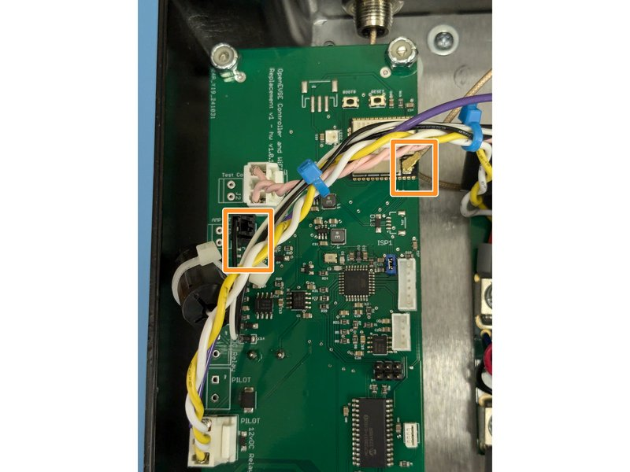</a>

- 🔴 Connect Antenna wire to the WiFi module
- 🟠 Connect the donut coil WITHOUT the additional wire wrap to the AMP_CT connector. One Power wire runs through this coil.

---

## Step 6 – Connect more low voltage wires

  <a href="images/step-06-1.jpg">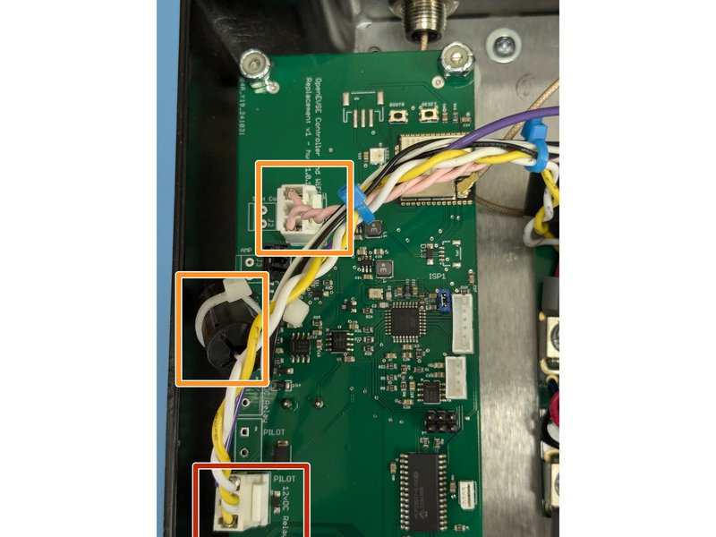</a>
  <a href="images/step-06-2.jpg">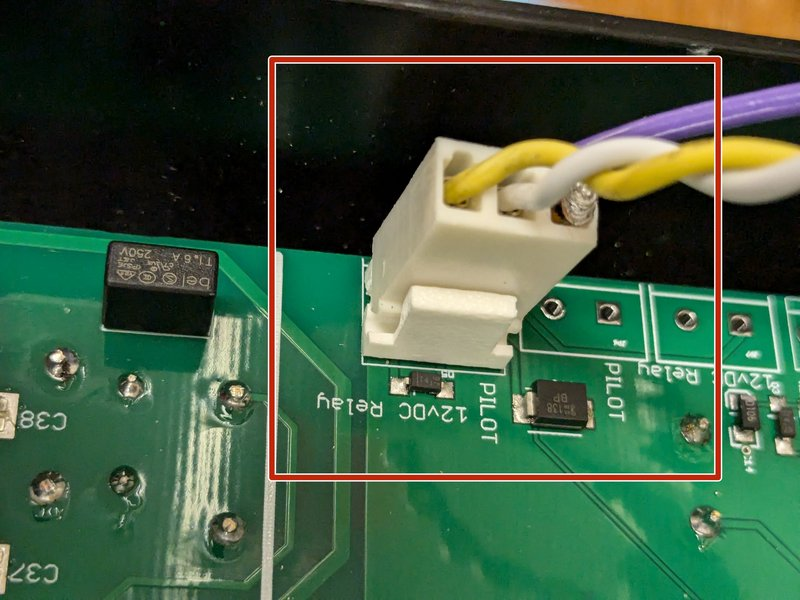</a>
  <a href="images/step-06-3.jpg">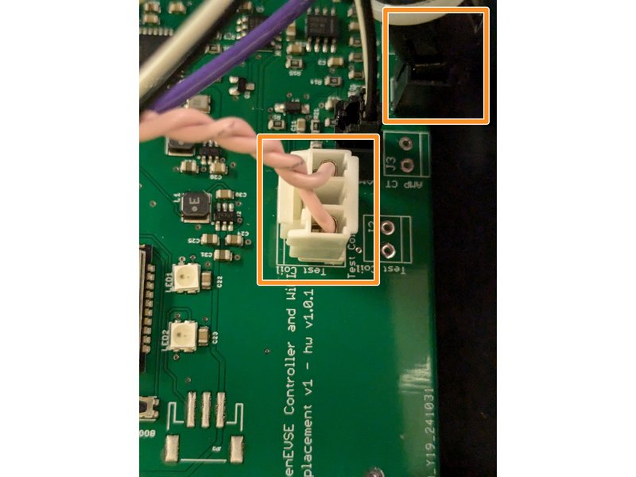</a>

- 🔴 Connect the 3 pin connector that goes to the relay and has the pilot line to the EV handle to the PILOT - 12vDC relay connector.
- 🟠 Connect the donut coil WITH the additional wire wrap to the GFCI connector. Connect the wrap to the Test Coil Connector.

---

## Step 7 – Install Lid

  <a href="images/step-07-1.jpg">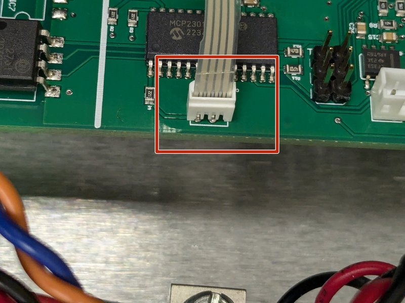</a>
  <a href="images/step-07-2.jpg">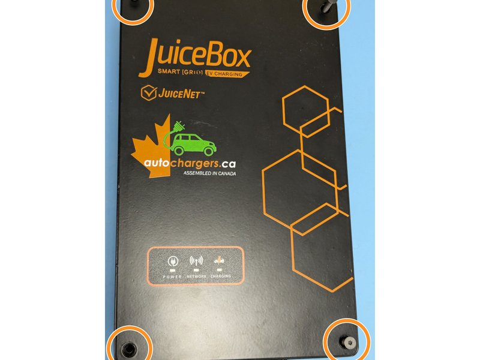</a>

- 🔴 Connect the ribbon cable for the indicator lights.
- 🟠 Secure the 4 TORX T10 screws on each corner of the lid.

---

