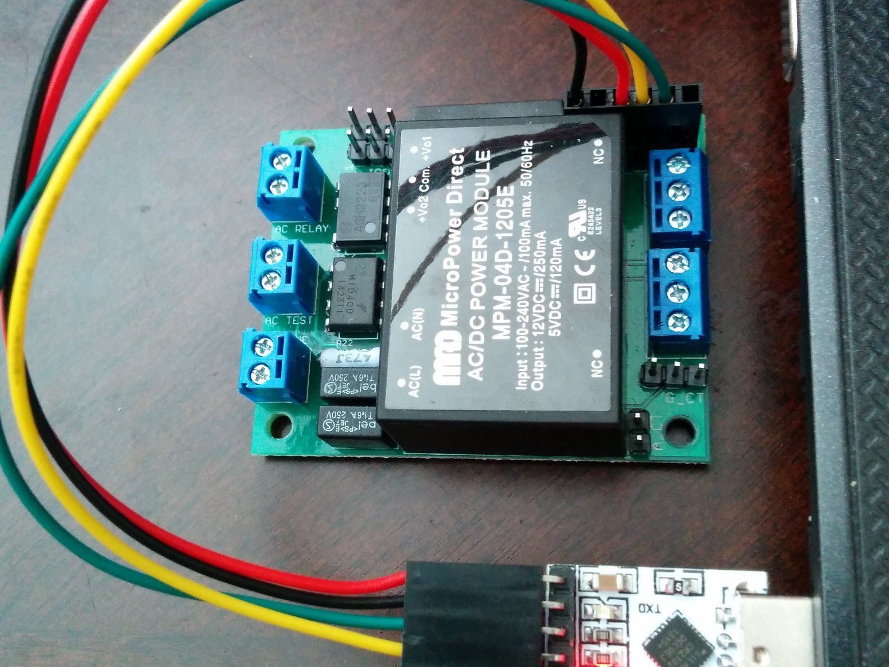
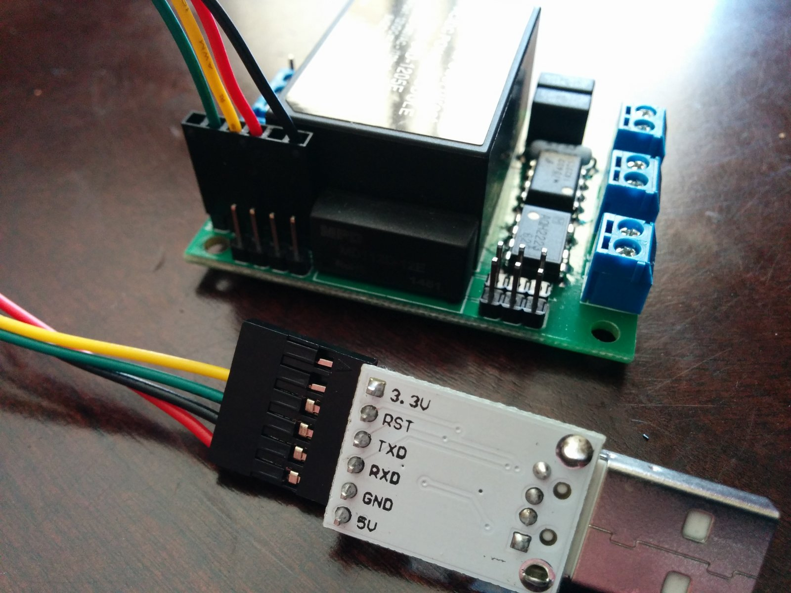
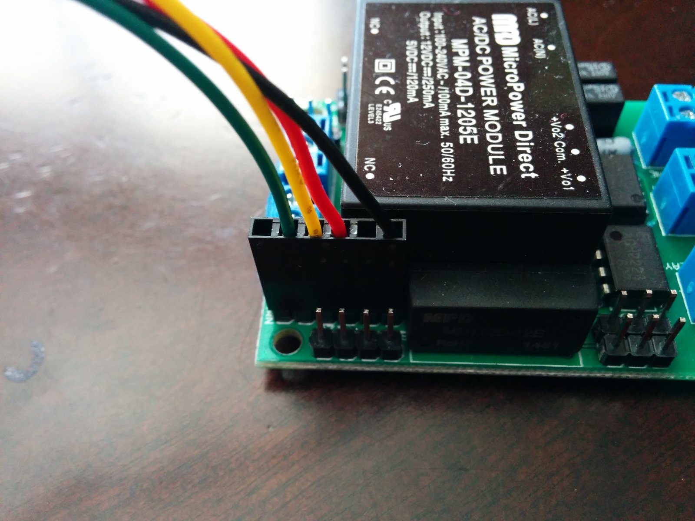
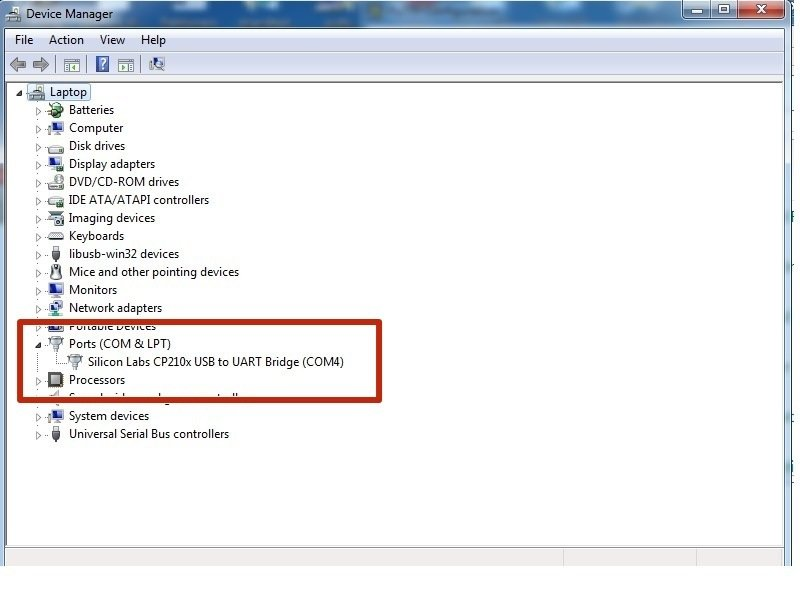
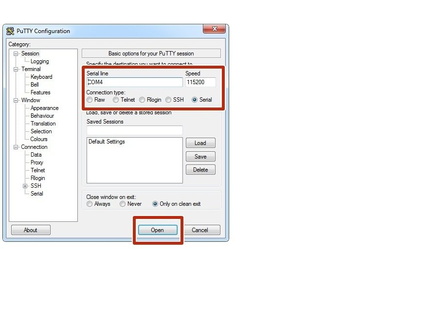
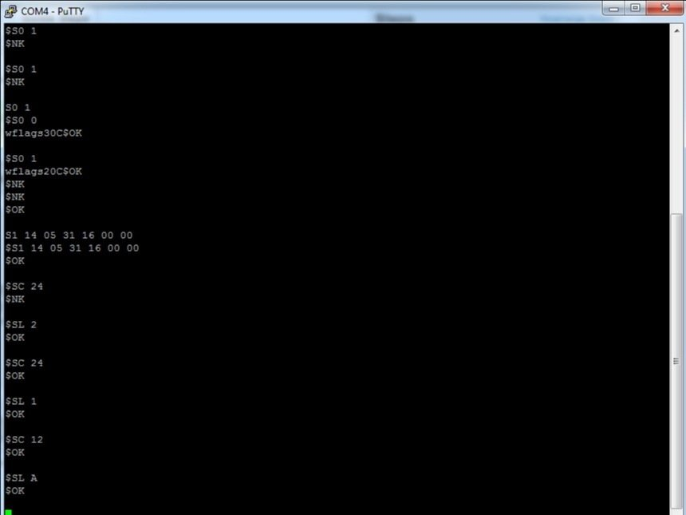
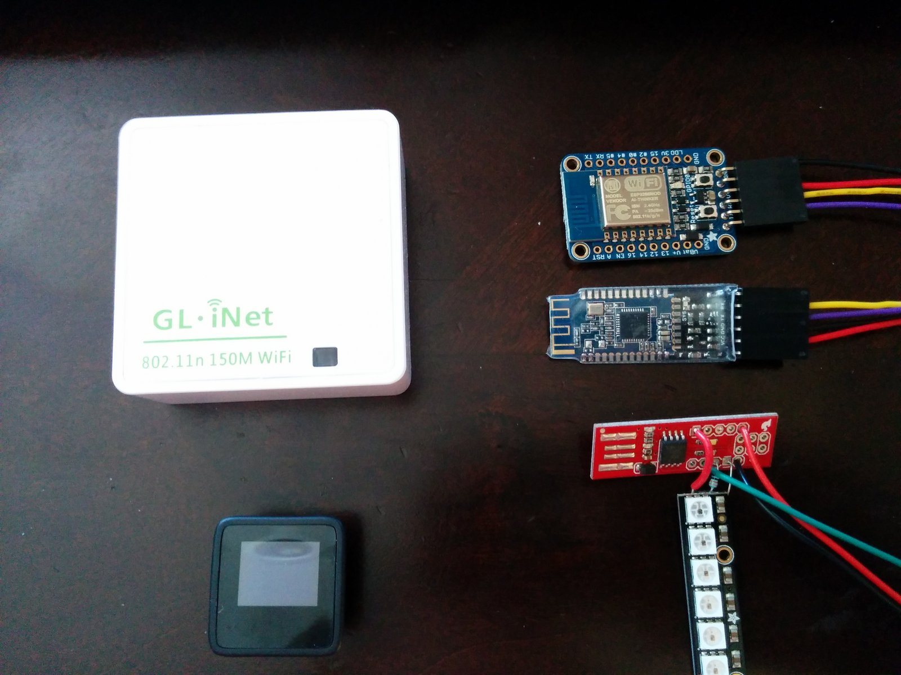

# Serial Communications with OpenEVSE

| Difficulty | Steps | Time Required |
| --- | --- | --- |
| Moderate | 5 | No estimate |

_Written By: Christopher Howell (and one other contributor)_

### Bullet key

Colored bullets match the colored markers drawn on the photos for each step.

| Marker | Meaning |
| --- | --- |
| ⚫ 🔴 🟠 🟡 🟢 🔵 🩵 🟣 | Instruction — matches the same-colored marker in the photo |
| ℹ️ | Note |
| ⚠️ | Caution |
| 📌 | Reminder / Tip |

## Contents

1. [Hardware](#step-1--hardware)
2. [USB-TTL -  Serial Console](#step-2--usb-ttl----serial-console)
3. [Remote API Get commands](#step-3--remote-api-get-commands)
4. [Remote API Set Commands](#step-4--remote-api-set-commands)
5. [External Communications](#step-5--external-communications)

---

## Step 1 – Hardware

  
  
  

- ⚫ OpenEVSE supports many Serial TTL Devices at 5v on the 6 pin header.
- ⚫ The header is the common FTDI format.
  - ⚫ Pin 1 - Ground (Black)
  - ⚫ Pin 2 - No Connection
  - 🔴 Pin 3 - 5v (Red) - **75ma max** Higher power devices must use external power.
  - 🟡 Pin 4 - Recieve (Yellow) connects to transmit on the remote device.
  - 🟢 Pin 5 - Transmit (Green) connects to receive on the remote device.
- ⚠️ It is recommended to update the latest version of firmware. Many changes have been made over time. This guide was written with Firmware version 3.7.8.

---

## Step 2 – USB-TTL -  Serial Console

  
  
  

- ⚫ Insert the serial to USB adapt or and install the appropriate driver
  - ℹ️ The windows driver for the adaptor sold in the OpenEV store is here: [Windows Driver](https://www.silabs.com/products/development-tools/software/usb-to-uart-bridge-vcp-drivers)
- ⚫ Using a terminal console (PuTTY recommended) set the COMM port to the USB-TTL adapter and the baud rate to 115200. Then click Open.
  - ℹ️ If you do not know the comm port you can go into the Device manager and look under Ports.
- ⚫ In the console window enter $ and press enter. You should receive a $NK response.
- ⚫ Next enter $SE 1. This will turn on local echo so you can see what you send. The response should be $OK.
- ⚫ Now enter the command $GV. The response should be $OK followed by the Firmware version and the Remote API version.

---

## Step 3 – Remote API Get commands

  

- ⚠️ Full documentation of the Remote API is located in the rapi_proc.h file in the OpenEVSE Source code. The file is located here: [rapi_proc.h](https://github.com/OpenEVSE/open_evse/blob/stable/firmware/open_evse/rapi_proc.h)
- ⚫ The Remote API is a very powerful tool for extending OpenEVSE, useful for information, configuration and external applications.
- ⚫ Here are some interesting Get commands:
  - ⚫ $GG - Get real time charging current. Returns $OK current voltage(future hardware)
  - ⚫ $GP - Get real time Temprature values from RTC chip, MCP9808 and TMP007 IR sensors. Returns $OK RTC, MCP9808, TMP007 - 0 is returned if sensor is not found.
  - ⚫ $GS - Get EVSE State. Returns the current state $OK State - 1 Not Connected - 2 Connected - 3 Charging - 4 Error - 5 Error.
  - ⚫ $GU - Get usage statistics. Returns $OK Energy used last session and lifetime

---

## Step 4 – Remote API Set Commands

  

- ⚠️ Full documentation of the Remote API is located in the rapi_proc.h file in the OpenEVSE Source code. The file is located here: [rapi_proc.h](https://github.com/OpenEVSE/open_evse/blob/stable/firmware/open_evse/rapi_proc.h)
- ⚫ The Remote API is a very powerful tool for extending OpenEVSE, useful for information, configuration and external applications.
- ⚫ Here are some interesting Set commands:
  - ⚫ $SC amp - Set current value in amps. Subject to Mix and Max for each setting min 6A Max 80A.
  - ⚫ $SL 1 or 2 or A - set service level L1 /L2 / Auto
  - 📌 Tip you can set Service level 1 set current for L1 then set Service Level 2 and set current. Each has its own setting.
  - ⚫ S1 yr mo day hr min sec - Set current time 2 digit value for each hour 24 hour value.
  - ⚫ $S0 0 or 1 - Set LCD Type 0 = Monochrome 1 = RGB.

---

## Step 5 – External Communications

  

- ⚫ OpenEVSE can be extended with many devices using 5v TTL (or 3.3v with level shifting).
- ⚠️ External power is required if device draws more than 75ma at 5v.

---
