# Testing Basic and Advanced

| Difficulty | Steps | Time Required |
| --- | --- | --- |
| Moderate | 11 | 00:20:00 |

_Written By: Christopher Howell (and 2 other contributors)_

### Bullet key

Colored bullets match the colored markers drawn on the photos for each step.

| Marker | Meaning |
| --- | --- |
| ⚫ 🔴 🟠 🟡 🟢 🔵 🩵 🟣 | Instruction — matches the same-colored marker in the photo |
| ℹ️ | Note |
| ⚠️ | Caution |
| 📌 | Reminder / Tip |

## Contents

1. [Introduction](#step-1--introduction)
2. [Basic Testing - Power on Self Test (POST)](#step-2--basic-testing---power-on-self-test-post)
3. [Basic Testing - Testing EVSE States](#step-3--basic-testing---testing-evse-states)
4. [Basic Testing (Optional) Pilot Signal Frequency and Duty Cycle](#step-4--basic-testing-optional-pilot-signal-frequency-and-duty-cycle)
5. [Basic Testing - GFCI Test](#step-5--basic-testing---gfci-test)
6. [Advanced Testing](#step-6--advanced-testing)
7. [Advanced Testing - GFCI Fault trip point](#step-7--advanced-testing---gfci-fault-trip-point)
8. [Advanced Testing - GFCI Auto Retry](#step-8--advanced-testing---gfci-auto-retry)
9. [Advanced Testing - GFCI Lockout](#step-9--advanced-testing---gfci-lockout)
10. [Advanced Testing - Welded Contactor](#step-10--advanced-testing---welded-contactor)
11. [Advanced Testing - Earth Ground](#step-11--advanced-testing---earth-ground)

---

## Step 1 – Introduction

  <a href="images/step-01-1.jpg">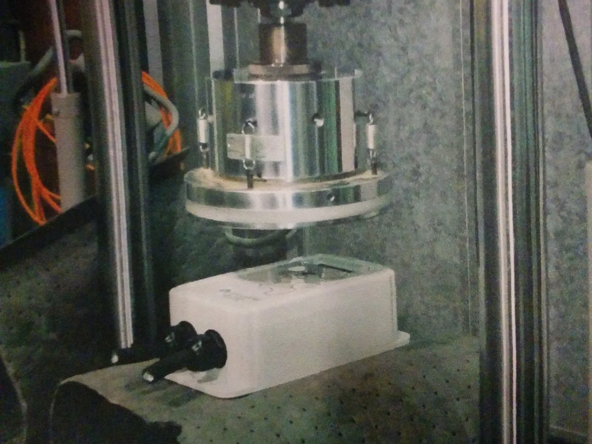</a>
  <a href="images/step-01-2.jpg">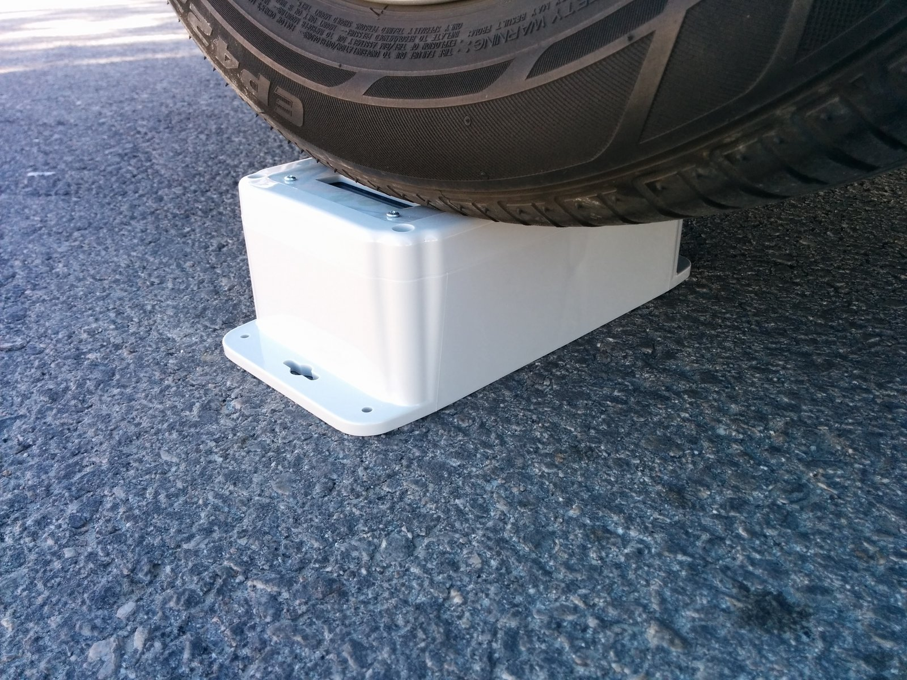</a>
  <a href="images/step-01-3.jpg">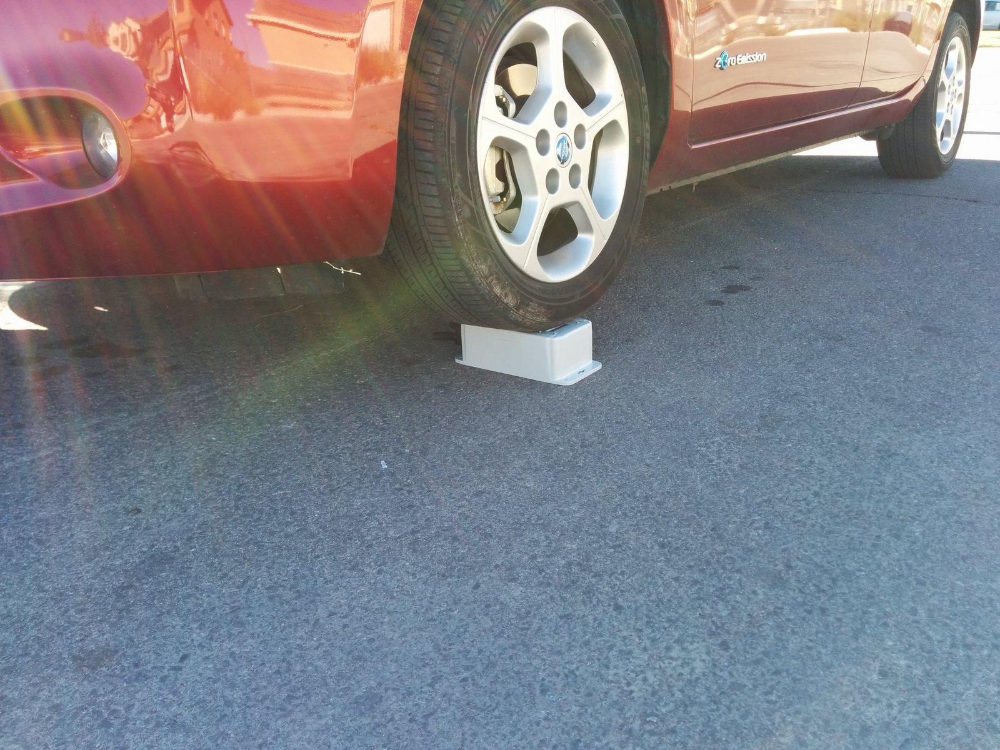</a>

- ⚠️ Testing is an important part of the OpenEVSE build process. This guide provides testing recommendation both for the user and those developing hardware and software.
- ℹ️ OpenEVSE performs extensive self test during boot, before closing relays/contactors and while operating.
- 📌 Basic Testing is recommended for all builders after building your charging station and whenever maintenance is performed.
- 📌 Advanced testing shall be performed by hardware and software developers before releasing "Stable" firmware or a new hardware revision.
- ℹ️ For builders wishing to better understand how a charging stations work, Advanced Testing may be performed.
- ⚠️ Advanced Tests require live AC Power. Use extreme caution when working near energized high voltage components.

---

## Step 2 – Basic Testing - Power on Self Test (POST)

  <a href="images/step-02.mp4">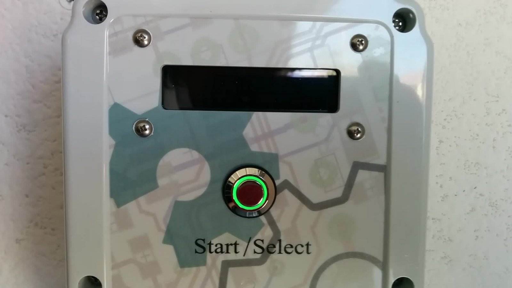</a>

▶️ [Watch the video for this step](images/step-02.mp4)

- ℹ️ During the boot process OpenEVSE will run a Power on Self Test (POST).
- ⚠️ If the POST fails by indicating any Error condition or a RED LED/LCD please refer to the Troubleshooting guide before proceeding.

---

## Step 3 – Basic Testing - Testing EVSE States

  <a href="images/step-03-1.jpg">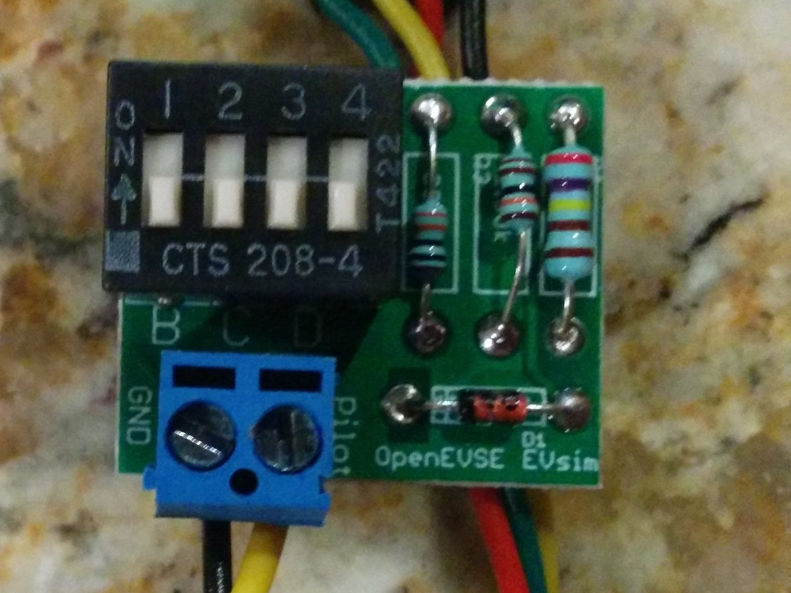</a>

- 🟢 EVSE states can be tested with a few resistors and a diode, and EV Simulator or an EVSE Tester. After a sucessful Power on Self Test OpenEVSE should enter State A - Ready and the LED/LCD should be Green.
- 🟡 State B - EV Connected. Connect 2.74k resistance plus a diode from Pilot to ground. OpenEVSE display should display "EV Connected" and LED/LCD should turn Yellow. (OpenEVSE Sim - 1 on)
- 🩵 State C - Charging. Connect 882 ohm resistance plus a diode from Pilot to ground. OpenEVSE display should display "Charging" and LED/LCD should turn Blue. (OpenEVSE Sim - 1 on + 2 on)
- 🔴 State D - Ventilation Required. Connect 246 ohms resistance plus a diode from Pilot to ground. OpenEVSE display should display "EVSE ERROR - VENT REQUIRED" and LED/LCD should turn Red. (OpenEVSE Sim - 1 on + 2 on + 3 on)

---

## Step 4 – Basic Testing (Optional) Pilot Signal Frequency and Duty Cycle

  <a href="images/step-04-1.jpg">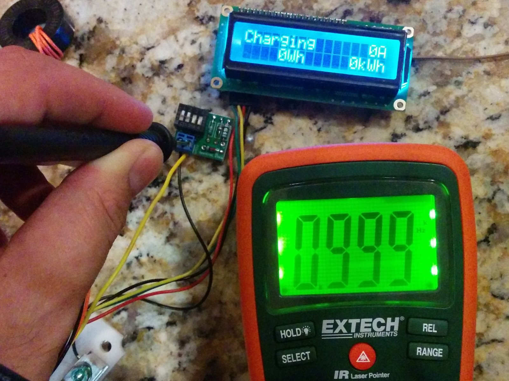</a>
  <a href="images/step-04-2.jpg">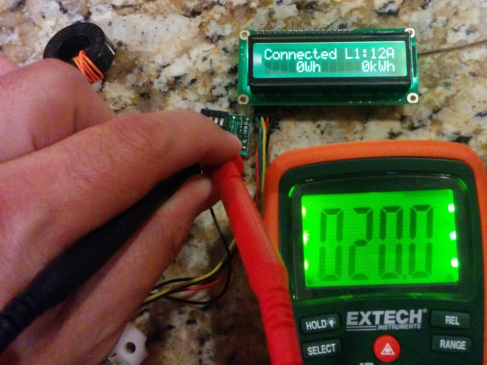</a>

- ℹ️ OpenEVSE outputs a 1000hz pilot signal when connected to an EV and Ready.
- 🟡 Using a Multimeter with frequency measurement, a oscilloscope or an EV Sim II from nslayer. Enter State B and measure frequency from pilot to ground.
- ℹ️ Frequency should measure between 980 to 1020Hz.
- 🟡 Using a Multimeter with duty cycle measurement, a oscilloscope or an EV Sim II from nslayer. Enter State B and measure duty cycle from pilot to ground. Duty Cycle should match formulas below.
  - ℹ️ 6 to 51A -- Amps = Duty cycle x 0.6 -- Duty cycle = Amps / 0.6
  - ℹ️ 51 - 80A -- Amps = (Duty Cycle - 64) 2.5

---

## Step 5 – Basic Testing - GFCI Test

  

- ⚫ Power on OpenEVSE Charging Station with the GFCI coil with self test loop disconnected.
- 🔴 The OpenEVSE Charging Station should fail the boot process with "Error GFCI Self Test Failed" and indicate red on the LED/LCD.
- 🟢 If the Power on Self Test does not fail with the coils disconnected, check that GFCI Self Test is enabled in the Service Menu.
- ⚠️ If GFCI self check is enabled and the test does not fail please refer to the Troubleshooting guide.

---

## Step 6 – Advanced Testing

  <a href="images/step-06-1.jpg">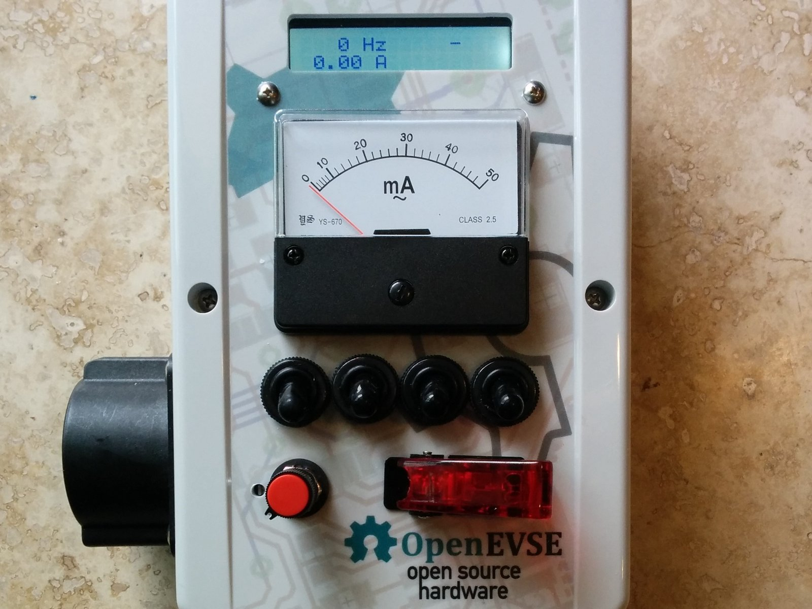</a>

- ⚫ The following tests are intended for Hardware and Software developers to validate hardware revisions and validate production software.
- ℹ️ Builders who wish to better understand the safety features of OpenEVSE Charging Stations may proceed if desired.
- ⚠️ Advanced Tests require live AC Power. Use extreme caution when working near energized high voltage components.

---

## Step 7 – Advanced Testing - GFCI Fault trip point

  <a href="images/step-07-1.jpg">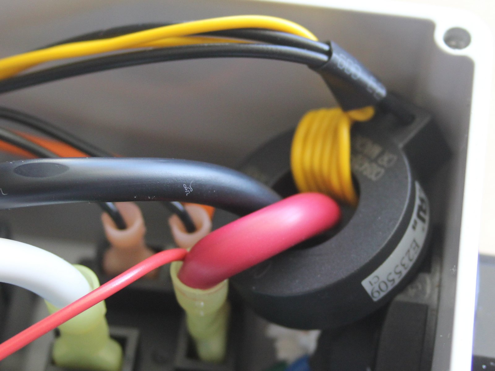</a>

- 📌 GFCI must trip between 15ma and 20ma.
- ⚫ Using Ohms Law select to correct 5 watt resistors to draw 15ma and 20ma. Alternatively, a 5 watt resistor selected for 12ma plus a 5k 5 watt pot can be used to determine the exact trip point.
- ℹ️ US - 120v line to ground 8k = 15ma and 6k = 20ma
- ℹ️ Europe 230v line to ground 15.3k = 15ma and 11.5k = 20ma
- 🩵 While the EVSE is in State C "Charging" connect a wire with the 15ma resistor in parallel through the GFCI coil from one hot to ground. The Charging Station should not trip.
- 🔴 While the EVSE is in State C "Charging" connect a wire with the 20ma resistor in parallel through the GFCI coil from one hot to ground. The Charging Station should trip this time.

---

## Step 8 – Advanced Testing - GFCI Auto Retry

  

- ℹ️ OpenEVSE will recover and retry after a GFCI fault. The time to retrys is configurable in the OpenEVSE firmware.
- ⚫ Induce a GFCI Fault.
  - 🔴 EVSE should display EVSE ERROR - GFCI FAULT.
- ⚫ Remove GFCI Fault. EVSE should recover after the time to retry has elapsed.

---

## Step 9 – Advanced Testing - GFCI Lockout

  

- ℹ️ OpenEVSE will lockout if a GFCI fault occurs within 2 seconds of contact closure.
- 🩵 Enter State C (Charging).
- 🔴 Within 2 seconds of contact closure induce GFCI Fault. OpenEVSE should display SERVICE REQUIRED - GFCI Fault.
- ⚠️ OpenEVSE will remain in this state until power is removed.

---

## Step 10 – Advanced Testing - Welded Contactor

  <a href="images/step-10-1.jpg">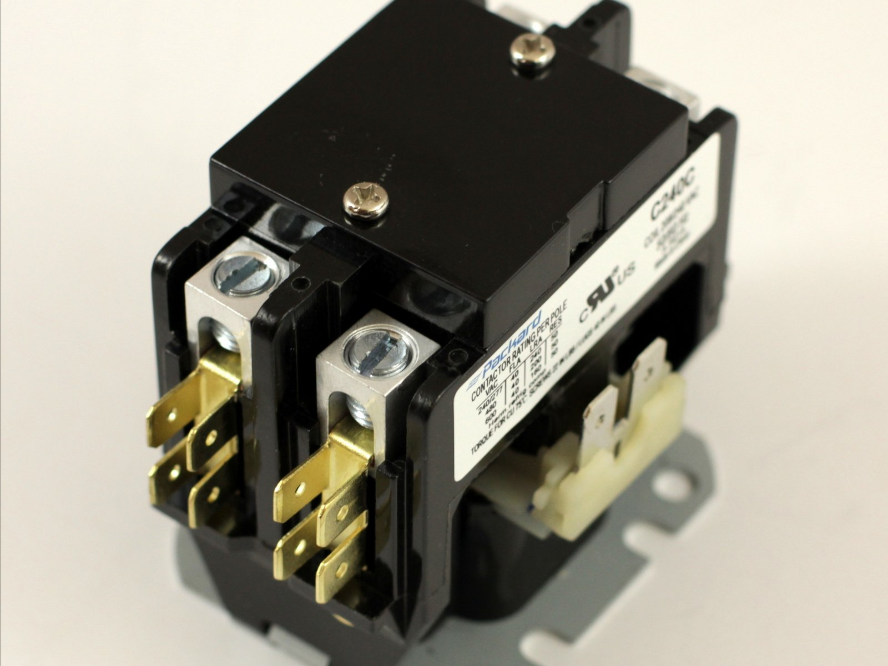</a>
  <a href="images/step-10-2.jpg">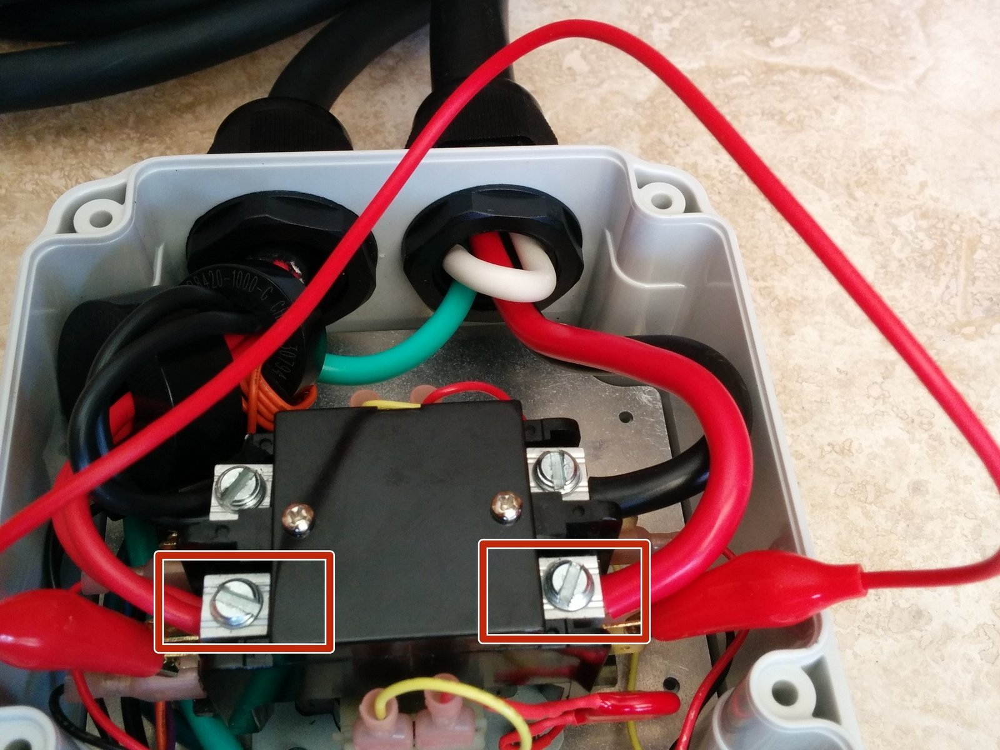</a>
  <a href="images/step-10-3.jpg">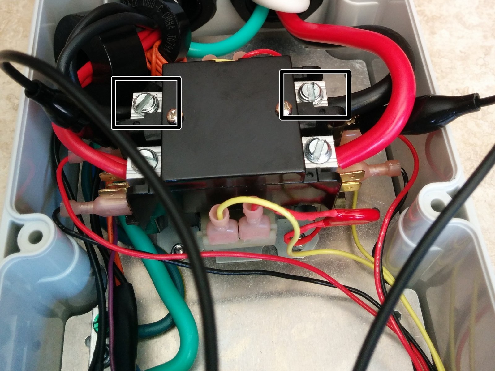</a>

- ℹ️ OpenEVSE tests the Contactor at each boot and every time before closing the contacts.
- ⚠️ All OpenEVSE versions except v3 have 2 AC Detect chips. For v3 test just the hot connected to AC_TEST.
- ⚠️ For testing on single phase 208 (US) and 230 (Europe) test just the Hot line. Neutral will not produce any results ad Neutral to ground should measure 0v.
- 🔴 Testing Hot - Using a alligator clip connect across the relay from the line side of Hot 1 to the EV load side. Power on the Charging Station - The Charging should display "Error Stuck Relay".
- 🔴 Testing Hot 2 (US Split Phase) (Versions except v3) - Using a alligator clip connect across the relay from the line side of Hot 2 to the EV load side. Power on the Charging Station - The Charging should display "Error Stuck Relay".

---

## Step 11 – Advanced Testing - Earth Ground

  <a href="images/step-11-1.jpg">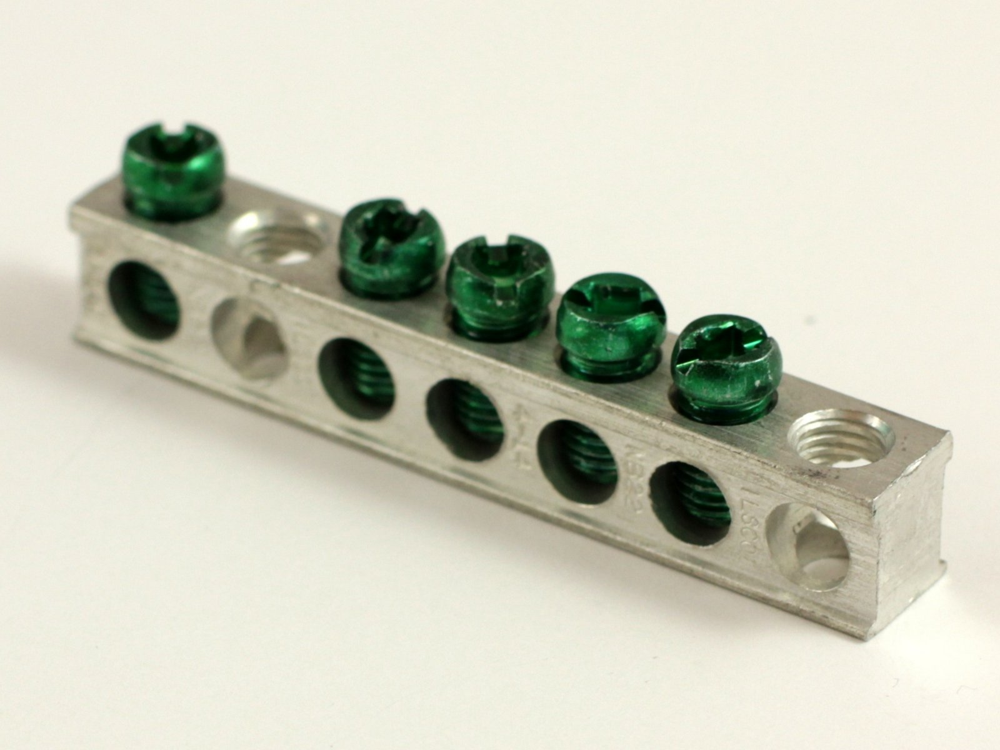</a>
  <a href="images/step-11-2.jpg">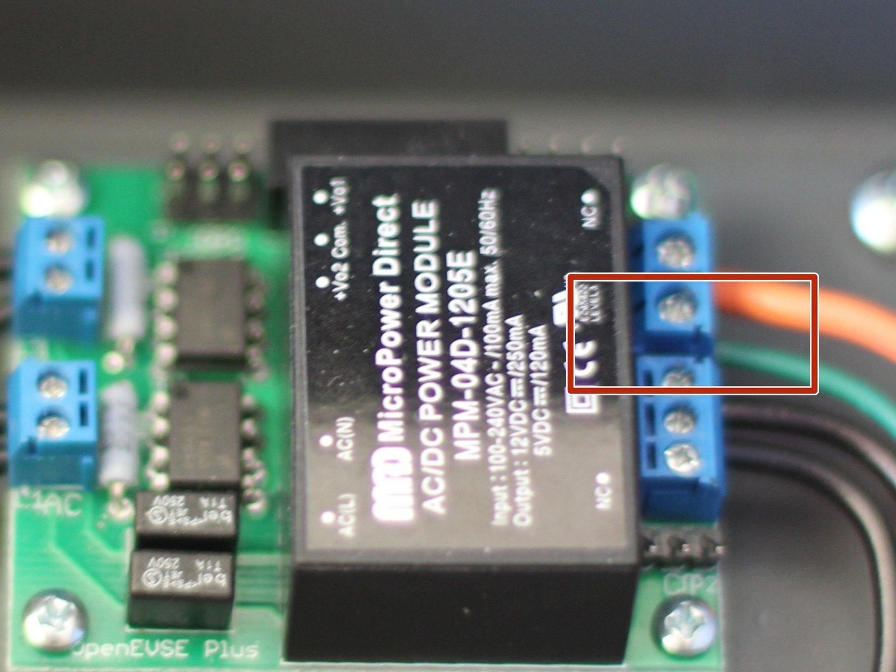</a>

- ℹ️ OpenEVSE checks for Earth Ground Continuously while Charging (State C).
- 🔴 Testing - Connect EV Simulator. Enter State C Charging. Disconnect Earth Ground from the OpenEVSE board. OpenEVSE should enter and Error state and Display "EVSE ERROR - NO GROUND".
- 🩵 Restore Ground Connection. EVSE should resume charging within 1 minute.

---
