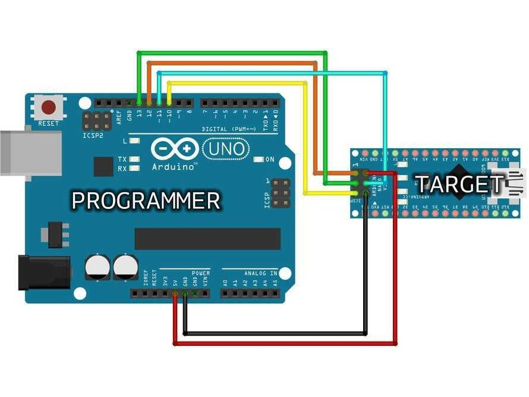
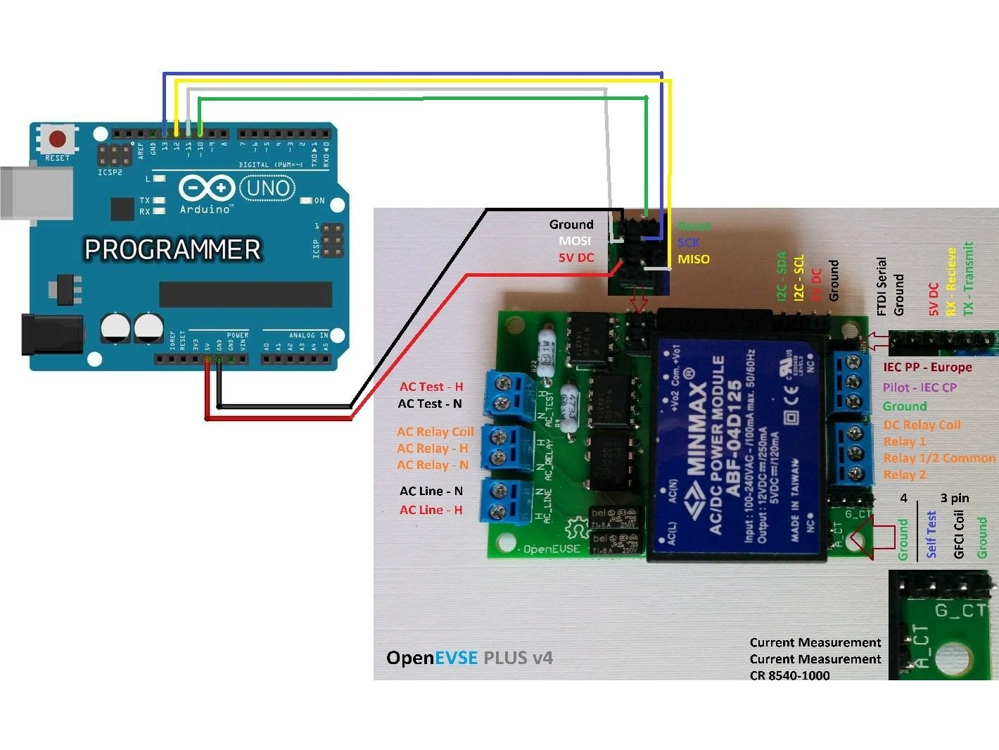
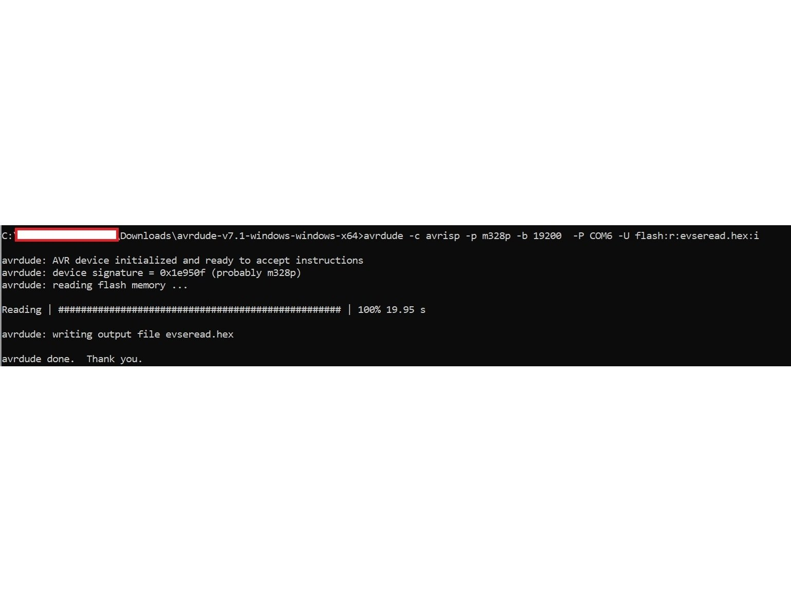
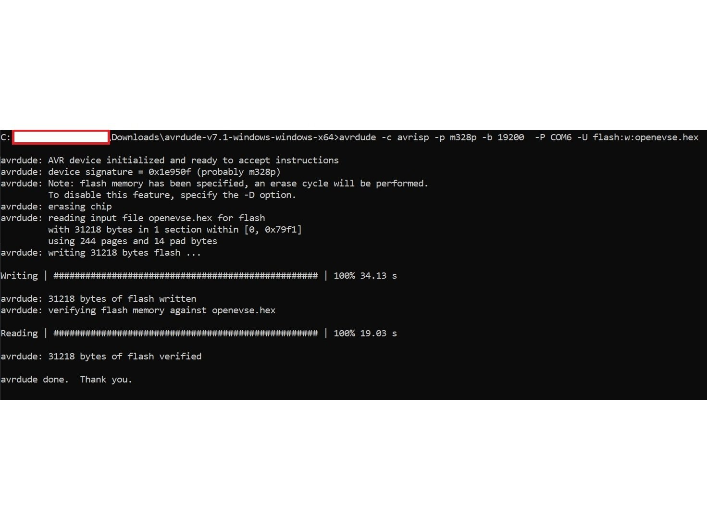

# Upgrade OpenEVSE Plus V4 Firmware with Arduino

| Difficulty | Steps | Time Required |
| --- | --- | --- |
| Moderate | 5 | 01:00:00 – 02:00:00 |

_Written By: Juan_

> [!NOTE]
> This guide was marked **In Progress** on the original OpenEVSE guide site and may be incomplete.

## Tools

- Arduino

### Bullet key

Colored bullets match the colored markers drawn on the photos for each step.

| Marker | Meaning |
| --- | --- |
| ⚫ 🔴 🟠 🟡 🟢 🔵 🩵 🟣 | Instruction — matches the same-colored marker in the photo |
| ℹ️ | Note |
| ⚠️ | Caution |
| 📌 | Reminder / Tip |

## Contents

1. [Prepare Arduino as ISP Programmer](#step-1--prepare-arduino-as-isp-programmer)
2. [Get AVRDUDE & OpenEVSE Firmware](#step-2--get-avrdude--openevse-firmware)
3. [Connect Open EVSE to Arduino](#step-3--connect-open-evse-to-arduino)
4. [Firmware Backup](#step-4--firmware-backup)
5. [Update Firmware](#step-5--update-firmware)

---

## Step 1 – Prepare Arduino as ISP Programmer

  

- ⚫ Follow the instructions from the Arduino webpage to get your Arduino ready to act as the ISP programmer.
- ⚫ [https://docs.arduino.cc/built-in-examples/arduino-isp/ArduinoISP/](https://docs.arduino.cc/built-in-examples/arduino-isp/ArduinoISP/)
- ⚫ Make a note of the COM port that your Arduino is using to connect to the Arduino IDE. You will need this uploading the firmware.

---

## Step 2 – Get AVRDUDE & OpenEVSE Firmware

- ⚫ Install AVRDUDE, use whatever version necessary for your distribution.
- ⚫ The following link is for a windows .exe
- ⚫ [https://wingetgui.com/apps/AVRDudes-AVRDUDE](https://wingetgui.com/apps/AVRDudes-AVRDUDE)
- ⚫ Download the firmware version you want to use from the OpenEVSE Git.
- ⚫ [https://github.com/OpenEVSE/open_evse](https://github.com/OpenEVSE/open_evse)

---

## Step 3 – Connect Open EVSE to Arduino

  

- ⚫ If you've uploaded the Arduino ISP Sketch and made no modifications, this is how you would wire up the Arduino to the OpenEVSE.

---

## Step 4 – Firmware Backup

  

- ⚫ Open command prompt in administrator mode and go to the folder where you extracted avrdude.exe, youll need to use the change directory command CD, such as "cd c:\download\avrdude"
- ⚫ Once there if everything is backed up properly. You can type the following command to backup your OpenEVSE firmware in case something goes wrong.
- ⚫ avrdude -c avrisp -p m328p -b 19200 -P COM6 -U flash:r:evseread.hex:i
- ⚫ -c avrisp #is the programer
- ⚫ -p m328p #is the chipset your reprograming on the OpenEVSE
- ⚫ -b 19200 #baudrate which the arduino is using to communicate with the OpenEVSE
- ⚫ -P COM6 # is the com port we annotated earlier
- ⚫ -U flash:r:evseread.hex:i # is the action which is reading the flash memory and saving it as "evseread.hex" in the avrdude folder as an intel hex file

---

## Step 5 – Update Firmware

  

- ⚫ Type the following command to update the firmware.
- ⚫ avrdude -c avrisp -p m328p -b 19200 -P COM6 -U flash:w:openevse.hex
- ⚫ Only thing that changed from the back up command is "-U flash:w:openevse.hex"
- ⚫ openevse.hex should be in the avrdude.exe folder for ease. If everything goes right it should look like the screenshot.

---
