# Current - v6.5.1 OpenEVSE Advanced

| Difficulty | Steps | Time Required |
| --- | --- | --- |
| Moderate | 11 | 00:30:00 – 02:00:00 |

_Written By: Christopher Howell (and 4 other contributors)_

## Introduction

**OpenEVSE Store -** [Purchase this OpenEVSE Kit](https://store.openevse.com/)

**Warning** Assembly of a Electric Vehicle charging station requires wiring Alternating Current (AC) components that will be exposed to voltages from 100 to 250v. If you do not have the experience and knowledge required to safely work with AC voltages please consult with an experienced electrician for assistance and inspection of your work.

**Note** Regularly inspect your charging station. Pay special attention to excess heat, components, handles, and wiring will be warm but they should not be HOT...

**Always** Disconnect your charging station from power before performing an inspection and/or maintenance

### Bullet key

Colored bullets match the colored markers drawn on the photos for each step.

| Marker | Meaning |
| --- | --- |
| ⚫ 🔴 🟠 🟢 🔵 🟣 | Instruction — matches the same-colored marker in the photo |
| ℹ️ | Note |
| ⚠️ | Caution |
| 📌 | Reminder / Tip |

## Contents

1. [Connection Diagrams](#step-1--connection-diagrams)
2. [Prepare Relay](#step-2--prepare-relay)
3. [Mounting Plate](#step-3--mounting-plate)
4. [Mount Enclosure Plate](#step-4--mount-enclosure-plate)
5. [EV Cable](#step-5--ev-cable)
6. [Connect EV Cable](#step-6--connect-ev-cable)
7. [Input Cable](#step-7--input-cable)
8. [OpenEVSE Controller](#step-8--openevse-controller)
9. [Controller Wiring](#step-9--controller-wiring)
10. [Display and Temperature Sensor](#step-10--display-and-temperature-sensor)
11. [Finishing Up](#step-11--finishing-up)

---

## Step 1 – Connection Diagrams

  <a href="images/step-01-1.png">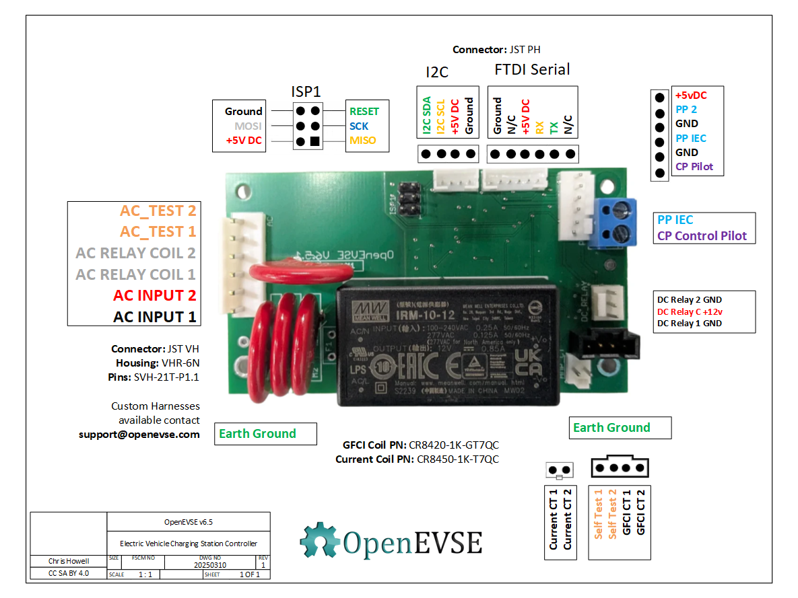</a>
  <a href="images/step-01-2.png">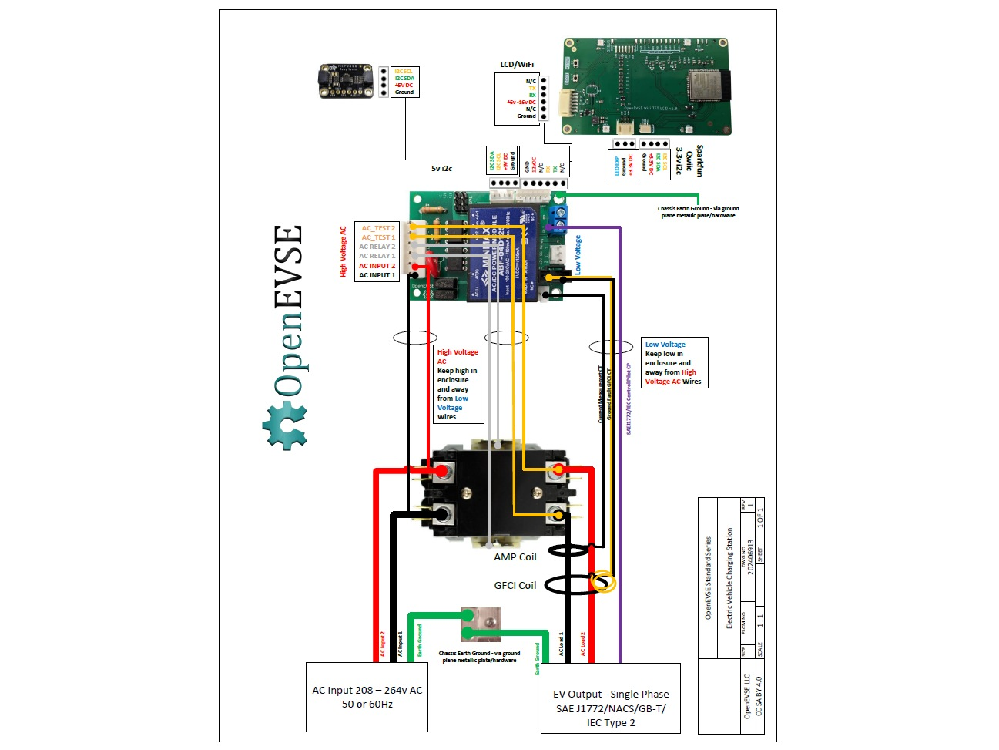</a>

- ℹ️ This documents will assist with the steps that follow.
- ⚠️ Full Size Download -**OpenEVSE Board Pins and Connections [Download PDF](https://github.com/OpenEVSE/OpenEVSE_PLUS/blob/master/OpenEVSE_PLUS_v5.5/OpenEVSE_v5.5.pdf)**
- ⚠️ Full Size Download - **System Diagram [Download PDF](https://github.com/OpenEVSE/OpenEVSE_PLUS/blob/master/OpenEVSE_PLUS_v5.5/Advanced_2024.pdf)**

---

## Step 2 – Prepare Relay

  <a href="images/step-02-1.jpg">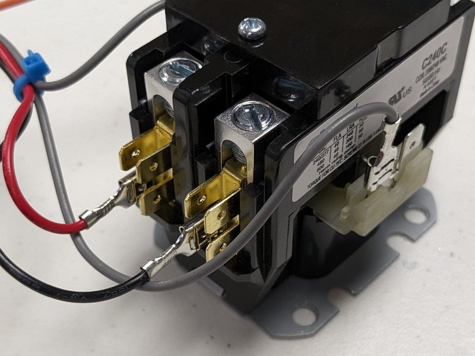</a>
  <a href="images/step-02-2.jpg">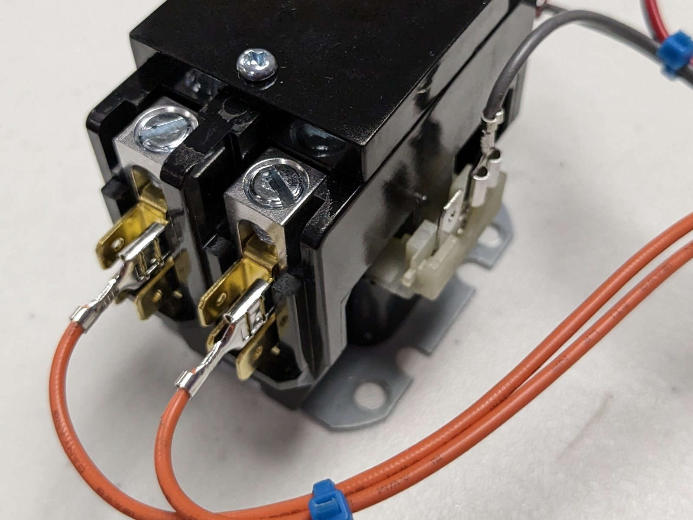</a>

- 🔴 Connect RED and BLACK wires to BOTTOM terminals on one side of the contactor
- ⚫ Connect the GREY wires to the terminals in the middle of the contactor
- 🟠 Connect the ORANGE wires to the TOP terminals on the opposite side.

---

## Step 3 – Mounting Plate

  <a href="images/step-03-1.jpg">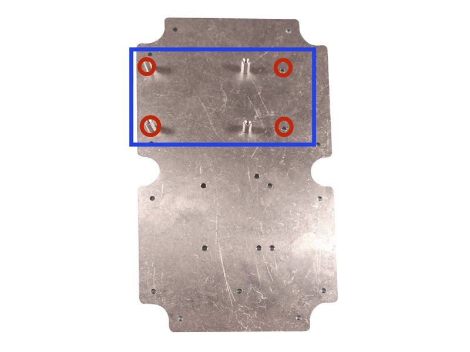</a>
  <a href="images/step-03-2.jpg">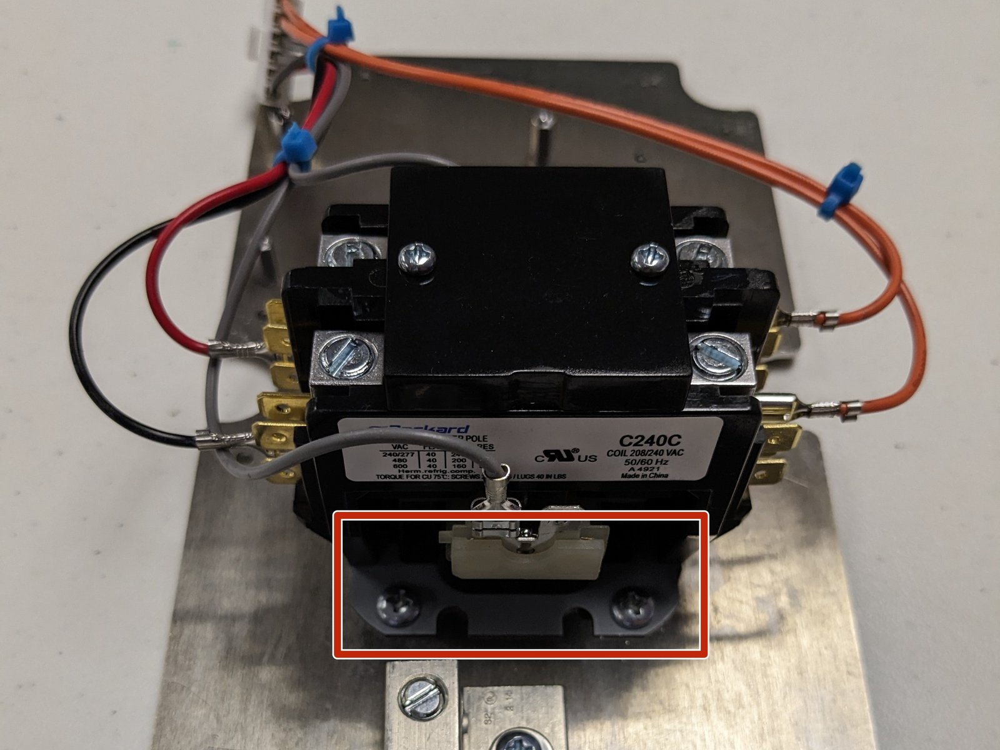</a>
  <a href="images/step-03-3.jpg">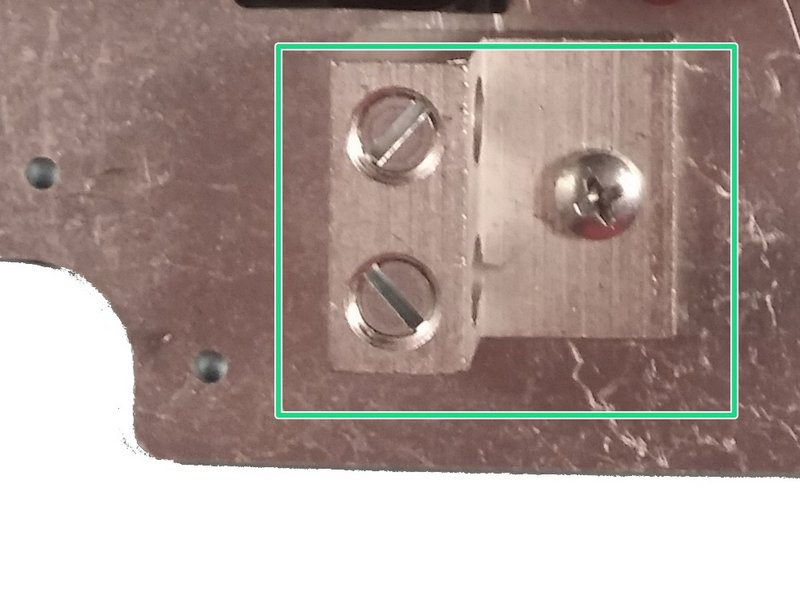</a>

- ⚫ Position the plate with the FOUR holes for the OpenEVSE controller up top-left.
  - ℹ️ Note - the v6.5.1 is longer than v5.5 and below. Use the hole locations circled in red.
- 🔵 Mount the FOUR 4.5 Hex x 10mm standoffs to the top side of the plate with FOUR M2.5 x 6 mm screws.
  - ⚠️ Tip - use blue LOCTITE on each screw to ensure it remains tight.
- 🔴 Mount the Packard Contactor using FOUR 1/4" self threading screws.
- 🟢 Mount ground bar to the plate with ONE washer and ONE 1/4" self threading screw.

---

## Step 4 – Mount Enclosure Plate

  <a href="images/step-04-1.jpg">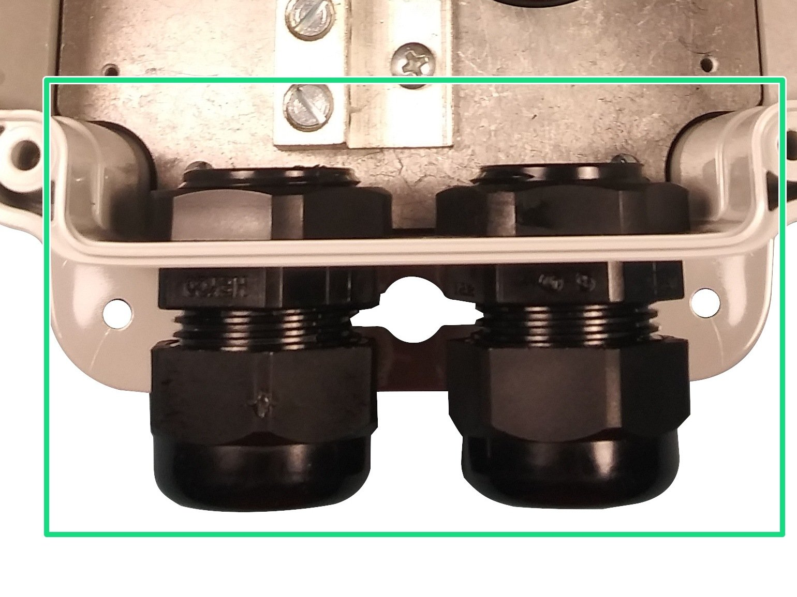</a>
  <a href="images/step-04-2.jpg">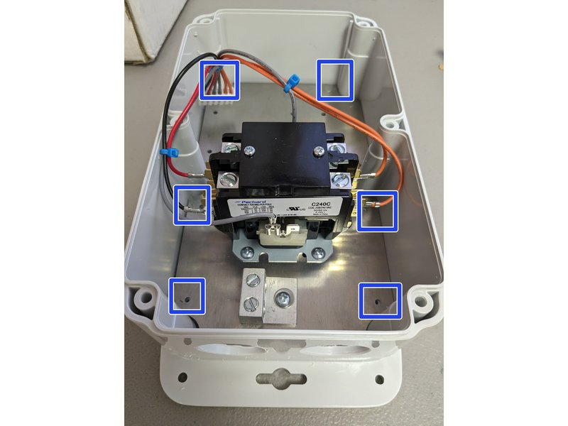</a>

- 🔵 Mount plate in enclosure with SIX coarse threaded 6mm screws. 2 top, 2 middle, 2 bottom 1 each Left and Right
- 🟢 Install the TWO cable glands.
- ℹ️ Ensure all 6 wires from the relay stay HIGH in the enclosure and AWAY from all low voltage wires going to the controller, WiFi, display, coils and Ground.

---

## Step 5 – EV Cable

  <a href="images/step-05-1.png">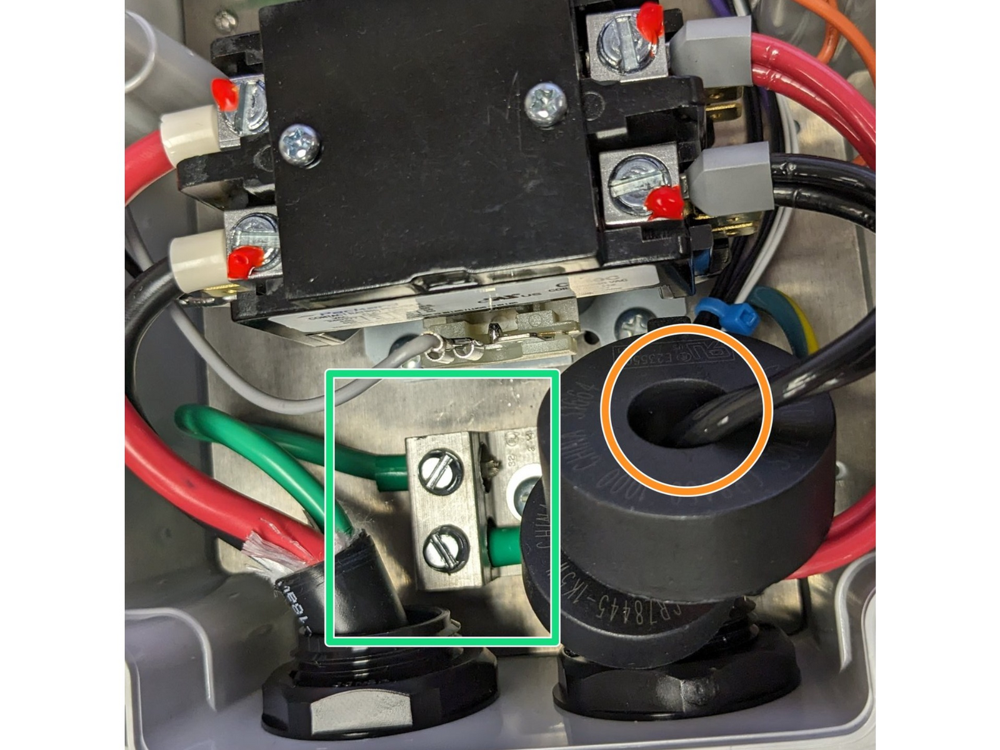</a>
  <a href="images/step-05-2.jpg">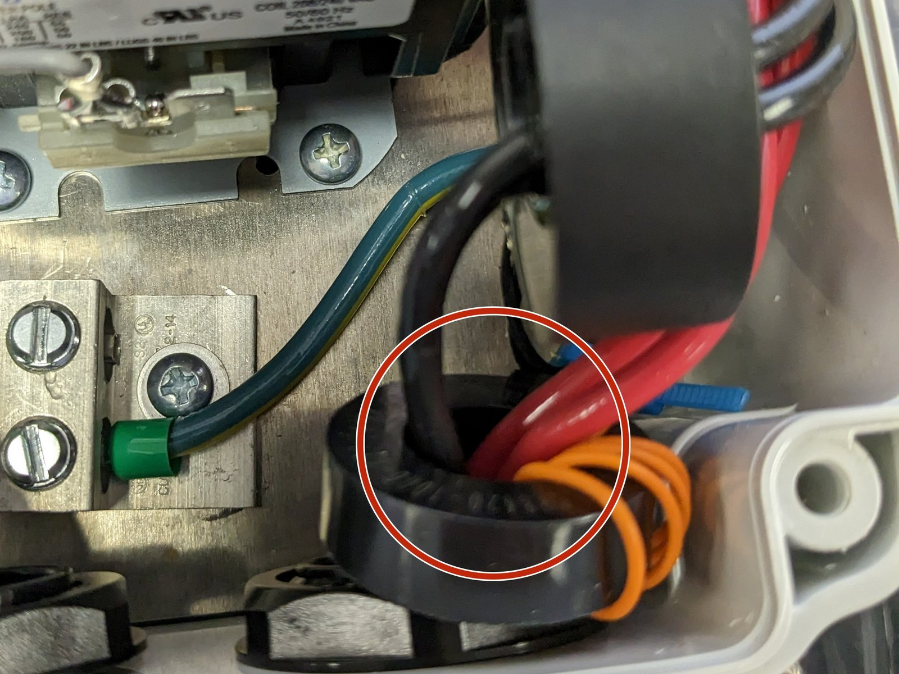</a>
  <a href="images/step-05-3.jpg">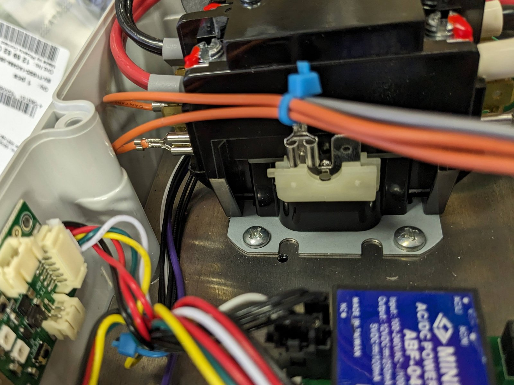</a>

- ⚫ Insert EV Cable through the Cable Gland on the RIGHT and tighten.
- 🟢 Connect the ground wire to the ground block.
- ℹ️ Route the ground, pilot and coil wires low in the enclosure to avoid crossing any high voltage wires or components.
- 🔴 Thread **ALL** hot and neutral lines through the 4 wire GFCI coil. UPDATE - coils with black and white wire, the orange self test wrap is now internal to coil.
  - 📌 Do not thread the ground wire or pilot wire through.
- 🟠 Advanced Series Only - Thread **EITHER** hot **OR** neutral through the Current Measurement Coil.
- 📌 Tip - zip tie smaller wires together near the top and bottom to keep them neat and out of the way.

---

## Step 6 – Connect EV Cable

  
  <a href="images/step-06-2.jpg">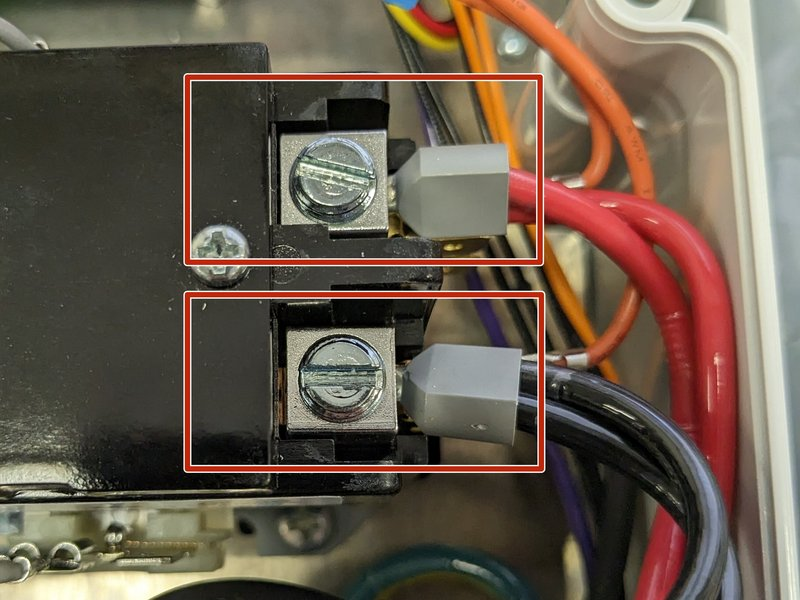</a>
  <a href="images/step-06-3.jpg">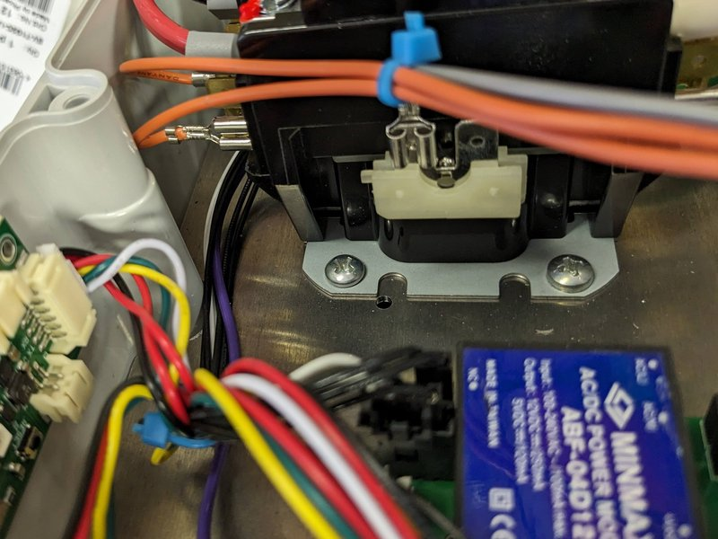</a>

- 🔴 Secure the wire ferrules RED and BLACK wires on the EV cable directly to contactor.
  - ⚠️ Ensure both EV cable wires have good contact directly to the contactor and the screw is tight.
  - ℹ️ Preventative maintenance. It is recommended the terminals are inspected annually to ensure the screw connection is tight.
- ⚠️ Tip - run the low voltage wires on the bottom. Ensure they is plenty of clearance.

---

## Step 7 – Input Cable

  <a href="images/step-07-1.jpg">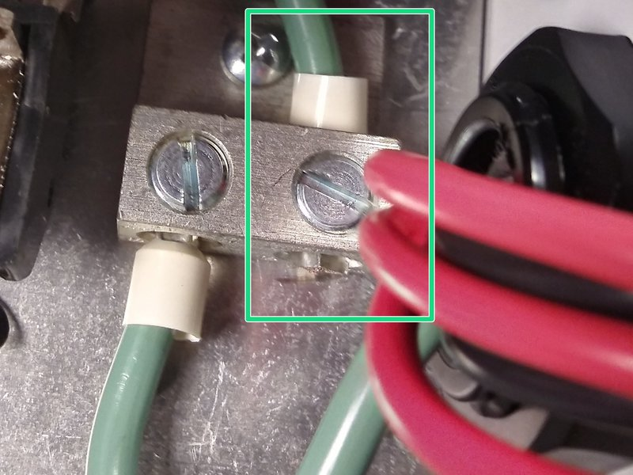</a>
  <a href="images/step-07-2.jpg">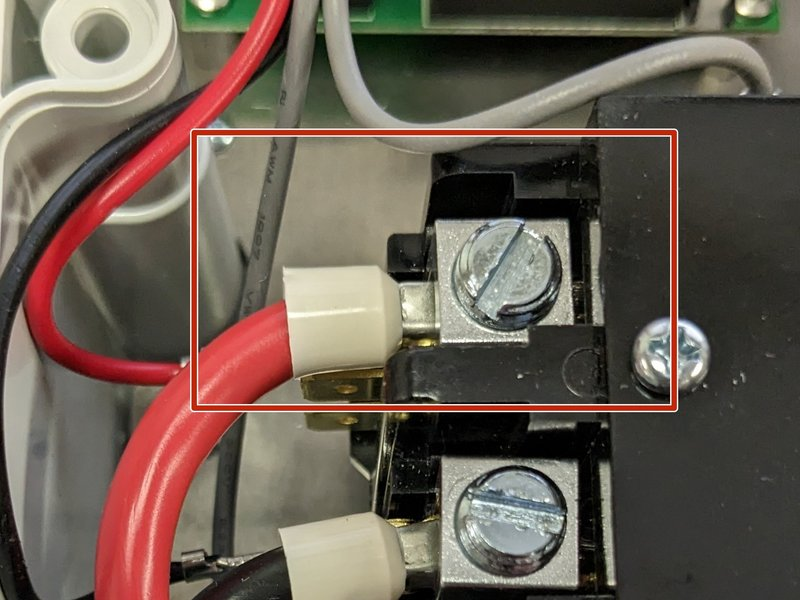</a>
  <a href="images/step-07-3.jpg">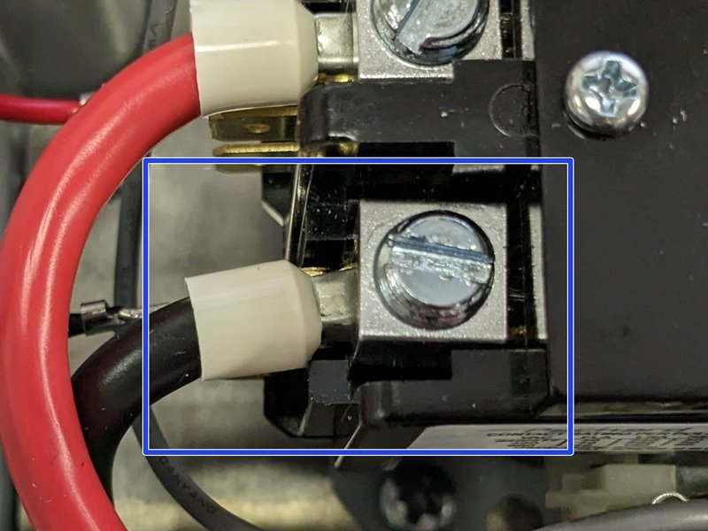</a>

- ⚫ Insert the AC input cable through the LEFT gland.
- 🟢 Connect the ground wire to the ground block.
- 🔴 Screw the RED wire of the INPUT cable to the terminal lug just above the red wire from the wiring harness.
  - ⚠️ Ensure both Input cable terminals have good contact directly to the contactor pads and the screw is tight.
  - ℹ️ Preventative maintenance. It is recommended the terminals are inspected annually to ensure the screw connection is tight.
- 🔵 Screw the BLACK wire of the INPUT cable to the terminal lug just above the black wire from the wiring harness.
- ⚠️ Tip - run the small power wire to the controller in low in the enclosure.

---

## Step 8 – OpenEVSE Controller

  <a href="images/step-08-1.jpg">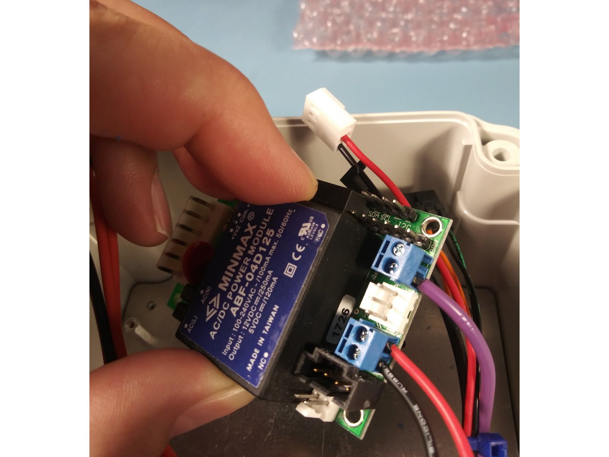</a>

- ℹ️ Static sensitive - Lift controller by board edges or AC/DC power supply. Do not touch components.
- ⚫ Mount OpenEVSE controller to the hex standoffs with FOUR M2.5 x 6mm screws.
- 🟣 Connect the control pilot (CP) wire to the OpenEVSE controller.

---

## Step 9 – Controller Wiring

  <a href="images/step-09-1.jpg">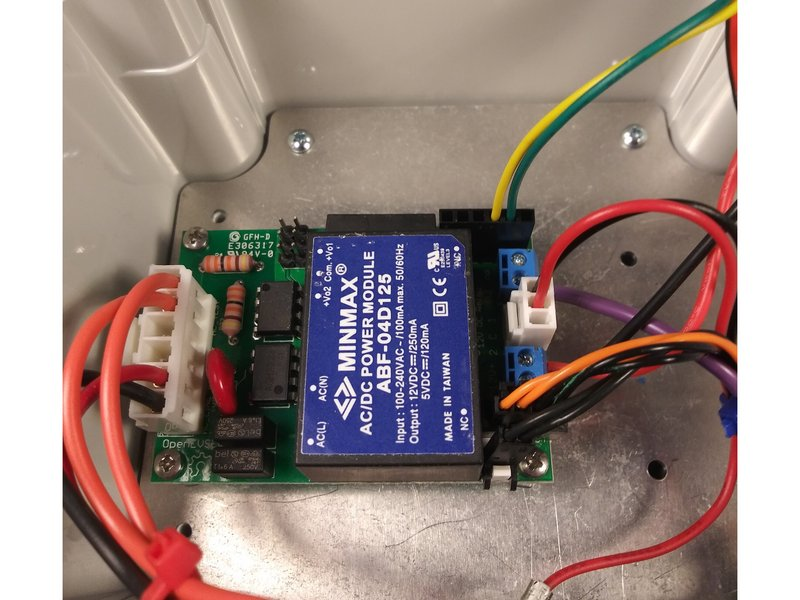</a>
  <a href="images/step-09-2.jpg">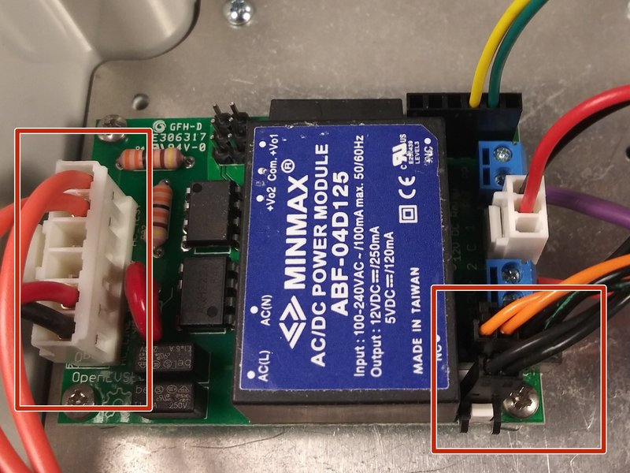</a>
  <a href="images/step-09-3.jpg">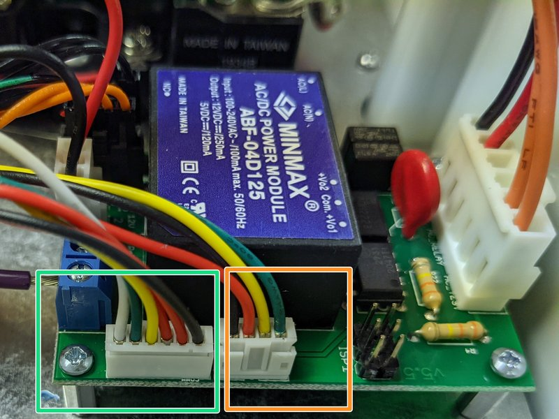</a>

- ℹ️ View OpenEVSE v5 Diagram - Step 1 for wires named below.
- 🔴 Connect the keyed wiring harnesses to OpenEVSE controller.
  - ⚠️ Wire colors may vary.
- 🔴 Connect the 2 wire connector from the larger coil (current measurement) to the OpenEVSE controller.
- 🔴 Connect the 4 wire connector from the smaller coil (ground fault) to the OpenEVSE controller.
- 🟢 Connect the 6 pin LCD/WiFi cable to the controller.
- 🟠 Connect the 4 pin Temperature sensor Cable to the controller.

---

## Step 10 – Display and Temperature Sensor

  <a href="images/step-10-1.jpg">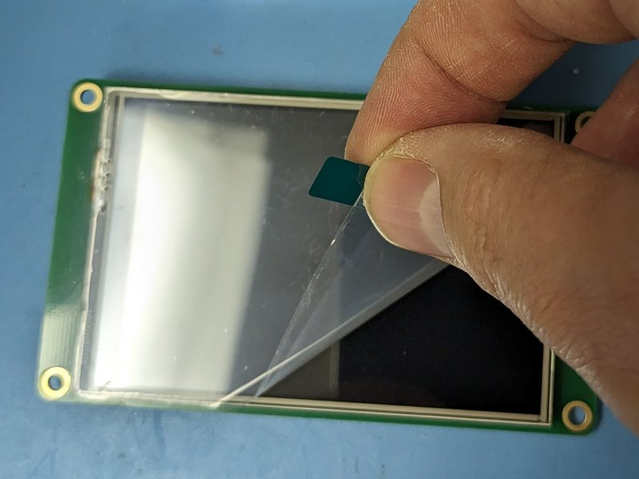</a>
  <a href="images/step-10-2.jpg">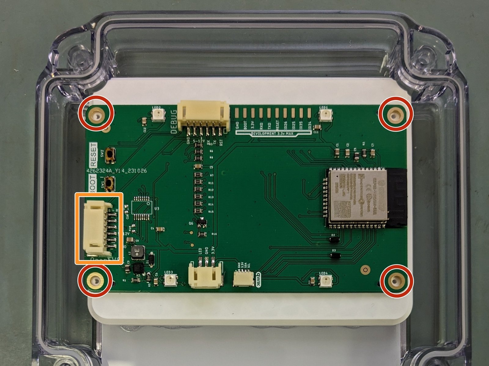</a>
  <a href="images/step-10-3.jpg">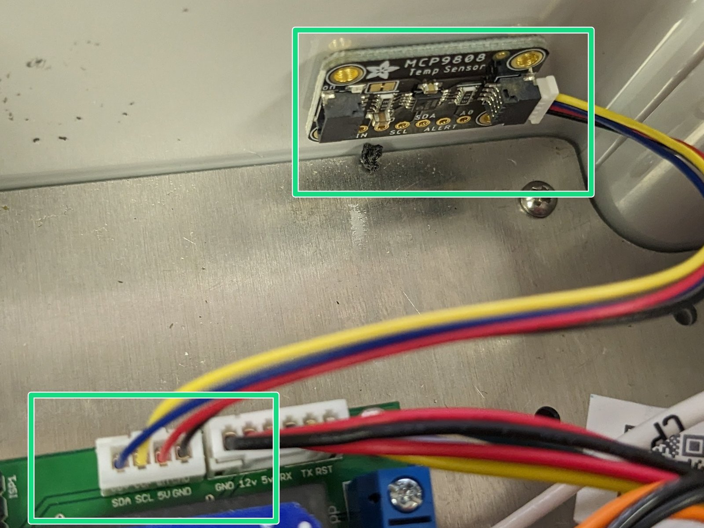</a>

- ℹ️ Static sensitive - Lift display by board edges. Do not touch components.
- ⚫ Remove protective film from display
- 🔴 Attach display to lid using 4 coarse threaded screws.
- 🟠 Connect 6 pin cable to display on left side. (connector under the BOOT and RESET buttons.
- 🟢 Peel the backing on the tape and mount the sensor then connect the temperature sensor to the 4 pin connector on the OpenEVSE controller.

---

## Step 11 – Finishing Up

  <a href="images/step-11-1.jpg">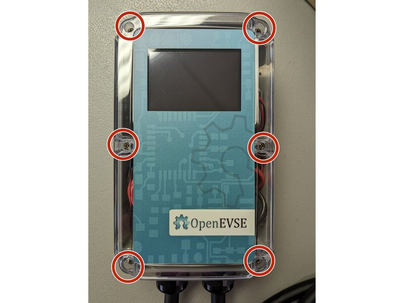</a>

- ⚫ Place the enclosure lid on and ensure there are no wires pinched in the lid.
- 🔴 Start all SIX 6-32 x 1 1/4" screws before tightening.
- ℹ️ Tighten all SIX so the lid slightly squishes down slightly on the clear seal embedded into the lid. Do not over-tighten.
- ⚫ Mount station with template. [Mounting Your Charging Station Quick Start Guide](https://openevse.dozuki.com/Guide/Mounting+Your+Charging+Station/22)
- ⚫ Setup Wifi - [WiFi - Join Network Quick Start Guide](https://openevse.dozuki.com/Guide/WiFi+-+Join+Network/29)

---

