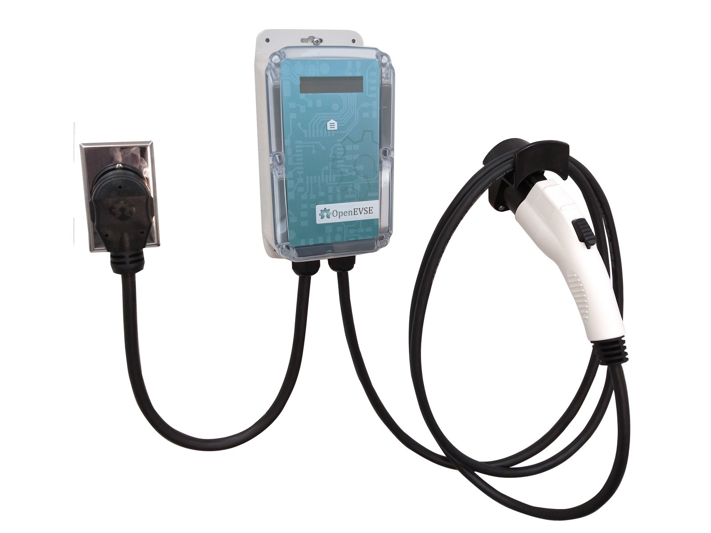
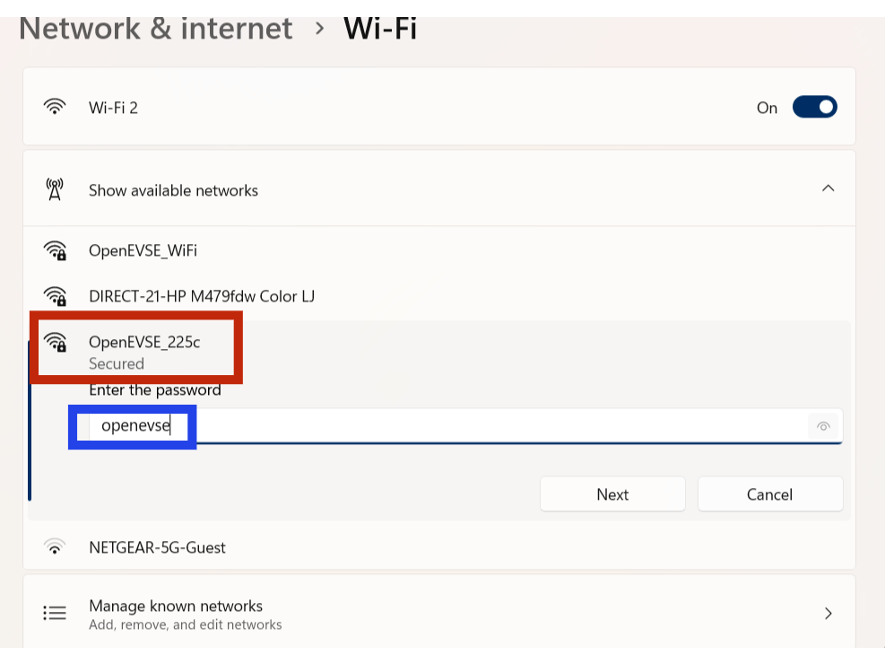
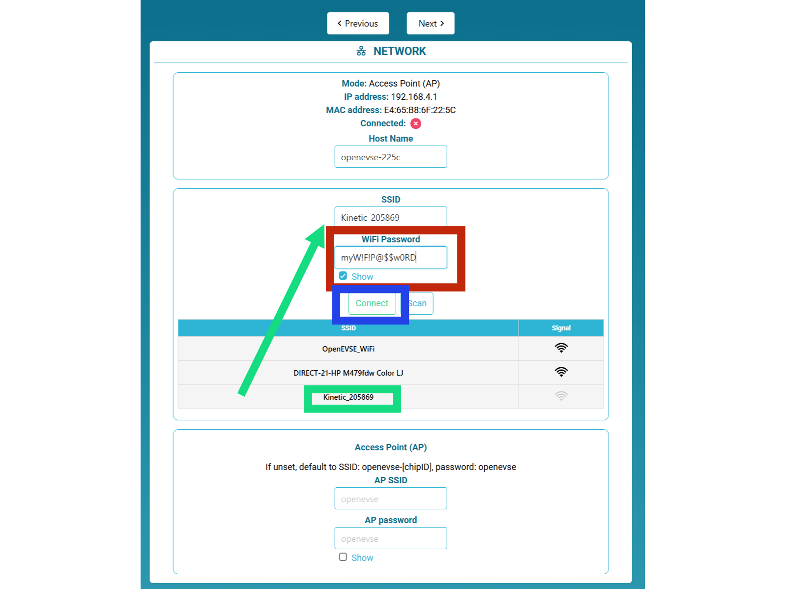
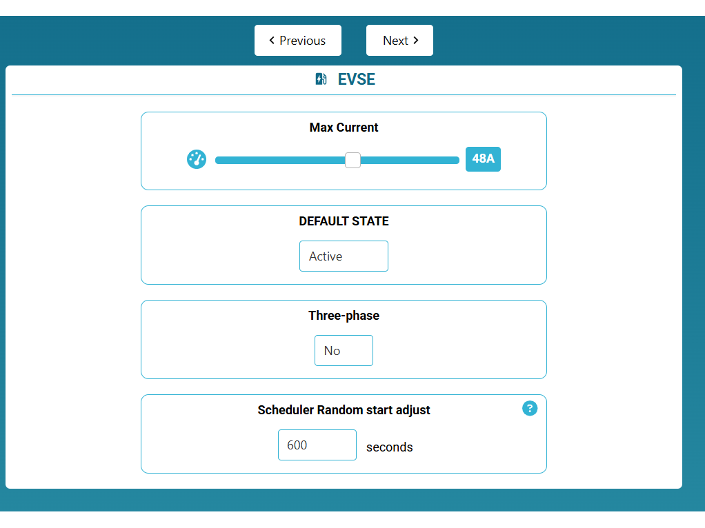

# WiFi - Join Network

| Difficulty | Steps | Time Required |
| --- | --- | --- |
| Easy | 4 | 00:05:00 |

_Written By: Christopher Howell_

### Bullet key

Colored bullets match the colored markers drawn on the photos for each step.

| Marker | Meaning |
| --- | --- |
| ⚫ 🔴 🟠 🟡 🟢 🔵 🩵 🟣 | Instruction — matches the same-colored marker in the photo |
| ℹ️ | Note |
| ⚠️ | Caution |
| 📌 | Reminder / Tip |

## Contents

1. [Boot Charging Station](#step-1--boot-charging-station)
2. [Join OpenEVSE_XXXX](#step-2--join-openevse_xxxx)
3. [Open Portal](#step-3--open-portal)
4. [Help?](#step-4--help)

---

## Step 1 – Boot Charging Station

  

- ⚫ By default OpenEVSE will boot hosting a default WiFi network portal.
  - ⚫ Network: OpenEVSE_XXXX
  - ⚠️ XXXX represents a random identifier for your station.
  - ⚫ Password: openevse

---

## Step 2 – Join OpenEVSE_XXXX

  

- ⚫ Go to settings on your phone, laptop or tablet and navigate to the WiFi Settings.
- 🔴 Connect to the OpenEVSE_XXXX network with a wireless phone, tablet or laptop.
- ⚠️ In this example our name is OpenEVSE_225c.
- 📌 Write down the last 4 of your station for use later.
- 🔵 The password is openevse

---

## Step 3 – Open Portal

  
  

- ℹ️ If the Portal does not automatically open, open a web browser enter 192.168.4.1 for the address.
- ⚠️ 192.168.4.1 is temporary and only used in this mode.
- 🟢 Select your WiFi name from the list, enter your WiFi password and click connect.
- 🔴 Enter the password of your WiFi network.
- 🔵 Click Connect
  - ⚠️ If successful the OpenEVSE_XXXX network will disappear and the temporary address will no longer work.
  - 📌 A new IP address will now be assigned by your WiFi Router and displayed every time the station is started.
  - ℹ️ Reconnect using the new IP address or [http://openevse-XXXX.local](http://openevse-XXXX.local). Replace XXXX with unique digits of your hostname.

---

## Step 4 – Help?

  

- ⚫ If you need help please contact OpenEVSE Support via Email at support@openevse.com

---
